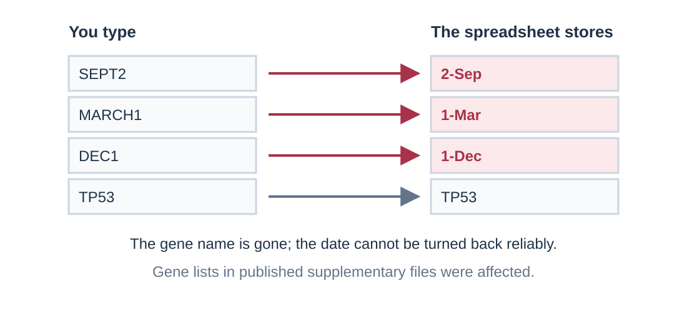
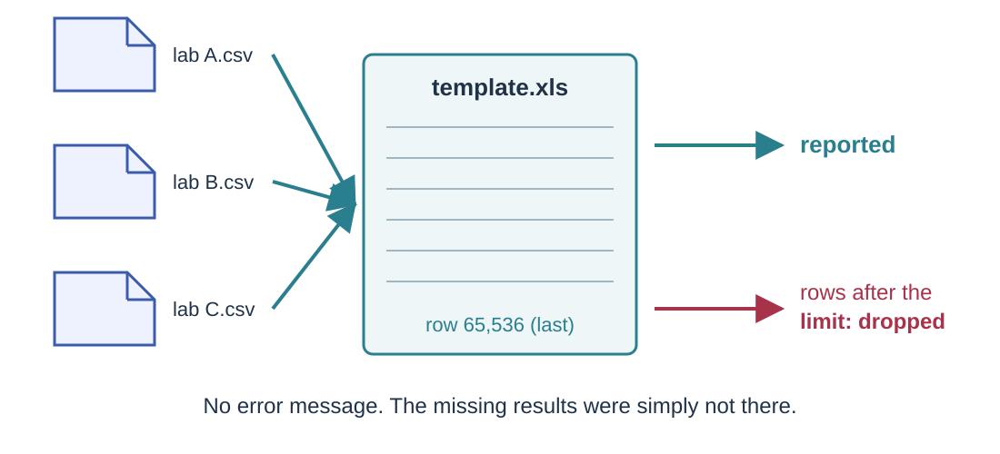
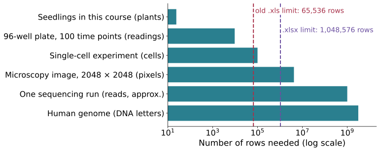
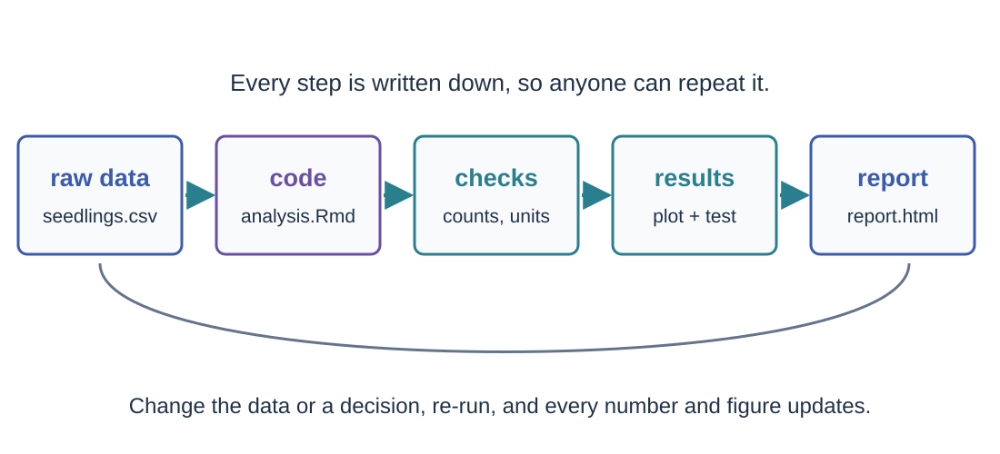

## About this course

Biology is now measured in files: plate-reader exports, microscope images, sequencing reads, field records. In every lab course, in your thesis, and in most jobs after it, someone will hand you data and ask **what it shows**.

In five weeks you will learn to:

- organise and inspect data files, and use a terminal;
- analyse a table in **R** instead of clicking in a spreadsheet;
- describe variation and compare groups honestly;
- write a report that **anyone can re-run** and get the same numbers.

You do not need any programming experience.

::: notes
Set the tone: this is a practical course for biologists, not a programming course. Everything is anchored in biological measurements, mostly a simulated seedling experiment. The next three slides answer the question students will have: why not just use Excel, which they already know?
:::

## Spreadsheets change your data

:::: {.columns}
::: {.column width="42%"}
- Type the gene symbol **SEPT2** into Excel and it becomes the date **2 September**. MARCH1 becomes 1 March.
- This happened in published papers: about **one in five** papers with Excel gene lists had damaged names (Ziemann et al., 2016).
- In 2020 the gene-naming committee gave up and **renamed the genes** (SEPT2 → SEPTIN2, MARCH1 → MARCHF1).
:::
::: {.column width="58%"}
{width="100%"}
:::
::::

::: notes
This is a real and well-documented problem: Zeeberg et al. first described it in 2004, Ziemann, Eren and El-Osta quantified it in Genome Biology in 2016, and a follow-up in 2021 found it had not improved. The point is not that Excel is evil, but that a spreadsheet silently guesses what you meant, and the guess is stored instead of your data. A plain-text file read by R stores exactly what is in it.
:::

## Spreadsheets lose data without telling you

:::: {.columns}
::: {.column width="42%"}
- In October 2020, England's public health agency left out nearly **16,000 positive COVID-19 tests** from its daily reports.
- Lab results were collected in an old `.xls` spreadsheet format, which holds at most **65,536 rows**. Everything after that row was dropped.
- No error message. Contact tracing of those people was delayed.
:::
::: {.column width="58%"}
{width="100%"}
:::
::::

::: notes
Widely reported at the time (Public Health England, 25 September to 2 October 2020). The lesson for us: a tool that quietly truncates, rounds, or reformats is dangerous precisely because it does not complain. In this course we always check counts after loading data: how many rows did we expect, how many do we have?
:::

## Biological data are getting big

{width="85%" fig-align="center"}

- A modern spreadsheet stops at about **1 million rows**. One sequencing run gives around a billion reads; one microscope image has millions of pixels.
- These data need code, and sometimes a bigger computer than your laptop. Week 5 shows how to estimate when.

::: notes
Each step on the x-axis is a factor of ten. Our seedling table is tiny on purpose so we can see every value. But the same skills — a table in a plain-text file, read by code, checked, plotted, summarised — are what scale to the data students will meet in genetics, microbiology, imaging and their thesis. The sizes are rough orders of magnitude.
:::

## Clicks leave no record; code does

{width="80%" fig-align="center"}

- A supervisor asks: "how did you get this number?" With clicks, you cannot show it. With code, the answer is the code.
- Fix one wrong value in the raw data, re-run, and every figure and table updates.

::: notes
This is the course's central habit: the raw data stay untouched, every step from raw file to report is written down as code, and the report is rebuilt from scratch to prove it still works. Students will render their first report in week 2 and test that someone else can re-run it in week 5.
:::

## The five weeks

| Week | Question | You will |
|---|---|---|
| 1 Files and the terminal | What is in our data files, and where are they? | Tell plain text from Word/Excel files, use paths and a terminal, meet R |
| 2 R and reports | How much did the seedlings grow? | Import a table, calculate, plot, and render an R Markdown report |
| 3 Variation | How much do individual plants differ? | Check data quality, summarise groups, understand SD and replicates |
| 4 Comparisons and lines | Did the treatment work? How do two measurements relate? | Estimate a difference with uncertainty, analyse pairs, fit a line |
| 5 Bigger data and reproducibility | Can someone else repeat our analysis? | Estimate data size, use a remote computer, run a small study, reproduce it |

::: notes
Keep this brief; the sidebar on the course website follows the same structure. Point out that week 1 starts with files rather than R because every later step begins with finding and reading a file correctly.
:::

## Summary

- Spreadsheets silently change data (gene names into dates) and lose it (the COVID row limit).
- Biological data are growing far beyond what a spreadsheet can hold.
- Code keeps a complete, re-runnable record from raw data to report.
- This course teaches that workflow from the very first file.

**Before Day 1:** install the software via the [Getting started](../../index.qmd#getting-started) pages and download the course files.

**Next (Day 1, kinds of files):** plain text versus Word and Excel files, and why it matters for your data.

::: notes
If installation is not finished, that is fine; Day 1 starts in the file manager and a text editor. Encourage students to bring installation problems to the first session rather than struggling alone.
:::
