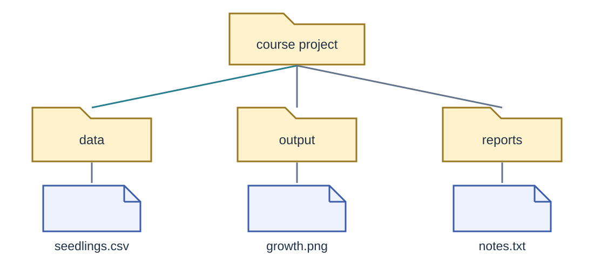
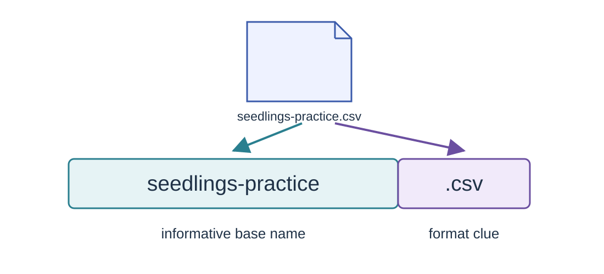

## About this lecture

Did a treatment make seedlings grow more? The measurements are in a file. Before we can analyse anything, we need that file on our own computer, and we need to be able to find it again.

Today you will:

- download the course files and unpack them into a folder you choose;
- find and open the seedling measurements;
- save a note, close everything, and open the note again.

No programming today. Every later day starts from files you can find.

::: notes
Keep the opening concrete. The biology question motivates the course; today's job is getting the data onto the laptop and being sure where it is. Many students have only used files through "recent" lists or cloud apps, so finding a file by its folder is a real skill, not a formality.
:::

## The data: one row per seedling

{height=330}

- 24 seedlings: 12 treated, 12 controls. Each was measured at the start and at the end (mm).
- P01 grew from 25.7 mm to 44.3 mm, so it grew **18.6 mm**.

::: notes
These are simulated teaching data. Read P01's row aloud: plant ID, group, initial length, final length. The units come from the data dictionary in the data folder; the file itself only contains commas and numbers.
:::

## Download and unpack the course files

:::: {.columns}
::: {.column width="45%"}
1. Download the course ZIP.
2. Show it in File Explorer (Windows) or Finder (Mac).
3. **Extract** the whole ZIP.
4. Move the extracted folder to *Documents*.
5. Open `data`, then `seedlings.csv`.

Open files from the extracted folder, not from inside the ZIP.
:::
::: {.column width="55%"}
{width="100%"}
:::
::::

::: notes
Demonstrate on the supported system and wait until everyone has found the Downloads folder. Windows "Extract All" and a Mac double-click can create an extra folder level; check that data, output and reports are directly inside the folder you will work in. Find the file by opening folders, not through "recent files".
:::

## A file is not the window showing it

{height=330}

- The same `seedlings.csv` can be opened in a text editor or a spreadsheet.
- Closing the window does not delete the file.

::: notes
Show it both ways. Ask what happens to the measurements when both windows close: nothing, they are still saved. Avoid a discussion of which program is best; the point is one file, several programs.
:::

## Read the whole filename

{height=300}

- The ending (`.csv`, `.txt`) is part of the name. Turn on "show file extensions".
- Renaming a file does not change what is inside it.

::: notes
Show the file-manager setting for extensions. With extensions hidden, a note can end up as notes.txt.rtf without anyone noticing. Renaming .csv to .txt leaves the same commas and numbers inside; the exercises let students try this on a copy.
:::

## Keep the original; work on a copy

{height=330}

Copy `data/seedlings.csv` to `output/seedlings-practice.csv`. Change only the copy.

::: notes
The original is what was measured. If something goes wrong in the copy, start again from the original. Demonstrate the copy in the file manager.
:::

## Save, close, and reopen

{height=300}

Save `day01-notes.txt` in `reports/`. Close the editor. Find the note through its folder and open it again.

::: notes
Use a plain-text editor. Some editors restore unsaved text when reopened, so the test is: can you find the saved file in its folder? Have students say where their note is: which folder, which full name.
:::

## Two similar folders? Pick one

{height=300}

Downloading or extracting twice gives similar folders. Choose one to work in, and do not delete the other until you know what is in it.

::: notes
Show a "course-files (1)" example. The working folder is the one with data, output, reports and the .Rproj file directly inside. Students should ask before deleting anything.
:::

## Check yourself

1. You close the editor. Is the saved note gone?
2. You change `seedlings-practice.csv`. Did `data/seedlings.csv` change?
3. You rename a `.csv` to `.txt`. Did the numbers change?
4. You know a file's name. Do you know which folder it is in?

::: notes
Answers: 1 no; 2 no, it is a separate copy; 3 no, renaming does not convert; 4 not necessarily, several folders can contain files with the same name. Ask students to check 1 and 2 on their own computers rather than just answering.
:::

## Summary

- A file is saved in a folder. Programs only open and show it.
- The full filename includes its ending, such as `.csv`.
- Keep the original data unchanged; work on a copy.
- Saved means you can close everything and open it again from its folder.

**Next (Day 2):** writing down *where* a file is, as a path.

**Now:** [open the Day 1 exercises](../../week1/01-files.qmd). Leave with `reports/day01-notes.txt` and `output/seedlings-practice.csv`, and be able to find both after closing every window.

::: notes
The exercises give the detailed click sequence and hints. A student who cannot yet find their files again needs help before Day 2, because paths build directly on this.
:::
