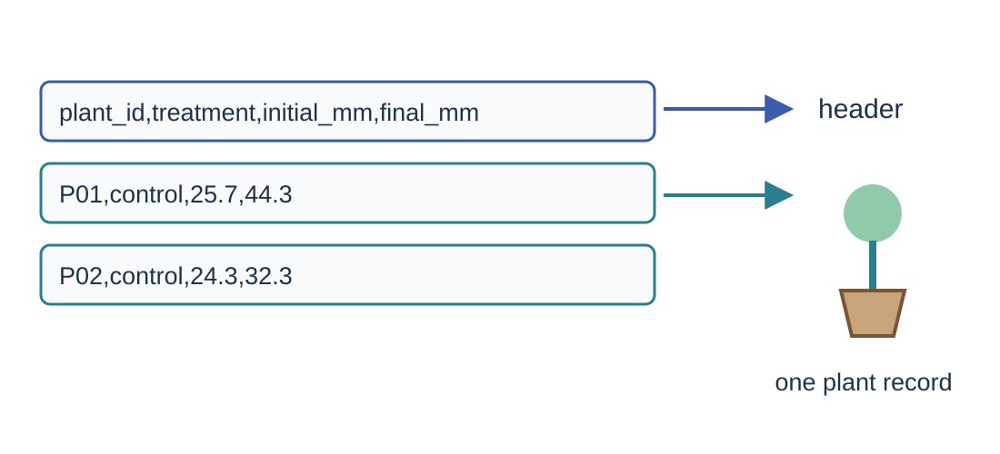
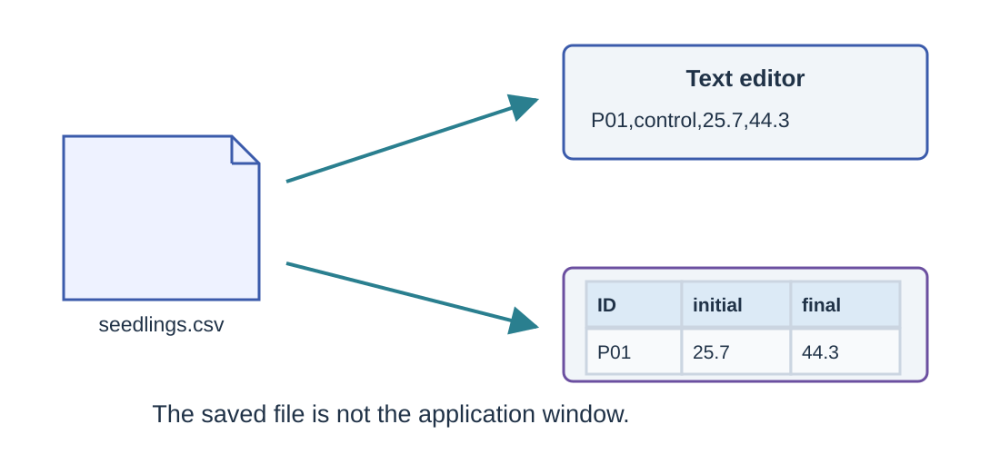
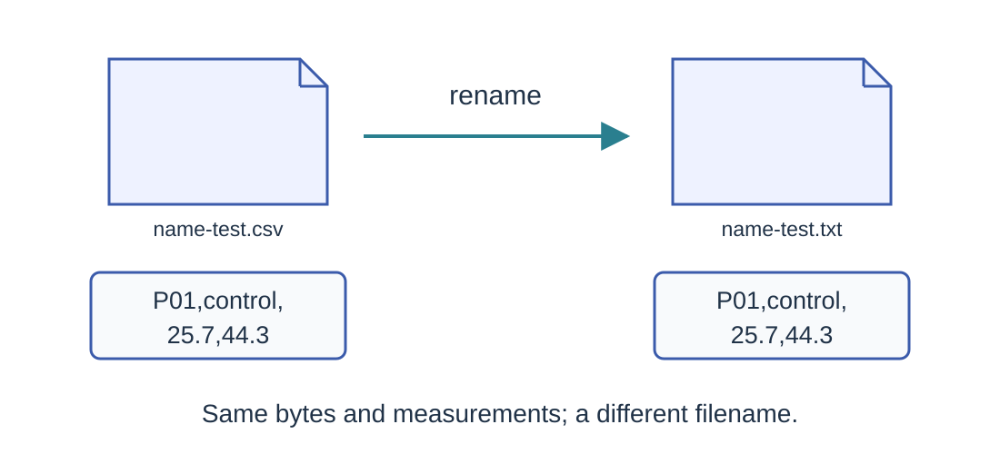
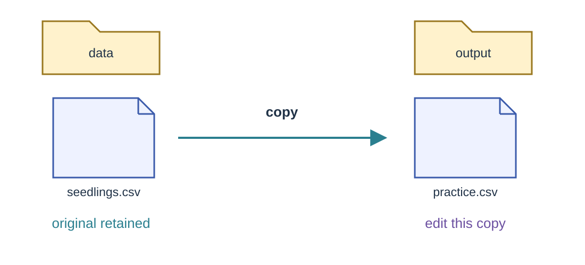
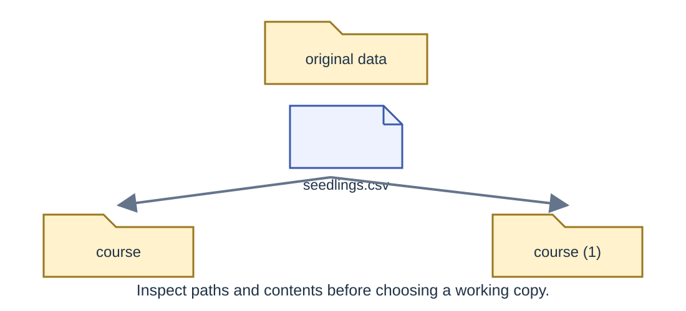

## About this lecture

Every measurement you take in a lab course, a project, or a thesis ends up as a **file**: an instrument export, a spreadsheet from a colleague, a photo of a gel. **Before any statistics, you must be able to find that file, keep the original safe, and get back to your own work tomorrow.**

- A **file** is saved information with a name and a location. An **application** only displays or changes it.
- A file's **full name** (including its extension) and its **folder** together say what it is and where it is.
- The **raw data** stay unchanged; you work on a **copy** and you know which copy.
- "Saved" means you can **close everything and reopen it** — not that a window still shows it.

This is a **concept and practice** day with no programming. Everything later in the course — the terminal, R, reports — assumes these habits.

::: notes
Open with the biology, not the computer: we have seedling measurements and want to know whether a treatment changed growth. Then say plainly why we spend a whole day on files. In later lab courses, the instrument writes a file; the analysis reads a file; the report is a file you hand in. Most early failures are not statistical: a student cannot find the export, has typed over the raw values, or hands in a copy from last week. The four bullets are the whole lecture; the rest of the slides make each one concrete.
:::

## What goes wrong without these habits

Situations that are common in student lab work:

| What happened | What it cost |
|---|---|
| The instrument export was "somewhere in Downloads" and was later cleaned away | The measurements had to be repeated |
| Values were corrected by typing over the original spreadsheet | Nobody could check what the instrument actually recorded |
| A report was rebuilt from `results (2).csv`, an older copy | The figure and the text disagreed |
| A table was sent as a screenshot | The receiver had to retype every number |
| `report.docx` was renamed `report.pdf` | The file no longer opened; nothing had been converted |

Each row is fixed by one habit from today. None of them needs programming.

::: notes
Ask the room whether any of these has happened to them, or to a group partner. These are ordinary, not careless-student stories: modern operating systems hide extensions, show "recent files" instead of folders, and autosave to places that are hard to find. The point of the slide is motivation: the cost of not knowing where a file is shows up as repeated lab work or as a report nobody can check. Come back to this table at the end; each row maps to one summary line.
:::

## Today's data: one row per seedling

:::: {.columns}
::: {.column width="42%"}
Our (simulated) study: **24 seedlings**, each in its own pot. **12 treated, 12 control**, assigned at random. Each plant was measured at the start and the end.

The file `data/seedlings.csv` stores this as a table:

- The **header** names the fields: `plant_id`, `treatment`, `initial_mm`, `final_mm`.
- Each **record** (row) describes **one plant**.
- P01 grew from 25.7 mm to **44.3 mm** — an increase of 44.3 − 25.7 = **18.6 mm**, not 44.3 mm.

Units and meanings come from the **data dictionary**, not from the commas.
:::
::: {.column width="58%"}
{width="100%"}
:::
::::

::: notes
Introduce the dataset we will use for weeks: a randomised treatment/control comparison of seedling growth. Read P01's row aloud field by field and give the units from the dictionary. Work the subtraction: 44.3 minus 25.7 is 18.6 mm. Stress that the computer cannot infer the study design, the units, or which column is the outcome from the comma characters; that knowledge lives in the dictionary and in your notes. A control is a comparison group that shows what might have happened without treatment.
:::

## A file is not the window showing it

:::: {.columns}
::: {.column width="42%"}
- The **file** is what is saved on disk. An **application** opens it and shows a **view**.
- One CSV can be shown as plain text (a text editor) or as a grid (a spreadsheet). The saved content is the same comma-separated text.
- Closing the application **does not** delete the file. Deleting the file is a separate action.
- The **format** (CSV) is not the **application** (Excel). R, a text editor, and Excel can all read the same CSV.
:::
::: {.column width="58%"}
{width="100%"}
:::
::::

::: notes
Demonstrate: open seedlings.csv in a text editor, then in a spreadsheet viewer. Same file, same path, two views. Ask what happens to the measurements when both windows close: nothing; they are still on disk. This is the mental model that everything else rests on, so make it explicit. Avoid turning this into a software preference discussion; the point is one file, several applications.
:::

## From download to a folder you can find again

:::: {.columns}
::: {.column width="45%"}
1. Download the course ZIP with the browser.
2. **Show it in the file manager** (File Explorer or Finder) — note the folder, usually *Downloads*.
3. **Extract the whole archive**, then move the extracted folder to *Documents*.
4. Open files from the **extracted folder**, not from a preview inside the ZIP.
5. Find `data/seedlings.csv` by **opening folders**, not via "recent files".

A download that you cannot locate afterwards is not yet usable data.
:::
::: {.column width="55%"}
{width="100%"}
:::
::::

::: notes
Demonstrate on the supported operating system and pause after locating Downloads so everyone has caught up. Windows Extract All and Mac double-click can create an extra parent folder; check what is directly inside the folder you will work in: data, output, reports, report.Rmd, introcomputing.Rproj. "Recent files" is convenient but hides the location, and location is exactly what tomorrow's lesson on paths depends on. If someone has a cloud-managed Documents folder, check the files are really on the laptop.
:::

## Read the whole filename

:::: {.columns}
::: {.column width="45%"}
| Name | Content |
| --- | --- |
| `seedlings.csv` | Text table of measurements |
| `day01-notes.txt` | Your plain-text note |
| `report.Rmd` | Source for a future report |

- The **extension** (`.csv`, `.txt`) is **part of the name**. It tells applications what to expect.
- Many systems **hide extensions** by default. Turn them on, or `notes.txt` can silently become `notes.txt.rtf`.
:::
::: {.column width="55%"}
{width="100%"}
:::
::::

::: notes
Show the file-manager setting that displays extensions; do it live on the supported system. Define CSV as comma-separated values. A folder normally has no extension. The classic trap: a word processor saves rich text, the student types ".txt" into the name, and the real name becomes notes.txt.rtf. With extensions hidden, it looks right and behaves wrong.
:::

## Renaming does not convert the contents

:::: {.columns}
::: {.column width="42%"}
- Renaming `seedlings-practice.csv` to `name-test.txt` changes only the **label**.
- The commas and measurements inside are **identical**.
- To change a format you must **export or convert** with a program that rewrites the content.
- An extension is a **clue**, not proof of what is inside. A wrong extension makes a file **misleading**.

Experiment only on a copy, then restore the informative name.
:::
::: {.column width="58%"}
{width="100%"}
:::
::::

::: notes
This connects to the motivation table: renaming report.docx to report.pdf does not make a PDF. Demonstrate on output/name-test.txt made from a practice copy and open it in a text editor: the same records are there. Then restore the .csv name. Students should leave able to say: the name is a promise about the content; only a converting program changes the content.
:::

## Keep the raw data untouched

:::: {.columns}
::: {.column width="42%"}
- The original file is your **evidence**: it is what the instrument or the notebook recorded.
- Copy `data/seedlings.csv` to `output/seedlings-practice.csv` and **edit only the copy**.
- Two locations, two names: you always know which file is the source.
- If an analysis goes wrong, you can **start again from the original**. If the original is changed, you cannot.
:::
::: {.column width="58%"}
{width="100%"}
:::
::::

::: notes
Demonstrate the copy in the file manager. The scientific reason matters more than the computing one: a reviewer, supervisor, or you in six months must be able to see what was actually measured. Corrections are made later in a traceable way (week 3 covers this), never by typing over the source. Our supplied data are simulated, but practise the habit as if they were your own thesis data.
:::

## Saved means: close everything, then reopen

:::: {.columns}
::: {.column width="42%"}
1. Write a sentence in a **plain-text** editor.
2. Save as `day01-notes.txt` inside `reports/`.
3. **Close** the editor and the file manager.
4. Navigate back through the folders and **reopen** it.

Editors may autosave or restore drafts. The only reliable test is the **saved file**: you can state its folder and full name, and it opens from there.
:::
::: {.column width="58%"}
{width="100%"}
:::
::::

::: notes
Use a plain-text editor, not a word processor. If the editor appends .txt automatically, check the final name rather than producing a doubled extension. Some editors restore unsaved text when reopened, which can make students think something is saved when it is not; ask what is in the actual file. Have each student say out loud the computer, folder, and full name of their note.
:::

## Several copies need an explicit choice

:::: {.columns}
::: {.column width="42%"}
- Downloading twice gives `course-files (1).zip`; extracting twice gives two similar folders.
- Similar names **do not** mean identical contents — one may have your edits.
- Choose **one working project** by its **contents and path**: `data`, `output`, and the `.Rproj` file directly inside.
- Do not delete a similar folder until you know what is in it.
:::
::: {.column width="58%"}
{width="100%"}
:::
::::

::: notes
This is the row "a report was rebuilt from an older copy" in the motivation table. Show a second extraction and a "(1)" download. Open folders until the chosen root is clear. No deletion is required today; students should ask before removing anything that might contain their own work.
:::

## Predict before clicking

Answer each one, then check on your own computer:

1. You close the editor. Did the saved note disappear?
2. You edit `seedlings-practice.csv`. Did `data/seedlings.csv` change?
3. You know a file's name. Do you know which folder it is in?
4. You rename a `.csv` to `.txt`. Did the measurements change?
5. A colleague sends a **screenshot** of the table. What can you check from it, and what must you still ask for?

::: notes
Expected answers: 1 no, a saved file survives closing; 2 no, the practice copy is a separate file; 3 not necessarily, several folders can contain the same name; 4 no, renaming does not convert; 5 a screenshot shows visible headings and values and can help discuss a problem, but may omit rows, cannot be read by R, and cannot be updated; ask for the CSV and its dictionary. Have students demonstrate 1, 2 and 4 on their own files rather than just answering.
:::

## Worked example: receiving a new table

A second class sends `seedlings-transfer.csv` (18 plants). Before using it, write a short **receipt** note:

| Question | Answer for this file |
|---|---|
| Where is the original, and where is my copy? | `data/seedlings-transfer.csv`; copy in `output/` |
| What does one row record? | One plant: ID, treatment, initial and final length |
| Units? | mm (from the dictionary) |
| A check of one record | T01: 25.3 → 40.3 mm, change **15.0 mm** |
| How do I find it again? | Folder path and full filename, written in the note |

The same five questions apply to any file you receive from an instrument, a lab partner, or a supervisor.

::: notes
This is the independent transfer task in miniature: new data, same habits. T18 is a treated plant, 21.6 to 43.0 mm. The receipt is deliberately not about R; it is about knowing what you have and where it is. In later courses, replace "second class" with "the plate reader" or "my supervisor's spreadsheet" and the questions are unchanged.
:::

## Summary

| Idea | Key fact |
|---|---|
| File vs application | The file is saved on disk; applications only show or change it |
| Location | A file is identified by its **folder** and its **full name** |
| Extension | Part of the name; a clue to the format. Renaming does not convert |
| Raw data | Never edit the original; work on a named copy in `output/` |
| Saved | You can close everything and reopen it from its folder |
| Several copies | Choose one working project by contents and path |
| Receiving data | Note source, copy, row meaning, units, and one checked record |

**Next (Day 2, folders and the working computer):** how to write down *where* a file is as a **path**, so you and others can find it without clicking.

**Now:** [open the Day 1 exercises](../../week1/01-files.qmd). Leave with `reports/day01-notes.txt` and `output/seedlings-practice.csv`, and be able to find both after closing every window.

::: notes
Walk back to the "what goes wrong" table and match each row to a summary line: lost export → location; typed over → raw data; older copy → several copies; screenshot → receiving data; renamed docx → extension. The exercises give the detailed click sequence and hints. A student who cannot yet reopen their files needs help before Day 2, because paths build directly on this.
:::
