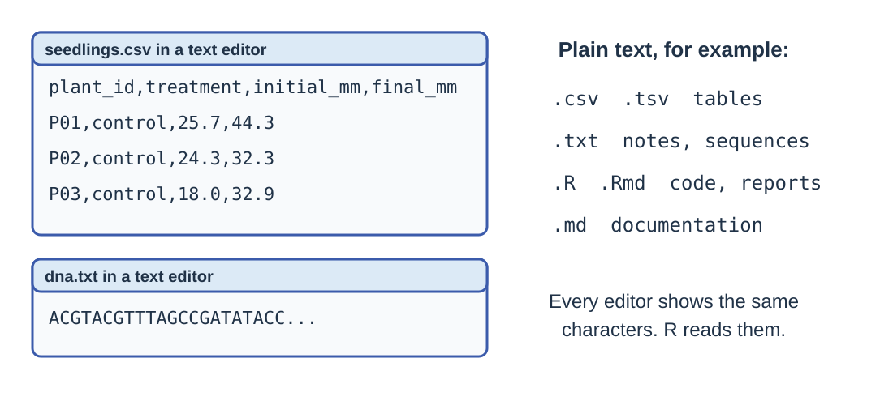
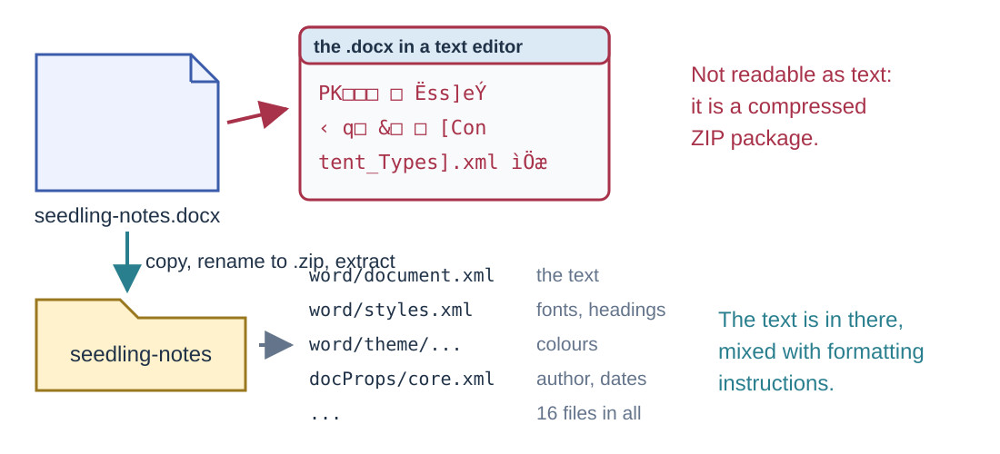
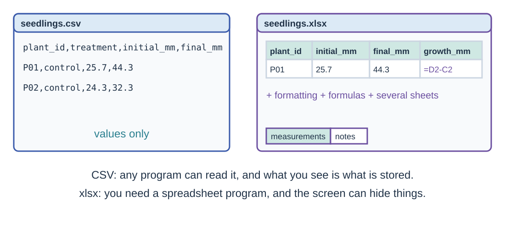
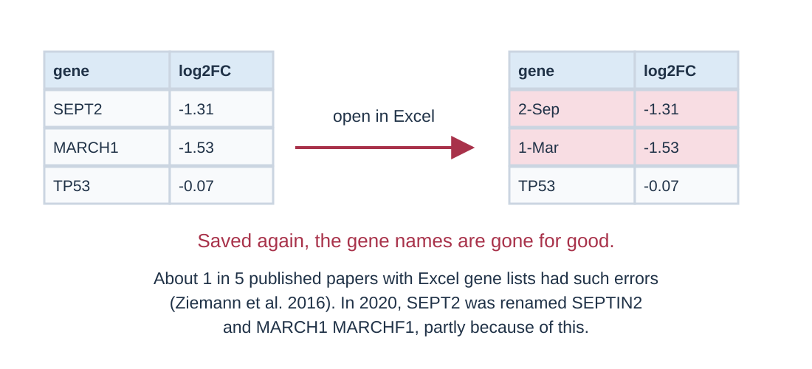
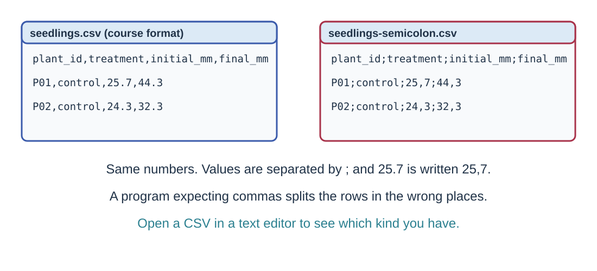
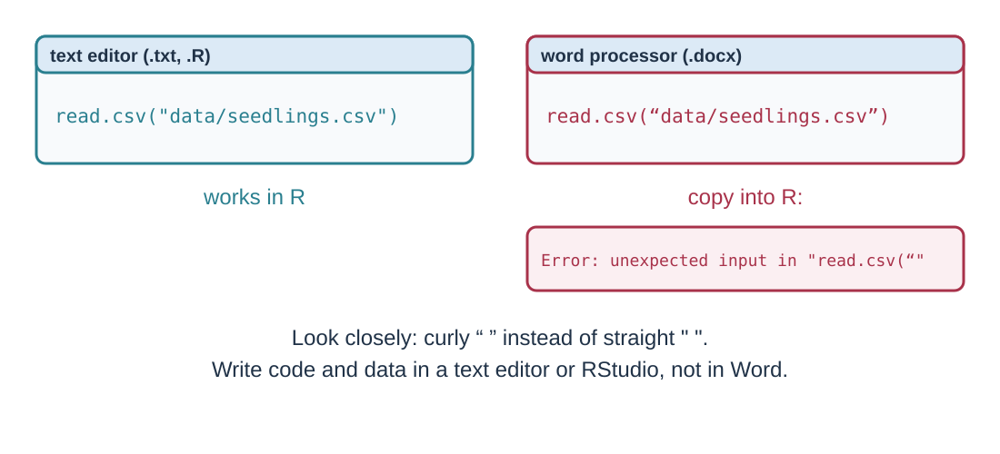
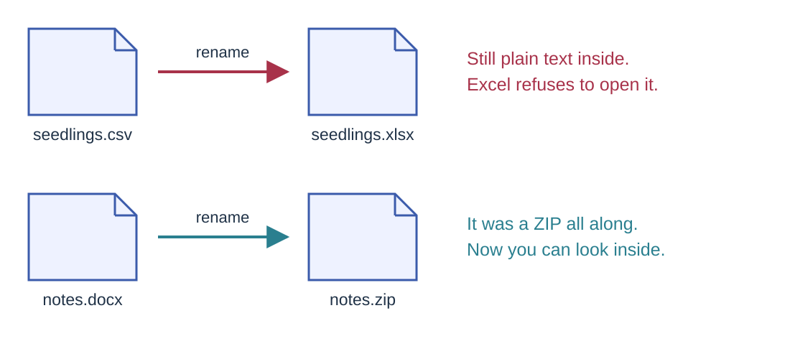
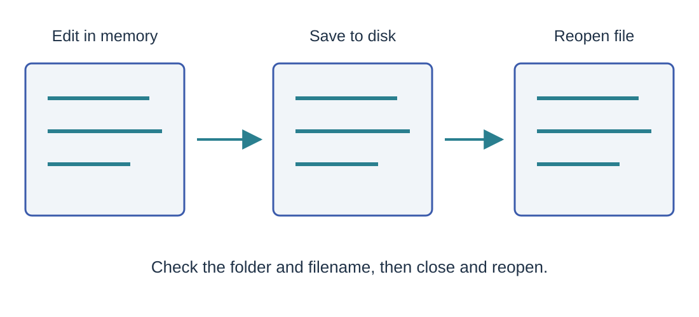

## About this lecture

Did a treatment make seedlings grow more? The measurements are in a file. Some kinds of files any program can read; others only one program understands, and some programs **change your data without asking**. Which kind of file should hold our measurements?

Today you will:

- download the course folder;
- open different files in a plain-text editor and see what is inside;
- compare the same table as CSV and as Excel;
- save a plain-text note.

No programming today. Every later day reads and writes plain-text files.

::: notes
Students know roughly what a file is; today is about what is inside different kinds of files. Keep it concrete: open files, look, compare. The seedling data are simulated teaching data.
:::

## Download and unpack the course files

:::: {.columns}
::: {.column width="45%"}
1. Download the course ZIP.
2. **Extract** it (Windows: Extract All; Mac: double-click).
3. Move `introcomputing-course` to *Documents*.
4. Turn on **show file extensions**.

Work in the extracted folder, not inside the ZIP.
:::
::: {.column width="55%"}
{width="100%"}
:::
::::

::: notes
Demonstrate once and keep it short; the exercise page has the click-by-click steps. Check that data, examples, output and reports are directly inside the folder students work in; extraction can add an extra folder level, and a second download creates "(1)" names. Ask students with OneDrive/iCloud Documents to tell you. Show the extensions setting in File Explorer and Finder.
:::

## Plain text is just characters

{height=360}

- `seedlings.csv`: a header line, then one line per plant. P01 grew 44.3 − 25.7 = **18.6 mm**.
- Any editor shows the same characters. R reads them directly.

::: notes
Open data/seedlings.csv in Notepad or TextEdit on the projector. Point at the header and at P01. The units (mm) are in data/README.md, not in the file. Then open data/dna.txt: also plain text. Tell Mac users to set TextEdit to plain text (Settings, New Document, Plain text).
:::

## A Word file is a package

{height=380}

`.docx` and `.xlsx` are ZIP packages. PDF and PNG files are not text either.

::: notes
Demo: open examples/seedling-notes.docx in Notepad: "PK" and symbols. Copy it to output, rename to .zip, extract, open word/document.xml: the sentences are there between tags. On a Mac, TextEdit renders .docx files as documents; use File, Open, Options, "Ignore rich text commands", or rename a copy to .txt. Optionally open the PDF and PNG in the editor: they start with %PDF and PNG.
:::

## Same table: CSV or Excel

{height=380}

We keep data as CSV: every program reads it, and nothing is hidden.

::: notes
Open examples/seedlings.xlsx in Excel or LibreOffice: show the formula in E2 (=D2-C2, displayed 18.6) and the "notes" sheet. Then open data/seedlings.csv in the spreadsheet: values only. Formatting and calculations belong in R code, where every step is written down.
:::

## Spreadsheets can change your data

{height=380}

Never save raw data from a spreadsheet. Close it **without saving**.

::: notes
Open examples/genes.csv in a text editor, then in Excel. Excel may show dates; LibreOffice in our test left the names alone, so the figure is the backup. Ziemann et al. (2016, Genome Biology) found such errors in about 1 in 5 papers with supplementary Excel gene lists. HGNC renamed SEPT and MARCH genes in 2020 (SEPTIN2, MARCHF1), but older files still use the old names.
:::

## Swedish Excel writes a different "CSV"

{height=380}

Look at a CSV in a text editor before you analyse it.

::: notes
Relevant here at Umeå: Excel set to Swedish saves "CSV" with semicolons, because the comma is the decimal sign. Open examples/seedlings-semicolon.csv. R's read.csv stops with "more columns than column names"; read.csv2 reads it. Reading data into R comes later in the course.
:::

## Word "improves" your text

{height=380}

Write code, data and notes in a text editor (later, RStudio), not in Word.

::: notes
Compare the last line of examples/seedling-notes.txt and examples/seedling-notes.docx. Word's autocorrect replaced the straight quotes. Paste the curly version into R if R is installed: Error: unexpected input. TextEdit on a Mac is also a word processor by default: Format, Make Plain Text before saving, otherwise you get an .rtf file.
:::

## Extensions are labels

{height=380}

Renaming changes the name, not the contents. Converting needs **Save As**.

::: notes
Ask: what is inside seedlings.xlsx after renaming? The same commas and numbers. The extension tells the computer which program to use; it does not convert anything. That is also why extensions must be visible.
:::

## Keep the original; work on a copy

{height=360}

Copy `data/seedlings.csv` to `output/seedlings-practice.csv`. Experiment only on copies.

::: notes
The original is what was measured. If a spreadsheet changes the copy, start again from the original. Demonstrate the copy in the file manager; tomorrow's exercises use this file.
:::

## Save a plain-text note

{height=320}

Save `reports/day01-notes.txt`. Check that the name ends in `.txt`, not `.rtf`. Close the editor, then reopen the note from its folder.

::: notes
Mac: Format, Make Plain Text before saving. With extensions hidden, a note can end up as notes.txt.rtf without anyone noticing. Unsaved text is lost when the editor closes; a saved file stays on disk. Tomorrow students start by finding this note.
:::

## Check yourself

1. You open a `.docx` in Notepad and see `PK` and symbols. Is it broken?
2. Which file can R read directly: `seedlings.csv` or `seedlings.xlsx`?
3. A gene list shows `1-Mar`. What happened?
4. A CSV line reads `P01;control;25,7;44,3`. Where does it come from?

::: notes
Answers: 1 no, it is a ZIP package; 2 seedlings.csv (plain text); 3 a spreadsheet turned MARCH1 into a date; 4 Excel set to Swedish (or another language with decimal commas). Ask students to check 1 on their own computers.
:::

## Summary

- **Plain text** (`.csv`, `.txt`, `.R`, `.Rmd`, `.md`) is just characters: any editor shows it, R reads it.
- `.docx` and `.xlsx` are ZIP packages; PDF and images are not text either.
- An `.xlsx` adds formatting, formulas and sheets. We keep data as CSV.
- Spreadsheets can change data (gene names to dates) and write "CSV" with semicolons.
- Word turns `"` into `“ ”`. Write code in a text editor.
- An extension is a label. Renaming does not convert.

**Next (Day 2, folders and paths):** writing down exactly *where* a file is.

**Now:** [open the Day 1 exercises](../../week1/01-files.qmd). Leave with `reports/day01-notes.txt`, `reports/file-types.txt` and `output/seedlings-practice.csv`.

::: notes
The exercises have the detailed click sequence. The independent task sorts every file in the course folder into plain text or not. Students who could not extract the course folder need help before Day 2.
:::
