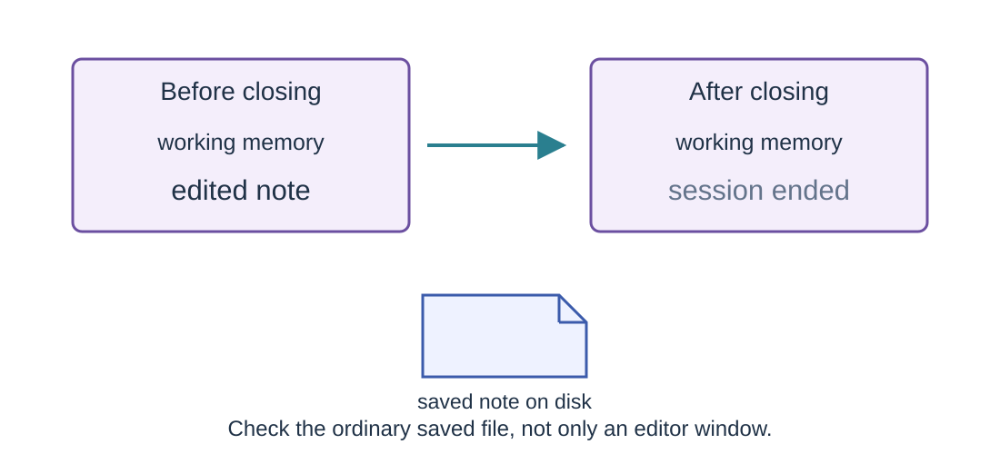
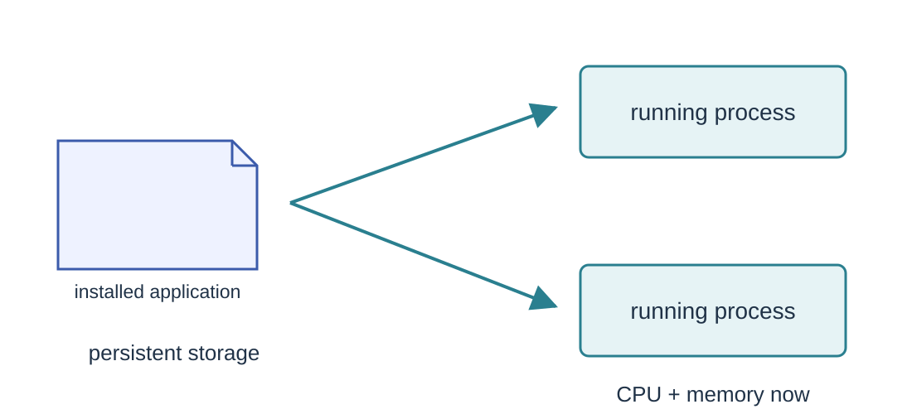
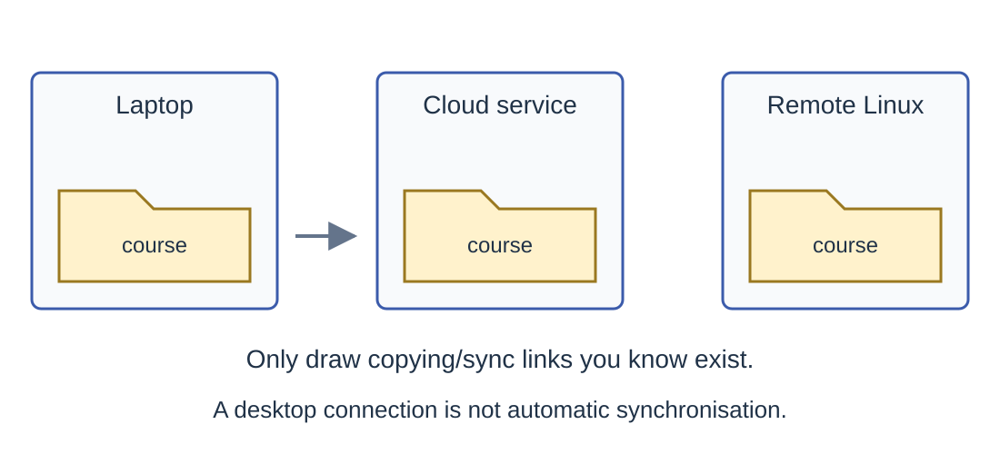

## A project is a tree of locations

{height=390}

`data` and `reports` are neighbours, not one inside the other.

::: notes
Ask students to locate yesterday's note first. Introduce parent folder and project root using the picture. Project root means the starting folder of this project, not the root of the entire computer. Have a student narrate the route from reports to data.
:::

## An address can be absolute or relative

Example absolute path on Linux:

```text
/home/anna/introcomputing-course/data/seedlings.csv
```

From the project root, the relative path is:

```text
data/seedlings.csv
```

Your username and complete home path may differ.

::: notes
Show Windows and Mac equivalents in the practical if needed. An absolute path supplies the full route from a drive or root. A relative path starts from the current folder. The illustrative username will differ from each student's account; personal absolute paths are one reason analyses fail when moved.
:::

## A relative path needs a starting point

{height=390}

**Current working directory:** where relative paths start.

::: notes
Physically move between the project root and reports in the graphical window. Say the route out loud. The file remains in data; changing the current folder changes the interpretation of a relative path. Tomorrow pwd will let a shell report this starting point.
:::

## Opening a CSV uses several computer parts

{height=390}

The operating system manages files, memory, devices, and running programs.

::: notes
Link each component to an action: storage retains the CSV, RAM holds working information, CPU carries out instructions. RStudio will later be an application and a process will be a running instance of it. More RAM does not automatically mean more persistent room for photographs. Avoid hardware shopping or binary arithmetic.
:::

## An unsaved change and a saved file differ

Try this only on a practice note:

1. Add a sentence, save, close, and reopen.
2. Add another sentence and discard the change when closing.
3. Inspect the actual file after reopening.

If the editor restores unsaved state, discuss what it has restored.

::: notes
The exercise reveals the difference between storage and current application state. Autosave and recovery differ between editors. Ask the class where the saved note is and which sentence is actually stored there.
:::

## Home folders belong to particular environments

{height=390}

An explicit transfer or configured sharing is needed to connect separate copies.

::: notes
Windows students use native RStudio and a separate Ubuntu shell. Mac students do not need local Ubuntu, but remote storage remains separate for them too. A cloud copy may synchronise, but a remote desktop is not automatically a sync service. The course's actual remote connection details are pending.
:::

## Which claim needs correcting?

“The note is in my editor, so I know where the file is.”

“I copied the ZIP beside the folder, so the laptop is backed up.”

“`data/seedlings.csv` means the same location from every folder.”

::: notes
All need correction. The editor may be displaying an unsaved or recovered version; a same-disk ZIP does not protect against loss of that disk; relative paths need a starting folder. Ask for a concrete fix to each claim rather than vocabulary alone.
:::

## A route starts somewhere

{height=350px}

From reports, data is a neighbour, not a child.

::: notes
Trace the route graphically before naming relative paths. Students should draw a parent and two children. The exact personal absolute path differs across machines; the within-project relation is portable.
:::

## Try a move on a practice tree

Create map-a and map-b under practice.

Put a note in map-a, write its route, then move map-a into map-b.

Which written route needs revising?

::: notes
Move only the disposable practice folder. Contents may remain identical while the address changes. Compare with copy: copying would leave the original route valid and create a second location. Ask students to predict before clicking.
:::

## Closing a process and saving a file differ

{height=350px}

Inspect the saved file to find out which changes survived.

::: notes
Use the plain-text disposable experiment and acknowledge autosave/recovery. Some applications restore unsaved changes. RAM supports running information; storage retains deliberately saved information between sessions.
:::

## A personal absolute path is a poor shared instruction

Illustrative laptop address:

```text
/Users/anna/Documents/future-lab/data/seedlings-transfer.csv
```

Portable instruction from the agreed project root:

```text
data/seedlings-transfer.csv
```

::: notes
The second route still assumes an agreed root and an intact folder structure. It does not find data anywhere on the network. On a remote computer the same text refers to storage accessible there, not automatically to the laptop.
:::

## Installed program versus running instance

{height=350px}

More RAM and more saved-file capacity solve different problems.

::: notes
Ask whether a closed editor remains installed. Yes, its saved program is still available to launch. A process is its current execution. Use these distinctions to explain everyday observation and recovery.
:::

## Plan the next laboratory folder

A practical supplies measurements, photographs, and a protocol.

Where would you keep originals, notes, derived figures, and the report?

Write a README that another person can use.

::: notes
The independent task creates a disposable future-lab project and text placeholders explicitly marked as such. Renaming text .jpg does not make a photograph. No particular folder scheme is scientifically mandatory; consistency and clear roles are what matter.
:::

## Connections do not all mean synchronisation

{height=350px}

Draw only the copying or sync links you actually know are configured.

::: notes
Cloud-managed folders can have local placeholders. A remote desktop is another interface, not automatic transfer. The course service details remain pending. Students can put a question mark on unknown links.
:::

## Test portability by moving the structure

Copy the complete practice project to a new location.

Find its README and data from the new root.

Explain which relative routes remain valid and which old absolute routes point elsewhere.

::: notes
This is a test of organisation, not a separate backup against losing the laptop. Keep one clearly named working course project. The student output is two maps and an investigation note, tested by reopening the files along the documented routes.
:::

## Practise explaining the route

[Open the exercises](../../week1/02-folders-computers.qmd).

Save `reports/day02-map.txt` with:

- A small project tree and the route to `seedlings.csv`.
- One sentence distinguishing RAM from saved storage.
- A note naming the computer holding your project.

::: notes
The practical also creates practice/field-notes and figures for tomorrow's navigation. Have students write directions, close their windows, and test the routes from the stated start. Keep backup discussions tied to the supported storage route when it is announced.
:::
