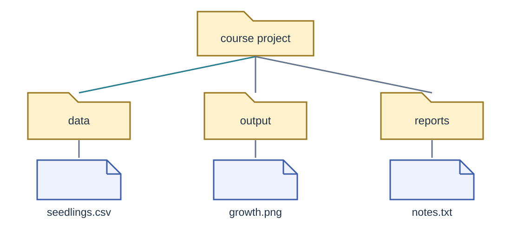
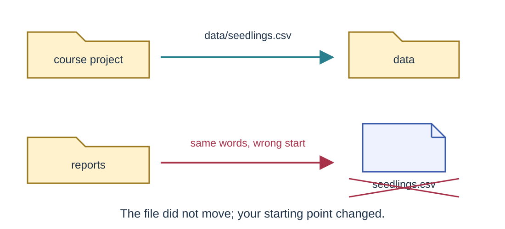
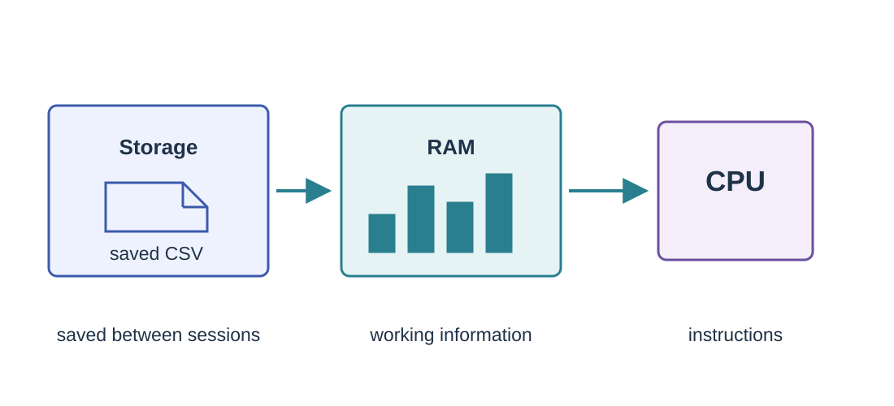

## A project is a tree of locations

{height=390}

`data` and `reports` are neighbours, not one inside the other.

::: notes
Ask students to locate yesterday's note first. Introduce parent folder and project root using the picture. Project root means the starting folder of this project, not the root of the entire computer. Have a student narrate the route from reports to data.
:::

## An address can be absolute or relative

Example absolute path on Linux:

```text
/home/anna/introcomputing-course/data/seedlings.csv
```

From the project root, the relative path is:

```text
data/seedlings.csv
```

Your username and complete home path may differ.

::: notes
Show Windows and Mac equivalents in the practical if needed. An absolute path supplies the full route from a drive or root. A relative path starts from the current folder. Do not have students copy the illustrative username; personal absolute paths are one reason analyses fail when moved.
:::

## A relative path needs a starting point

{height=390}

**Current working directory:** where relative paths start.

::: notes
Physically move between the project root and reports in the graphical window. Say the route out loud. The file remains in data; changing the current folder changes the interpretation of a relative path. Tomorrow pwd will let a shell report this starting point.
:::

## Opening a CSV uses several computer parts

{height=390}

The operating system manages files, memory, devices, and running programs.

::: notes
Link each component to an action: storage retains the CSV, RAM holds working information, CPU carries out instructions. RStudio will later be an application and a process will be a running instance of it. More RAM does not automatically mean more persistent room for photographs. Avoid hardware shopping or binary arithmetic.
:::

## An unsaved change and a saved file differ

Try this only on a practice note:

1. Add a sentence, save, close, and reopen.
2. Add another sentence and discard the change when closing.
3. Inspect the actual file after reopening.

If the editor restores unsaved state, discuss what it has restored.

::: notes
The exercise reveals the difference between storage and current application state. Autosave changes the experience, so do not claim every editor behaves the same way. Ask the class where the saved note is and which sentence is actually stored there.
:::

## Home folders belong to particular environments

{height=390}

An explicit transfer or configured sharing is needed to connect separate copies.

::: notes
Windows students use native RStudio and a separate Ubuntu shell. Mac students do not need local Ubuntu, but remote storage remains separate for them too. A cloud copy may synchronise, but a remote desktop is not automatically a sync service. The course's actual remote connection details are pending.
:::

## Which claim needs correcting?

“The note is in my editor, so I know where the file is.”

“I copied the ZIP beside the folder, so the laptop is backed up.”

“`data/seedlings.csv` means the same location from every folder.”

::: notes
All need correction. The editor may be displaying an unsaved or recovered version; a same-disk ZIP does not protect against loss of that disk; relative paths need a starting folder. Ask for a concrete fix to each claim rather than vocabulary alone.
:::

## Practise explaining the route

[Open the practical and notes](../../week1/02-folders-computers.qmd).

Save `reports/day02-map.txt` with:

- A small project tree and the route to `seedlings.csv`.
- One sentence distinguishing RAM from saved storage.
- A note naming the computer holding your project.

::: notes
The practical also creates practice/field-notes and figures for tomorrow's navigation. Let pairs give directions without pointing or touching the other's computer, then swap. Keep backup discussions tied to the supported storage route when it is announced.
:::
