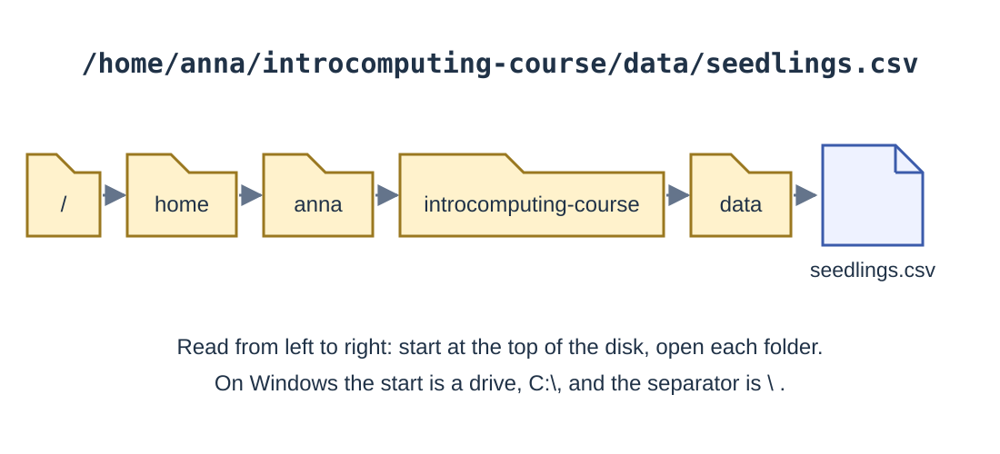
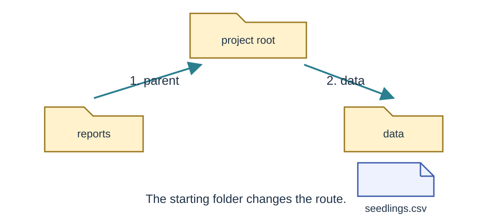
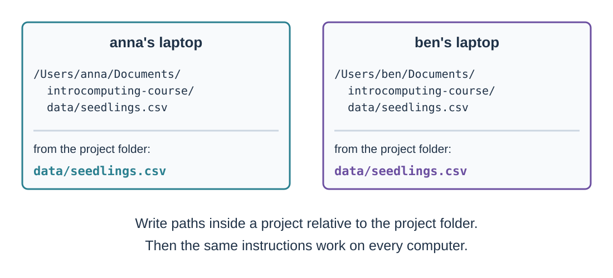
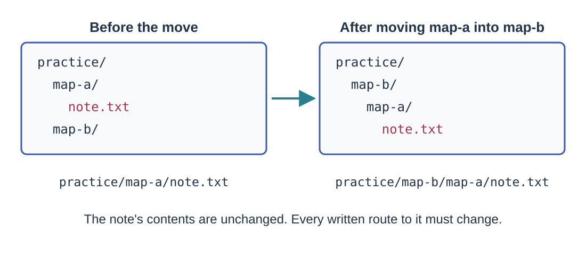
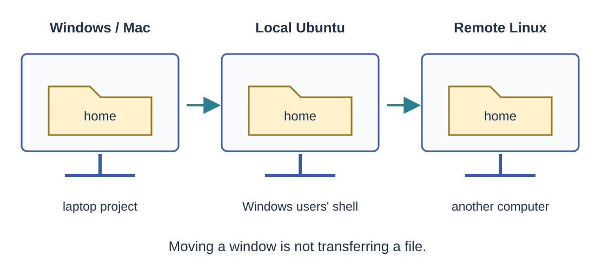

## About this lecture

R will not click through folders for you. To read the seedling measurements it needs a written address: **how do you write down exactly where a file is, so that it works on every computer?**

Today you will:

- draw the course project as a tree of folders;
- write absolute and relative paths;
- see why a relative path needs a starting folder;
- check that saved work is on disk.

Tomorrow the terminal uses these paths; from week 2, R does.

::: notes
Start by asking students to find yesterday's note, day01-notes.txt, through the folders, not through "recent files". The folders they opened, in order, are the path. Course data are simulated.
:::

## A project is a tree

{height=380}

- `data` and `reports` are neighbours; their **parent** is the project folder.
- The project folder is where every route in this project starts.

::: notes
Open the project in the file manager and walk the tree. Project root means the starting folder of this project, not the top of the whole disk. Turn on View, Show Path Bar in Finder; show the address bar in File Explorer.
:::

## A path names each folder on the route

{height=360}

This is how Ubuntu writes it. A Mac starts with `/Users/anna/...`; Windows writes `C:\Users\anna\...\data\seedlings.csv`.

::: notes
Read the path left to right, opening one folder per part. Show a real path: Windows "Copy as path", Mac right-click with Option, "Copy as Pathname". Paste it into a text editor. Usernames will differ from anna.
:::

## Absolute and relative paths

:::: {.columns}
::: {.column width="45%"}
**Absolute:** from the top of the disk.

```text
/home/anna/introcomputing-course/data/seedlings.csv
```

**Relative:** from an agreed folder, here the project folder.

```text
data/seedlings.csv
```
:::
::: {.column width="55%"}
{width="100%"}
:::
::::

The folder a program starts from is its **working directory**.

::: notes
From inside reports, data/seedlings.csv asks for reports/data/seedlings.csv, which does not exist. The file did not move; the starting point changed. Tomorrow pwd prints the terminal's working directory.
:::

## Going up to the parent

{height=380}

From `reports`, `data` is a neighbour: go up to the parent, then down.

::: notes
Trace it with the file manager: open reports, go up, enter data. In the terminal tomorrow, "up one level" is written as two dots, so the relative path from reports is ../data/seedlings.csv. Mention the notation but do not drill it today.
:::

## Relative paths work on every computer

{height=380}

That is why our R code will say `data/seedlings.csv`.

::: notes
Ask: if you email your R code with an absolute path to a classmate, what happens? It fails, because their username differs. The relative path assumes only that the project folder is intact and that R starts in it.
:::

## Moving a folder changes the path

{height=380}

Any route written before the move must be updated.

::: notes
This is the independent task: students create map-a and map-b in practice, write routes, predict, move, and correct. Copying would leave the old route valid and create a second file.
:::

## Saved work is on disk

{height=360}

Unsaved text is in memory and disappears when the program closes. Saved work stays on disk.

::: notes
Demonstrate on a practice copy: add a sentence, save, close, reopen; then add one, close with Don't save, reopen. Some editors autosave or restore drafts; what counts is the saved file. Hardware details come later in the course.
:::

## Different computers, different folders

{height=360}

A path is a place on one computer. A file is elsewhere only after you copy it there.

::: notes
Windows students will have a separate Ubuntu home folder for the terminal exercises. Later a remote Linux computer has its own folders. A cloud folder may synchronise; a remote desktop does not. A second copy on the same laptop is not a backup.
:::

## Check yourself

1. From the project folder, what is the path to yesterday's note?
2. From inside `reports`, what does `data/seedlings.csv` point to?
3. Why does `C:\Users\anna\...` fail on Ben's laptop?
4. You close the editor without saving. What is in the file?

::: notes
Answers: 1 reports/day01-notes.txt; 2 a data folder inside reports, which does not exist; 3 his username and folders differ; 4 the last saved version.
:::

## Summary

- A project is a tree; the project folder is the starting point.
- A **path** lists the folders on the route to a file.
- **Absolute** paths start at the top of the disk; **relative** paths start at the working directory.
- Relative paths inside a project work on every computer.
- Moving a folder changes the path, not the file. Saved work is on disk.

**Next (Day 3, the terminal):** the same folders, navigated by typing commands.

**Now:** [open the Day 2 exercises](../../week1/02-folders-computers.qmd). Leave with `reports/day02-map.txt` and the `practice` folder.

::: notes
Students who cannot find yesterday's files or explain a relative path need help before the terminal day.
:::
