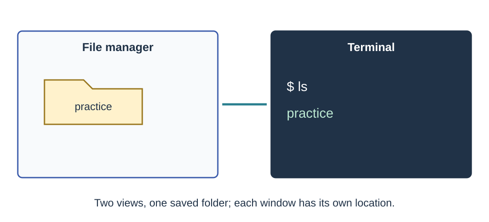
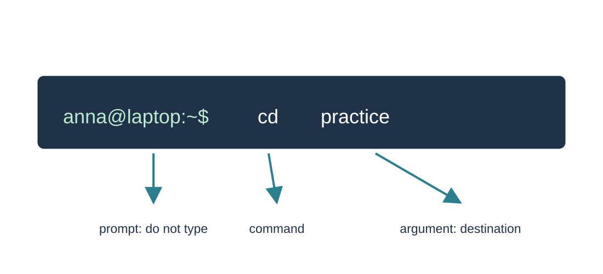
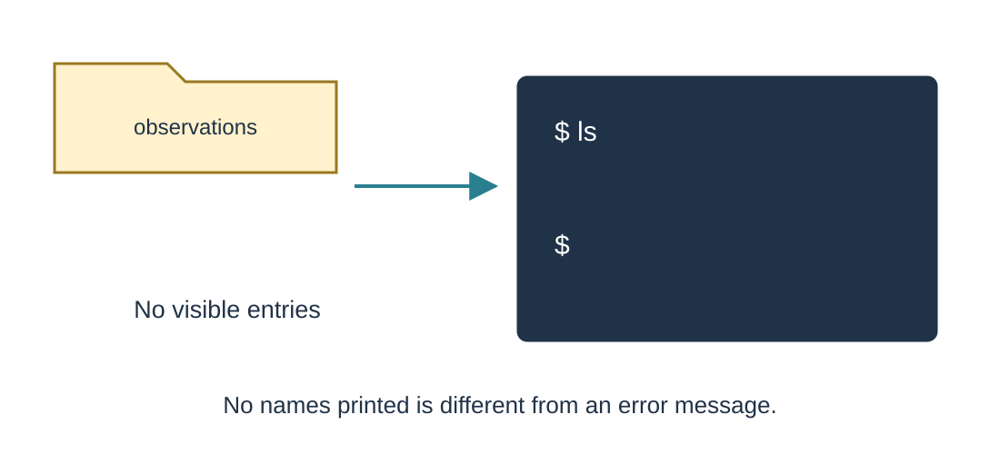

## Same folder, another interface

{height=390}

A shell reads commands; the terminal is the window we use to interact with it.

::: notes
Explain why this is worth learning: repeatable file work and remote Linux access. Windows uses Ubuntu; Mac uses Terminal. Show the workspace in both interfaces. Changing the folder in one window does not automatically move the other; each has its own current location.
:::

## Read the prompt before typing

{height=390}

Do not type the example prompt, `$`, or `%`. Press Enter to run the command.

::: notes
A prompt indicates readiness, not a command to copy. A Mac prompt may end in percent. Our example username is illustrative. Distinguish command from argument now; an option such as -p is an instruction modifying a command's behaviour.
:::

## Build a small workspace

Run one line at a time:

```bash
cd
mkdir -p introcomputing-shell/practice
cd introcomputing-shell
pwd
ls
```

`pwd` reports the location. `ls` should include `practice`.

::: notes
cd without a destination takes the user home. mkdir -p creates needed parent folders and accepts an existing folder. This workspace is deliberately separate from the native R project on Windows. Pause to confirm pwd and the practice name; do not assume browser Downloads is this location.
:::

## Navigation changes the starting point

{height=390}

`.` means here; `..` means the parent; `~` means your home directory.

::: notes
Walk into practice and then make seedlings and observations as in the practical. Ask students to predict the end of pwd before each command. The schematic workspace is introcomputing-shell. A path uses names already present; cd does not create a new destination.
:::

## Silence can be a successful result

{height=390}

An empty directory exists even when `ls` prints no visible entries.

::: notes
Run ls in a newly created directory. Contrast it with cd no-such-folder, which reports an error. The terminal is not a chat interface: commands often finish quietly. This example concerns visible entries; hidden entries are not needed for today's practical.
:::

## Recover by checking, not guessing

```bash
cd no-such-folder
pwd
ls
```

- Read the error: the destination does not exist.
- Match spelling and case to actual names.
- Return with `cd ~/introcomputing-shell` if lost.

::: notes
The failed cd leaves the current directory unchanged. Ubuntu is case-sensitive; a default Mac disk may accept case differences. Always match names so work transfers. Don't teach deletion or broad system repair to handle a navigation typo.
:::

## Make typing easier without changing the task

- **Tab:** complete an unambiguous filename or folder name.
- **Up arrow:** recall a command; read it before rerunning.
- **Ctrl+C:** interrupt a command or cancel partly typed input.
- Quote a space-containing name: `mkdir "field notes"`.

::: notes
Demonstrate each on disposable course folders. Ctrl+C is not the terminal copy shortcut; local Ubuntu commonly uses Ctrl+Shift+C/V while Mac uses Command+C/V. The practical gives platform detail. Ask why two unquoted words may become two arguments.
:::

## Connect words to the graphical view

[Open the practical and notes](../../week1/03-terminal.qmd).

- Ubuntu on Windows: `explorer.exe .`
- Mac: `open .`
- Save `navigation-notes.txt` in the shell workspace.

Be able to state what `cd` changes and what it leaves unchanged.

::: notes
These graphical-opening commands are local conveniences, not remote transfer. Have students independently reproduce the workspace tree, recover from one ordinary mistake, and identify the same folder in the file manager. Their note should give a route back from home and three command meanings.
:::
