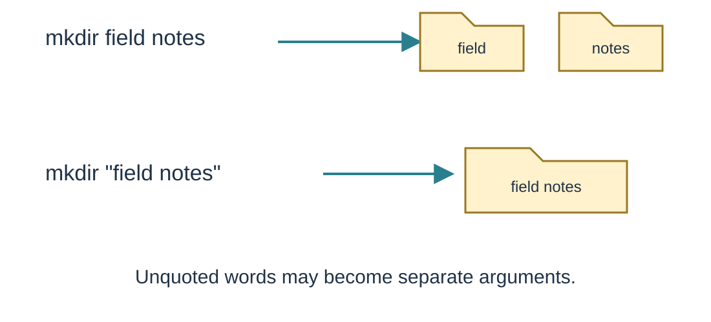
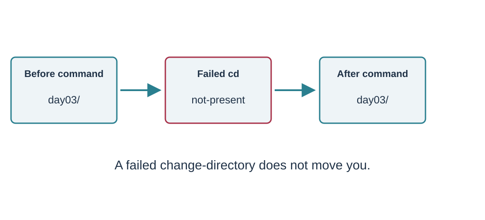
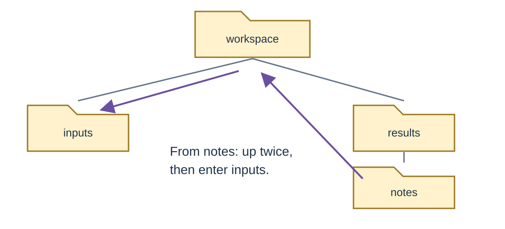

## Same folder, another interface

{height=390}

A shell reads commands; the terminal is the window we use to interact with it.

::: notes
Explain why this is worth learning: repeatable file work and remote Linux access. Windows uses Ubuntu; Mac uses Terminal. Show the workspace in both interfaces. Changing the folder in one window does not automatically move the other; each has its own current location.
:::

## Read the prompt before typing

{height=390}

Type only the command after the prompt. Press Enter to run it.

::: notes
A prompt indicates readiness, not a command to copy. A Mac prompt may end in percent. Our example username is illustrative. Distinguish command from argument now; an option such as -p is an instruction modifying a command's behaviour.
:::

## Build a small workspace

Run one line at a time:

```bash
cd
mkdir -p introcomputing-shell/practice
cd introcomputing-shell
pwd
ls
```

`pwd` reports the location. `ls` should include `practice`.

::: notes
cd without a destination takes the user home. mkdir -p creates needed parent folders and accepts an existing folder. This workspace is deliberately separate from the native R project on Windows. Pause to confirm pwd and the practice name; browser Downloads may be elsewhere.
:::

## Navigation changes the starting point

{height=390}

`.` means here; `..` means the parent; `~` means your home directory.

::: notes
Walk into practice and then make seedlings and observations as in the practical. Ask students to predict the end of pwd before each command. The schematic workspace is introcomputing-shell. A path uses names already present; cd does not create a new destination.
:::

## Silence can be a successful result

{height=390}

An empty directory exists even when `ls` prints no visible entries.

::: notes
Run ls in a newly created directory. Contrast it with cd no-such-folder, which reports an error. The terminal is not a chat interface: commands often finish quietly. This example concerns visible entries; hidden entries are not needed for today's practical.
:::

## Recover by checking, not guessing

```bash
cd no-such-folder
pwd
ls
```

- Read the error: the destination does not exist.
- Match spelling and case to actual names.
- Return with `cd ~/introcomputing-shell` if lost.

::: notes
The failed cd leaves the current directory unchanged. Ubuntu is case-sensitive; a default Mac disk may accept case differences. Always match names so work transfers. Don't teach deletion or broad system repair to handle a navigation typo.
:::

## Make typing easier without changing the task

- **Tab:** complete an unambiguous filename or folder name.
- **Up arrow:** recall a command; read it before rerunning.
- **Ctrl+C:** interrupt a command or cancel partly typed input.
- Quote a space-containing name: `mkdir "field notes"`.

::: notes
Demonstrate each on disposable course folders. Ctrl+C is not the terminal copy shortcut; local Ubuntu commonly uses Ctrl+Shift+C/V while Mac uses Command+C/V. The practical gives platform detail. Ask why two unquoted words may become two arguments.
:::

## Spaces change argument boundaries

{height=350px}

Quote a space-containing name, or use a simple name while learning.

::: notes
Demonstrate only inside a disposable practice tree. The shell divides unquoted words into arguments; it does not read a natural-language folder description. Tab completion helps use names actually present.
:::

## Read a command as an action with inputs

```bash
mkdir "field notes"
cd "field notes"
pwd
```

Name the command, destination argument, and resulting location.

::: notes
Options modify behaviour; arguments supply values. Here quotes group the two-word destination, not a new kind of folder. Type only the command after the prompt. Explain the distinction before students copy the examples.
:::

## A failed cd leaves you where you were

{height=350px}

An error message is information about the attempted action.

::: notes
Record the failed destination and pwd result. Return to a known workspace and inspect names to recover.
:::

## Prediction: which commands create something?

```bash
pwd
ls
mkdir readings
cd readings
```

Which line changes storage? Which changes the shell’s starting location?

::: notes
mkdir creates a directory; cd changes that shell’s working directory; pwd and ls inspect. Their output or silence should be connected to an action rather than judged as successful solely because text appeared.
:::

## Two shells can look at different folders

{height=350px}

Moving Shell A does not automatically move Shell B.

::: notes
Open two actual windows and record each pwd. It is possible to inspect the same files from both while standing in different folders. File-manager location is another independent view. These are local shells unless an SSH connection has been made.
:::

## Recover with a named return point

```bash
cd ~/introcomputing-shell
pwd
ls
```

Check the actual tree before taking the next route.

::: notes
The tilde refers to the current account’s home on this computer. It is not the root of the entire filesystem. This return point is useful because the course deliberately created it; a path to a missing workspace cannot conjure it into existence.
:::

## Follow the route from the stated start

{height=350px}

From results/notes, reach inputs through the common parent.

::: notes
Have students draw the tree and predict before commands. The independent route challenge asks for root to notes, notes to inputs, and inputs to the workspace. A correct path needs the correct starting place and existing destination names.
:::

## A command log records reasoning

For each test, save:

- Starting folder and command.
- Predicted ending location.
- Actual pwd or listing.
- Recovery if the prediction was wrong.

::: notes
The log can be a plain-text note edited graphically; no logging software or shell scripting is needed. Include the computer, especially if the exercise is later repeated remotely. A recorded error and successful recovery are useful evidence of understanding.
:::

## Connect words to the graphical view

[Open the exercises](../../week1/03-terminal.qmd).

- Ubuntu on Windows: `explorer.exe .`
- Mac: `open .`
- Save `navigation-notes.txt` in the shell workspace.

Be able to state what `cd` changes and what it leaves unchanged.

::: notes
These graphical-opening commands are local conveniences, not remote transfer. Have students independently reproduce the workspace tree, recover from one ordinary mistake, and identify the same folder in the file manager. Their note should give a route back from home and three command meanings.
:::
