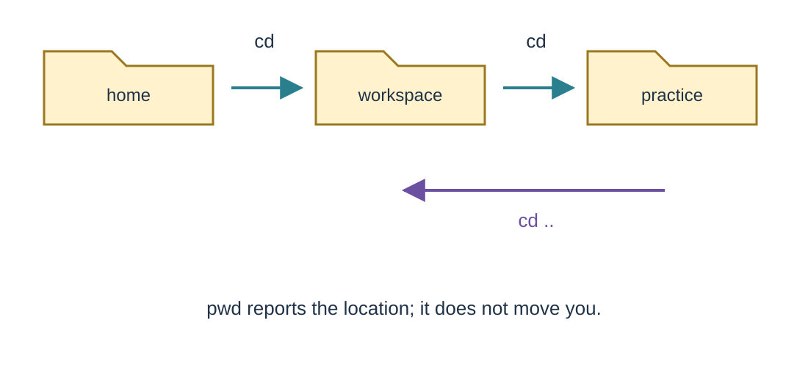
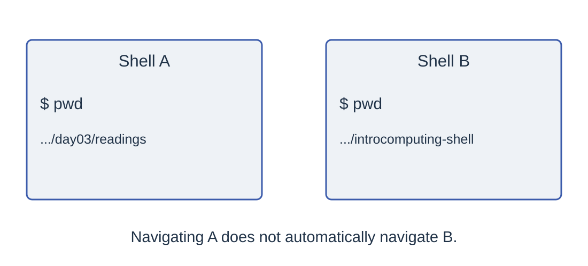

## About this lecture

Why type commands when you can click? Because the computers that hold large biological data, such as a sequencing facility's server or a university compute cluster, often have no desktop and no mouse. You log in and type. And a command you have written once can be repeated on 200 files instead of 200 rounds of clicking.

Today you will:

- open a terminal and read its prompt;
- ask where you are (`pwd`) and what is there (`ls`);
- create folders (`mkdir`) and move between them (`cd`);
- recover calmly when a command fails.

The folders are the same ones you clicked through on Days 1 and 2. We use these commands again on Day 4 and on the remote computer in week 5.

::: notes
Keep the motivation concrete: big data lives on remote Linux machines, and those are driven by typed commands. Do not promise that the terminal is faster for everything; for one file, clicking is fine. Windows students use Ubuntu, Mac students use Terminal, as on the setup page.
:::

## Same folders, another window

:::: {.columns}
::: {.column width="42%"}
- The **terminal** is a window where you type. The **shell** is the program that reads and runs what you type.
- Windows: open **Ubuntu**. Mac: open **Terminal**.
- Nothing new is stored. The terminal shows the same folders as the file manager, described in words instead of icons.
:::
::: {.column width="58%"}
{width="100%"}
:::
::::

::: notes
Show the workspace in both interfaces side by side. On Windows, Ubuntu has its own home folder, separate from the Windows Documents folder; this week we deliberately work in the Ubuntu home. The R project stays in Documents.
:::

## Read the prompt before typing

{height=300}

- The **prompt** (`anna@laptop:~$`, or ending in `%` on a Mac) means "ready". Do not type it.
- Then comes the **command** (`cd`), then its **argument**: what it acts on (`practice`).
- Press Enter to run it.

::: notes
The username in the prompt is only an example. Distinguish the command from its argument now. An option such as `-p` in `mkdir -p` changes how a command behaves; `-l` in `ls -l` asks for a longer listing.
:::

## Where am I? What is here?

:::: {.columns}
::: {.column width="52%"}
```text
$ cd
$ mkdir -p introcomputing-shell/practice
$ cd introcomputing-shell
$ pwd
/home/anna/introcomputing-shell
$ ls
practice
```
:::
::: {.column width="48%"}
- `cd` alone takes you to your **home** folder. It prints nothing.
- `mkdir -p` makes the folder `introcomputing-shell` and `practice` inside it. Also silent.
- `pwd` prints where you are now.
- `ls` lists what is here: the new `practice` folder.
:::
::::

Your path starts differently (`/Users/anna` on a Mac); it should **end** in `introcomputing-shell`.

::: notes
Pause after pwd and ask several students what their path ends with. The beginning differs per person; the end should be introcomputing-shell. Browser Downloads may be elsewhere: we are not working there. -p also means mkdir does not complain if the folder exists already.
:::

## Move down, and back up

:::: {.columns}
::: {.column width="45%"}
```text
$ cd practice
$ mkdir seedlings
$ mkdir observations
$ ls
observations  seedlings
$ cd seedlings
$ pwd
/home/anna/introcomputing-shell/practice/seedlings
$ cd ..
$ pwd
/home/anna/introcomputing-shell/practice
```
:::
::: {.column width="55%"}
{width="100%"}

`..` means the folder **one level up**; `~` means your home folder.
:::
::::

::: notes
Before each pwd, ask students to predict how the path will end. cd only moves into folders that already exist; it does not create anything.
:::

## Each window has its own location

:::: {.columns}
::: {.column width="42%"}
- `explorer.exe .` (Ubuntu on Windows) or `open .` (Mac) opens the current folder in the file manager. The `.` means "here".
- Clicking into a folder there does **not** move the terminal. Check with `pwd`.
- Two terminal windows can also stand in different folders.
:::
::: {.column width="58%"}
{width="100%"}
:::
::::

::: notes
Open a second terminal and run pwd in both. These opening commands are local conveniences; on a remote computer there is no file manager to open.
:::

## Silence often means success

:::: {.columns}
::: {.column width="42%"}
```text
$ cd observations
$ ls
$ pwd
/home/anna/introcomputing-shell/practice/observations
```

- `ls` in an empty folder prints **nothing**. The folder exists; it is just empty.
- Many commands, such as `mkdir`, print nothing when they work.
- A real problem prints a **message**: read it.
:::
::: {.column width="58%"}
{width="100%"}
:::
::::

::: notes
Run ls inside observations, then contrast with cd no-such-folder on the next slide. The terminal is not a chat: it does not confirm success unless asked.
:::

## When a command fails, you stay put

:::: {.columns}
::: {.column width="52%"}
```text
$ pwd
/home/anna/introcomputing-shell/practice
$ cd no-such-folder
bash: cd: no-such-folder: No such file or directory
$ pwd
/home/anna/introcomputing-shell/practice
$ cd Observations
bash: cd: Observations: No such file or directory
$ cd ~/introcomputing-shell
$ pwd
/home/anna/introcomputing-shell
```
:::
::: {.column width="48%"}
- The error names the folder it could not find. `pwd` shows you **did not move**.
- Capitals matter: the folder is `observations`, so `Observations` fails on Ubuntu.
- Lost? `cd ~/introcomputing-shell` brings you back from anywhere.
:::
::::

::: notes
A Mac with its default disk may accept Observations; match the real spelling anyway so work transfers. On a Mac with zsh the message reads "cd: no such file or directory: no-such-folder". Do not teach deleting or "repairing" anything to recover from a typo; ask "where am I and what is here?" (pwd, ls). The failed-cd.svg figure is no longer needed here; the session shows it.
:::

## Spaces split a name in two

:::: {.columns}
::: {.column width="45%"}
```text
$ mkdir field notes
$ ls
field  notes
$ mkdir "field notes"
$ ls
field  'field notes'  notes
```

- Without quotes the shell splits at the space: **two** folders.
- With quotes: **one** folder, `field notes`. (`ls` shows it in quotes.)
- Easier: names without spaces, such as `field-notes`.
:::
::: {.column width="55%"}
{width="100%"}
:::
::::

::: notes
Demonstrate only in the practice folder. Ask students how many folders each line creates before running it. Older systems print the spaced name without quotes.
:::

## Keys that save typing

- **Tab** completes a file or folder name. Type `cd pra`, press Tab.
- **Up arrow** brings back the previous command. Read it before pressing Enter.
- **Ctrl+C** stops a running command or clears a half-typed line. It does **not** copy.
- Copy and paste in the terminal: Ctrl+Shift+C / Ctrl+Shift+V (Ubuntu), Command+C / Command+V (Mac).

Tab completion also prevents typos: it only completes names that really exist.

::: notes
Show each key live. Students who press Ctrl+C to copy and see their command disappear will remember this slide.
:::

## Worked example: a route between neighbours

:::: {.columns}
::: {.column width="50%"}
The folders were made with `mkdir -p` beforehand.

```text
$ cd route-challenge/results/notes
$ pwd
/home/anna/introcomputing-shell/route-challenge/results/notes
$ cd ../../inputs
$ pwd
/home/anna/introcomputing-shell/route-challenge/inputs
```

`../../inputs`: up to `results`, up to `route-challenge`, then into `inputs`.
:::
::: {.column width="50%"}
{width="100%"}

A route only works from the folder it was written for, so write down the start too.
:::
::::

::: notes
This is the route challenge in the exercises. Have students draw the tree and predict before running. If they run the same route from a different folder it fails or lands somewhere else: that is the point.
:::

## Check yourself

1. You run `cd seedlings`. Did any file move?
2. `ls` prints nothing. Did it fail?
3. `cd Observations` gives an error. Where are you now?
4. Which of `pwd`, `ls`, `mkdir`, `cd` creates something?

::: notes
Answers: 1 no, only the shell's current folder changed; 2 no, the folder is empty (an error would print a message); 3 where you were before; 4 only mkdir. pwd and ls look, cd moves.
:::

## Summary

- The terminal shows the same folders as the file manager, in words.
- `pwd` tells you where you are; `ls` what is there.
- `mkdir` makes a folder; `cd` moves you (`..` up, `~` home). Moving changes nothing on disk.
- No output is often success; an error message tells you what went wrong, and you stay where you were.
- Quote names with spaces, or avoid spaces.

**Next (Day 4, inspect and unzip):** use the terminal to unpack an archive of laboratory files and look inside them.

**Now:** [open the Day 3 exercises](../../week1/03-terminal.qmd). Leave with the `introcomputing-shell` workspace and `navigation-notes.txt` in it: your `pwd` path, the route back from home, and three commands with their meanings.

::: notes
The exercises add a command log (prediction, result, correction) and a route challenge. Students who cannot yet return to their workspace from anywhere need help before Day 4.
:::
