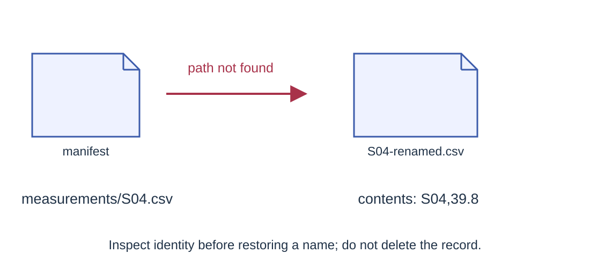

## About this lecture

A lab group sends you `lab-data.zip`: four seedling pots, two treated and two controls, one length measurement each. **Which samples were treated, and are they longer?** Data often arrive like this, as a ZIP of several files. Before any statistics you need to see what you received and pick out the right records.

Today you will:

- list and unpack a ZIP in the terminal;
- read the manifest that says which file belongs to which sample;
- pick out lines with `grep`, count them with a pipe, and save them with `>`;
- work on a copy, never on the original.

This is the last shell day. On Day 5 you meet R.

::: notes
The archive is a small, separate practice dataset (four pots), not the 24-plant dataset students will use in R. Keep the question in view all session: which pots are treated, and how long are they? Every command today answers part of that.
:::

## What is in the archive?

:::: {.columns}
::: {.column width="58%"}
```text
$ unzip -l lab-data.zip
Archive:  lab-data.zip
  Length      Date    Time    Name
---------  ---------- -----   ----
      309  1980-01-01 00:00   README.txt
       29  1980-01-01 00:00   measurements/S01.csv
       29  1980-01-01 00:00   measurements/S02.csv
       29  1980-01-01 00:00   measurements/S03.csv
       29  1980-01-01 00:00   measurements/S04.csv
      157  1980-01-01 00:00   samples.tsv
       37  1980-01-01 00:00   field-notes/day1.txt
       40  1980-01-01 00:00   field-notes/day7.txt
---------                     -------
      659                     8 files
```
:::
::: {.column width="42%"}
- `unzip -l` **lists** what is inside without unpacking anything.
- 8 files: a README, a manifest `samples.tsv`, four measurement files, and two field notes.
- Look before you unpack: you now know what you received and where each file will end up.
:::
::::

::: notes
First copy the browser download into ~/introcomputing-shell with the file manager (explorer.exe . on Ubuntu/Windows, open . on Mac); Downloads is not the terminal's workspace. The dates are 1980 because the archive was built with fixed timestamps; ignore them.
:::

## Unpack it into its own folder

:::: {.columns}
::: {.column width="55%"}
```text
$ unzip lab-data.zip -d lab-data
Archive:  lab-data.zip
  inflating: lab-data/README.txt
  inflating: lab-data/measurements/S01.csv
  ...
$ cd lab-data
$ ls
field-notes  measurements  README.txt  samples.tsv
$ cat README.txt
SIMULATED LAB-GROUP DATA
Four independent seedling pots, two control and
two nutrient-treated. ... Lengths are millimetres.
```
:::
::: {.column width="45%"}
{width="100%"}

`-d lab-data` names the folder. The ZIP itself stays as it was.
:::
::::

::: notes
Read the README aloud: four pots, lengths in mm after seven days. If unzip asks to replace files, answer n and extract to a fresh folder name. less README.txt works too (press q to leave); cat is simpler for a short file.
:::

## The manifest: which file belongs to which sample

:::: {.columns}
::: {.column width="55%"}
```text
$ cat samples.tsv
sample_id   treatment   file
S01         control     measurements/S01.csv
S02         control     measurements/S02.csv
S03         treated     measurements/S03.csv
S04         treated     measurements/S04.csv
$ wc -l samples.tsv
5 samples.tsv
```
:::
::: {.column width="45%"}
- The first line is a **header** naming the columns. Columns are separated by tabs (a TSV file).
- Each other line is one sample, with its group and the file holding its measurement.
- `wc -l` counts **5 lines**: the header plus **4 samples**.
:::
::::

::: notes
Ask before running wc -l: how many lines? Students often say 4. The header is not a sample. A CSV is the same idea with commas. For a long file, head -n 3 samples.tsv shows just the start.
:::

## Which samples were treated?

:::: {.columns}
::: {.column width="55%"}
```text
$ grep -F treated samples.tsv
S03         treated     measurements/S03.csv
S04         treated     measurements/S04.csv
```

{width="100%"}
:::
::: {.column width="45%"}
- `grep` prints only the lines that contain the text `treated`.
- `-F` means: search for exactly these letters.
- Answer: **S03 and S04**. The header and the control lines are not printed.
:::
::::

::: notes
Point out that grep does not know about columns; it just looks for the letters t-r-e-a-t-e-d anywhere on the line. We test that limit in two slides.
:::

## Count with a pipe, save with `>`

:::: {.columns}
::: {.column width="55%"}
```text
$ grep -F treated samples.tsv | wc -l
2
$ grep -F treated samples.tsv > treated-samples.txt
$ cat treated-samples.txt
S03         treated     measurements/S03.csv
S04         treated     measurements/S04.csv
```
:::
::: {.column width="45%"}
{width="100%"}

- `|` sends grep's lines into `wc -l`: **2**.
- `>` sends them into a file instead; `cat` shows it. `>` **replaces** an existing file, so never write to your input.
:::
::::

::: notes
Ask which file changed: only the new one. Do not demonstrate input = output on real files; just explain the danger.
:::

## `grep` matches text, not meaning

:::: {.columns}
::: {.column width="55%"}
Suppose S01 had been labelled `untreated`:

```text
$ grep -F treated search-trap.tsv
S01         untreated   measurements/S01.csv
S03         treated     measurements/S03.csv
S04         treated     measurements/S04.csv
```
:::
::: {.column width="45%"}
- `untreated` contains the letters `treated`, so S01 is selected too, and the count would be **3**.
- grep cannot know what a word means.
- Always look at the lines it selected, not only at the number.
:::
::::

::: notes
Students make this trap file themselves in the exercises, on a copy (search-trap.tsv). The real manifest still gives 2.
:::

## Are the treated seedlings longer?

:::: {.columns}
::: {.column width="45%"}
```text
$ cat measurements/S01.csv
sample_id,length_mm
S01,32.1
$ cat measurements/S03.csv
sample_id,length_mm
S03,42.4
```

Doing the same for all four: controls **32.1** and **35.2** mm, treated **42.4** and **39.8** mm.
:::
::: {.column width="55%"}
{width="100%"}
:::
::::

Both treated pots are longer, but two pots per group is a hint, not yet a result.

::: notes
The file column of the manifest gives each path. Units come from the README, not from the file. With so few pots we cannot conclude much; the 24-plant dataset in week 2 and the comparisons in week 4 address the question properly.
:::

## Work on a copy

:::: {.columns}
::: {.column width="55%"}
```text
$ mkdir working
$ cp samples.tsv working/samples-copy.tsv
$ mv working/samples-copy.tsv working/manifest-practice.tsv
$ ls working
manifest-practice.tsv
$ ls
field-notes  measurements  README.txt
samples.tsv  treated-samples.txt  working
```
:::
::: {.column width="45%"}
{width="100%"}

- `cp` copies, `mv` renames. They print nothing when they work, so check with `ls`.
- The original `samples.tsv` is unchanged.
:::
::::

::: notes
Ask which files exist after each line. Students then write working/observations.txt with today's answers.
:::

## When a listed file is missing

:::: {.columns}
::: {.column width="58%"}
```text
$ head measurements/S04.csv
head: cannot open 'measurements/S04.csv' for
reading: No such file or directory
$ ls measurements
S01.csv  S02.csv  S03.csv  S04-renamed.csv
$ cat measurements/S04-renamed.csv
sample_id,length_mm
S04,39.8
```
:::
::: {.column width="42%"}
{width="100%"}

- The manifest promises `S04.csv`; someone renamed it. The contents confirm it is S04, so restore the name with `mv`.
:::
::::

::: notes
In the exercise students rename the file themselves in a copied folder (received-check), so they know the cause. The point: a manifest says what should be there; check that the files really are.
:::

## Summary

- `unzip -l` to look, `unzip -d` to unpack into a named folder.
- The manifest has **5 lines**: a header and **4 samples**.
- `grep -F` picks lines by text: **2** treated, S03 and S04. Check the lines, not just the count.
- `|` passes output on; `>` saves it and replaces the destination.
- Work on copies; the original data stay untouched.

**Next (Day 5, meet R):** open the course project in RStudio and run a first calculation and plot.

**Now:** [open the Day 4 exercises](../../week1/04-inspect-archive.qmd). Leave with `treated-samples.txt`, `working/manifest-practice.tsv` and `working/observations.txt`.

::: notes
An optional exercise repeats the same commands on an organic-laboratory inventory (which samples are labelled ester? O02 and O03). Make sure everyone can find their extracted lab-data folder before leaving.
:::
