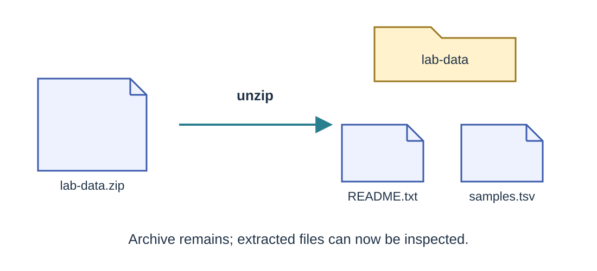
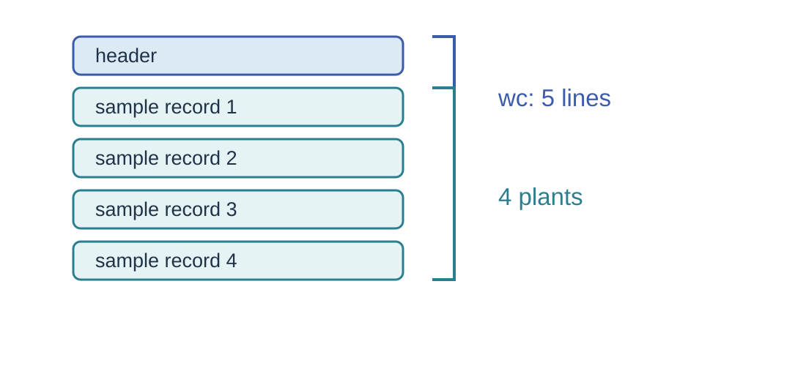
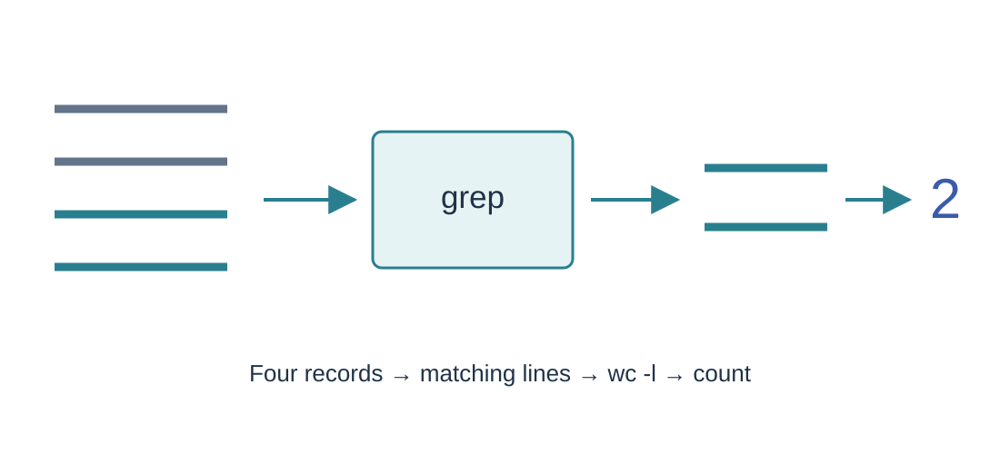
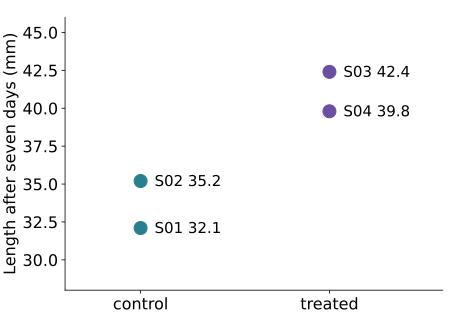
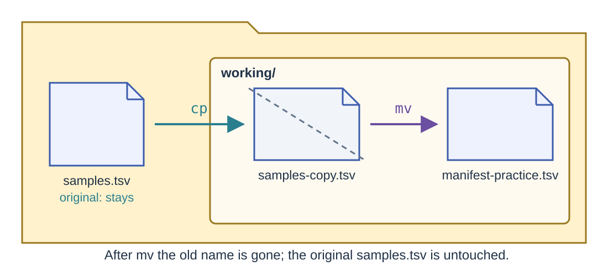

## About this lecture

A lab group sends you `lab-data.zip`: four seedling pots, two treated and two controls, one length measurement each. **Which samples were treated, and are they longer?** Data often arrive like this, as a ZIP of several files. Before any statistics you need to see what you received and pick out the right records.

Today you will:

- list and unpack a ZIP in the terminal;
- read the manifest that says which file belongs to which sample;
- pick out lines with `grep`, count them with a pipe, and save them with `>`;
- work on a copy, never on the original.

This is the last shell day. On Day 5 you meet R.

::: notes
The archive is a small, separate practice dataset (four pots), not the 24-plant dataset students will use in R. Keep the question in view all session: which pots are treated, and how long are they? Every command today answers part of that.
:::

## What is in the archive?

:::: {.columns}
::: {.column width="45%"}
```bash
unzip -l lab-data.zip
unzip lab-data.zip -d lab-data
cd lab-data
less README.txt
```

- `-l` **lists** without unpacking.
- `-d lab-data` names the folder to unpack into.
- The ZIP stays as it was. Press **q** to leave `less`.
:::
::: {.column width="55%"}
{width="100%"}
:::
::::

::: notes
First copy the browser download into ~/introcomputing-shell with the file manager (explorer.exe . on Ubuntu/Windows, open . on Mac); Downloads is not the terminal's workspace. Read the README aloud: four pots, lengths in mm after seven days. If unzip asks to replace files, answer n and extract to a fresh folder name.
:::

## The manifest links samples to files

:::: {.columns}
::: {.column width="45%"}
```bash
head -n 3 samples.tsv
wc -l samples.tsv
```

- One header line names the columns: `sample_id`, `treatment`, `file`.
- `wc -l` prints **5**: header + **4 samples**.
- Columns are separated by tabs (TSV).
:::
::: {.column width="55%"}
{width="100%"}
:::
::::

::: notes
Ask before running wc -l: how many lines? Students often say 4. The header is not a sample. A CSV is the same idea with commas.
:::

## Which samples were treated?

{height=330}

```bash
grep -F treated samples.tsv
```

`grep` prints the lines that contain the text. `-F` means plain text, not a pattern. Answer: **S03 and S04**.

::: notes
The header and the control lines are not printed. Point out that grep does not know about columns; it just looks for the letters t-r-e-a-t-e-d anywhere on the line. We test that limit in two slides.
:::

## Count with a pipe, save with `>`

:::: {.columns}
::: {.column width="50%"}
```bash
grep -F treated samples.tsv | wc -l
grep -F treated samples.tsv > treated-samples.txt
```

- `|` passes grep's lines to `wc -l`: **2**.
- `>` writes them into a new file. The manifest is unchanged.
- `>` **replaces** what was in the file. Never write to the input: `> samples.tsv` can empty it.
:::
::: {.column width="50%"}
{width="100%"}
:::
::::

::: notes
Open treated-samples.txt with less: two lines and no header. Ask which file changed (only the new one). Do not demonstrate input = output on real files; just explain the danger.
:::

## `grep` matches text, not meaning

{height=330}

If S01 were labelled `untreated`, the count would be **3**: `untreated` contains `treated`. Look at the lines selected, not only at the number.

::: notes
Students make this trap file themselves in the exercises, on a copy (search-trap.tsv). The real manifest still gives 2. This is the main reason to print the lines before counting.
:::

## Are the treated seedlings longer?

:::: {.columns}
::: {.column width="45%"}
```bash
head measurements/S03.csv
head measurements/S01.csv
```

| Sample | Group | Length (mm) |
|---|---|---|
| S01 | control | 32.1 |
| S02 | control | 35.2 |
| S03 | treated | 42.4 |
| S04 | treated | 39.8 |

Both treated pots are longer. Two pots per group is a hint, not yet a result.
:::
::: {.column width="55%"}
{width="100%"}
:::
::::

::: notes
The file column of the manifest gives each path. Units come from the README, not from the file. With so few pots we cannot conclude much; the 24-plant dataset in week 2 and the comparisons in week 4 address the question properly.
:::

## Work on a copy

{height=320}

```bash
mkdir working
cp samples.tsv working/samples-copy.tsv
mv working/samples-copy.tsv working/manifest-practice.tsv
```

`cp` copies, `mv` renames or moves. Both silently replace an existing file with the same name.

::: notes
Ask which files exist after each line. The original stays; only the copy is renamed. Students then write working/observations.txt with today's answers.
:::

## When a listed file is missing

:::: {.columns}
::: {.column width="45%"}
- The manifest lists `measurements/S04.csv`, but the folder has `S04-renamed.csv`.
- `head measurements/S04.csv` fails: *No such file or directory*.
- Look inside: it contains `S04,39.8`. Now you know it is S04 and can restore the name with `mv`.
- If the contents did not tell you, ask the lab group rather than guess.
:::
::: {.column width="55%"}
{width="100%"}
:::
::::

::: notes
In the exercise students rename the file themselves in a copied folder (received-check), so they know the cause. The point: a manifest says what should be there; check that the files really are.
:::

## Summary

- `unzip -l` to look, `unzip -d` to unpack into a named folder.
- The manifest has **5 lines**: a header and **4 samples**.
- `grep -F` picks lines by text: **2** treated, S03 and S04. Check the lines, not just the count.
- `|` passes output on; `>` saves it and replaces the destination.
- Work on copies; the original data stay untouched.

**Next (Day 5, meet R):** open the course project in RStudio and run a first calculation and plot.

**Now:** [open the Day 4 exercises](../../week1/04-inspect-archive.qmd). Leave with `treated-samples.txt`, `working/manifest-practice.tsv` and `working/observations.txt`.

::: notes
An optional exercise repeats the same commands on an organic-laboratory inventory (which samples are labelled ester? O02 and O03). Make sure everyone can find their extracted lab-data folder before leaving.
:::
