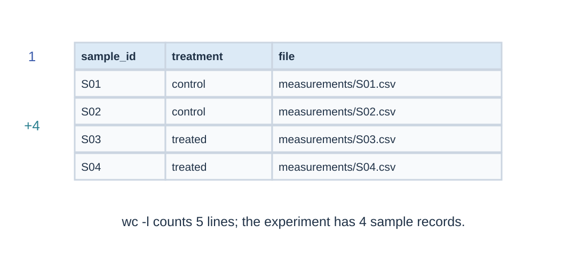
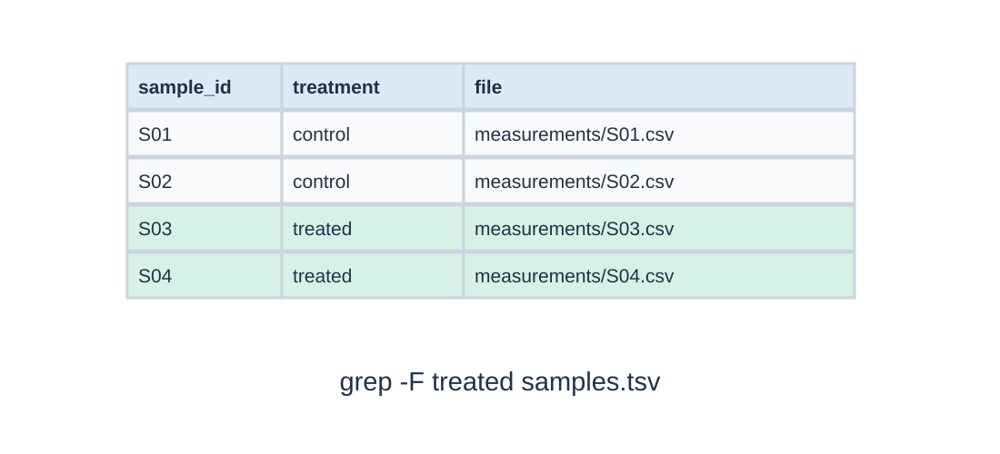
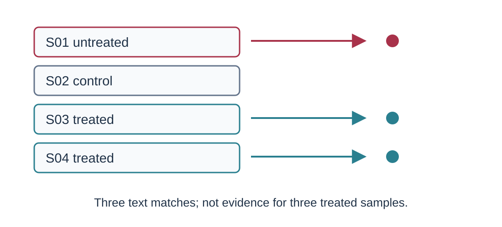
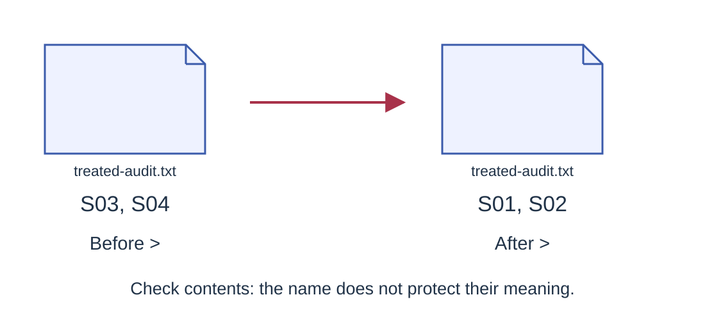

## Four samples, one manifest

{height=390}

This small simulated shell dataset is separate from the 24-plant R dataset.

::: notes
Read a manifest as a list of what is present. IDs connect metadata to measurements. The file paths locate measurements, while the README supplies their meaning and units. Distinguish four sample records from five text lines before discussing any command count.
:::

## An archive is a package of files

{height=390}

Copy the downloaded ZIP into the shell workspace deliberately.

::: notes
On Windows the browser download is not automatically in Ubuntu. Open the shell workspace graphically and copy the file. On Mac use the same explicit location check. In a remote environment, use the provided transfer route; no login hostname is assumed here.
:::

## Inspect first; extract to a known destination

```bash
unzip -l lab-data.zip
unzip lab-data.zip -d lab-data
cd lab-data
less README.txt
```

`-l` lists; `-d` names the extraction destination. Press **q** to leave `less`.

::: notes
The archive has four measurement files and supporting notes. If extraction asks to overwrite, inspect the existing destination and choose a fresh folder rather than automatically replacing work. These commands do not remove the original ZIP. Keep the command sequence tied to the current working directory.
:::

## Text search selects matching lines

{height=390}

```bash
grep -F treated samples.tsv
```

::: notes
-F requests literal text matching. The prepared file has control and treated labels; its header does not include treated. Explain that untreated would also contain treated, so grep does not understand treatment allocation or table columns. Inspect selected lines before interpreting them.
:::

## A pipe connects the outputs and inputs

{height=390}

```bash
grep -F treated samples.tsv | wc -l
```

::: notes
The pipe passes matching lines directly to the next program. wc -l counts newline-terminated lines, which represent records in this controlled file. No intermediate saved file is required. Ask students to predict 2 before running it, and compare with wc -l samples.tsv, which returns 5 including the header.
:::

## Redirection writes a separate output

```bash
grep -F treated samples.tsv > treated-samples.txt
less treated-samples.txt
```

- The manifest is read; the extract is written.
- `>` replaces existing contents at the destination.
- Never use the input filename as this destination.

::: notes
Students should explain which file changed. A text extract is not a full replacement manifest because it lacks the nonmatching header and control records. Show it in the file manager. Treat redirection as a concrete write action, not punctuation to memorise.
:::

## Work through one sample and one copy

```bash
head measurements/S03.csv
mkdir working
cp samples.tsv working/samples-copy.tsv
mv working/samples-copy.tsv working/manifest-practice.tsv
```

Which original files should still be present?

::: notes
The original archive and manifest remain. Only the practice copy is renamed. The S03 measurement file has one observed length; find its units in README. cp and mv may replace a destination, so inspect the names before running. Ask students to identify S04's path without copying the S03 line blindly.
:::

## A substring does not understand a treatment

{height=350px}

Test a search against known records before trusting its count.

::: notes
The student makes search-trap.tsv from a copy, changes S01 to untreated, and preserves the real manifest. That trap gives three matches, not evidence for three treated biological samples. The baseline fixture remains two treated records.
:::

## Inspect selected IDs, not just a number

```bash
grep -F treated samples.tsv
grep -F treated samples.tsv | wc -l
```

A correct count is not proof that the right lines were selected.

::: notes
Compare the same two commands on the trap copy. Explain -F literal matching. This is not a full table query language and should not replace structured data checks later in R.
:::

## A line count depends on the file structure

{height=350px}

Headers name fields; they are not an additional sample.

::: notes
Use the actual manifest with a final newline. wc -l counts newline characters, not an abstract number of biological observations. A CSV may contain quoted embedded newlines in general; this controlled TSV has one record per line, which makes the simple count valid here.
:::

## Follow a manifest path to a measurement

Read S04’s listed path, then locate its file.

What if the record is present but the file has been renamed?

Investigate the file discrepancy using the manifest and source.

::: notes
The independent exercise deliberately renames S04.csv only in a disposable received-check copy. The contents still identify S04 and length39.8mm. The manifest is an index of intended paths; it does not guarantee files currently occupy them.
:::

## A filename can outlive its correct meaning

{height=350px}

Read the saved output after writing it.

::: notes
Use the disposable treated-audit.txt experiment, retaining an extract-backup.txt. Show that > overwrites rather than appends. Never demonstrate input=output truncation on raw course data; explain the hazard without creating it.
:::

## Why input and output paths must differ

Unsafe pattern — **do not run**:

```text
grep -F treated samples.tsv > samples.tsv
```

The shell may truncate the destination before grep reads its input.

::: notes
Make the sequence explicit: the shell prepares output redirection, then starts the program. No deletion command is needed to lose data. A reproducible workflow preserves raw inputs and uses distinct informative output paths.
:::

## A discrepancy needs evidence before repair

{height=350px}

Use the deliberately known rename as evidence to restore its path.

::: notes
This does not establish a general rule to rename any nearby file to whatever is missing. Real ambiguous identities require source records or advice. Ask students to record the discrepancy, supporting evidence, repair, and verification in audit.txt.
:::

## Audit the recovered copy

Keep:

- Original source archive and manifest.
- Search command and selected IDs.
- The discrepancy and supported repair.
- A checked output and explanation of the units.

::: notes
The source archive still contains the original known fixture. The exercise ends with students locating the restored measurement from the manifest and explaining why line counts alone were insufficient. Record current computer and extraction location.
:::

## Save an inspection someone can explain

[Open the exercises](../../week1/04-inspect-archive.qmd).

Keep the selected records, a practice manifest, and `working/observations.txt`.

Explain **5 lines**, **4 samples**, and **2 treated records** in your own words.

::: notes
The practical also introduces the local/remote distinction via a teacher demonstration when access is ready. If service accounts are pending, complete the local file exercises and return to remote access when details are supplied.
:::
