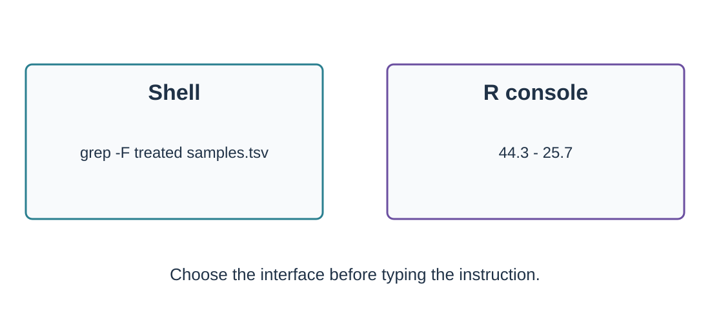

## A package should contain the useful files

{height=390}

First make the ordinary folder understandable; then archive it.

::: notes
Today consolidates the previous days rather than introducing a new shell language. The working folder contains findings explaining the question and selected sample records. A ZIP should be outside the folder being archived. It is a transport package, not proof that its contents are correct.
:::

## A copy and a rename do different things

{height=390}

Check source and destination names before running either command.

::: notes
Ask which entries exist after cp, then after mv. The drawing isolates each operation; the practical uses course files. Changes to the ordinary report folder do not automatically change a previously created archive. Repackage after revisions.
:::

## Test the ZIP by making the return trip

From the folder containing `report/`:

```bash
zip -r report-bundle.zip report/
unzip -l report-bundle.zip
unzip report-bundle.zip -d check-report
```

Open the extracted files and check that the findings make sense.

::: notes
Explain -r as including folder contents, including nested folders. The extraction destination should be fresh. Inspect the resulting tree rather than assuming extraction put findings directly in check-report; the report folder itself is included. A same-disk archive is not a backup against losing the laptop.
:::

## Remote access and file transfer are separate

{height=390}

Always name the computer that holds the file or runs the command.

::: notes
This is a conceptual preview; actual service settings remain pending. SSH gives a terminal and remote desktop a graphical workspace. Neither automatically synchronises Downloads. Do not imply that all processes survive disconnection. Use the supported course route when available.
:::

## Transfer the same skill to another lab record

Optional choice: inspect `organic-lab.zip` and its supplied inventory.

```bash
grep -F ester inventory.tsv
grep -F ester inventory.tsv | wc -l
```

Two records match: **O02 and O03**. No chemistry classification is required.

::: notes
Students choose this instead of one partner transfer check, not as extra compulsory work. The sample classes are already assigned labels. Searching ester is a text operation, not identification from a molecular structure. The archive also contains a later numerical practice table; no need to analyse it today.
:::

## Shell commands and R expressions differ

{height=390}

Ask “which interface is waiting?” before typing.

::: notes
Open RStudio only after students can explain the shell task. Its Console accepts R, while its editor holds a saved script or report. Windows students will use native RStudio in the extracted project, not assume that R is installed inside Ubuntu. Keep the two working locations explicit.
:::

## One biological calculation in R

In the **R Console**:

```r
44.3 - 25.7
```

P01 grew **18.6 mm** between the two measurements.

Saving the instructions will let us repeat that calculation tomorrow.

::: notes
The numbers come from the complete 24-plant R dataset, not the four-record shell archive. Do not type the Console prompt. [1] in printed output labels the first element; it is not part of the measurement. Demonstrate a supplied report briefly to show where these skills lead without teaching its syntax yet.
:::

## Finish with a clear handover

[Open the practical and notes](../../week1/05-lab-files.qmd).

- Retain the ordinary report folder and a tested `report-bundle.zip`.
- Explain which files were inputs and which were derived.
- Follow the R/RStudio setup guide if installation support is needed.

::: notes
Ask students to find all the relevant files after closing their windows. Save the optional ester extract if that route was chosen. Leave enough time for unresolved file-location problems; those are prerequisites for next week's R work.
:::
