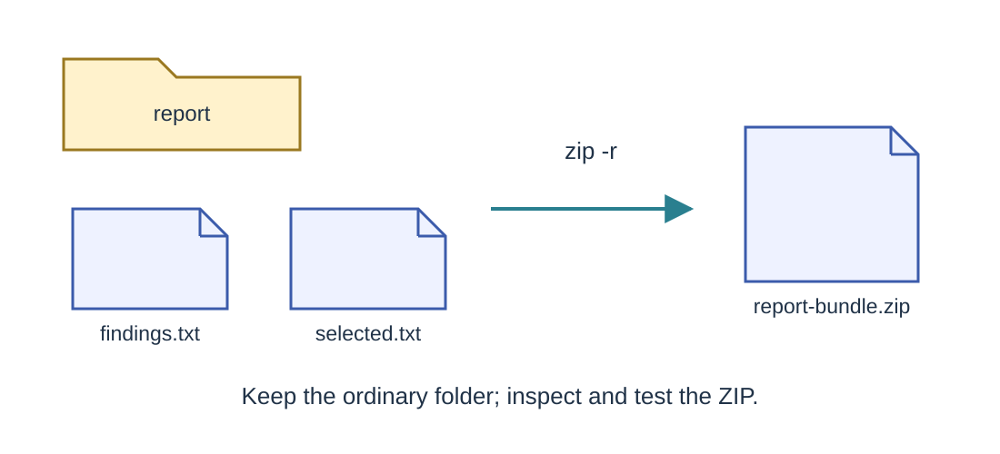
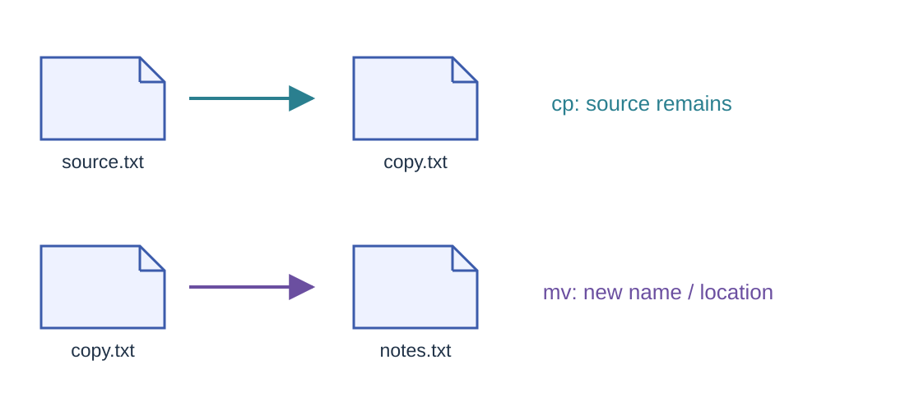
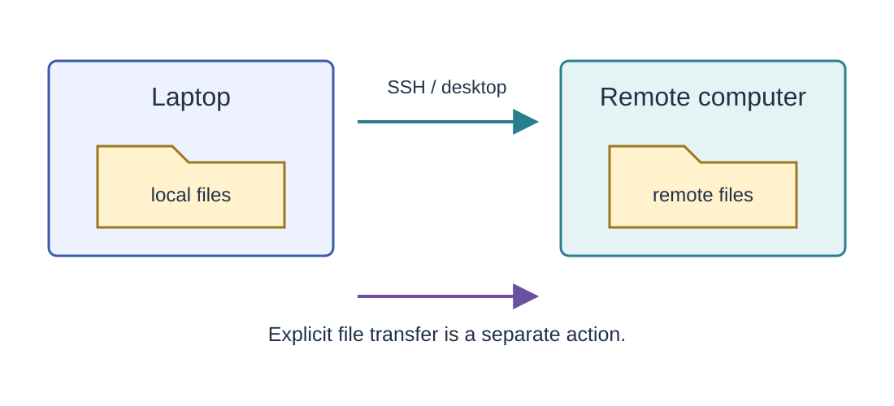
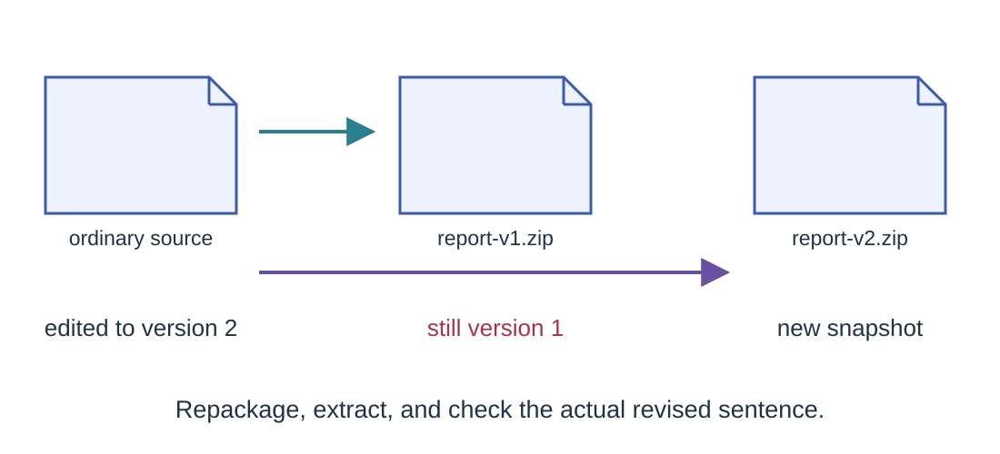
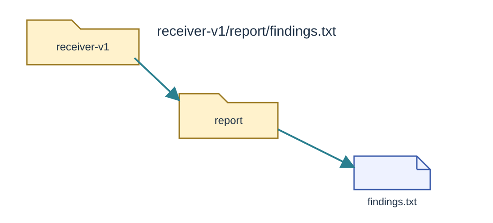
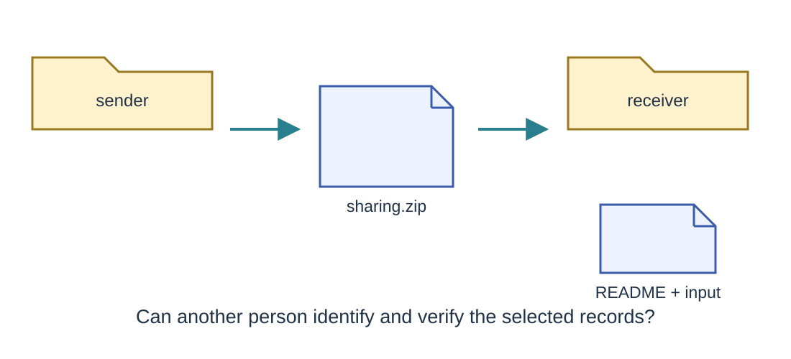
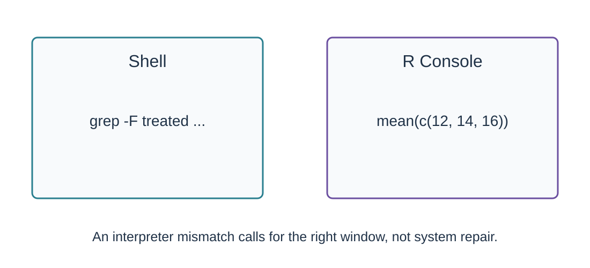

## A package should contain the useful files

{height=390}

First make the ordinary folder understandable; then archive it.

::: notes
Today consolidates the previous days rather than introducing a new shell language. The working folder contains findings explaining the question and selected sample records. A ZIP should be outside the folder being archived. It is a transport package, not proof that its contents are correct.
:::

## A copy and a rename do different things

{height=390}

Check source and destination names before running either command.

::: notes
Ask which entries exist after cp, then after mv. The drawing isolates each operation; the practical uses course files. Changes to the ordinary report folder do not automatically change a previously created archive. Repackage after revisions.
:::

## Test the ZIP by making the return trip

From the folder containing `report/`:

```bash
zip -r report-bundle.zip report/
unzip -l report-bundle.zip
unzip report-bundle.zip -d check-report
```

Open the extracted files and check that the findings make sense.

::: notes
Explain -r as including folder contents, including nested folders. The extraction destination should be fresh. Inspect the resulting tree rather than assuming extraction put findings directly in check-report; the report folder itself is included. A same-disk archive is not a backup against losing the laptop.
:::

## Remote access and file transfer are separate

{height=390}

Always name the computer that holds the file or runs the command.

::: notes
This is a conceptual preview; actual service settings remain pending. SSH gives a terminal and remote desktop a graphical workspace. Neither automatically synchronises Downloads. Explain that process behaviour after disconnection depends on how it was started. Use the supported course route when available.
:::

## Transfer the same skill to another lab record

Optional choice: inspect `organic-lab.zip` and its supplied inventory.

```bash
grep -F ester inventory.tsv
grep -F ester inventory.tsv | wc -l
```

Two records match: **O02 and O03**.

::: notes
Students choose this or the seedling file-route check. The sample classes are already assigned labels. Searching ester is a text operation, not identification from a molecular structure. The archive also contains a later numerical practice table; no need to analyse it today.
:::

## Shell commands and R expressions differ

{height=390}

Ask “which interface is waiting?” before typing.

::: notes
Open RStudio only after students can explain the shell task. Its Console accepts R, while its editor holds a saved script or report. Windows students will use native RStudio in the extracted project, not assume that R is installed inside Ubuntu. Keep the two working locations explicit.
:::

## One biological calculation in R

In the **R Console**:

```r
44.3 - 25.7
```

P01 grew **18.6 mm** between the two measurements.

Saving the instructions will let us repeat that calculation tomorrow.

::: notes
The numbers come from the complete 24-plant R dataset, not the four-record shell archive. Type the expression after the Console prompt. [1] in printed output labels the first element; it is not part of the measurement. Demonstrate a supplied report briefly to show where these skills lead without teaching its syntax yet.
:::

## A ZIP is a snapshot

{height=350px}

Editing a source folder does not update an existing archive.

::: notes
Create v1, extract and inspect it; revise the ordinary note; inspect v1 again before packaging v2. The change must be recognisable in contents, not only a renamed archive. This is file version discipline, not a Git topic.
:::

## What must the receiver know?

A README should identify:

- The source and what each included file does.
- What one record represents and its units.
- Which selection was performed.
- Any input the receiver still needs.

::: notes
Students should close the source windows and identify a selected sample using only the extracted README and files. A shortcut is not the target dataset. If the raw source is not included, the receipt must give its actual available source rather than pretending the package is complete.
:::

## Extraction can add another folder level

{height=350px}

Inspect the extracted tree before constructing a path.

::: notes
The folder name inside the archive is preserved. A new extraction destination is outside it, so an additional level is expected. This connects the archive exercise to the extra wrapper folder sometimes created when the course project is downloaded.
:::

## Keep the archive outside what it packages

```bash
zip -r report-v2.zip report/
unzip -l report-v2.zip
unzip report-v2.zip -d receiver-v2
```

Run from the folder containing report/.

::: notes
The package should not contain itself. When source changes, create a fresh named snapshot rather than assuming an old ZIP is live. The receiver test checks ordinary extracted files, not merely an archive listing.
:::

## Test the handover from a new location

{height=350px}

The receiver’s successful check is stronger evidence than your own familiar view.

::: notes
A single laptop copy tests portability but not all cross-machine software differences. If remote transfer is available, identify the supported direction and destination. Distinguish testing another local folder from transferring between computers.
:::

## Find the stale copy before recalculating

The extracted copy lacks your correction.

What would you ask first?

Check the archive version, extraction folder, and actual note contents.

::: notes
A missing revision can be a location/version problem rather than an editing failure. Have students compare v1 and v2 contents and record the correction sentence in handover-check.txt. Use distinct version names and a change note to identify the current package.
:::

## The interpreter matters too

{height=350px}

The wrong window needs a changed context, not system repair.

::: notes
Classify pwd, grep, unzip as shell commands, and arithmetic/mean as R. Run 44.3 − 25.7 = 18.6 and mean(c(12, 14, 16)) = 14 in R if setup works. Keep Windows native RStudio and local Ubuntu workspace separate.
:::

## Explain what was actually reproduced

A receiver can identify the selection and inspect the saved records.

What would they still need to recompute a future report?

Keep a source/input/output distinction in the receipt.

::: notes
The current week5 R work has not happened yet; students are meeting R, not required to construct a report from scratch today. The ordinary source files, data dictionary and later R code will make calculations repeatable. A screenshot or HTML alone is not the complete recipe.
:::

## Finish with a clear handover

[Open the exercises](../../week1/05-lab-files.qmd).

- Retain the ordinary report folder and a tested `report-bundle.zip`.
- Explain which files were inputs and which were derived.
- Follow the R/RStudio setup guide if installation support is needed.

::: notes
Ask students to find all the relevant files after closing their windows. Save the optional ester extract if that route was chosen. Resolve file-location problems before starting next week's R work.
:::
