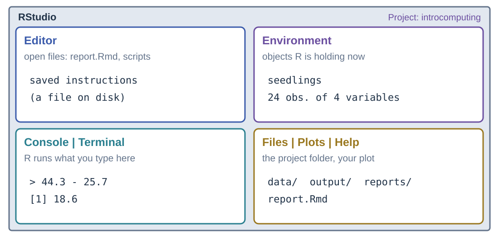
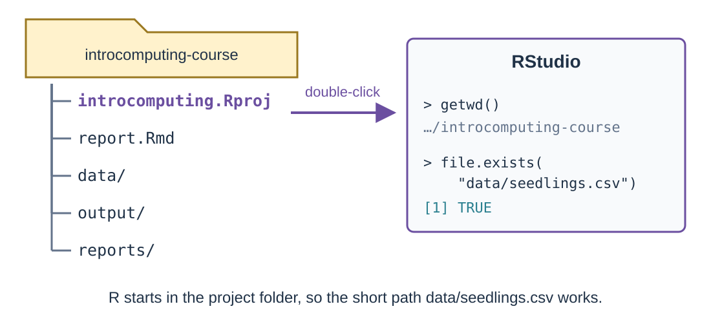
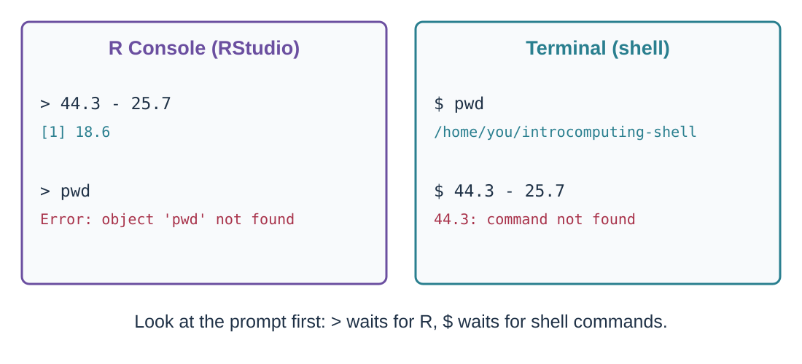
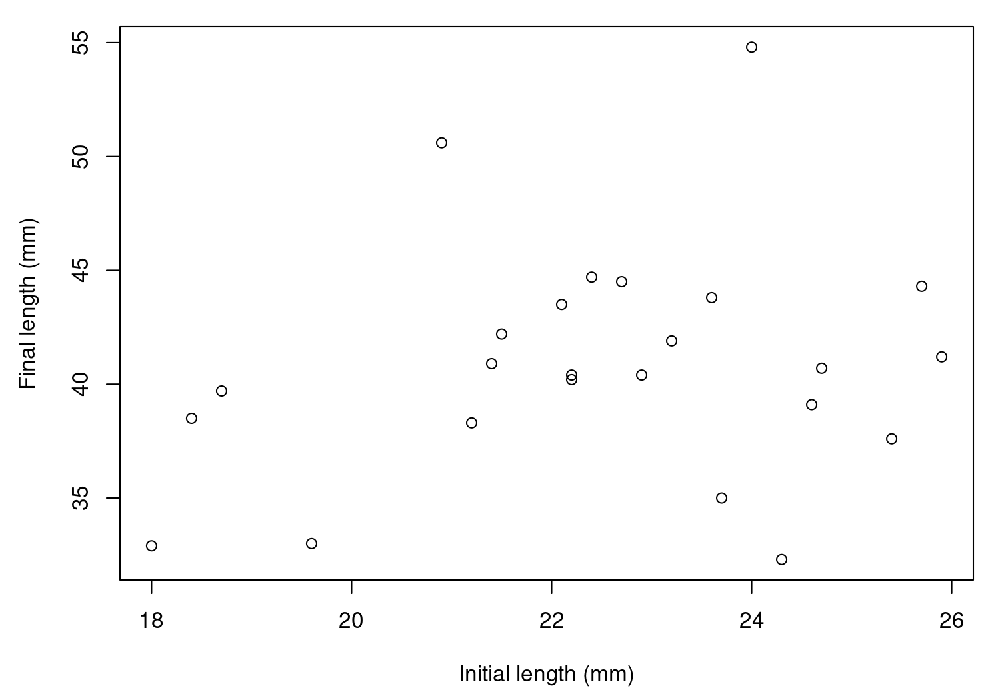
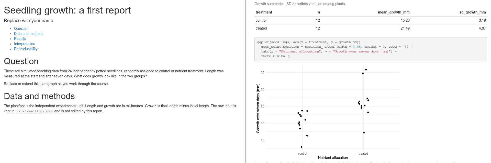
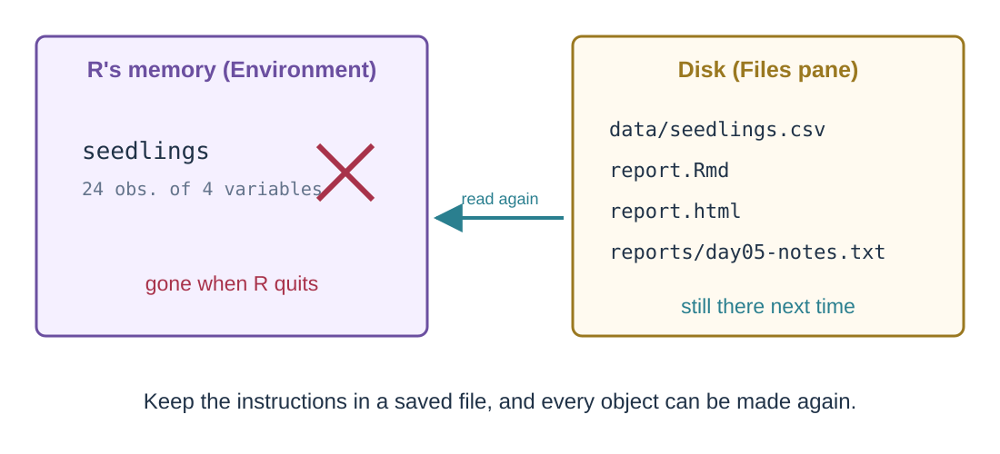

## About this lecture

You now have 24 seedlings in a file. Did the treated ones grow more? A spreadsheet can answer that once. But you will measure again next season, and your supervisor will ask how you got the number. From next week, **R** does the calculations and keeps the instructions, so the answer can be made again.

Today you will:

- open the course project in RStudio and find your way around its window;
- tell the R Console apart from the terminal;
- run a first calculation and a supplied plot;
- watch a finished report being made from saved files.

This is an orientation day. Day 6 explains R step by step.

::: notes
Keep it light. Students do not need to understand the code today; they need to know where to type and where to look. The motivation is the same as on day 1: results should come from saved files that you can find and use again. If someone has not installed R/RStudio yet, they follow along and use the setup page before day 6.
:::

## Two programs: R and RStudio

:::: {.columns}
::: {.column width="42%"}
- **R** calculates.
- **RStudio** is the window you work in. It starts R for you.
- Four panes: **Editor**, **Console**, **Environment**, **Files / Plots / Help**.
- The Editor shows saved *files*. The Console is a *conversation* with R.
:::
::: {.column width="58%"}
{width="100%"}
:::
::::

::: notes
Open RStudio on the projector and point at each pane in turn. The arrangement can be changed, so name panes by their job. The Editor only appears once a file is open.
:::

## Open the course project

:::: {.columns}
::: {.column width="42%"}
1. Open your extracted `introcomputing-course` folder.
2. Double-click `introcomputing.Rproj`.
3. Top right should say `introcomputing`.

R now works *inside* this folder, so `data/seedlings.csv` is found: the relative paths from Day 2.
:::
::: {.column width="58%"}
{width="100%"}
:::
::::

::: notes
Demonstrate from the file manager, not from RStudio's recent list. Type getwd() and file.exists("data/seedlings.csv") in the Console. If a student gets FALSE: check the project name in the corner; look for a ZIP preview or an extra nested folder level, as on day 1.
:::

## Console or terminal? Look at the prompt

{height=360}

`>` waits for R. `$` waits for the shell. An error in the wrong window means *move the instruction*, not *the computer is broken*.

::: notes
RStudio also has a Terminal tab next to the Console. It is a shell, like the one from days 3 and 4 (on Windows it may not be the Ubuntu shell). In this course R goes in the Console; shell commands stay in the usual terminal. Let students deliberately type pwd in the Console once to see the message.
:::

## A first calculation

:::: {.columns}
::: {.column width="50%"}
In the **Console**:

```r
44.3 - 25.7
```
```
[1] 18.6
```

P01 grew from 25.7 mm to 44.3 mm: **18.6 mm**.
:::
::: {.column width="50%"}
- `[1]` marks the first value printed. It is not part of the answer.
- A `+` prompt means R waits for the rest. Finish the line, or press **Esc**.
- Try P02: 32.3 − 24.3 gives `8`.
:::
::::

::: notes
Everyone types this, not only watches. Then show the + prompt by typing "44.3 -" and Enter, and how Esc brings back >. Numbers are from data/seedlings.csv (simulated).
:::

## A supplied plot of all 24 seedlings

:::: {.columns}
::: {.column width="45%"}
```r
seedlings <- read.csv("data/seedlings.csv")
plot(seedlings$initial_mm, seedlings$final_mm,
     xlab = "Initial length (mm)",
     ylab = "Final length (mm)")
```

- One point per plant: 24 points.
- `seedlings` appears in **Environment**: 24 obs. of 4 variables.
- Up is *final* length, not growth.
:::
::: {.column width="55%"}
{width="100%"}
:::
::::

::: notes
Paste the code; do not explain <-, $ or read.csv yet (days 6 and 7). The first line only works because the project is open. Click seedlings in the Environment pane to show the table viewer and point out that this is a view: the CSV file is unchanged. Ask: what is one point? Does the y-axis show growth?
:::

## Where we are heading: a report

{width="100%"}

Open `report.Rmd` and click **Knit**. R runs the saved instructions on `data/seedlings.csv` and writes `report.html`: question, code, table and plot.

::: notes
Demonstrate live. The table shows 12 control and 12 treated plants, with mean growth 15.28 and 21.49 mm. Do not teach the syntax now; the point is that the whole report is rebuilt from saved files. Students write their own first report on day 10. If Knit fails with a missing package, use the installation line from the setup page.
:::

## Memory goes, files stay

:::: {.columns}
::: {.column width="45%"}
1. Save a note as `reports/day05-notes.txt`.
2. Quit RStudio; reopen through `introcomputing.Rproj`.
3. The Environment is empty. `seedlings` is gone.
4. The note, `report.Rmd` and `report.html` are still there.
:::
::: {.column width="55%"}
{width="100%"}
:::
::::

That is why we will save instructions in files: Knit again and everything comes back.

::: notes
Connect to day 1 (saved means you can close and reopen) and to week 2: an object made only in the Console disappears; a saved script or report can make it again. Day 6 starts with exactly this.
:::

## Summary

- **R** calculates; **RStudio** is where you work.
- Open the course through `introcomputing.Rproj` so `data/...` paths work.
- `>` is R (Console); `$` is the shell (terminal).
- Objects live in memory; files are saved on disk.
- A report is rebuilt from saved instructions and data with **Knit**.

**Next (Day 6, R basics):** calculations, named objects and vectors, saved in a script.

**Now:** [open the Day 5 exercises](../../week1/05-meet-r.qmd). Leave with `reports/day05-notes.txt`, and `report.html` if Knit worked.

::: notes
Anyone whose project does not open or whose Knit fails should get setup help before day 6; week 2 starts from an open project.
:::
