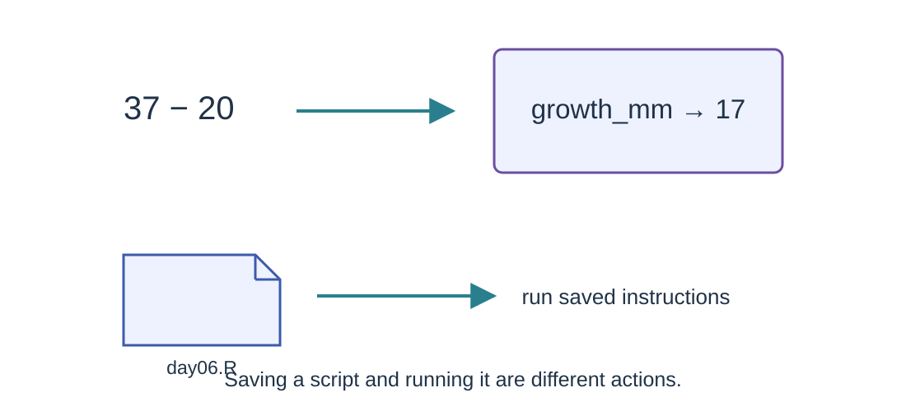
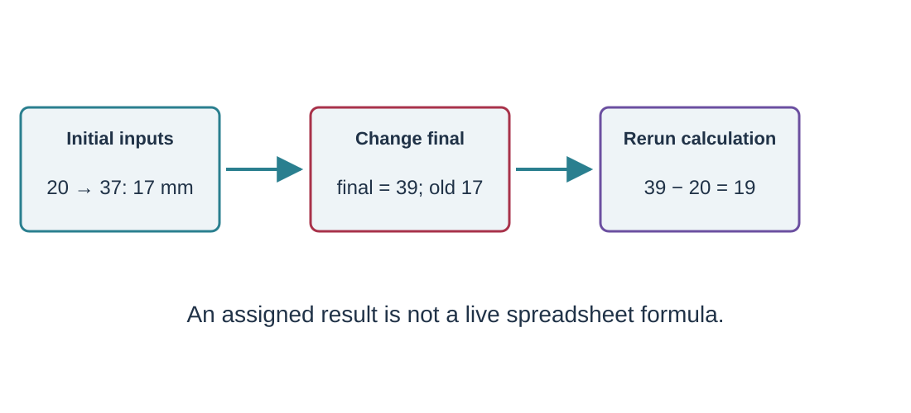
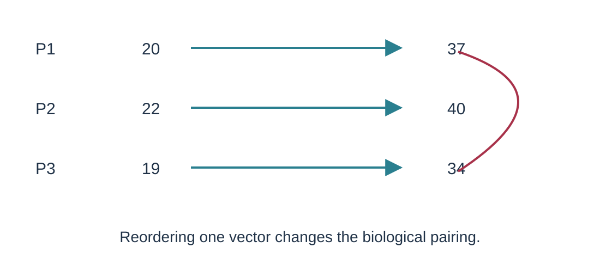
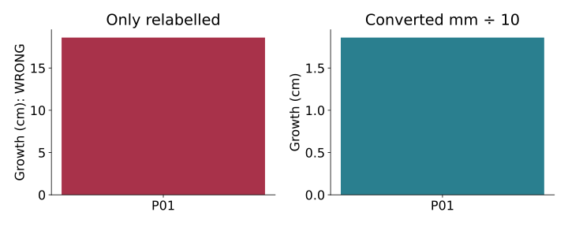
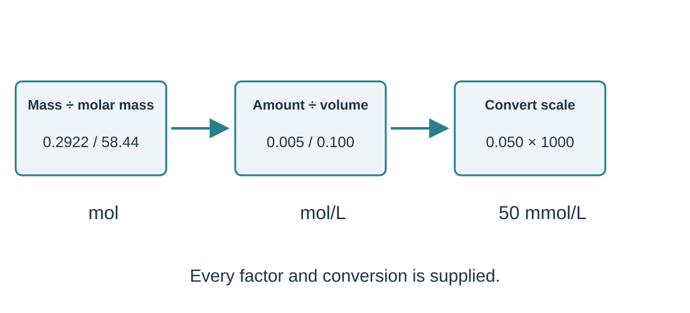

## About this lecture

A seedling was 20 mm long at the start and 37 mm at the end. A calculator gives 17 mm. But a real experiment has dozens of plants, a value gets corrected, and your supervisor asks you to redo it. **If the calculation is written down, you run it again. If it was done by clicking, you start over and hope you remember every step.**

Today you will:

- calculate in the R Console;
- store results under names;
- keep several plants' values together and summarise them;
- save a script that rebuilds everything after R restarts.

This is the first day of writing R. From Day 7 the numbers come from a file instead of being typed.

::: notes
Start from the biological question, not from an overview of programming languages. All example plants are simulated. The point of the day: a saved, rerunnable list of steps. Students met RStudio's panes on Day 5.
:::

## Why write the steps down?

{height=330}

- In a spreadsheet you see the answers, not which cells were typed, sorted or pasted.
- A **script** is a text file of instructions. Anyone can read it and run it again, and get the same result.

::: notes
Many published analyses cannot be repeated because they were done by clicking. Nobody, including the author, can say exactly which steps were taken. The script is the record. This is not "spreadsheets are bad"; they are fine for looking at data.
:::

## R as a calculator

:::: {.columns}
::: {.column width="42%"}
In the Console, after the `>` prompt:

```r
37 - 20
37 / 20
```

- `[1] 17` and `[1] 1.85`. `[1]` just numbers the first value printed.
- **17 mm** is the growth. **1.85** is a ratio with no unit: the plant ended 1.85 times as long.
- Both calculations are correct. Pick the one that answers your question.
:::
::: {.column width="58%"}
{width="100%"}
:::
::::

::: notes
Ask students to predict both results before running. A calculation can be right and still answer the wrong biological question. Ratios of two lengths in the same unit have no unit.
:::

## Give a result a name

:::: {.columns}
::: {.column width="45%"}
```r
# Lengths in millimetres
initial_mm <- 20
final_mm <- 37
growth_mm <- final_mm - initial_mm
growth_mm
```

- Read `<-` as "store this under this name".
- The name now appears in the **Environment** pane.
- `#` starts a comment for people; R ignores it.
- Capitals matter: `Growth_mm` is a different name.
:::
::: {.column width="55%"}
{width="100%"}
:::
::::

::: notes
Write this in a new script, File → New File → R Script, saved as day06.R in the project folder. Run each line with Run (Ctrl+Enter / Cmd+Enter). Putting the unit in the name (_mm) is a habit that prevents mistakes later.
:::

## A stored result does not update itself

:::: {.columns}
::: {.column width="45%"}
```r
final_mm <- 39
growth_mm      # still 17
growth_mm <- final_mm - initial_mm
growth_mm      # now 19
```

- A name holds a **value**, not a live formula as in a spreadsheet cell.
- Change an input, then **rerun the lines that use it**.
- Safest: run the whole script from the top.
:::
::: {.column width="55%"}
{width="100%"}
:::
::::

::: notes
Ask for a prediction before printing growth_mm the first time. This is the most common source of "but I changed it!" confusion in the first weeks.
:::

## Saved script versus objects in memory

- **Saving** the script writes instructions to disk. It does not run them.
- **Running** a line creates objects in memory. It does not save the script.
- Restart R (**Session → Restart R**): the objects are gone, the saved script is not.
- So after reopening, run the script from the top. Everything it needs must be in it.

Test it today: save `day06.R`, restart R, run all lines. Does `growth_mm` come back?

::: notes
This is the same disk versus memory distinction from week 1. Unsaved editor changes may be recoverable, but do not rely on it. A script that works only after some unrecorded Console typing is not a complete record.
:::

## Several plants in one name

:::: {.columns}
::: {.column width="45%"}
```r
initial_mm <- c(20, 22, 19)
final_mm <- c(37, 40, 34)
growth_mm <- final_mm - initial_mm
growth_mm
```

- `c()` combines values into a **vector**.
- R subtracts **position by position**: 17, 18, 15 mm.
- This is right only if both vectors list the **same plants in the same order**.
:::
::: {.column width="55%"}
{width="100%"}
:::
::::

::: notes
Work through the second plant: 40 − 22 = 18. R does not know which plant is which; it only matches positions.
:::

## Summarise and compare

:::: {.columns}
::: {.column width="50%"}
```r
mean(growth_mm)
length(growth_mm)
growth_mm > 16
plant_id <- c("P01", "P02", "P03")
```
:::
::: {.column width="50%"}
- `mean()` gives **16.67 mm**; `length()` gives **3** plants.
- `growth_mm > 16` gives `TRUE TRUE FALSE`: yes/no answers, not new measurements.
- Text goes in quotes. `"20"` is text, `20` is a number.
- `mean(plant_id)` makes no sense: IDs are labels, not measurements.
:::
::::

A **function** is a name followed by brackets: `mean(...)`. Run `?mean` to open its help page.

::: notes
Read the help's Description and Examples, not every option. Plant IDs contain digits but are still labels; storing them as text keeps R from treating them as numbers.
:::

## Wrong order, wrong answer, no warning

:::: {.columns}
::: {.column width="42%"}
```r
final_wrong <- c(34, 37, 40)
final_wrong - initial_mm
```

- Gives **14, 15, 21** instead of 17, 18, 15.
- Same values, same length, so R raises no error.
- Only you know which plant each position belongs to. Keep the order matched.
:::
::: {.column width="58%"}
{width="100%"}
:::
::::

::: notes
Equal lengths are necessary but do not prove matching plants. From Day 7 we keep both lengths in the same row of a table, which protects the pairing.
:::

## Convert the values, not only the label

:::: {.columns}
::: {.column width="45%"}
```r
growth_cm <- growth_mm / 10
mean(growth_mm)   # 16.67
mean(growth_cm)   # 1.667
```

- Dividing by 10 converts mm to cm. Store it under a **new name** ending `_cm`.
- Renaming an object or an axis to "cm" without dividing would be wrong by a factor of 10.
:::
::: {.column width="55%"}
{width="100%"}
:::
::::

::: notes
Keep the original values. A changed label does not change the numbers. The figure uses plant P01 from the course data (18.6 mm).
:::

## The same habit for a lab calculation

:::: {.columns}
::: {.column width="45%"}
```r
mass_g <- 0.2922
molar_mass_g_mol <- 58.44
volume_l <- 100 / 1000
amount_mol <- mass_g / molar_mass_g_mol
1000 * amount_mol / volume_l   # 50 mmol/L
```

- Every input has a name with its unit.
- Each step can be checked on its own.
:::
::: {.column width="55%"}
{width="100%"}
:::
::::

Doubling the mass gives 100 mmol/L; doubling the volume gives 25 mmol/L.

::: notes
A mole is a unit of chemical amount; molar mass is grams per mole. All values are supplied; no chemistry background is needed. The alternative ratio exercise is a product yield: 100 × 0.62 g / 1.00 g = 62%.
:::

## When something goes wrong

- **`object 'growth_mm' not found`**: check the spelling and capitals, then run the line that creates it.
- **A `+` prompt** instead of `>`: R is waiting for the rest of a line. Check quotes and brackets, or press Esc.
- **An old result**: did you rerun the lines after changing an input?
- **Lost track?** Restart R and run the script from the top.

::: notes
Teach checking the dependency (which line creates this object?) instead of running random lines until the error goes away.
:::

## Summary

- A script is a saved list of instructions; it can be read and run again.
- `<-` stores a value under a name. The value does not update itself when inputs change.
- `c()` makes a vector; R calculates position by position, so the order must match.
- Units belong in names and comments; converting means changing the values.
- Restart R and run the script from the top to check it is complete.

**Next (Day 7, import):** read a whole table of measurements from a file instead of typing values.

**Now:** [open the Day 6 exercises](../../week2/06-r-basics.qmd). Leave with `day06.R`: the four-plant example with comments about units, which runs from the top after a restart.

::: notes
The exercises extend to a fourth plant (21 to 39 mm) and offer a ratio or product-yield choice, then a stale-value and concentration exercise in day06-extended.R.
:::
