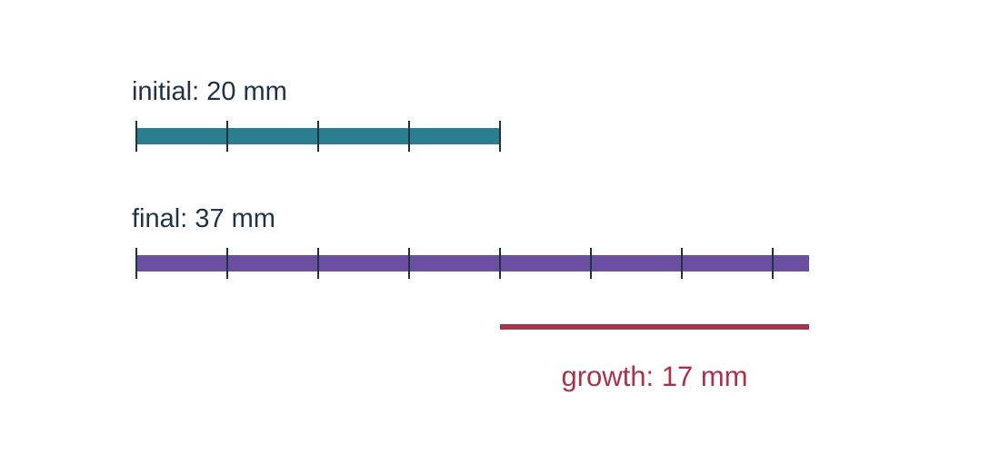
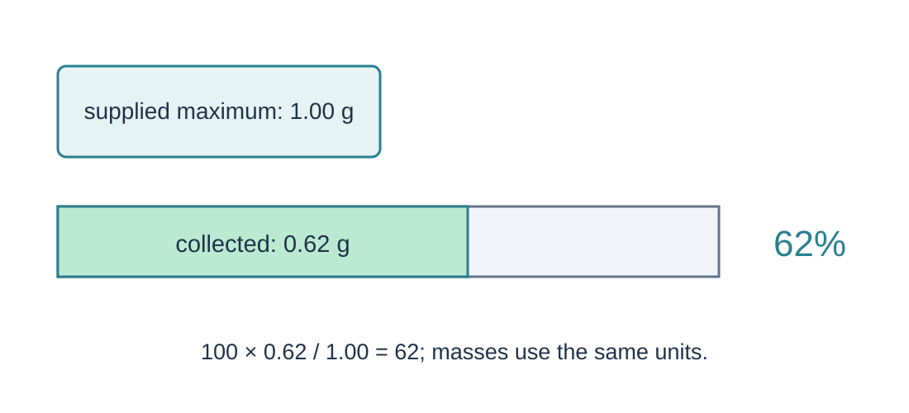

## Ask which quantity you want

{height=390}

Change is `37 - 20`; the ratio `37 / 20` answers a different question.

::: notes
Start from the simple biological question, not an overview of programming languages. All example plants are simulated. Growth has units of mm; a ratio of two lengths in the same units is dimensionless. Ask students to predict both before running R.
:::

## Assign a value to a name

{height=390}

Read `<-` as “store this under this name”.

::: notes
The Environment pane shows current session objects; the editor shows saved instructions. Show that saving alone does not execute a line and executing alone does not save editor changes. An object does not remain available after an ordinary fresh session unless the instructions recreate it.
:::

## Write and run a small script

Save as `day06.R` in the course project root:

```r
initial_mm <- 20
final_mm <- 37
growth_mm <- final_mm - initial_mm
growth_mm
```

R names are case-sensitive: `growth_mm` differs from `Growth_mm`.

::: notes
Open the extracted .Rproj first. Run each line using the editor's Run action. Explain the unit-bearing names and comments rather than requiring one preferred naming convention. The Console prompt is not typed. If an object is missing, check spelling and the line that should create it.
:::

## Several values can share one object name

{height=390}

The order must refer to the same plants in both vectors.

::: notes
Work through P02's 40 minus 22 equals 18. The picture is positional arithmetic, not R automatically matching plant IDs. Later tables will preserve correspondence explicitly. Do not suggest that arbitrary equal-length vectors can be subtracted meaningfully.
:::

## Calculate, summarise, compare

```r
initial_mm <- c(20, 22, 19)
final_mm <- c(37, 40, 34)
growth_mm <- final_mm - initial_mm
mean(growth_mm)
length(growth_mm)
growth_mm > 16
```

Results: mean about **16.67 mm**, length **3**, comparison **TRUE TRUE FALSE**.

::: notes
c combines values into a vector; mean and length are functions with parentheses. Greater-than gives logical values, not new measurements. Text needs quotation marks. Plant IDs are labels, so averaging them would not answer a useful question. Keep syntax explanations tied to these operations.
:::

## A ratio can describe product yield too

{height=390}

**Percentage yield = 100 × collected dry mass / supplied maximum mass.**

::: notes
This is the optional substitute for the extra plant-ratio exercise. Define synthesis as making a product; supply the theoretical mass without reaction balancing. Assume collected product is pure only for this calculation. Both masses use grams. Changing collected mass to 0.70 g gives 70%. A higher yield does not establish purity or safety.
:::

## Predict what survives a restart

You have run the code but not saved the script. Then you restart R.

- Which instructions are saved?
- Which session objects must be recreated?
- What should you run first after reopening?

::: notes
The unsaved script changes may be lost or recoverable by the editor, but should not be relied upon. Save explicitly. In a fresh R session the objects need recreating from the beginning. Introduce error recovery as checking a dependency rather than running random lines until the error disappears. Esc cancels an unfinished expression marked by a plus prompt.
:::

## Practise a complete, repeatable calculation

[Open the practical and notes](../../week2/06-r-basics.qmd).

- Add a fourth plant to **both** measurement vectors.
- Change an input, predict the effect, and rerun.
- Save `day06.R`; restart and run it from the top.

::: notes
The worked mean uses three plants; the practical then extends to four. Keep the input values and comments in the saved source so the result can be reconstructed. Students doing the organic ratio choice still practise the matched-plant vector basics.
:::
