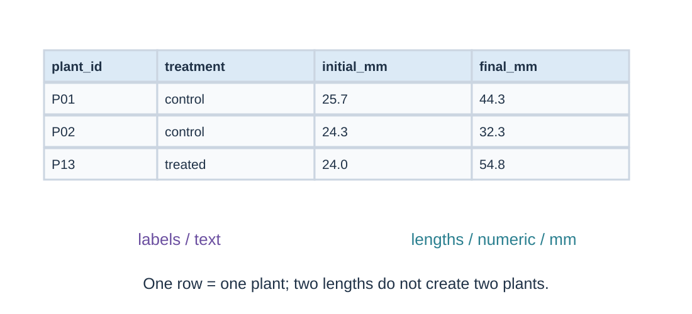
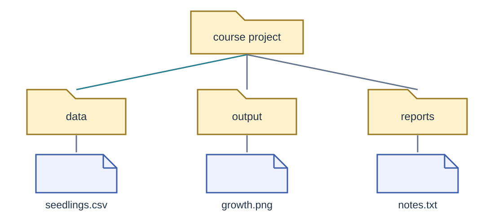
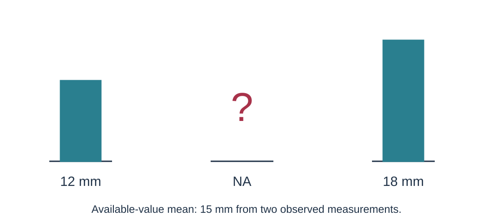

## Importing creates an object in this session

{height=390}

The saved input is separate from the imported object.

::: notes
Open the course project before importing. A CSV is text; importing interprets it as a table. Do not imply that editing the object automatically changes the CSV. Conversely, changing the CSV does not update an already imported object until reread. These are the same disk/memory distinctions from week 1.
:::

## Columns have roles and types

{height=390}

One row is one plant. The column header is not another observation.

::: notes
Read P01's entire row aloud. The two length readings refer to the same plant seven days apart, not two independent plants. Numeric-looking IDs remain labels. The file's contents cannot establish units or randomisation; use the data dictionary's study description.
:::

## Load the importer, then inspect the result

```r
library(readr)
seedlings <- read_csv("data/seedlings.csv",
                      show_col_types = FALSE)
head(seedlings)
dim(seedlings)
names(seedlings)
str(seedlings)
```

Expect **24 rows × 4 columns** in this complete teaching dataset.

::: notes
A package is installed on storage but loaded in each session. read_csv returns a tibble, a table format; head prints only its first rows. Suppressing the importer message does not replace checking types. Point students at names rather than expecting exact column names from memory.
:::

## Start paths from the project root

{height=390}

```r
getwd()
file.exists("data/seedlings.csv")
```

::: notes
The second command should give TRUE. If not, identify the current folder, the actual extracted tree, and the computer holding the file. Common causes are an extra extraction folder or opening a ZIP preview. Do not fix this by copying a personal absolute path into every analysis line.
:::

## An unavailable value is not a measured zero

{height=390}

`NA` means not available. Explain missingness when reporting a result.

::: notes
This is a separate toy vector, not a missing entry in seedlings.csv, which is complete. Replacing the unknown value by zero would invent a length measurement. A denominator should count what was actually observed for that summary. The practical later explains missing values more fully.
:::

## Ask R how the calculation handles missingness

```r
example_mm <- c(12, NA, 18)
mean(example_mm)
mean(example_mm, na.rm = TRUE)
is.na(example_mm)
```

The first mean is `NA`; the second is **15 mm from two available values**.

::: notes
na.rm is an argument to the calculation, not deletion of the original row or an explanation of why data are missing. Ask students to read the is.na result. Later exercises will count missing observations explicitly and retain evidence for data corrections.
:::

## A computation needs a biological description

```r
seedlings$initial_mm
length(seedlings$initial_mm)
mean(seedlings$initial_mm)
```

- `$` selects one column as a vector.
- Count plants, not the header.
- Describe an average length **in mm**, not only a number.

::: notes
Have students distinguish the count from the mean. The mean initial length combines both allocations; it does not estimate a treatment difference. No hypothesis testing is needed today. The code only answers a meaningful question when the variable and observational unit are understood.
:::

## Import a second table deliberately

[Open the practical and notes](../../week2/07-import.qmd).

Save `day07.R`, then inspect `data/leaf-mass.csv` too.

Which columns and units differ? What does one row represent there?

::: notes
The leaf table has eighteen independent plants, one leaf each, area in square centimetres and dry mass in milligrams. Students need not infer any causal relationship. Reuse the import/inspect workflow while reading that dataset's dictionary rather than assuming the seedling schema applies.
:::
