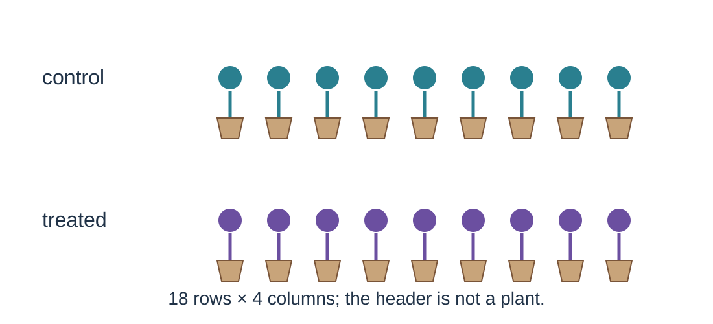
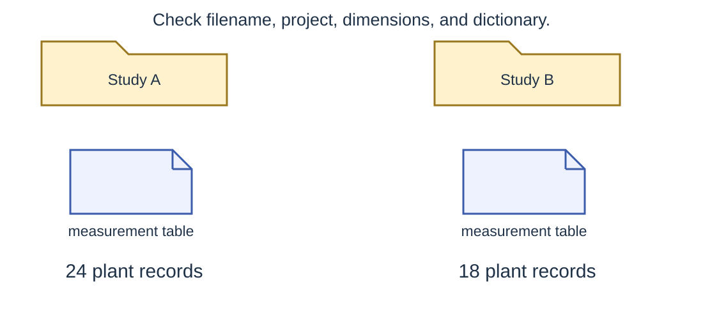

## About this lecture

Your supervisor sends a CSV file with lengths of 24 seedlings, and later a results file with many thousands of rows. Remember Day 1: opening a table in a spreadsheet and saving it again can quietly change the data. **How do we bring a table into R unchanged, and check that it contains what we think it contains?**

Today you will:

- make sure R is looking in the right folder for the file;
- import a CSV file into a table and inspect its size, columns and types;
- tell labels from measurements, and a missing value from a zero;
- write down what you checked, so someone else can trust the table.

Day 6 typed values by hand. From today the values come from files. Day 8 calculates and plots from the imported table.

::: notes
Day 1 showed gene names such as SEPT2 turned into dates; only call back to it here. The new example is real: in October 2020 Public Health England missed about 16,000 positive COVID-19 results because results were passed through the old .xls format, which holds at most 65,536 rows. Neither is a reason to fear spreadsheets for looking at data; they are reasons not to let a program silently rewrite your only copy.
:::

## Why not just open it in a spreadsheet?

:::: {.columns}
::: {.column width="45%"}
- Day 1: a spreadsheet turned the gene name *SEPT2* into the date 2-Sep.
- Size limits fail silently too. The old `.xls` format stops at 65,536 rows; in 2020 this hid about 16,000 positive COVID-19 tests in the UK.
- `read_csv()` reads the file and leaves it unchanged on disk. Every check, such as the number of rows, is a line in your script.
:::
::: {.column width="55%"}
{width="100%"}
:::
::::

::: notes
The data were not wrong; the container was too small and nothing warned anyone. In R, the size of a table is checked with one line (dim), which we do shortly.
:::

## A file on disk, a table in memory

:::: {.columns}
::: {.column width="42%"}
- As on Day 1, a **CSV** is plain text: a header line with column names, then one line per row.
- `read_csv()` reads it and creates a **table object** in R's memory.
- Changing the object does not change the file. Changing the file does not change the object until you import again.
:::
::: {.column width="58%"}
{width="100%"}
:::
::::

::: notes
Same disk versus memory distinction as week 1 and Day 6. Open seedlings.csv in a text editor once so students see the commas. The raw file stays exactly as supplied all course.
:::

## First: is R looking in the right folder?

:::: {.columns}
::: {.column width="45%"}
```r
getwd()
file.exists("data/seedlings.csv")
```

- `getwd()` should print your **project folder**, not `data`.
- The second line should print `TRUE`.
- `data/seedlings.csv` is a **relative path**: it starts from the project folder, so it works on a classmate's computer too.
:::
::: {.column width="55%"}
{width="100%"}
:::
::::

If you get `FALSE`: open `introcomputing.Rproj` from the extracted folder. Do not paste your personal path into the code.

::: notes
Common causes of FALSE: working inside the ZIP preview, an extra folder level from extraction, or a different project open. Fix by opening the right project, not by writing C:/Users/anna/... into every line.
:::

## Import and inspect

:::: {.columns}
::: {.column width="50%"}
```r
library(readr)
seedlings <- read_csv("data/seedlings.csv",
                      show_col_types = FALSE)
head(seedlings)
dim(seedlings)
names(seedlings)
str(seedlings)
```
:::
::: {.column width="50%"}
- `library(readr)` loads the importer. Installed once; loaded in every new session.
- `head()` shows the first 6 rows only, not the whole table.
- `dim()`: **24 rows, 4 columns**.
- `str()`: `plant_id` and `treatment` are text (`chr`); the lengths are numbers (`num`).
:::
::::

::: notes
read_csv returns a tibble, a kind of table. show_col_types = FALSE only hides a message; it does not replace looking at the types with str(). Have students copy column names from names() rather than typing from memory.
:::

## What does one row mean?

:::: {.columns}
::: {.column width="42%"}
- One row is **one plant**. P01: control, 25.7 mm at the start, 44.3 mm seven days later.
- Two lengths in one row are the same plant measured twice, not two plants.
- `plant_id` and `treatment` are **labels**; the `_mm` columns are **measurements**.
- The file does not say "mm" or "seven days": that comes from `data/README.md`.
:::
::: {.column width="58%"}
{width="100%"}
:::
::::

::: notes
Read P01's row aloud. The header is not an observation. Units, random allocation and the fact that the data are simulated are all in the data dictionary, not in anything R can compute.
:::

## One column, one vector

```r
seedlings$initial_mm
length(seedlings$initial_mm)    # 24
mean(seedlings$initial_mm)      # 22.47
```

- `$` picks one column by name and gives a vector, like those on Day 6.
- 24 values: one per plant. The header is not counted.
- The mean initial length is **22.47 mm**. Always give the unit: R only sees numbers.
- This mean mixes both groups, so it says nothing yet about the treatment.

::: notes
Ask students to say the result as a full sentence with unit and what was averaged. Comparing the groups is Day 8 and week 3.
:::

## Missing is not zero

:::: {.columns}
::: {.column width="45%"}
```r
mean(c(10, NA, 20))                # NA
mean(c(10, NA, 20), na.rm = TRUE)  # 15
mean(c(10, 0, 20))                 # 10
sum(is.na(seedlings$final_mm))     # 0
```

- `NA` = not available: no reading exists.
- `na.rm = TRUE` leaves it out: mean of **two** values.
- Writing 0 instead invents a plant of zero length.
:::
::: {.column width="55%"}
{width="100%"}
:::
::::

::: notes
R refuses to give a mean when a value is NA unless asked: it will not pretend all values are known. In a report, say how many values were missing and why if known. seedlings.csv is complete; the messy version on Day 11 is not.
:::

## Worked example: a second study

:::: {.columns}
::: {.column width="48%"}
```r
transfer <- read_csv("data/seedlings-transfer.csv",
                     show_col_types = FALSE)
dim(transfer)                       # 18 4
tail(transfer)
length(unique(transfer$plant_id))   # 18
table(transfer$treatment)           # 9 9
sum(is.na(transfer$final_mm))       # 0
```
:::
::: {.column width="52%"}
{width="100%"}
:::
::::

- A new name, `transfer`, so the 24-plant `seedlings` table is not overwritten.
- 18 rows, 18 distinct IDs, 9 per group, nothing missing: what the study description promises.

::: notes
tail shows the last rows; head alone could hide problems at the end. unique() counts distinct IDs; repeated IDs would prompt investigation here because the design has one row per plant. Random allocation is stated in the design, not visible in the rows.
:::

## A plausible table can still be the wrong one

:::: {.columns}
::: {.column width="42%"}
- Two studies can have the **same column names**. Both import without errors.
- Check the numbers against the description: 24 plants or 18? 12 or 9 per group?
- Same for a lab table: `solutions.csv` has **6 rows, 5 columns**. Mass (g) and molar mass (g/mol) are both numbers, but adding them is meaningless.
:::
::: {.column width="58%"}
{width="100%"}
:::
::::

::: notes
A wrong file with a plausible name produces plausible output. A numeric type tells you R can do arithmetic, not that the arithmetic makes sense; the dictionary says what each column means.
:::

## Write down what you checked

A useful import note gives evidence, not just "checked":

> `data/seedlings-transfer.csv`: 18 rows × 4 columns, 18 distinct plant IDs, 9 control and 9 treated, no missing lengths. Lengths in mm, seven days apart (from `data/README.md`). Simulated teaching data.

- Facts from R: rows, columns, types, IDs, group counts, missing values.
- Facts from the dictionary: units, what one row is, how plants were allocated.

::: notes
The practical asks for reports/transfer-import-audit.txt and reports/solutions-import-audit.txt. Unusual values prompt questions, never silent deletion.
:::

## Summary {.smaller}

| Idea | Key fact |
|---|---|
| Why code, not a spreadsheet | `read_csv()` leaves the file unchanged; spreadsheets can silently convert or drop data (row limits) |
| File vs object | The CSV stays on disk; the imported table lives in R's memory |
| Relative path | `data/seedlings.csv` from the project folder; check with `file.exists()` |
| Inspect | `dim()`, `names()`, `str()`, `head()`, `tail()`: 24 × 4 for `seedlings.csv` |
| Rows and columns | One row = one plant; IDs and groups are labels; lengths are measurements in mm |
| Missing | `NA` is not 0; `na.rm = TRUE` leaves it out of that calculation; report how many |
| Meaning | Units and design come from `data/README.md`, not from R |

**Next (Day 8, transform and plot):** calculate each plant's growth as a new column and draw a figure where every point is a plant.

**Now:** [open the Day 7 exercises](../../week2/07-import.qmd). Leave with `day07.R`, which imports and inspects `seedlings.csv` and `leaf-mass.csv` and runs from the top after a restart.

::: notes
The extended exercises inspect the 18-plant transfer study and solutions.csv and save two short audit notes in reports/.
:::
