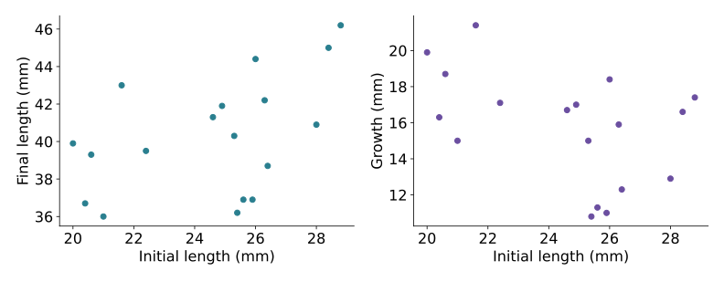
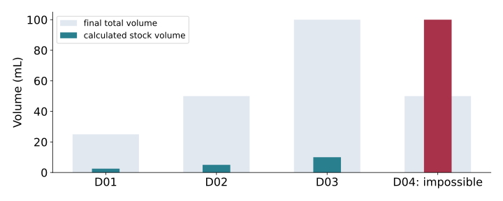
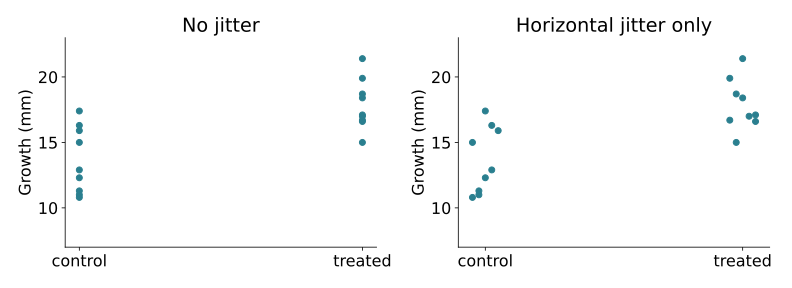

## Growth is a derived measurement

{height=390}

For P01: **44.3 − 25.7 = 18.6 mm**.

::: notes
The raw file records two lengths. Growth is their difference for the same plant, not a change to the source CSV. Distinguish final size from growth: a plant can start larger and still grow less. A negative change deserves checking, not automatic deletion.
:::

## Add the column in code

```r
library(readr)
library(dplyr)
library(ggplot2)
seedlings <- read_csv("data/seedlings.csv",
                      show_col_types = FALSE)
seedlings <- mutate(seedlings,
                     growth_mm = final_mm - initial_mm)
```

Save the calculation in `day08.R`.

::: notes
mutate returns a modified table that is assigned back to an object name. It finds the named columns in the supplied table. The packages must be loaded in this session. Ask students to inspect the new column and check P02's growth, 8 mm, by hand.
:::

## Selecting rows is different from selecting columns

{height=390}

`filter()` asks **which observations?** `select()` asks **which variables?**

::: notes
Use control_plants <- filter(seedlings, treatment == "control") and growth_table <- select(seedlings, plant_id, treatment, growth_mm) in the live demonstration. Explain that == compares while <- assigns. A pipe is a readable sequence of operations; it does not change their biological meaning.
:::

## Each plot answers a particular question

{height=390}

This shows final size against initial size, **not growth against treatment**.

::: notes
Read the axes before discussing the pattern. Every point is a plant and colour is a group label. The plot is generated from the actual course CSV. It does not establish that starting larger causes a particular final size. The corresponding plotting code is in the practical.
:::

## Show growth for each plant

{height=390}

Horizontal jitter separates overlapping points; vertical values stay unchanged.

::: notes
The practical's position_jitter uses height = 0 and a seed for repeatable display. Ask the class what higher/lower means on this axis and whether the groups overlap. Do not declare a treatment effect solely from a plotted cloud; formal comparison and uncertainty come later.
:::

## Name the objects before exporting them

```r
growth_table <- select(seedlings, plant_id, treatment, growth_mm)
growth_plot <- ggplot(seedlings, aes(treatment, growth_mm)) +
  geom_point(position = position_jitter(width = 0.08, height = 0, seed = 8)) +
  labs(x = "Allocation", y = "Growth (mm)") +
  theme_minimal()
growth_plot
```

Assigning creates the object; printing displays it; exporting writes a file.

::: notes
This supplies the objects needed by the following export slide. The complete
sequence can run from the imports at the start of the deck. Separate selecting
columns from mapping them to a figure; both retain the recorded raw input.
:::

## A plot object and an image file differ

```r
ggsave("output/seedling-growth.png",
       plot = growth_plot, width = 6, height = 4)
write_csv(growth_table, "output/seedling-growth.csv")
```

The output folder must exist. Locate the saved PNG and CSV in the file manager.

::: notes
The preceding code creates growth_plot and growth_table before export. Naming a plot object does not save an image. An image does not contain the full source analysis. Both export operations can replace an existing destination, so use intentional names and keep raw inputs unchanged.
:::

## Transfer choice: percentage yield

For the optional organic-laboratory table, both masses are supplied in grams:

```r
organic <- read_csv("data/organic-recovery.csv",
                   show_col_types = FALSE)
organic <- mutate(organic, yield_percent =
                    100 * isolated_mass_g / theoretical_mass_g)
```

Compare percentages when starting scales differ; a larger mass alone is insufficient.

::: notes
Define theoretical mass as the supplied maximum and isolated mass as dry collected product assumed pure for this numerical task. No reaction equation is required. Y01 is 62%. This choice substitutes for an extra plant-plot variation, not the main seedling workflow. Higher yield does not establish higher purity or general protocol superiority.
:::

## Rows and columns are separate decisions

{height=350px}

Predict the row and column counts before running the selection.

::: notes
Use the eighteen-plant transfer dataset. The full derived table has 18 rows; the treated subset has nine. Adding a growth column should not remove plants. Do not select every second row as a proxy for the supplied allocation label.
:::

## Derive from recorded values, preserve the input

```r
transfer <- read_csv("data/seedlings-transfer.csv",
                     show_col_types = FALSE)
transfer <- transfer |>
  mutate(growth_mm = final_mm - initial_mm)
```

T01:40.3−25.3=15.0mm.

::: notes
Load the familiar packages and inspect names and types first. Derived values remain separate from the original CSV. Export the full derived table and selected subsets under informative filenames.
:::

## The same plants can answer different plotted questions

{height=350px}

Read the axes before interpreting a pattern.

::: notes
A final-size plot is not directly a growth plot. Both may be useful, but the scientific question determines the choice. An association plot alone does not establish causality.
:::

## Save, reopen, and interpret the derived result

Export a CSV and two useful PNGs under a transfer-prefix.

Then open the saved files outside R and explain:

- Which are values, and which are pictures?
- What does one point represent?

::: notes
Printing a plot object does not automatically save an image. write_csv exports a table, not a figure. Captions identify units and independent observations; the surrounding prose explains pattern and limitation.
:::

## A calculated request can be impossible

{height=350px}

Retain the request and flag it; do not invent a feasible answer.

::: notes
Define stock as known concentration and dilution as adding solvent to a final total volume while conserving solute. D01–D03 need 2.5, 5 and 10 mL. D04 targets 200 from a stock of 100 mmol/L, so dilution alone cannot satisfy it.
:::

## Add the supplied rule and a clear flag

```r
dilutions <- read_csv("data/dilutions.csv",
                      show_col_types = FALSE)
dilutions <- dilutions |> mutate(
  stock_volume_ml = target_mmol_l * final_volume_ml / stock_mmol_l,
  possible_by_dilution = target_mmol_l <= stock_mmol_l)
```

::: notes
Explain <= and logical columns. Both concentrations use mmol/L; final mL gives stock mL. Positive inputs are supplied. This numerical check needs neither a student-written conditional statement nor a new package.
:::

## Jitter changes visibility, not measurement

{height=350px}

Keep vertical jitter at zero for these plots.

::: notes
Use actual transfer measurements. Different horizontal widths must not change measured y values or plant count. A prettier plot is not a reason to move measured values or hide observations.
:::

## Interpret calculated and observed relations differently

A dilution plot follows a supplied formula.

A plant scatter plot shows measured observations.

Which needs an explanation of the input rule, and which needs a description of observed variation?

::: notes
Do not fit a hypothesis test to these formula-generated dilution cases as though they supplied independent biological evidence. Save the complete flagged table, supported subset, plot and explanation of the impossible request.
:::

## Make a figure someone can read

[Open the exercises](../../week2/08-transform-plot.qmd).

- Use the intended table and columns.
- Label axes with quantities and units.
- Explain what one point represents and one limitation.
- Save the source script, derived table, and figure.

::: notes
Have students close and reopen the saved outputs, then rerun the script from a fresh session. A useful recovery question is whether a missing column was calculated earlier. Keep interpretation short and concrete; no new test or regression is needed in this lesson.
:::
