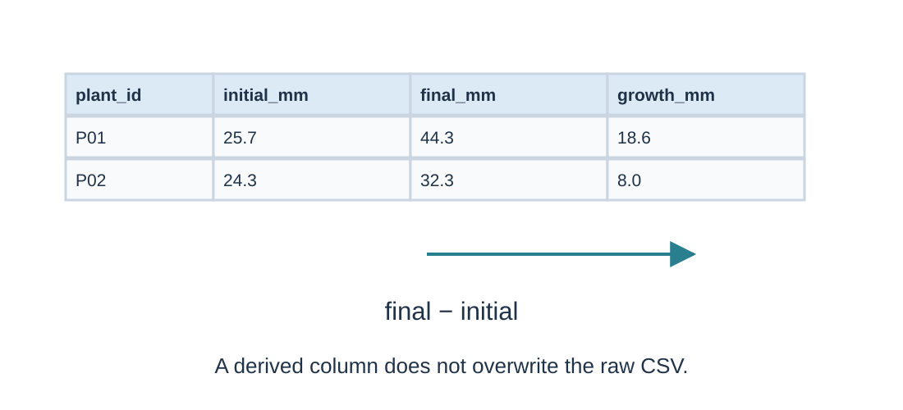
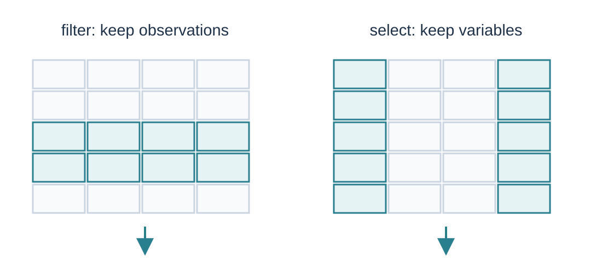

## About this lecture

The seedling table is in R. The question is: **how much did each plant grow, and did treated plants grow more?** In a spreadsheet you would drag a formula down a new column and click a chart together. When a value is corrected next week, you would repeat every step by hand. Here, the new column and the figure come from a few lines of code that you simply run again.

Today you will:

- add a calculated column (growth) with `mutate()`;
- keep the rows you want with `filter()` and the columns you want with `select()`;
- draw a labelled figure with `ggplot()`, where each point is one plant;
- save the figure and the table as files other programs can open.

This builds on Day 7's import. On Day 9 the code and the figure go into one report.

::: notes
The biological question drives the day: growth per plant and a first look at the groups. No statistics today; we describe what we see. The organic-yield and dilution tables in the exercises use the same steps on lab calculations.
:::

## Growth is a new column, not an edit

:::: {.columns}
::: {.column width="45%"}
```r
library(readr)
library(dplyr)
library(ggplot2)
seedlings <- read_csv("data/seedlings.csv",
                      show_col_types = FALSE)
seedlings <- mutate(seedlings,
  growth_mm = final_mm - initial_mm)
```

- P01: 44.3 − 25.7 = **18.6 mm**. P02: **8.0 mm**.
- The CSV on disk is unchanged; the table in R gains a fifth column.
:::
::: {.column width="55%"}
{width="100%"}
:::
::::

::: notes
Save in day08.R. mutate() looks for final_mm and initial_mm inside the table and returns a new table, which we assign back to seedlings. Ask students to check P02 by hand. Growth is change; final_mm is size: a plant can start large and grow little. A negative growth would deserve checking, not deletion.
:::

## Which plants? Which columns?

:::: {.columns}
::: {.column width="45%"}
```r
control_plants <- filter(seedlings,
  treatment == "control")
growth_table <- select(seedlings,
  plant_id, treatment, growth_mm)
```

- `filter()` keeps **rows** (plants): `control_plants` has **12 rows**.
- `select()` keeps **columns** (variables): `growth_table` is **24 × 3**.
- `==` asks "is it equal?"; `<-` stores. Do not mix them up.
:::
::: {.column width="55%"}
{width="100%"}
:::
::::

::: notes
Predict the row and column counts before running each line. Quotes mark the text label "control"; it must match the spelling in the data exactly.
:::

## Read the steps from left to right

:::: {.columns}
::: {.column width="48%"}
```r
longer_control <- seedlings |>
  filter(treatment == "control") |>
  filter(growth_mm > 15)
nrow(longer_control)   # 7
```

- `|>` (the **pipe**) passes the table on to the next step.
- Read it as: take seedlings, *then* keep controls, *then* keep growth above 15 mm.
- 7 of the 12 control plants grew more than 15 mm.
:::
::: {.column width="52%"}
{width="100%"}
:::
::::

::: notes
The pipe is a convenience for writing steps in order; it does not change what they do. When something goes wrong, run the chain one step at a time.
:::

## A plot maps columns to positions

:::: {.columns}
::: {.column width="48%"}
```r
size_plot <- ggplot(seedlings,
    aes(x = initial_mm, y = final_mm,
        colour = treatment)) +
  geom_point(size = 2) +
  labs(x = "Initial seedling length (mm)",
       y = "Final seedling length (mm)",
       colour = "Treatment") +
  theme_minimal()
size_plot
```
:::
::: {.column width="52%"}
{width="100%"}
:::
::::

`aes()` says which column goes where. Each point is one plant. `+` adds a layer; `labs()` gives axis names **with units**.

::: notes
Read the axes before the pattern. Colour shows a group label, not a measurement. This plot is about final size; it does not show growth directly, and it cannot show that starting longer causes ending longer.
:::

## Pick the plot that answers your question

:::: {.columns}
::: {.column width="42%"}
- Same plants, same x-axis, different y-axis.
- **Left:** final length. Plants that started long tended to end long.
- **Right:** growth. Here, plants that started long tended to grow *less*.
- "Bigger at the end" is not "grew more". Read the y-axis label before you interpret.
:::
::: {.column width="58%"}
{width="100%"}
:::
::::

::: notes
These panels use the 18-plant transfer study, which students work with in the exercises. The question decides the plot: for a treatment effect on growth, growth belongs on the y-axis.
:::

## Show every plant's growth

:::: {.columns}
::: {.column width="50%"}
```r
growth_plot <- ggplot(seedlings,
    aes(x = treatment, y = growth_mm)) +
  geom_point(position = position_jitter(
    width = 0.08, height = 0, seed = 8)) +
  labs(x = "Treatment",
       y = "Change in seedling length (mm)") +
  theme_minimal()
growth_plot
```

- **Jitter** spreads points sideways so they don't hide each other. `height = 0`: no value moves up or down.
:::
::: {.column width="50%"}
{width="100%"}
:::
::::

::: notes
Ask: what is one dot? (one plant). What does higher mean? (more growth, mm). Do the groups overlap? (yes: control 8.0 to 18.7 mm, treated 12.2 to 30.8 mm). Treated values tend to be higher; whether that is more than chance is a question for week 4. seed = 8 makes the sideways spread the same every time.
:::

## Jitter must never change a measurement

{height=340}

- Sideways spread makes hidden points visible. The number of points and their heights stay the same.
- Never add vertical jitter, and never drop points to make a plot look tidier.

::: notes
Transfer-study data. In the exercises students change only the width and confirm the y values are unchanged.
:::

## Save files other programs can open

```r
ggsave("output/seedling-growth.png", plot = growth_plot,
       width = 6, height = 4, dpi = 150)
write_csv(growth_table, "output/seedling-growth.csv")
```

- `growth_plot` is an object in memory. `ggsave()` writes a **PNG image** to disk.
- `write_csv()` writes a **table** to disk. An image is not a table, and vice versa.
- Both overwrite a file with the same name without asking. Use clear names; never write into `data/`.
- Open both files from the file manager to check they exist.

::: notes
The output/ folder is part of the supplied project. If saving fails, check getwd() and dir.exists("output").
:::

## Worked example: the same steps on new data

:::: {.columns}
::: {.column width="55%"}
```r
transfer <- read_csv("data/seedlings-transfer.csv",
                     show_col_types = FALSE) |>
  mutate(growth_mm = final_mm - initial_mm)
nrow(transfer)                       # 18
treated <- filter(transfer, treatment == "treated")
nrow(treated)                        # 9
```
:::
::: {.column width="45%"}
- T01: 40.3 − 25.3 = **15.0 mm**. Check one plant by hand.
- Adding a column keeps all 18 plants.
- Change the names, labels and file names; the steps stay the same.
:::
::::

Then plot growth by group and save as `output/transfer-...` so nothing from the main study is overwritten.

::: notes
This is day08-transfer.R in the exercises. Compare with the main study: what changed (object names, row counts, file names), what stayed the same (operations).
:::

## Same steps for a lab calculation

:::: {.columns}
::: {.column width="48%"}
```r
dilutions <- read_csv("data/dilutions.csv",
                      show_col_types = FALSE) |>
  mutate(stock_volume_ml =
           target_mmol_l * final_volume_ml /
           stock_mmol_l,
         possible_by_dilution =
           target_mmol_l <= stock_mmol_l)
```

- D01–D03 need **2.5, 5 and 10 mL** stock.
- D04 needs **100 mL** for a 50 mL final volume: impossible. Keep the row and **flag** it.
:::
::: {.column width="52%"}
{width="100%"}
:::
::::

::: notes
A stock is a solution of known concentration; dilution adds solvent up to a final total volume. D04's target, 200 mmol/L, is above its stock, 100 mmol/L. A formula can produce a number for a request that cannot be carried out. The organic-yield alternative uses the same mutate step: Y01 yield = 100 × 0.62 / 1.00 = 62%.
:::

## Summary {.smaller}

| Step | Function | What to check |
|---|---|---|
| New column | `mutate(growth_mm = final_mm - initial_mm)` | One plant by hand (P01: 18.6 mm); the CSV is unchanged |
| Keep rows | `filter(treatment == "control")` | Row count (12) |
| Keep columns | `select(plant_id, treatment, growth_mm)` | Column count (3); all 24 plants remain |
| Chain steps | `|>` (pipe) | Run one step at a time when something breaks |
| Plot | `ggplot(aes(x, y)) + geom_point() + labs()` | One point = one plant; y-axis is the quantity you ask about; units in labels |
| Jitter | `position_jitter(width = 0.08, height = 0)` | Heights unchanged, no points lost |
| Save | `ggsave()` for images, `write_csv()` for tables | Open the files outside R |

**Next (Day 9, R Markdown):** put the explanation, the code and the figure into one report that rebuilds itself from the data.

**Now:** [open the Day 8 exercises](../../week2/08-transform-plot.qmd). Leave with `day08.R`, `output/seedling-growth.png` and `output/seedling-growth.csv`, all recreated after restarting R.

::: notes
Exercises: a treated-only table, an initial-versus-growth plot or the organic-yield alternative, then the transfer study and the dilution check. Keep interpretation descriptive: pattern, overlap, one thing the plot cannot settle.
:::
