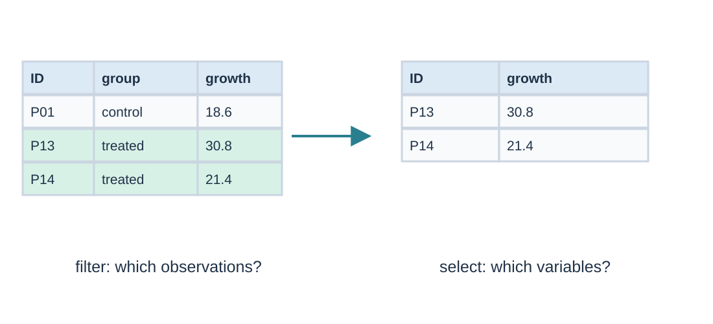
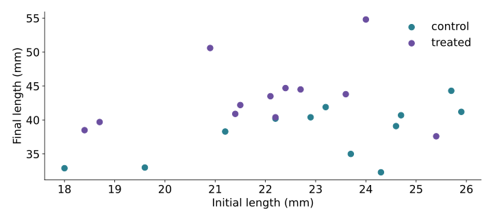

## Growth is a derived measurement

{height=390}

For P01: **44.3 − 25.7 = 18.6 mm**.

::: notes
The raw file records two lengths. Growth is their difference for the same plant, not a change to the source CSV. Distinguish final size from growth: a plant can start larger and still grow less. A negative change deserves checking, not automatic deletion.
:::

## Add the column in code

```r
library(readr)
library(dplyr)
library(ggplot2)
seedlings <- read_csv("data/seedlings.csv",
                      show_col_types = FALSE)
seedlings <- mutate(seedlings,
                     growth_mm = final_mm - initial_mm)
```

Save the calculation in `day08.R`.

::: notes
mutate returns a modified table that is assigned back to an object name. It finds the named columns in the supplied table. The packages must be loaded in this session. Ask students to inspect the new column and check P02's growth, 8 mm, by hand.
:::

## Selecting rows is different from selecting columns

{height=390}

`filter()` asks **which observations?** `select()` asks **which variables?**

::: notes
Use control_plants <- filter(seedlings, treatment == "control") and growth_table <- select(seedlings, plant_id, treatment, growth_mm) in the live demonstration. Explain that == compares while <- assigns. A pipe is a readable sequence of operations; it does not change their biological meaning.
:::

## Each plot answers a particular question

{height=390}

This shows final size against initial size, **not growth against treatment**.

::: notes
Read the axes before discussing the pattern. Every point is a plant and colour is a group label. The plot is generated from the actual course CSV. It does not establish that starting larger causes a particular final size. The corresponding plotting code is in the practical.
:::

## Show growth for each plant

{height=390}

Horizontal jitter separates overlapping points; vertical values stay unchanged.

::: notes
The practical's position_jitter uses height = 0 and a seed for repeatable display. Ask the class what higher/lower means on this axis and whether the groups overlap. Do not declare a treatment effect solely from a plotted cloud; formal comparison and uncertainty come later.
:::

## A plot object and an image file differ

```r
ggsave("output/seedling-growth.png",
       plot = growth_plot, width = 6, height = 4)
write_csv(growth_table, "output/seedling-growth.csv")
```

The output folder must exist. Locate the saved PNG and CSV in the file manager.

::: notes
The code assumes growth_plot and growth_table have been created by the practical's complete script. Naming a plot object does not save an image. An image does not contain the full source analysis. Both export operations can replace an existing destination, so use intentional names and keep raw inputs unchanged.
:::

## Transfer choice: percentage yield

For the optional organic-laboratory table, both masses are supplied in grams:

```r
organic <- read_csv("data/organic-recovery.csv",
                   show_col_types = FALSE)
organic <- mutate(organic, yield_percent =
                    100 * isolated_mass_g / theoretical_mass_g)
```

Compare percentages when starting scales differ; a larger mass alone is insufficient.

::: notes
Define theoretical mass as the supplied maximum and isolated mass as dry collected product assumed pure for this numerical task. No reaction equation is required. Y01 is 62%. This choice substitutes for an extra plant-plot variation, not the main seedling workflow. Higher yield does not establish higher purity or general protocol superiority.
:::

## Make a figure someone can read

[Open the practical and notes](../../week2/08-transform-plot.qmd).

- Use the intended table and columns.
- Label axes with quantities and units.
- Explain what one point represents and one limitation.
- Save the source script, derived table, and figure.

::: notes
Have students close and reopen the saved outputs, then rerun the script from a fresh session. A useful recovery question is whether a missing column was calculated earlier. Keep interpretation short and concrete; no new test or regression is needed in this lesson.
:::
