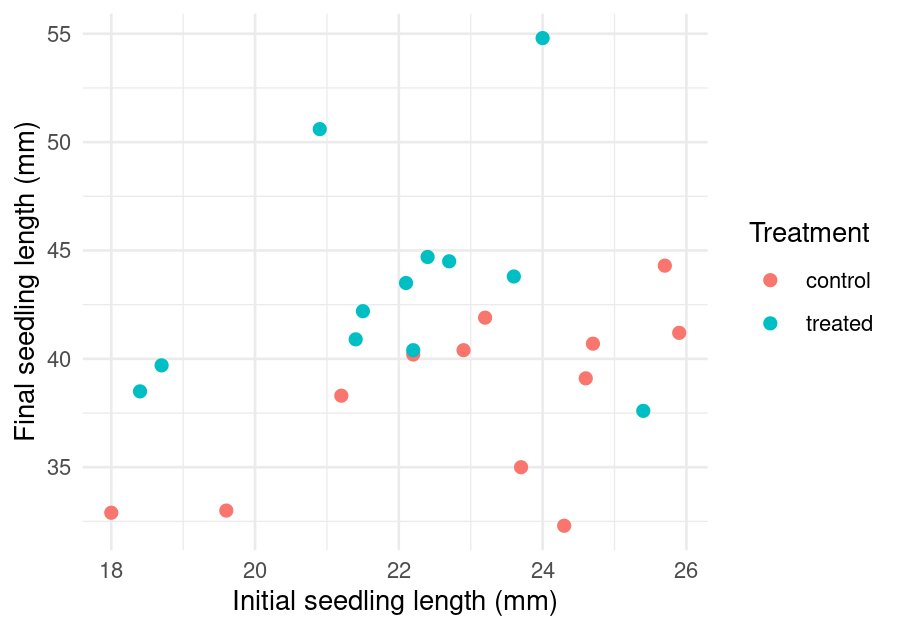
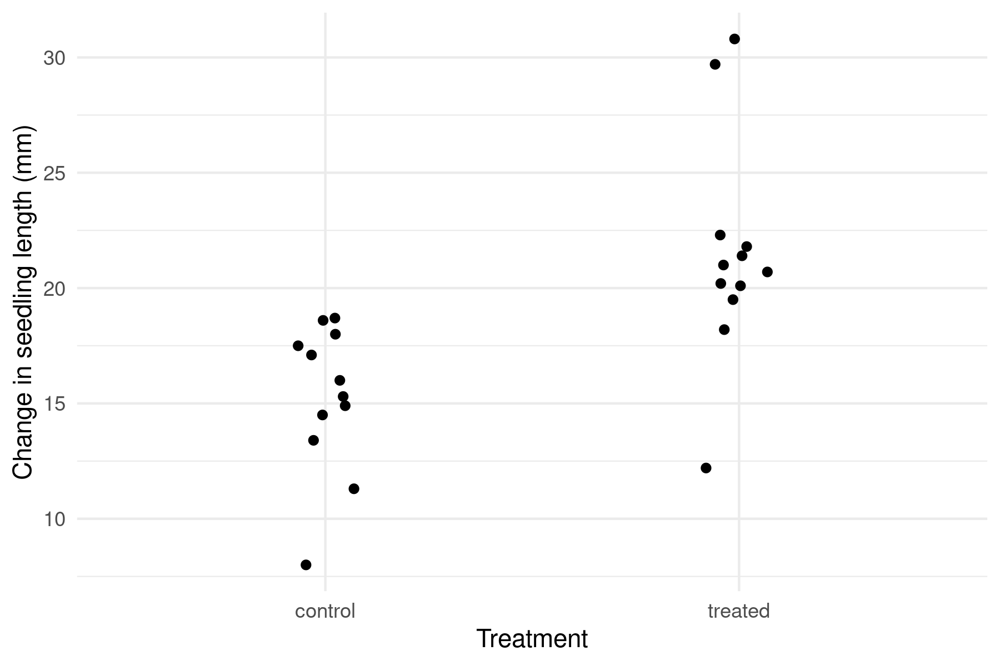
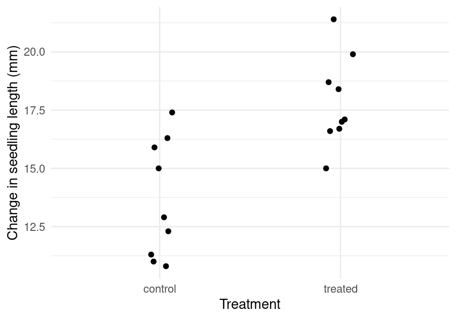

## About this lecture

The seedling table is in R. The question is: **how much did each plant grow, and did treated plants grow more?** In a spreadsheet you would drag a formula down a new column and click a chart together. When a value is corrected next week, you would repeat every step by hand. Here, the new column and the figure come from a few lines of code that you simply run again.

Today you will:

- add a calculated column (growth) with `mutate()`;
- keep the rows you want with `filter()` and the columns you want with `select()`;
- draw a labelled figure with `ggplot()`, where each point is one plant;
- save the figure and the table as files other programs can open.

This builds on Day 7's import. On Day 9 the code and the figure go into one report.

::: notes
The biological question drives the day: growth per plant and a first look at the groups. No statistics today; we describe what we see. The organic-yield and dilution tables in the exercises use the same steps on lab calculations.
:::

## Growth is a new column, not an edit

First load the packages: `library(readr)`, `library(dplyr)`, `library(ggplot2)`. (`dplyr` prints a note about "masked" functions; that is normal.)

```text
> seedlings <- read_csv("data/seedlings.csv", show_col_types = FALSE)
> seedlings <- mutate(seedlings, growth_mm = final_mm - initial_mm)
> head(seedlings, 3)
# A tibble: 3 × 5
  plant_id treatment initial_mm final_mm growth_mm
  <chr>    <chr>          <dbl>    <dbl>     <dbl>
1 P01      control         25.7     44.3      18.6
2 P02      control         24.3     32.3       8  
3 P03      control         18       32.9      14.9
```

- `mutate()` adds a column calculated from the others: now **5 columns**. P01: 44.3 − 25.7 = **18.6 mm**; P02: **8 mm**.
- The CSV file on disk is unchanged; only the table in R has the new column.

::: notes
Save in day08.R. mutate() looks for final_mm and initial_mm inside the table and returns a new table, which we store back under seedlings. R prints 8 rather than 8.0. Growth is change; final_mm is size: a plant can start large and grow little. A negative growth would deserve checking, not deletion.
:::

## Which plants? Which columns?

:::: {.columns}
::: {.column width="50%"}
```text
> control_plants <- filter(seedlings,
+   treatment == "control")
> nrow(control_plants)
[1] 12
> growth_table <- select(seedlings,
+   plant_id, treatment, growth_mm)
> dim(growth_table)
[1] 24  3
```

- `filter()` keeps **rows** (plants) that meet a condition: the **12** controls.
- `select()` keeps the **columns** you name: all 24 plants, now 3 columns.
:::
::: {.column width="50%"}
{width="100%"}

`==` asks "is it equal?"; `<-` stores. `"control"` is in quotes because it is a text label.
:::
::::

::: notes
Predict the row and column counts before running each line. The label must match the spelling in the data exactly. The figure shows the same two operations on three example rows.
:::

## Read the steps from left to right

```text
> longer_control <- seedlings |>
+   filter(treatment == "control") |>
+   filter(growth_mm > 15)
> longer_control
# A tibble: 7 × 5
  plant_id treatment initial_mm final_mm growth_mm
  <chr>    <chr>          <dbl>    <dbl>     <dbl>
1 P01      control         25.7     44.3      18.6
2 P04      control         22.2     40.2      18  
3 P06      control         24.7     40.7      16  
4 P07      control         21.2     38.3      17.1
5 P09      control         25.9     41.2      15.3
6 P10      control         23.2     41.9      18.7
7 P12      control         22.9     40.4      17.5
```

- `|>` (the **pipe**) passes the table on to the next step. Read it as: take `seedlings`, *then* keep the controls, *then* keep growth above 15 mm.
- The answer: **7** of the 12 control plants grew more than 15 mm. The `+` at the line starts is R saying "the instruction continues".

::: notes
The pipe is a convenience for writing steps in order; it does not change what they do. When something goes wrong, run the chain one step at a time. table-operations.svg was dropped from this slide; the printed table shows the filter result directly.
:::

## A plot maps columns to positions

:::: {.columns}
::: {.column width="46%"}
```text
> size_plot <- ggplot(seedlings,
+     aes(x = initial_mm, y = final_mm,
+         colour = treatment)) +
+   geom_point(size = 2) +
+   labs(x = "Initial seedling length (mm)",
+        y = "Final seedling length (mm)",
+        colour = "Treatment") +
+   theme_minimal()
> size_plot
```

Typing `size_plot` draws the figure on the right in the Plots pane.
:::
::: {.column width="54%"}
{width="100%"}
:::
::::

`aes()` says which column goes where: x, y and colour. Each point is one plant. `geom_point()` draws points, `labs()` names the axes **with units**, and `+` adds each part.

::: notes
Read the axes before the pattern. Colour shows a group label, not a measurement. This plot is about final size; it does not show growth directly, and it cannot show that starting longer causes ending longer. Treated plants sit mostly higher, but the x-axis is initial length, not group.
:::

## Pick the plot that answers your question

:::: {.columns}
::: {.column width="42%"}
- Same plants, same x-axis, different y-axis.
- **Left:** final length. Plants that started long tended to end long.
- **Right:** growth. Here, plants that started long tended to grow *less*.
- "Bigger at the end" is not "grew more". Read the y-axis label before you interpret.
:::
::: {.column width="58%"}
{width="100%"}
:::
::::

::: notes
These panels use the 18-plant transfer study, which students work with in the exercises. The question decides the plot: for a treatment effect on growth, growth belongs on the y-axis.
:::

## Show every plant's growth

:::: {.columns}
::: {.column width="48%"}
```text
> growth_plot <- ggplot(seedlings,
+     aes(x = treatment, y = growth_mm)) +
+   geom_point(position = position_jitter(
+     width = 0.08, height = 0, seed = 8)) +
+   labs(x = "Treatment",
+        y = "Change in seedling length (mm)") +
+   theme_minimal()
> growth_plot
```

- **Jitter** spreads points a little sideways so they don't hide each other. `height = 0`: no value moves up or down.
:::
::: {.column width="52%"}
{width="100%"}

Controls grew 8.0–18.7 mm, treated plants 12.2–30.8 mm: treated tend higher, but the groups overlap.
:::
::::

::: notes
Ask: what is one dot? (one plant). What does higher mean? (more growth, mm). Whether the difference is more than chance is a question for week 4. seed = 8 makes the sideways spread the same every time.
:::

## Jitter must never change a measurement

{height=340}

- Sideways spread makes hidden points visible. The number of points and their heights stay the same.
- Never add vertical jitter, and never drop points to make a plot look tidier.

::: notes
Transfer-study data. In the exercises students change only the width and confirm the y values are unchanged.
:::

## Save files other programs can open

:::: {.columns}
::: {.column width="55%"}
```text
> ggsave("output/seedling-growth.png",
+        plot = growth_plot,
+        width = 6, height = 4, dpi = 150)
> write_csv(growth_table,
+           "output/seedling-growth.csv")
> list.files("output")
[1] "seedling-growth.csv" "seedling-growth.png"
> read_csv("output/seedling-growth.csv",
+          show_col_types = FALSE)
# A tibble: 24 × 3
   plant_id treatment growth_mm
   <chr>    <chr>         <dbl>
 1 P01      control        18.6
 2 P02      control         8  
...
```
:::
::: {.column width="45%"}
- `ggsave()` writes the plot as a **PNG image**; `write_csv()` writes the table as a **CSV file**. Both print nothing.
- `list.files("output")` shows the two new files.
- Reading the CSV back shows all **24 rows**, as saved.
- An existing file with the same name is replaced without asking. Never write into `data/`.
:::
::::

::: notes
The output/ folder is part of the supplied project. If saving fails, check getwd() and dir.exists("output"). Open the PNG in the file manager too. If output/ already contains other files, list.files shows them as well.
:::

## Worked example: the same steps on new data

:::: {.columns}
::: {.column width="52%"}
```text
> transfer <- read_csv(
+     "data/seedlings-transfer.csv",
+     show_col_types = FALSE) |>
+   mutate(growth_mm = final_mm - initial_mm)
> nrow(transfer)
[1] 18
> transfer$growth_mm[1]
[1] 15
> treated <- filter(transfer,
+   treatment == "treated")
> nrow(treated)
[1] 9
```

The first plant, T01: 40.3 − 25.3 = **15 mm**. All 18 plants kept; 9 treated.
:::
::: {.column width="48%"}
{width="100%"}

Same plotting code with `transfer`: controls 10.8–17.4 mm, treated 15.0–21.4 mm. Again they overlap.
:::
::::

::: notes
This is day08-transfer.R in the exercises. Compare with the main study: what changed (object names, row counts, file names output/transfer-...), what stayed the same (operations).
:::

## Same steps for a lab calculation

```text
> dilutions <- read_csv("data/dilutions.csv", show_col_types = FALSE) |>
+   mutate(stock_volume_ml = target_mmol_l * final_volume_ml / stock_mmol_l,
+          possible_by_dilution = target_mmol_l <= stock_mmol_l)
> select(dilutions, solution_id, stock_volume_ml, possible_by_dilution)
# A tibble: 4 × 3
  solution_id stock_volume_ml possible_by_dilution
  <chr>                 <dbl> <lgl>               
1 D01                     2.5 TRUE                
2 D02                     5   TRUE                
3 D03                    10   TRUE                
4 D04                   100   FALSE               
```

- A **stock** is a solution of known concentration; **diluting** adds liquid up to a final volume. Stock volume = target × final volume / stock.
- D04 needs **100 mL** of stock for 50 mL of solution: impossible, because its target (200 mmol/L) is stronger than its stock (100 mmol/L). `<=` flags it `FALSE`; keep the row.

::: notes
<= means "less than or equal to"; the new column holds TRUE/FALSE (<lgl>). A formula can produce a number for a request that cannot be carried out. The organic-yield alternative uses the same mutate step: Y01 yield = 100 × 0.62 / 1.00 = 62%. dilution-feasibility.svg is no longer used on this slide; the printed table carries the result.
:::

## Summary {.smaller}

| Step | Function | What to check |
|---|---|---|
| New column | `mutate(growth_mm = final_mm - initial_mm)` | One plant by hand (P01: 18.6 mm); the CSV is unchanged |
| Keep rows | `filter(treatment == "control")` | Row count (12) |
| Keep columns | `select(plant_id, treatment, growth_mm)` | Column count (3); all 24 plants remain |
| Chain steps | `|>` (pipe) | Run one step at a time when something breaks |
| Plot | `ggplot(aes(x, y)) + geom_point() + labs()` | One point = one plant; y-axis is the quantity you ask about; units in labels |
| Jitter | `position_jitter(width = 0.08, height = 0)` | Heights unchanged, no points lost |
| Save | `ggsave()` for images, `write_csv()` for tables | Open the files outside R |

**Next (Day 9, R Markdown):** put the explanation, the code and the figure into one report that rebuilds itself from the data.

**Now:** [open the Day 8 exercises](../../week2/08-transform-plot.qmd). Leave with `day08.R`, `output/seedling-growth.png` and `output/seedling-growth.csv`, all recreated after restarting R.

::: notes
Exercises: a treated-only table, an initial-versus-growth plot or the organic-yield alternative, then the transfer study and the dilution check. Keep interpretation descriptive: pattern, overlap, one thing the plot cannot settle.
:::
