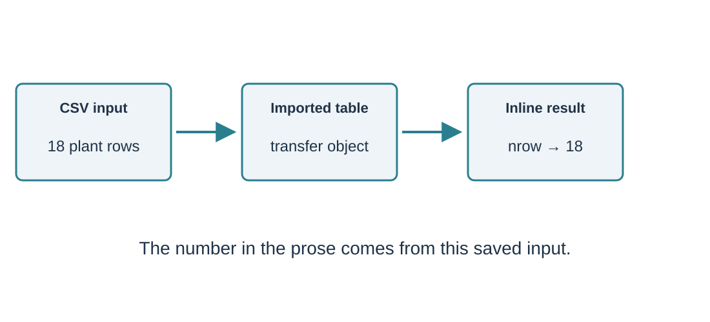
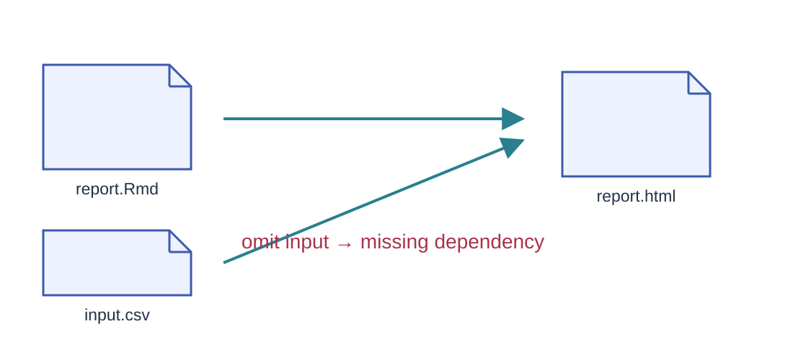
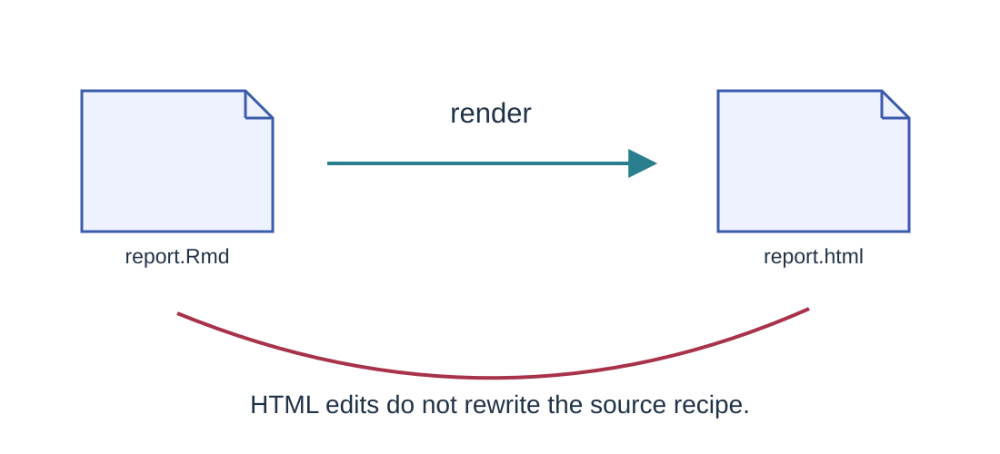

## Keep explanation connected to calculation

{height=390}

Your report source is **`.Rmd`**. Its readable output is **`.html`**.

::: notes
Open the supplied report.Rmd beside its HTML. These lecture webpages are made with Quarto, but students do not need to author Quarto. The course's report format is R Markdown. Rendering runs the calculations and combines their output with prose instead of requiring manual copy-and-paste of results.
:::

## Code chunks have opening and closing fences

<pre><code>&#96;&#96;&#96;{r import}
library(readr)
seedlings &lt;- read_csv("data/seedlings.csv",
                      show_col_types = FALSE)
&#96;&#96;&#96;
</code></pre>

Ordinary sentences go outside chunks. Give each chunk a unique label.

::: notes
The displayed fences are literal R Markdown syntax. Show the opening three backticks, braces with r and an optional label, then the closing fence. The report header between --- lines sets title and html_document output. Demonstrate in the supplied template rather than asking students to reconstruct everything from memory.
:::

## A report runs in order

{height=390}

Ask what each chunk needs before it can run.

::: notes
Use seedlings then growth_mm then a figure as the concrete dependency. A correct expression can still fail when its input object does not yet exist. Package installation is separate setup; library calls belong in the report. Repeated unnecessary imports can obscure the sequence.
:::

## Read the first useful error

Suppose a plot refers to `growth_mm`, but the report only imports the raw table.

- Which earlier calculation is missing?
- Is the name spelled exactly as created?
- In which chunk should the repair go?

::: notes
The raw CSV does not contain growth_mm. Add final minus initial in a preparation chunk before plotting. Do not try to cure this by repeatedly creating objects in the Console. Deliberately introduce one misspelling in a demonstration, read the reported chunk, fix it, and render again.
:::

## Your Console is not the report's saved method

{height=390}

Put all required imports and calculations in the source document.

::: notes
Run an import only in the Console, then explain why a recipient cannot reproduce that unstated step. The Knit route uses a separate rendering process; the direct render function can use a calling environment, so the practical's restart-and-render check is important. Do not promise every rendering invocation automatically isolates all state.
:::

## HTML is useful, but keep its inputs and source

{height=390}

The report belongs at the project root so `data/` paths stay consistent.

::: notes
A .Rmd file does not contain the original CSV simply because it mentions its name. An HTML file can be read without RStudio, but it is not the editable analysis source. Moving the report into reports/ would change ordinary relative paths; output HTML may go there while the source remains in the project root.
:::

## Render from the Console, not from inside itself

Save the document, then use **Knit**, or run in the **R Console**:

```r
rmarkdown::render("report.Rmd", output_dir = "reports")
```

Do not put that command inside the report you are rendering.

::: notes
The double colon calls a function from a package. output_dir changes where the HTML is written, not where the source belongs. The Knit button may put the output beside the source; locate the actual file. Restart R before a reproducibility check. A self-rendering chunk would create a recursive workflow and is not required.
:::

## Chunk labels locate code in a report

{height=350px}

Unique descriptive labels help diagnose an error.

::: notes
Duplicate a label only in the disposable workshop copy. Read the first meaningful error, restore unique labels, and render successfully. Chunk labels locate code sections; they are not the headings in the final prose.
:::

## Break one thing, record it, then repair

In a workshop copy, test:

- A duplicated chunk label.
- A misspelt input filename.
- A plot placed before its required calculation.

Restore a successful render after each test.

::: notes
Change one cause at a time. Log the changed line, exact error, diagnosis, repair and successful rerun. Keep the original template available. Adding repeated imports randomly is not a diagnostic strategy.
:::

## Inline results are calculated dependencies

{height=350px}

When the input changes, the data description must change too.

::: notes
The transfer report must describe 18 plants, nine per group, from the correct input. Inline calculations reduce copied stale numbers, but they do not automatically repair a written description of the wrong experimental design.
:::

## Input replacement needs a narrative audit

Change the import to seedlings-transfer.csv.

Then check the question, methods, caption, inline count, and interpretation.

A new plot beneath an old 24-plant description is inconsistent.

::: notes
The source and narrative must describe one deliberate study. Search for the old filename and the number 24 as prompts to investigate; not every occurrence is necessarily wrong. Retain separate workshop and transfer reports.
:::

## Source alone cannot supply a missing dataset

{height=350px}

A shortcut or screenshot does not replace the measurement file.

::: notes
The local portability test uses a separate extracted project and its own root. Preserve relative input paths. This rehearsal does not verify authentication, remote software, or actual network transfer.
:::

## Run the renderer outside the report

Use Knit, or run in the R Console:

```r
rmarkdown::render("report-workshop.Rmd")
```

Do not place this command inside that report.

::: notes
A render call inside the document would cause the report to try to render itself. Packages and calculations belong in its appropriate chunks; installing software belongs to the separate setup step.
:::

## Change the recipe, then rebuild its output

{height=350px}

Make revisions in .Rmd, then render and inspect the new HTML.

::: notes
Source prose and code are editable instructions; HTML is the reading copy. A browser can show an older file if a student opens the wrong output location. Locate the actual rendered filename and folder.
:::

## A recovery log preserves the lesson from an error

Save the exact failure and successful repair.

Then restart R and render the corrected source without manual Console preparation.

::: notes
Keep report-workshop.Rmd, transfer-report.Rmd, their HTML outputs and render-recovery.txt. Ask students to explain why code order and input location matter rather than memorising one particular error message.
:::

## Make one change and check it

[Open the practical and notes](../../week2/09-rmarkdown.qmd).

Render the unchanged template first. Then add your question, methods, labelled
figure, and interpretation. Restart and render the saved source again.

::: notes
Begin with a known-working baseline. Ask the student to name the source, output, and input locations before editing. The practical supplies a complete minimal report and error-recovery hints. A short caption plus clear prose is more useful than formatting additions that obscure the calculation.
:::
