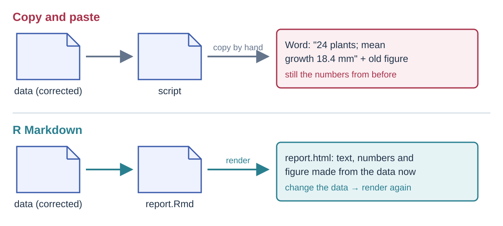
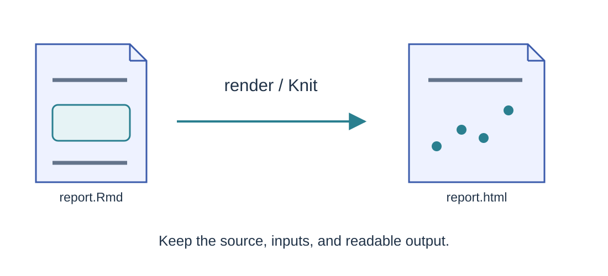
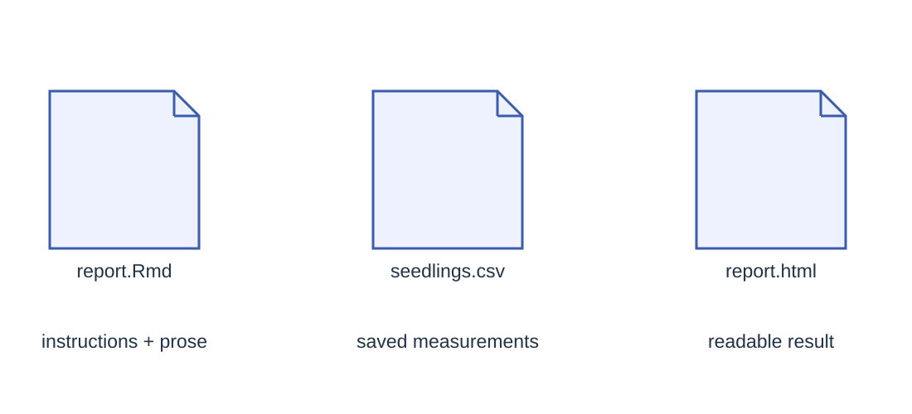
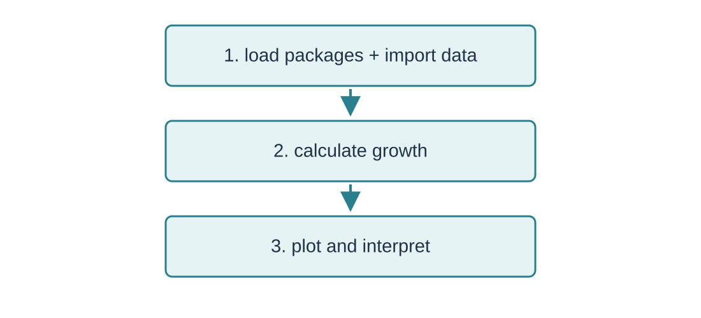
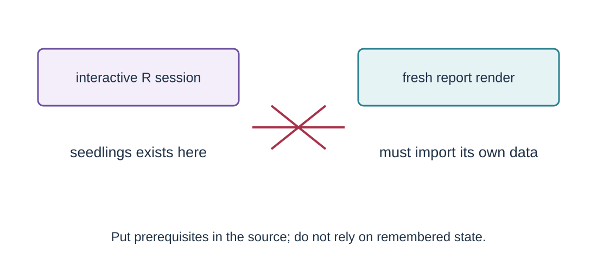
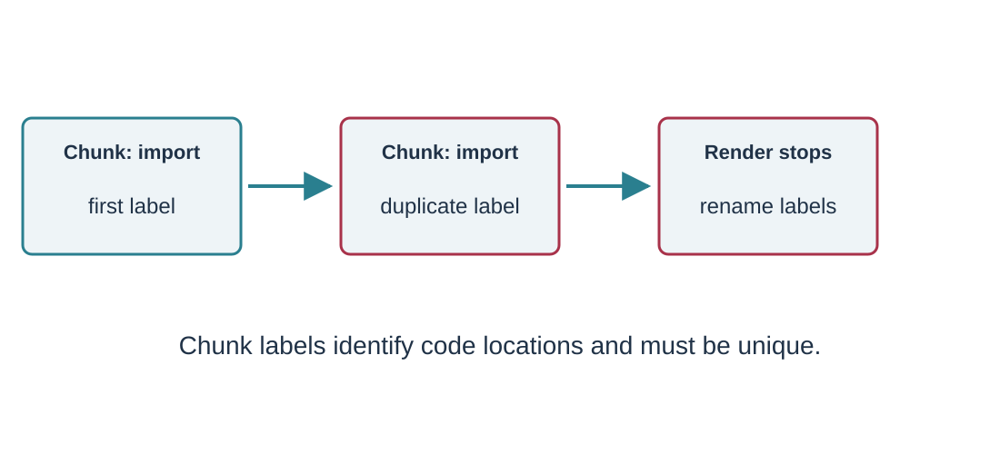

## About this lecture

You have a script, a figure and a few numbers. The usual next step is to paste the figure into Word and type the numbers into sentences. Then one value in the data is corrected, and the document keeps the old numbers. Months later, nobody, including you, can say which version of the data produced Figure 2. **An R Markdown report keeps the explanation, the code and its results in one file, and rebuilds all of them from the data each time you render it.**

Today you will:

- read the parts of an `.Rmd` file: header, text and code chunks;
- render it into an HTML report you can open in any browser;
- put a calculated number into a sentence, so it updates itself;
- find and fix the first error when rendering stops.

Day 10 uses this to write your first complete short report. Every report in this course is made this way.

::: notes
Lab reports, thesis chapters and supplementary methods all suffer from copied numbers that no longer match the data. The course webpages are made with Quarto, a close relative; students only need R Markdown.
:::

## Copied numbers go stale

{height=360}

- Copy and paste: every correction means finding and retyping every affected number and figure.
- R Markdown: correct the data, render again, and text, numbers and figures all agree.

::: notes
Ask who has had to redo a figure in a lab report after a correction. The point is not that Word is bad for writing; it is that results should come from the analysis, not from memory or the clipboard.
:::

## One source file, one readable report

:::: {.columns}
::: {.column width="42%"}
- `report.Rmd` is the **source**: your text plus R code. You edit this.
- **Rendering** runs the code and writes `report.html`: text, results and figures.
- The HTML is a **reading copy**. Edits made there are lost at the next render.
- Keep the `.Rmd`, the data and the HTML together.
:::
::: {.column width="58%"}
{width="100%"}
:::
::::

::: notes
Open the supplied report.Rmd next to its rendered HTML. The source alone does not contain the CSV; it only names it.
:::

## Inside an `.Rmd` file

:::: {.columns}
::: {.column width="52%"}
<pre><code>---
title: "Seedling growth"
output: html_document
---

## Question

How much did the seedlings grow?

&#96;&#96;&#96;{r import}
library(readr)
seedlings &lt;- read_csv("data/seedlings.csv",
                      show_col_types = FALSE)
&#96;&#96;&#96;
</code></pre>
:::
::: {.column width="48%"}
- **Header** between the `---` lines: title and output format.
- **Text** as you would write it. `## Question` is a heading.
- **Code chunk** between <code>&#96;&#96;&#96;{r}</code> and <code>&#96;&#96;&#96;</code>. `import` is the chunk's label; each label must be unique.
- `#` outside a chunk makes a heading; inside a chunk it starts an R comment.
:::
::::

::: notes
The supplied template has this structure. Students should not have to type the fences from memory; copy from the template. The .Rmd stays in the project root so that data/seedlings.csv points to the data.
:::

## Render it

:::: {.columns}
::: {.column width="42%"}
Save, then click **Knit**. Or type in the **Console**:

```r
rmarkdown::render("report.Rmd",
                  output_dir = "reports")
```

- Never put this line inside the report: a report must not render itself.
- `output_dir` puts the HTML in `reports/`; the `.Rmd` stays in the project folder.
:::
::: {.column width="58%"}
{width="100%"}
:::
::::

::: notes
Knit may put the HTML next to the source instead; find the actual file rather than assuming. rmarkdown::render calls the render function from the rmarkdown package without loading the whole package.
:::

## Chunks run from top to bottom

:::: {.columns}
::: {.column width="42%"}
- Rendering runs chunks **in order**, like a script from the top.
- A plot of `growth_mm` must come **after** the chunk that calculates it.
- `library()` and the import go first.
- Installing packages is setup, not part of the report.
:::
::: {.column width="58%"}
{width="100%"}
:::
::::

::: notes
In the exercises students move a plot chunk above the calculation on purpose, read the error, and move it back.
:::

## The report starts from nothing

:::: {.columns}
::: {.column width="42%"}
- Knit starts a **fresh** R session. Objects you made in the Console do not exist there.
- So every import and calculation the report needs must be written **in the report**.
- The test: restart R, then render. If it works, the report is complete.
:::
::: {.column width="58%"}
{width="100%"}
:::
::::

::: notes
A report that only works after some Console typing cannot be reproduced by anyone else. The direct render() call can see Console objects, which is why the course always says "restart R, then render".
:::

## Put calculated numbers into sentences

:::: {.columns}
::: {.column width="42%"}
In the text of the `.Rmd`:

<pre><code>There are &#96;r nrow(seedlings)&#96; plants.</code></pre>

The HTML reads: *There are 24 plants.*

- Import the 18-plant transfer study instead, and it reads 18. No retyping.
- But words you typed yourself, such as "twelve per group", do **not** update. Reread the text when the data change.
:::
::: {.column width="58%"}
{width="100%"}
:::
::::

::: notes
Inline R removes stale copied numbers, but it cannot fix a description of the wrong study. The transfer-report exercise asks students to search their source for "24" and the old filename.
:::

## A figure with a caption

<pre><code>&#96;&#96;&#96;{r growth-figure, fig.cap="Each point is one independently potted seedling."}
ggplot(seedlings, aes(x = treatment, y = growth_mm)) +
  geom_point(position = position_jitter(width = 0.08, height = 0, seed = 8)) +
  labs(x = "Treatment", y = "Change in seedling length (mm)")
&#96;&#96;&#96;
</code></pre>

- Reuse the plotting code from Day 8; add `library(ggplot2)` to the first chunk.
- The **caption** says what the figure shows. A sentence below it says what you see in it.

::: notes
Code can stay visible in these first reports so the method is easy to inspect. The caption names the unit of observation; the prose interprets.
:::

## When rendering stops: read the first error

:::: {.columns}
::: {.column width="45%"}
The message names the **chunk**. Check, in order:

1. Is the package loaded (`library()`) before use?
2. Are file and column names spelt exactly right?
3. Is the object made in an **earlier** chunk?
4. Are all chunk labels unique, every fence closed?

Change one thing, render again.
:::
::: {.column width="55%"}
{width="100%"}
:::
::::

::: notes
In the workshop copy students break one thing at a time (duplicate label, misspelt file, plot before calculation), record the message and the repair in reports/render-recovery.txt, and restore a working render each time. Recovery, not memorising messages.
:::

## Sharing the `.Rmd` alone is not enough

:::: {.columns}
::: {.column width="42%"}
- The report reads `data/seedlings.csv`. Someone who gets only `report.Rmd` cannot render it.
- Share the **project folder**: `.Rproj`, `.Rmd`, `data/`, `output/`, `reports/`, with the same layout.
- A screenshot or a shortcut does not replace the data file.
:::
::: {.column width="58%"}
{width="100%"}
:::
::::

::: notes
The last exercise copies the project to another folder and renders it from there. Moving the .Rmd into reports/ would break its relative data path.
:::

## Summary {.smaller}

| Idea | Key fact |
|---|---|
| Why | Results come from the data at every render; no copied numbers that go stale |
| Source and output | Edit `report.Rmd`; `report.html` is a reading copy, rebuilt at each render |
| Parts | Header between `---`; text; code chunks between fences, each with a unique label |
| Render | Knit, or `rmarkdown::render()` in the Console, never inside the report |
| Order | Chunks run top to bottom: packages, import, calculation, then plot |
| Fresh session | The report must contain every step; restart R, then render to test |
| Inline R | <code>&#96;r nrow(seedlings)&#96;</code> puts a calculated number in a sentence; typed words still need checking |
| Errors | Read the first error and its chunk label; change one thing at a time |
| Sharing | `.Rmd` plus data in the same project layout |

**Next (Day 10, first report):** write a short report that answers a biological question and that someone else can rerun.

**Now:** [open the Day 9 exercises](../../week2/09-rmarkdown.qmd). Leave with `report.Rmd` (question, methods, labelled figure, interpretation) and its rendered HTML, rendered again after restarting R.

::: notes
Start the exercises by rendering the unchanged template, so there is a known working baseline. Extended work: report-workshop.Rmd with deliberate errors, transfer-report.Rmd for the 18-plant study, and render-recovery.txt.
:::
