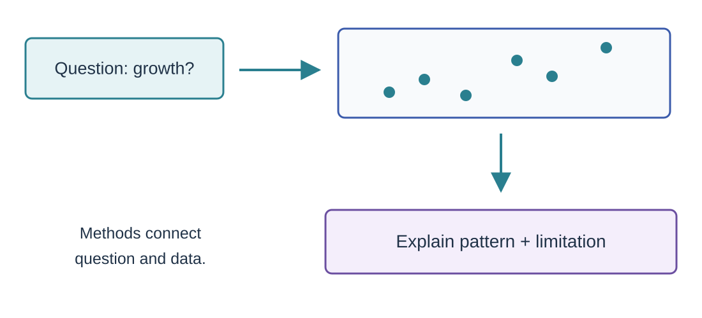
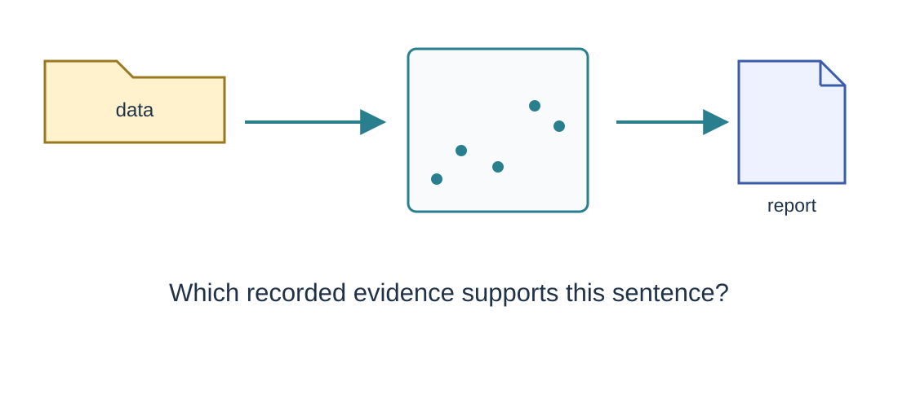

## Describe what was independently measured

{height=390}

The simulated study measures 24 plants twice, seven days apart.

::: notes
This is a consolidation briefing, not another statistics lecture. Each plant has its own pot and a randomly allocated control/nutrient treatment. The nutrient formulation is unspecified. Two time measurements on the same plant are not two separate plants. Do not invent experimental details beyond the dictionary.
:::

## Explain the method in biological terms

“Growth was calculated as final minus initial length for each plant, in mm.”

That explains more than “we called `mutate()`”.

The report still needs the import and calculation code so someone can rerun it.

::: notes
Distinguish a scientific methods explanation from a transcript of function names. The reader should understand the operation without speaking R. Students already have working code from previous days; their job is to place it in a self-contained report and explain it.
:::

## A readable figure shows the observations

{height=390}

What is one dot? What does the vertical axis measure? Where is the overlap?

::: notes
Expect one independently potted plant and change in length in mm. Ask for a concrete visible pattern and a limitation. Avoid p-values or an unsupported declaration that the treatment works. A mean across both groups would not answer whether groups differ; group summaries come next week.
:::

## Connect evidence to an interpretation

{height=390}

Say what you observe and what the observations alone cannot settle.

::: notes
Possible prose: growth varied among plants in both groups, and treated values tended to be higher but overlapped controls. The small simulated sample and lack of a quantified uncertainty comparison limit conclusions. Do not prescribe a single identical sentence for everyone; ask what evidence supports their wording.
:::

## Keep the project portable

{height=390}

`data/seedlings.csv` should not contain your personal username.

::: notes
The .Rmd stays at the project root. Generated HTML can be next to it or in the documented reports/ output folder. A project file sets a working context; it does not embed the data. The diagram motivates later peer reproduction without adding a new remote service procedure.
:::

## Test it after restarting R

In the **R Console**, after saving `first-report.Rmd`:

```r
rmarkdown::render("first-report.Rmd", output_dir = "reports")
```

If an object is missing, repair the source rather than hiding the gap in Console state.

::: notes
Do not insert this render command into the report itself. Work from the first relevant error and its chunk. Check file paths, package loading, and the growth calculation before rewriting the whole report. A successful fresh-session render is evidence of reproducibility in this environment, not proof the interpretation is correct.
:::

## Descriptions need evidence

{height=350px}

A difference in typical growth does not mean every treated plant outgrew every control.

::: notes
Use the actual transfer data. Read three draft claims and identify a supporting figure, recorded value, or supplied design fact. Revise universal or causal claims that this descriptive exercise cannot establish.
:::

## Audit the report as a reader

Can the HTML alone identify:

- The question and independent unit?
- The input and measurement units?
- The calculation and plotted quantity?
- A defensible conclusion and limitation?

::: notes
Read without the source first to find communication gaps. Then locate the code and dictionary supporting each fact. Revise the R Markdown source, not only the generated HTML.
:::

## Connect the question to the recorded evidence

{height=350px}

Each section has a job in the reasoning.

::: notes
Methods identify what was done; results describe what was observed; interpretation connects observations to the question within limits. Four clear short sections may communicate better than a long formal document.
:::

## Choose a figure because it answers a question

Compare final-size and growth plots.

Keep one as the main evidence. Retain another only if it answers a stated useful question.

::: notes
More figures are not automatically better. This session expands revision and transfer rather than adding a statistical test. A partner should state which measured or derived quantity the vertical axis actually shows.
:::

## The received project needs the same internal structure

{height=350px}

Test from the received copy’s root in a fresh session.

::: notes
A working original project is not proof that the received package reproduces it. Include the ordinary CSV and dictionary rather than a shortcut. Native Windows RStudio should use the extracted Windows project, not an unnoticed Ubuntu copy.
:::

## A smaller brief tests transfer without new methods

Choose the transfer seedlings or the supplied solutions table.

Import, check, calculate, plot, and write a short laboratory brief.

Save one selected brief, not both contexts.

::: notes
For plants derive growth. For solutions, every formula and molar mass is given. The row roles differ: plants are experimental units, while solutions are numerical preparation cases. Do not call a supplied formula relation a discovered biological effect.
:::

## Converting a label is not converting values

{height=350px}

Check the values, variable names and axis units together.

::: notes
A unit-label error can leave R code running without warnings. Conversion needs a numerical change as well as a changed label. Encourage explicit comments and independent checks, not evaluation of appearance alone.
:::

## Leave a revision trail and a working brief

Retain:

- A revised earlier report and its source.
- One laboratory-brief.Rmd and HTML.
- Saved table/figure and a revision log.
- A successfully tested practice package.

::: notes
The solution checks are 50, 100 and 150 mmol/L for each solute. The transfer plant input has 18 records and T01 growth of 15.0 mm. These are practice products, not a grading rubric or an examination design.
:::

## Give the reader four short sections

[Open the exercises](../../week2/10-first-report.qmd).

1. **Question and data:** design, measurements, independent unit.
2. **Methods:** import and growth calculation.
3. **Results:** a labelled figure and relevant calculated facts.
4. **Interpretation:** pattern, variation, and one limitation.

::: notes
Save first-report.Rmd and its HTML. A partner should be able to read the HTML without RStudio and identify the units and meaning of a point. With spare practice time, the provided leaf-area/mass table offers a transfer exercise; it does not require fitting a line today. Keep time for support rather than extending the deck.
:::
