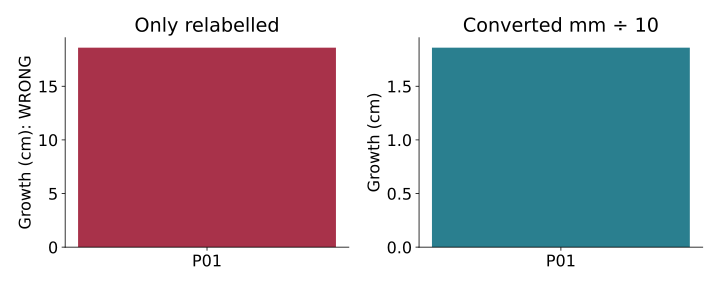
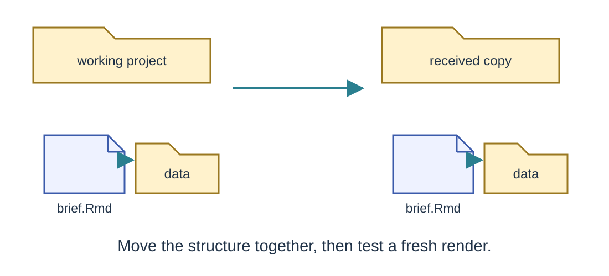
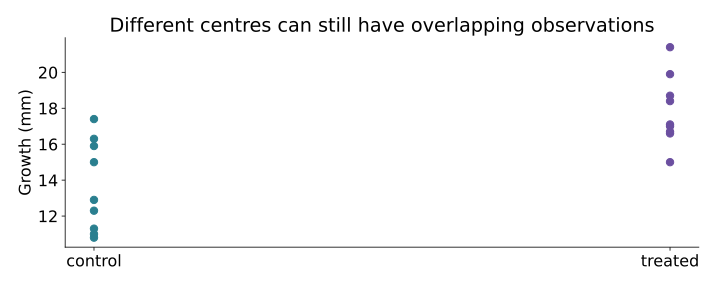

## About this lecture

A lab report, a thesis chapter or a paper is read by someone who was not in the room and will not run your code first. They need to know what was measured, how, what you saw, and what you cannot conclude. A report that announces "the treatment works!" from two overlapping clouds of points, or that only renders on your own laptop, fails that reader. **Today you write a short report that answers a biological question honestly and that someone else can rerun.**

Today you will:

- build a report from four short sections: question and data, methods, results, interpretation;
- explain a method in biological words, with the code underneath;
- describe a figure honestly: pattern, overlap and one limitation;
- check that the project renders from a fresh session and from another folder.

This day brings together Days 6–9. Day 11 asks what to do when the table itself contains errors.

::: notes
This is a consolidation day: no new R functions. The skill is putting existing pieces together for a reader. Keep the bar realistic: four short, correct sections beat a long formal document.
:::

## Four sections, four jobs

:::: {.columns}
::: {.column width="45%"}
1. **Question and data:** what was asked, what was measured, what one row is.
2. **Methods:** how the file was read and how growth was calculated.
3. **Results:** a labelled figure and a few calculated facts.
4. **Interpretation:** what the pattern is, how much plants vary, one limitation.
:::
::: {.column width="55%"}
{width="100%"}
:::
::::

Every sentence should be backed by the data, a figure or the study description.

::: notes
Save report.Rmd as first-report.Rmd in the project root. Students already have most of the code from Days 8 and 9.
:::

## Question and data: what was measured?

:::: {.columns}
::: {.column width="42%"}
- **24 seedlings** in separate pots; 12 randomly allocated to a nutrient treatment, 12 controls.
- Length measured at the start and after **seven days**, in mm.
- One row = one plant. Two lengths of the same plant are not two plants.
- Simulated teaching data: say so.
:::
::: {.column width="58%"}
{width="100%"}
:::
::::

::: notes
All of this comes from data/README.md, not from R. The nutrient formulation is unspecified; do not invent one.
:::

## Methods: biology first, code underneath

> "Growth was calculated as final minus initial length for each plant, in mm."

That tells a reader more than "we used `mutate()`". The code still belongs in the report so the calculation can be rerun:

```r
seedlings <- read_csv("data/seedlings.csv", show_col_types = FALSE)
seedlings <- mutate(seedlings, growth_mm = final_mm - initial_mm)
nrow(seedlings)                    # 24
sum(is.na(seedlings$growth_mm))    # 0
range(seedlings$growth_mm)         # 8.0 30.8
```

Simple checks like these tell the reader the data are complete: 24 plants, nothing missing.

::: notes
The range describes these 24 plants, not all seedlings in nature, and is sensitive to a single unusual plant. Keep library() calls in the first chunk.
:::

## Results: a figure the reader can read

:::: {.columns}
::: {.column width="42%"}
- **One dot = one plant.** Say so in the caption.
- **y-axis:** change in length (mm). Not final size.
- Every plant shown, so the reader sees the spread, not only a summary.
- The figure answers the question; one good figure beats three unexplained ones.
:::
::: {.column width="58%"}
{width="100%"}
:::
::::

::: notes
If students also made the initial-versus-final plot on Day 8, ask which figure answers "did treated plants grow more?". Keep the second only if it answers a stated question.
:::

## Interpretation: say what you see, and no more

| Sentence | OK? |
|---|---|
| "Growth varied among plants in both groups." | Yes: visible in the figure |
| "Treated plants tended to grow more, but the groups overlap: control 8.0–18.7 mm, treated 12.2–30.8 mm." | Yes: describes these data |
| "Every treated plant grew more than every control." | No: P17 (treated) grew 12.2 mm, less than many controls |
| "The treatment works." | Not yet: we have not measured how uncertain the difference is (week 4) |

End with one limitation, e.g. a small simulated study, or no uncertainty assessed yet.

::: notes
Ask students which sentence in their own draft is closest to the last row, and rewrite it. "The graph shows a difference" is vague: say what is higher, by roughly how much, and with how much overlap.
:::

## A unit slip runs without warning

:::: {.columns}
::: {.column width="42%"}
- Relabelling the axis "cm" without dividing by 10 makes P01's 18.6 mm into "18.6 cm".
- R gives no error: it does not know units.
- Check together: the values, the column name (`_mm`), the axis label and the text.
:::
::: {.column width="58%"}
{width="100%"}
:::
::::

::: notes
The same check as Day 6: conversion changes values, not only labels. A reader trusts the axis label.
:::

## Make the project portable

:::: {.columns}
::: {.column width="42%"}
- Paths start from the project folder: `data/seedlings.csv`, not a personal path such as `C:/Users/anna/Desktop`.
- The `.Rmd` stays in the project folder; the HTML can go to `reports/`.
- Then the whole folder can move to another place or person and still work.
:::
::: {.column width="58%"}
{width="100%"}
:::
::::

::: notes
The .Rproj file sets the working folder; it does not contain the data. Personal absolute paths are the most common reason a report fails on someone else's computer.
:::

## Test it like a stranger would

:::: {.columns}
::: {.column width="45%"}
Restart R, then in the **Console**:

```r
rmarkdown::render("first-report.Rmd",
                  output_dir = "reports")
```

- Fails? Fix the source, not the Console.
- Then copy the project to another folder, open **that** `.Rproj`, and render again.
:::
::: {.column width="55%"}
{width="100%"}
:::
::::

::: notes
A successful fresh render shows the report is reproducible here; it does not show the interpretation is right. On Windows, use the native project in Documents, not a copy inside Ubuntu.
:::

## Read the HTML as the reader

Open the HTML in a browser, without the source. Can you find:

- the question, and what one plant (one row, one dot) is?
- the input file and the units?
- how growth was calculated, and what the y-axis shows?
- the main pattern, the overlap, and one limitation?

Anything missing: add it to the `.Rmd` and render again. Never edit the HTML.

::: notes
The extended exercise turns this into a revision log, reports/report-revision.txt: issue, correction, evidence the corrected report reruns.
:::

## Then: a second, smaller brief

:::: {.columns}
::: {.column width="42%"}
Pick one table and write `laboratory-brief.Rmd` with the same four sections:

- **18-plant transfer study:** T01 grew 15.0 mm; 9 plants per group.
- **Or `solutions.csv`:** calculated concentrations of 50, 100 and 150 mmol/L for each solute.
:::
::: {.column width="58%"}
{width="100%"}
:::
::::

Same skills, new data: check every number and every sentence against this table, not the old one.

::: notes
For solutions, rows are calculation cases, not independent experimental units; concentrations follow from a supplied formula, not from measured variation among plants. The leaf-mass scatter plot (leaf-first-look.R) is a further optional transfer.
:::

## Summary {.smaller}

| Section | What it must contain |
|---|---|
| Question and data | Question; 24 plants, 12 per group, random allocation; one row = one plant; units; simulated |
| Methods | Growth = final − initial length (mm), in words, plus the code with relative paths |
| Results | A labelled figure with every plant; a few checked facts (24 plants, none missing) |
| Interpretation | Pattern, overlap and variation, one limitation; no "the treatment works" yet |
| Reproducible | Renders after restarting R, and from a copy of the project in another folder |

**Next (Day 11, data quality):** what to do when the table itself has typos, wrong units, duplicates and missing values.

**Now:** [open the Day 10 exercises](../../week2/10-first-report.qmd). Leave with `first-report.Rmd` and its HTML in `reports/`, rendered after restarting R.

::: notes
Self-check: the .Rmd contains imports, the derived column and the plot; the HTML makes sense without reading every code line; no personal paths.
:::
