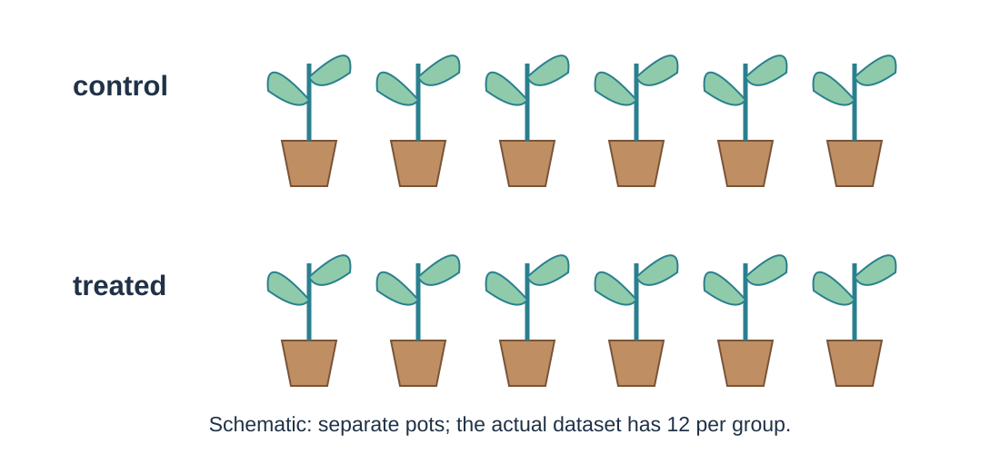
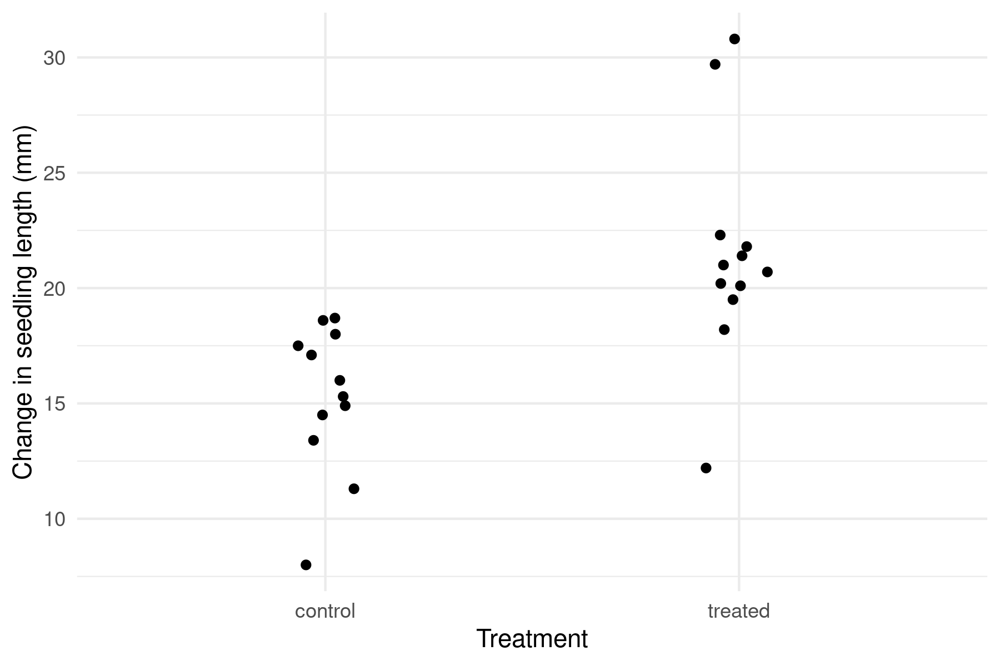
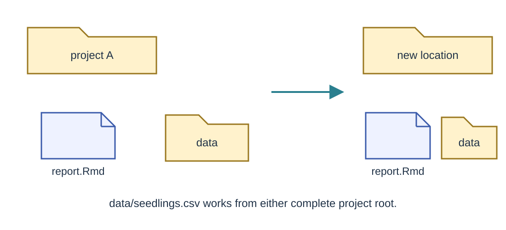

## Describe what was independently measured

{height=390}

The simulated study measures 24 plants twice, seven days apart.

::: notes
This is a consolidation briefing, not another statistics lecture. Each plant has its own pot and a randomly allocated control/nutrient treatment. The nutrient formulation is unspecified. Two time measurements on the same plant are not two separate plants. Do not invent experimental details beyond the dictionary.
:::

## Explain the method in biological terms

“Growth was calculated as final minus initial length for each plant, in mm.”

That explains more than “we called `mutate()`”.

The report still needs the import and calculation code so someone can rerun it.

::: notes
Distinguish a scientific methods explanation from a transcript of function names. The reader should understand the operation without speaking R. Students already have working code from previous days; their job is to place it in a self-contained report and explain it.
:::

## A readable figure shows the observations

{height=390}

What is one dot? What does the vertical axis measure? Where is the overlap?

::: notes
Expect one independently potted plant and change in length in mm. Ask for a concrete visible pattern and a limitation. Avoid p-values or an unsupported declaration that the treatment works. A mean across both groups would not answer whether groups differ; group summaries come next week.
:::

## Connect evidence to an interpretation

{height=390}

Say what you observe and what the observations alone cannot settle.

::: notes
Possible prose: growth varied among plants in both groups, and treated values tended to be higher but overlapped controls. The small simulated sample and lack of a quantified uncertainty comparison limit conclusions. Do not prescribe a single identical sentence for everyone; ask what evidence supports their wording.
:::

## Keep the project portable

{height=390}

`data/seedlings.csv` should not contain your personal username.

::: notes
The .Rmd stays at the project root. Generated HTML can be next to it or in the documented reports/ output folder. A project file sets a working context; it does not embed the data. The diagram motivates later peer reproduction without adding a new remote service procedure.
:::

## Test it after restarting R

In the **R Console**, after saving `first-report.Rmd`:

```r
rmarkdown::render("first-report.Rmd", output_dir = "reports")
```

If an object is missing, repair the source rather than hiding the gap in Console state.

::: notes
Do not insert this render command into the report itself. Work from the first relevant error and its chunk. Check file paths, package loading, and the growth calculation before rewriting the whole report. A successful fresh-session render is evidence of reproducibility in this environment, not proof the interpretation is correct.
:::

## Give the reader four short sections

[Open the practical and notes](../../week2/10-first-report.qmd).

1. **Question and data:** design, measurements, independent unit.
2. **Methods:** import and growth calculation.
3. **Results:** a labelled figure and relevant calculated facts.
4. **Interpretation:** pattern, variation, and one limitation.

::: notes
Save first-report.Rmd and its HTML. A partner should be able to read the HTML without RStudio and identify the units and meaning of a point. With spare practice time, the provided leaf-area/mass table offers a transfer exercise; it does not require fitting a line today. Keep time for support rather than extending the deck.
:::
