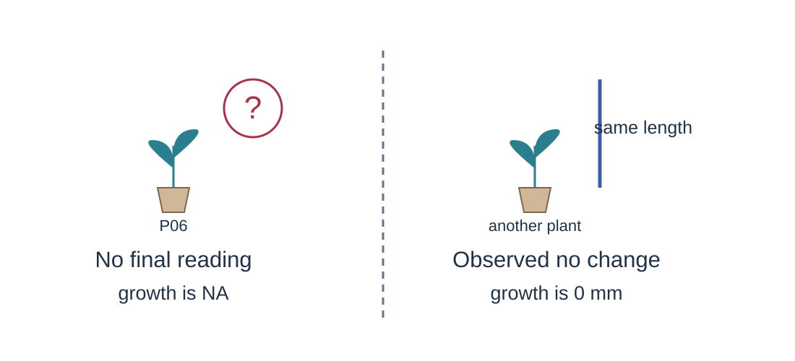

## Did we measure 25 plants?

{height=350px}

The study has **24 plants**. The export has **25 rows**.

::: notes
Ask whether the extra row proves another plant existed. It does not. The supplied source notes confirm that P01 was imported twice. A repeated ID can be legitimate in other designs, such as measurements over time; this study specifies one row per plant.
:::

## Keep the original and explain every repair

{height=350px}

A script makes the changes inspectable and repeatable.

::: notes
Locate the raw file in the project before showing code. Preserve it unchanged. A script is not just a way to save typing: it records which evidence justified each transformation. A copy with unexplained edits is harder to audit.
:::

## Inspect the original entries as text

```r
library(readr)
library(dplyr)
raw <- read_csv("data/seedlings-messy.csv",
  col_types = cols(.default = col_character()),
  trim_ws = FALSE, show_col_types = FALSE)
unique(raw$treatment)
```

`Control`, `control`, and `treated ` are different stored strings.

::: notes
The import deliberately preserves whitespace and mixed entries. Demonstrate the trailing space by pointing at the printed quoted value. We are not asking beginners to memorise the importer options; explain why these options help inspect this particular file.
:::

## A suspicious number is a question, not a verdict

{height=350px}

The source notebook confirms P21: **43.8 mm**.

::: notes
The entered 4.38 is not automatically an error because it is small. The supplied source note confirms that a centimetre value was transcribed into a millimetre column. A confirmed conversion is different from changing an inconvenient biological observation.
:::

## Unknown is different from zero

{height=350px}

Keep P06’s final length as `NA`.

::: notes
A missing final measurement prevents us calculating its growth. A measured growth of zero would mean that initial and final readings were equal. Do not copy the complete teaching file’s P06 value into this separate missing-data exercise.
:::

## Repair only what the evidence supports

```r
cleaned <- raw |>
  mutate(treatment = tolower(trimws(treatment)),
    initial_mm = if_else(plant_id == "P18", "18.7", initial_mm),
    final_mm = if_else(plant_id == "P21", "43.8", final_mm)) |>
  distinct() |>
  mutate(initial_mm = parse_double(initial_mm),
    final_mm = parse_double(final_mm),
    growth_mm = final_mm - initial_mm)
```

The original file stays unchanged; missing measurements remain missing.

::: notes
This is a supplied worked repair. Explain trimws as removing edge spaces and tolower as standardising the confirmed labels. distinct removes identical rows here because the duplicate import is documented. It would be unsafe to keep one arbitrary row for every repeated ID when records disagreed.
:::

## Count records and available measurements separately

{height=350px}

24 unique plants; **23 available growth measurements**.

::: notes
After numeric conversion and subtraction, the corrected table has 24 rows, zero duplicated IDs, and one missing growth. Control has 12 records but 11 available growths; treated has 12 and 12. Removing a missing value inside a mean does not make the missingness disappear from reporting.
:::

## Prediction: what should these two means return?

```r
mean(cleaned$growth_mm)
mean(cleaned$growth_mm, na.rm = TRUE)
```

Explain the missing observation before choosing the second calculation.

::: notes
The first returns NA. The second is about 18.48696 mm across the 23 available growth values. It is not a grouped treatment comparison. Ask students to say how many observations were used and what is unknown about the missing plant.
:::

## Practical: leave a repair trail

Save **`day11-cleaning.R`**, a derived CSV, and short cleaning notes.

- Which source fact justified each change?
- Which measurement stayed unknown?
- Can the script recreate the corrected file after restarting R?

[Open the practical and worked repair](../../week3/11-data-quality.qmd).

::: notes
Students should run inspection first, then the repairs, then verify counts. Ask a partner to locate the original, script, field notes, and output. Do not add an outlier-removal exercise: distinguishing evidence from convenience is the main outcome.
:::
