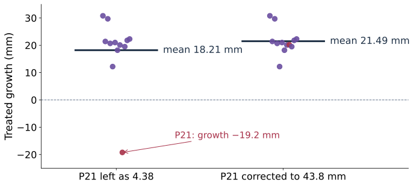
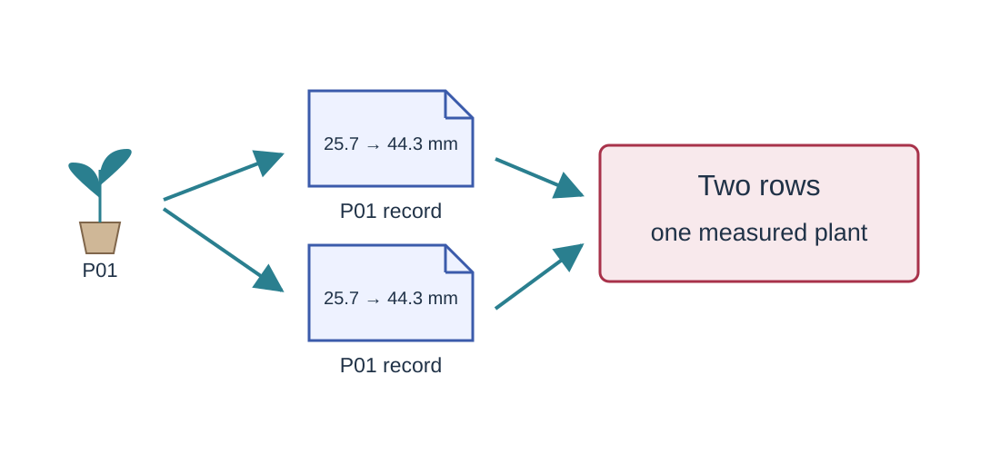
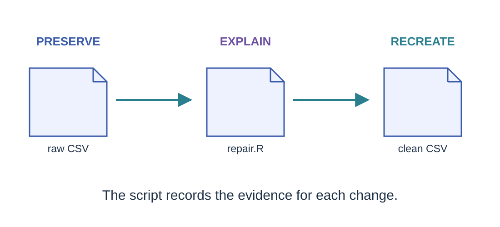
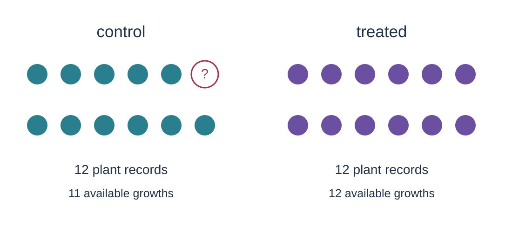
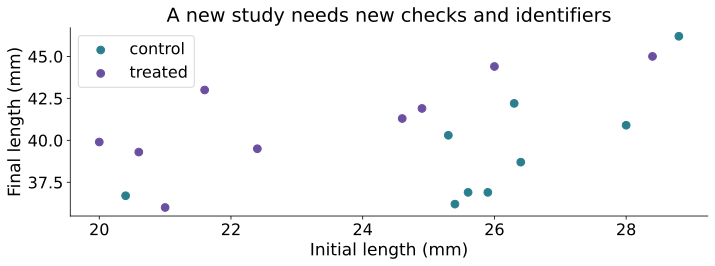

## About this lecture

A labmate exports the seedling measurements from the lab spreadsheet and sends you the file. You calculate the group means and email them to your supervisor. A week later someone notices that one plant appears twice and one length was typed in centimetres. R never complained: it calculates a precise-looking answer from whatever table it is given. **How do you know the table is fit to calculate from?**

Today you will:

- **inspect** a raw file as text before turning it into numbers;
- **repair only what source evidence supports**, in a script, keeping the original file unchanged;
- keep an **unknown value unknown**, and count plant records and usable measurements separately;
- **save and re-check** the cleaned file so that someone else can trace every change.

Week 3 is about describing data. The checked table and these habits carry into Days 12–15 and into the comparisons of week 4.

::: notes
Motivate from the student's own future: every lab spreadsheet, field sheet and instrument export contains slips. The skill is not suspicion of every unusual value; it is knowing which changes evidence supports and leaving a trail. The practical file data/seedlings-messy.csv has planted problems, and data/field-notes.txt contains the source evidence.
:::

## The problem: one slip changes the result

:::: {.columns}
::: {.column width="42%"}
- In the export, plant P21's final length is **4.38**. The source notebook says **43.8 mm**: the value was typed in centimetres.
- Left as it is, P21 "grew" **−19.2 mm**.
- That one cell pulls the treated mean from **21.49 mm** down to **18.21 mm**.
- R prints both numbers with the same confidence. Only a check against the source tells them apart.
:::
::: {.column width="58%"}
{width="100%"}
:::
::::

::: notes
This is the motivation for the whole day. Ask: if this mean went into a report, who would notice? Usually nobody, until a reviewer or a repeat experiment disagrees. The treated means are computed after the other documented repairs (labels, P18, duplicate). The correction of P21 is justified by the notebook entry, not by the fact that the value looks small.
:::

## What is wrong with this export?

:::: {.columns}
::: {.column width="45%"}
The study has **24 plants**; `data/seedlings-messy.csv` has **25 rows**.

- **P01** appears twice: one plant, two identical rows.
- Treatment is written `control`, `Control` and `treated ` (with a trailing space).
- **P18**'s initial length is the text `18.7 mm`.
- **P21**'s final length is 4.38 (centimetres).
- **P06** has no final length.

`data/field-notes.txt` records what actually happened for each case.
:::
::: {.column width="55%"}
{width="100%"}
:::
::::

::: notes
Open the CSV in a text editor first so students see the raw characters. A repeated ID is a question, not automatically an error: in a design with one row per time point, repeated IDs are expected. Here the protocol says one row per plant, and the field notes confirm that the second P01 row is an import duplicate.
:::

## Keep the original; repair in a script

:::: {.columns}
::: {.column width="45%"}
- Never edit the raw CSV by hand. Keep it exactly as received.
- Make each repair in **`day11-cleaning.R`** and write a **new** derived file.
- For every changed value, the trail is: **observation → evidence → action → check**.
- Then you, a supervisor or a reviewer can see each change, why it was made, and rerun it.
:::
::: {.column width="55%"}
{width="100%"}
:::
::::

::: notes
A hand-edited spreadsheet loses the record of what was changed. A script is a record: the comments say which source note justified each line. In the exercises students write output/cleaning-notes.txt with one line per problem: plant, observation, evidence, action.
:::

## Inspect the entries as text first

```r
library(readr)
library(dplyr)
raw <- read_csv("data/seedlings-messy.csv", show_col_types = FALSE,
                col_types = cols(.default = col_character()), trim_ws = FALSE)
dim(raw)                                   # 25 rows, 4 columns
unique(raw$treatment)                      # "control" "Control" "treated" "treated "
raw |> count(plant_id) |> filter(n > 1)    # P01 appears twice
```

- `col_character()` reads every column as text, so `18.7 mm` and `4.38` stay visible instead of being guessed or turned into missing values.
- `trim_ws = FALSE` keeps the trailing space in `"treated "`; the default would hide it.
- `count()` finds repeated IDs. Then look at **both P01 rows in full** before deciding anything.

::: notes
Demonstrate the printed output and point at the quoted "treated " value. We are not asking beginners to memorise importer options; explain why these options help inspect this particular file. If two rows shared an ID but disagreed in a measurement, they would need investigation, not arbitrary deletion.
:::

## A suspicious value is a question, not a verdict

:::: {.columns}
::: {.column width="45%"}
- 4.38 is not wrong *because it is small*. It is wrong because the notebook records **43.8 mm**.
- `"18.7 mm"` becomes the number 18.7 only after we confirm the unit is millimetres.
- A very small or large value **without** source evidence stays in the data. Plants really do vary.
- If you cannot decide, ask the person who recorded it, and note the open question.
:::
::: {.column width="55%"}
{width="100%"}
:::
::::

::: notes
The field notes end with: "A low or high measurement by itself is not sufficient reason to change or exclude it." Read that sentence aloud. Deleting inconvenient biological values to make a result look cleaner is a serious error in research. A confirmed transcription slip is different.
:::

## Unknown is different from zero

:::: {.columns}
::: {.column width="42%"}
- P06's final length was not recorded. Keep it as **`NA`** (not available).
- A zero would claim the plant shrank to nothing: growth **−24.7 mm** (its initial length was 24.7 mm).
- That invented value pulls the overall mean from **18.49 mm** to **16.69 mm**.
- Do not copy a value from another file to fill the gap either. Report the plant as missing.
:::
::: {.column width="58%"}
{width="100%"}
:::
::::

::: notes
A measured zero growth would mean that initial and final readings were equal: a real observation. A missing value means we do not know. Spreadsheets sometimes turn blanks into zeros on export; always check how missing values are coded. In the exercises students make a separate object wrong_zero_example to see this effect, and keep it apart from the corrected table.
:::

## The repair, step by step

```r
cleaned <- raw |>
  mutate(treatment = tolower(trimws(treatment)),                       # P03, P15 labels
         initial_mm = if_else(plant_id == "P18", "18.7", initial_mm),  # unit text removed
         final_mm = if_else(plant_id == "P21", "43.8", final_mm)) |>   # notebook value
  distinct() |>                                                         # identical P01 row
  mutate(initial_mm = parse_double(initial_mm),
         final_mm = parse_double(final_mm),
         growth_mm = final_mm - initial_mm)
```

- `trimws()` removes edge spaces; `tolower()` makes `Control` into `control`.
- `if_else()` changes **one identified record** only, never "every small value".
- `distinct()` removes rows that are identical in every column; we use it only because the P01 rows are identical and the notes confirm the duplicate.
- P06 stays missing: `parse_double()` keeps the blank as `NA`.

::: notes
Each line maps to one sentence in the field notes; ask students to say which. distinct(plant_id, .keep_all = TRUE) would silently keep one of two disagreeing records and is not used here. The raw object and the CSV on disk are unchanged.
:::

## Count records and usable measurements separately

:::: {.columns}
::: {.column width="45%"}
```r
nrow(cleaned)                 # 24 plants
sum(is.na(cleaned$growth_mm)) # 1 unknown
mean(cleaned$growth_mm)       # NA
mean(cleaned$growth_mm, na.rm = TRUE)
                              # 18.49 (23 plants)
```

- `NA` from `mean()` is R telling you a value is unknown. Good.
- `na.rm = TRUE` gives the mean of the **23 available** growths. Report it as such: "n = 23 of 24 plants".
:::
::: {.column width="55%"}
{width="100%"}
:::
::::

::: notes
Ask students to predict both mean calls before running them. The first returns NA; the second is about 18.49 mm across 23 available growth values, both groups combined. Control has 12 records but 11 usable growths. Removing a missing value inside a mean does not remove it from the report.
:::

## Save, read back, and check the file on disk

```r
write_csv(cleaned, "output/seedlings-cleaned.csv")
check_copy <- read_csv("output/seedlings-cleaned.csv", show_col_types = FALSE)
nrow(check_copy)                      # 24
anyDuplicated(check_copy$plant_id)    # 0: no repeated ID
sum(is.na(check_copy$growth_mm))      # 1: P06
check_copy |> count(treatment)        # control 12, treated 12
```

- An object in the Environment pane is not the file a colleague receives. Check the **saved** file.
- Then restart R and rerun the whole script: the raw CSV still has 25 rows, the derived CSV has 24. That difference is expected and documented.

::: notes
The output folder already exists in the course project. Restarting R is the test that the script, not leftover console work, produces the file. Students also write output/cleaning-notes.txt describing each change and the value left unknown.
:::

## A new file is a new source to check

:::: {.columns}
::: {.column width="45%"}
A second class sends `data/seedlings-transfer.csv`: 18 plants, 9 per group.

Before importing, write down what you **expect**: what one row is, which ID must be unique, column names, units, allowed labels. Then check and record what you **observe**.

- No source note reports an error in this file, so **no correction is justified**.
- An unusual value: inspect it, keep it, and ask the recorder.
:::
::: {.column width="55%"}
{width="100%"}
:::
::::

::: notes
The data dictionary in data/README.md gives the meanings and units. The checks are the familiar ones: nrow, unique IDs, unique labels, missing values, numeric types, and whether final minus initial can be calculated. Students record what they observed, not just "passed". Their handover must state that no correction was supported.
:::

## Summary {.smaller}

| Concept | Key fact |
|---|---|
| Inspect first | Read as text (`col_character()`, `trim_ws = FALSE`); `unique()`, `count()` reveal labels and repeated IDs |
| Evidence | A value is changed only when a source record supports it, never because it looks odd |
| Raw file | Never edited; repairs live in a script that writes a separate derived file |
| Duplicates | Compare all fields and the design; `distinct()` only for confirmed identical rows |
| Missing | Unknown stays `NA`; a zero is a claim (P06 would "grow" −24.7 mm) |
| Counts | 24 plant records, 23 usable growths; report the n behind every mean |
| Check | Read the saved file back; restart R and rerun the script |

**Next (Day 12, variation):** with a table we can trust, we describe how much individual plants differ from each other, not only their average.

**Now:** [open the Day 11 exercises](../../week3/11-data-quality.qmd). Leave with `day11-cleaning.R`, `output/seedlings-cleaned.csv` and your cleaning notes.

::: notes
Ask for one sentence: which source fact justified each change, and which measurement stayed unknown? The exercises add the cleaning notes, the effect of the P21 slip and of an invented zero, and a check of the transfer file.
:::
