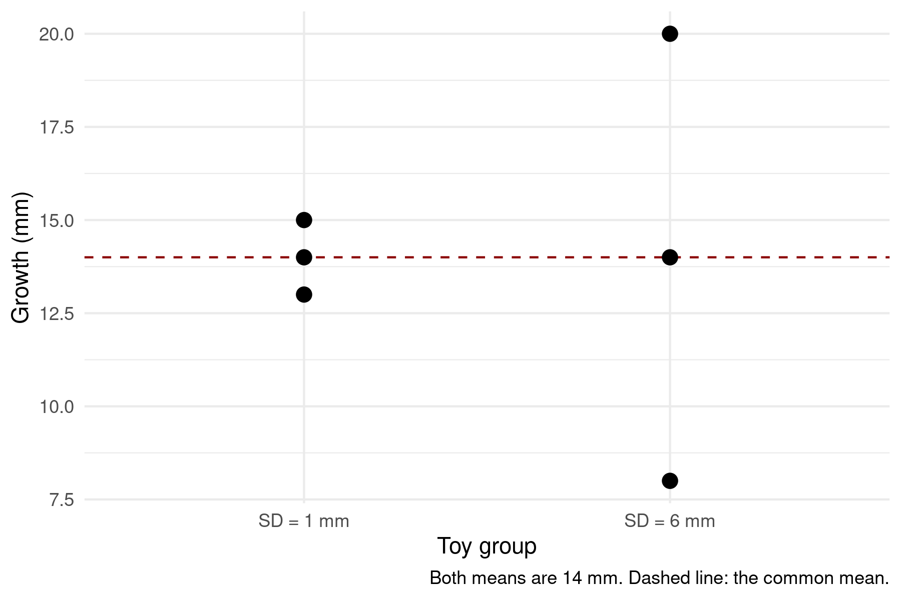
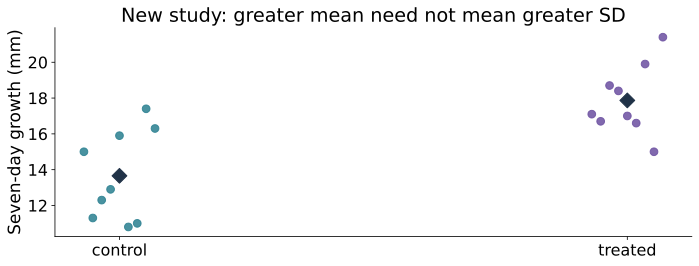

## About this lecture

You write in a lab report: "control seedlings grew 15.3 mm on average." A reader cannot tell whether every plant grew about 15 mm, or whether some grew 8 mm and others nearly 19 mm. Those are very different biological pictures: one unusual plant, or a treatment that makes plants more variable, would be invisible. **How do we describe both the typical value and how much plants differ?**

- The **mean** and **median** describe the centre; one unusual value moves them differently.
- **Deviations** from the mean lead to the **variance** (squared units) and the **standard deviation** (SD, original units).
- Adding a constant or changing units changes the numbers in predictable ways, which makes a useful **check**.
- The SD describes how much **individual plants** vary. It is not the uncertainty of the mean (Day 14) and does not tell you *why* plants vary.

This is a concept day with small hand calculations; centre and spread are used in every later day.

::: notes
Ask students to imagine two seed batches with the same mean growth: one uniform, one with a few plants that hardly grew. A breeder, a field ecologist or a reviewer would care about that difference. Today's numbers are the tools to say it.
:::

## The problem: same mean, different plants

:::: {.columns}
::: {.column width="42%"}
- Group A: 13, 14, 15 mm. Group B: 8, 14, 20 mm.
- Both means are **14 mm**.
- In A plants are alike (SD **1 mm**); in B they differ a lot (SD **6 mm**).
- Reporting only "mean 14 mm" makes the two groups look identical.

A description needs a **centre** *and* a **spread**.
:::
::: {.column width="58%"}
{width="100%"}
:::
::::

::: notes
Give students a moment to read the axis before naming SD. A larger spread is not automatically sloppy work: organisms really differ, and measurement noise also contributes. We need words and numbers for both centre and spread.
:::

## Mean and median: two ways to describe the centre

:::: {.columns}
::: {.column width="45%"}
```text
> uneven_mm <- c(10, 10, 10, 100)
> mean(uneven_mm)
[1] 32.5
> median(uneven_mm)
[1] 10
> changed_mm <- c(12, 14, 26)
> mean(changed_mm)
[1] 17.33333
> median(changed_mm)
[1] 14
```

- **Mean:** add all values, divide by how many. Every value pulls on it.
- **Median:** the middle of the sorted values (the average of the two middle ones if n is even).
- One large value moves the mean a lot and the median hardly at all. If it is a real measurement, it **stays**.
:::
::: {.column width="55%"}
{width="100%"}
:::
::::

::: notes
Ask for predictions before showing the output. `c()` combines numbers into one vector, as on day 6. For 12, 14, 16 both mean and median are 14 mm; changing 16 to 26 moves only the mean. The changed set also has SD 7.57 mm instead of 2 mm: one value changes spread a lot. This is not permission to remove a real large value; only source evidence justifies a change.
:::

## Spread starts with deviations from the mean

:::: {.columns}
::: {.column width="42%"}
- Take three growth values: **12, 14, 16 mm**. Their mean is 14 mm.
- Each **deviation** is value minus mean: **−2, 0, +2 mm**.
- Deviations carry the measurement's units.
- Adding them gives **0**, always: positives and negatives cancel. So the plain average deviation cannot measure spread.
- Squaring removes the sign: 4, 0, 4.
:::
::: {.column width="58%"}
{width="100%"}
:::
::::

::: notes
Work through the three numbers slowly on the board. Students do this by hand in the exercises and then check with R. The cancellation is a property of the mean, not a coincidence of this example.
:::

## Variance and standard deviation

:::: {.columns}
::: {.column width="45%"}
For 12, 14, 16 mm:

1. Squared deviations: 4 + 0 + 4 = **8 mm²**.
2. Divide by **n − 1 = 2**: variance = **4 mm²**.
3. Square root: SD = **2 mm**.

- Variance is in **squared units** (mm²), hard to picture.
- SD is back in **mm**, the same units as the plants, so it can be read next to the mean.
- Dividing by n − 1 rather than n is the convention for estimating spread from a sample; R uses it.
:::
::: {.column width="55%"}
{width="100%"}
:::
::::

::: notes
No derivation of n − 1 is needed; say that with small samples, dividing by n tends to underestimate population spread. SD is not an error bar for the mean, and it does not mean every plant lies within one SD of the mean.
:::

## Let R do the arithmetic, and check it by hand

:::: {.columns}
::: {.column width="55%"}
```text
> growth_mm <- c(12, 14, 16)
> deviations_mm <- growth_mm - mean(growth_mm)
> deviations_mm
[1] -2  0  2
> deviations_mm^2
[1] 4 0 4
> sum(deviations_mm^2) / (length(growth_mm) - 1)
[1] 4
> var(growth_mm)
[1] 4
> sd(growth_mm)
[1] 2
```
:::
::: {.column width="45%"}
- Subtracting the mean from a vector subtracts it from **every** value: the deviations −2, 0, 2.
- `^2` squares each one; `sum()` adds them (8); `length()` is n (3). So 8 / 2 = **4**.
- `var()` gives the same 4 (mm²) and `sd()` its square root, 2 (mm).
- R prints no units. **You** add mm or mm² when you write the numbers down.
:::
::::

::: notes
Ask students to predict each line before running it. If R disagrees with a hand calculation, find out why. The point is not memorising function names but choosing the quantity that answers the question and labelling it with its unit.
:::

## Worked example: our control plants

:::: {.columns}
::: {.column width="52%"}
```text
> seedlings <- read_csv("data/seedlings.csv",
+                       show_col_types = FALSE) |>
+   mutate(growth_mm = final_mm - initial_mm)
> control <- filter(seedlings,
+                   treatment == "control")
> sort(control$growth_mm)
 [1]  8.0 11.3 13.4 14.5 14.9 15.3 16.0 17.1 17.5
[10] 18.0 18.6 18.7
> mean(control$growth_mm)
[1] 15.275
> median(control$growth_mm)
[1] 15.65
> sd(control$growth_mm)
[1] 3.190932
```
:::
::: {.column width="48%"}
{width="100%"}

- The 12 plants grew **8.0 to 18.7 mm**; none grew exactly 15.28 mm.
- Treated plants: mean **21.49 mm**, SD **4.87 mm**: higher centre *and* more spread.
:::
::::

::: notes
We switch to the complete, clean seedlings.csv today, not yesterday's deliberately incomplete export; say this explicitly. Load readr and dplyr first, as in the practical. sort() only shows the values in order; it does not change the table. The control variance is 10.18 mm². Report with sensible rounding: mean 15.3 mm, SD 3.2 mm, n = 12.
:::

## Shifts and unit changes: a built-in check

:::: {.columns}
::: {.column width="42%"}
Start with 13, 14, 15 mm (mean 14, SD 1).

- **Add 10 mm** to every value: mean becomes **24 mm**, SD stays **1 mm**. Moving all plants together does not change how they differ.
- **Convert to cm** (÷ 10): mean **1.4 cm**, SD **0.1 cm**, variance ÷ **100** (mm² → cm²).
- The smaller SD in cm is a different unit, not less variable plants.
- If a shift changes your SD, there is a mistake in the code.
:::
::: {.column width="58%"}
{width="100%"}
:::
::::

::: notes
In code: mean(close_mm + 10), sd(close_mm + 10), and the same with close_mm / 10. For 12, 14, 16 the variance 4 mm² becomes 0.04 cm² and the SD 2 mm becomes 0.2 cm. Variance scales with the square of the conversion factor. This is a units check, not a new method.
:::

## What the SD does not tell you

:::: {.columns}
::: {.column width="42%"}
In a second class's study, treated plants have the **larger mean** (17.87 vs 13.66 mm) but the **smaller SD** (1.94 vs 2.53 mm).

- Centre and spread are separate facts; one does not predict the other.
- A larger SD can come from **biology** (plants really differ) or **measurement noise**. The SD alone cannot say which.
- The SD is about **individual plants**, not about how precisely we know the mean. That is Day 14.
:::
::: {.column width="58%"}
{width="100%"}
:::
::::

::: notes
In the main study the treated group had both the larger mean and the larger SD; here it is the other way round, so students should use the actual values. A claim such as "the group with the larger SD has the worse technique" goes beyond what the SD shows. The transfer data: data/seedlings-transfer.csv, 9 plants per group, T01 grew 15.0 mm.
:::

## Same tools in another lab: percentage yield

An organic synthesis run (one attempt to make a product) collects some dry product; the starting materials set the most it **could** give. Runs start from different amounts, so we compare **percentage yield** = 100 × collected / possible mass.

:::: {.columns}
::: {.column width="60%"}
```text
> organic <- read_csv("data/organic-recovery.csv",
+                     show_col_types = FALSE) |>
+   mutate(yield_percent = 100 * isolated_mass_g / theoretical_mass_g)
> organic |> select(run_id, protocol, yield_percent) |> head(3)
# A tibble: 3 × 3
  run_id protocol yield_percent
  <chr>  <chr>            <dbl>
1 Y01    standard            62
2 Y02    standard            70
3 Y03    standard            68
> standard_runs <- filter(organic, protocol == "standard")
> mean(standard_runs$yield_percent)
[1] 68.66667
> sd(standard_runs$yield_percent)
[1] 4.320494
```
:::
::: {.column width="40%"}
- Y01: 100 × 0.62 g / 1.00 g = **62%**.
- Six standard runs: mean **68.67%**, SD **4.32 percentage points**.
- From 62% to 70% is **8 percentage points**, not an 8% increase.
- `select()` keeps the named columns; `head(3)` shows the first 3 rows.
:::
::::

::: notes
This is a transfer choice from data/organic-recovery.csv, an alternative to the treated-group step in the practical. Collected material is assumed pure in this simplified calculation, so a higher yield says nothing about purity. Variance is 18.67 squared percentage points. Modified protocol: mean 77.00%, SD 3.74 percentage points.
:::

## Report centre and spread together

**Good:** "Control seedlings grew a mean of **15.3 mm** (SD **3.2 mm**, median 15.7 mm, **n = 12** plants)."

- Name the **quantity** (seven-day growth), the **unit**, **n**, the centre and the spread.
- Calculate with full precision; **round only** the numbers you display. Six decimals from R are not six decimals of ruler precision.
- If you convert units, change the mean, SD, variance units and axis labels **together**.

| Misreading | Better |
|---|---|
| "The average plant grew 15.3 mm." | The mean is a summary; individual plants grew 8.0 to 18.7 mm. |
| "The SD is the error of the mean." | The SD describes plant-to-plant variation. |

::: notes
A table with correct numbers but wrong unit labels is still a misleading report. The ordering of group means and the relative spread stay the same under a positive unit conversion; that is a good check.
:::

## Summary {.smaller}

| Concept | Key fact |
|---|---|
| Mean | Sum ÷ n; pulled by unusual values (12, 14, 26 → 17.33) |
| Median | Middle of the sorted values; less affected by one extreme (stays 14) |
| Deviation | Value − mean; deviations always sum to 0 |
| Variance | Sum of squared deviations ÷ (n − 1); squared units (mm²) |
| SD | √variance; original units (mm); describes spread among individuals |
| Shift / unit | + constant moves the mean only; ÷ 10 divides mean and SD by 10, variance by 100 |
| Seedlings | Control 15.28 mm (SD 3.19); treated 21.49 mm (SD 4.87), n = 12 each |
| Limits | SD does not identify its cause, and is not uncertainty in the mean |

**Next (Day 13, group summaries):** calculate these summaries for every group at once, and plot them without hiding the individual plants.

**Now:** [open the Day 12 exercises](../../week3/12-variation.qmd). Leave with `day12-variation.R` and a short interpretation of centre and spread with units.

::: notes
Ask: what would stay the same if every measurement increased by 10 mm? What changes when mm become cm? Keep the by-hand three-number example before moving to the full dataset.
:::
