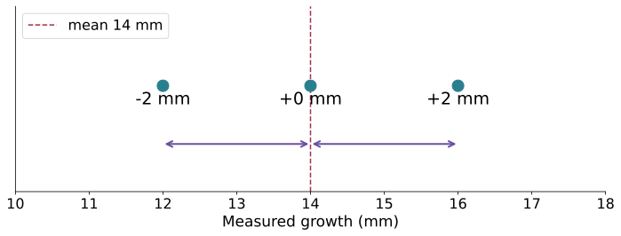
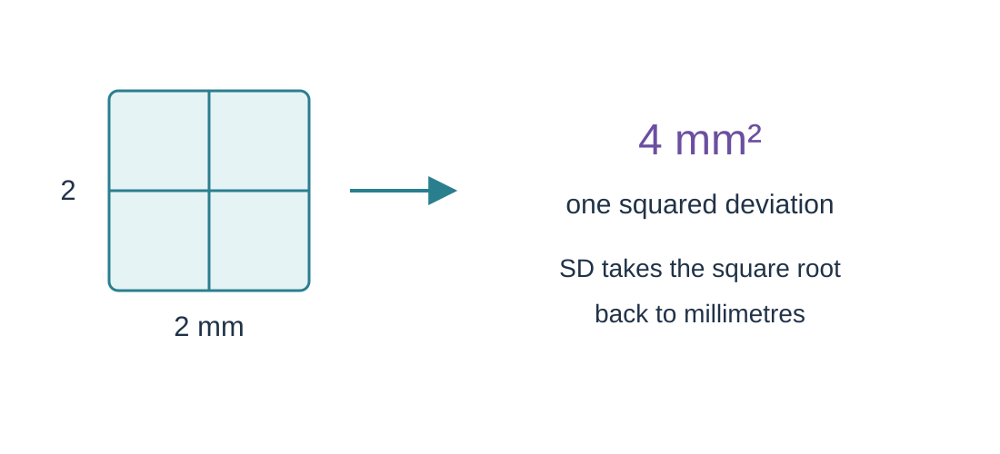
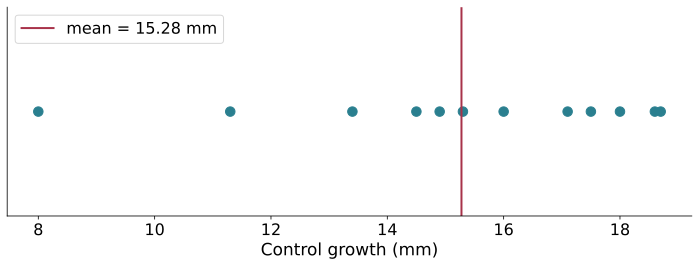
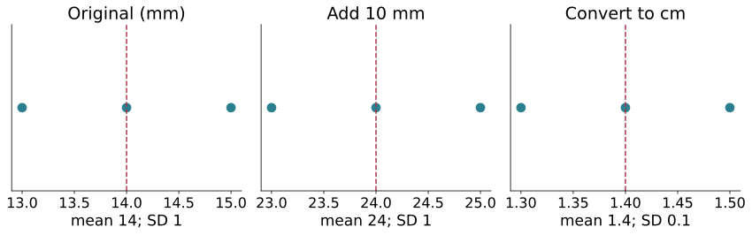
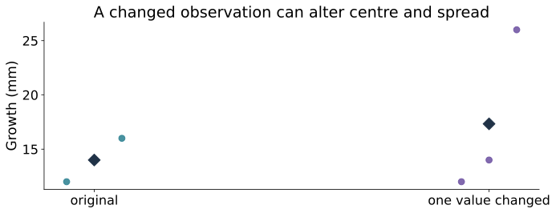
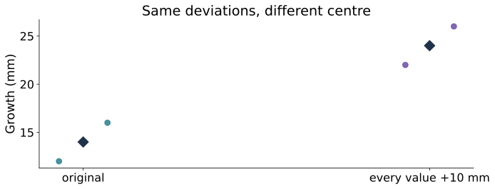
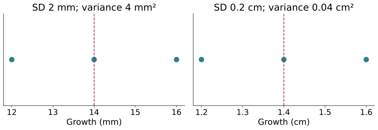

## Same average; different observations

{height=350px}

What does the mean leave out?

::: notes
Give students a moment to read the axis before naming SD. Both sets have mean 14 mm; one contains 13,14,15 and the other 8,14,20. The second set has greater spread. We need to describe centre and variation, not choose one number to represent all plants.
:::

## Mean and median describe a centre

```r
x <- c(10, 10, 10, 100)
mean(x)       # 32.5
median(x)     # 10
```

The mean uses every value. The median is the middle of the ordered values.

::: notes
For an even number of observations, the median averages the two middle values. The large observation changes the mean strongly; it does not make either function wrong. Check unusual values against source information rather than deleting them to make summaries agree.
:::

## Measure deviations from the mean

{height=350px}

Adding the signed deviations gives zero, even with spread.

::: notes
Work through the three numbers slowly. Subtraction uses the same units as the measurement. Positive and negative deviations cancel. Squaring is one way to avoid cancellation and leads to the sample variance used by R.
:::

## Variance has squared units; SD has the original units

{height=350px}

For 12, 14, 16: variance = **4 mm²**, SD = **2 mm**.

::: notes
The sum of squared deviations is 4+0+4=8. Divide by n−1=2 for sample variance, giving 4 mm². The square root is 2 mm. Explain the denominator as a sample-variance convention that estimates population variance; no derivation is needed. SD is not an error bar for the mean.
:::

## Let R do the arithmetic, while you keep the meaning

```r
x <- c(12, 14, 16)
mean(x)
var(x)
sd(x)
```

A mean or SD needs its measurement unit in the report.

::: notes
Ask students to predict 14,4,2 before running. Their task is not memorising function names: it is choosing the quantity that answers their question and labelling the output correctly. Neither SD nor variance means every observation lies within a specified range.
:::

## Our control plants vary around their mean

{height=350px}

Mean ≈ **15.28 mm**; sample SD ≈ **3.19 mm**.

::: notes
These are the complete clean seedling data, not yesterday’s deliberately incomplete export. State the switch explicitly:12 control plants now contribute. The mean is a summary, not an observed “average plant”. Biological and measurement variation may both contribute to spread.
:::

## Changing the origin is different from changing the unit

{height=350px}

Predict what happens to SD before running R.

::: notes
Adding 10 mm changes 13,14,15 into 23,24,25: mean shifts from 14 to 24, SD remains 1 mm. Dividing by 10 gives 1.3,1.4,1.5 cm: mean 1.4 cm and SD 0.1 cm. Variance divides by 100. This is a units check, not a new statistical method.
:::

## Transfer choice: a yield is a percentage

A supplied maximum is **1.00 g**; collected dry product is **0.62 g**.

`yield_percent = 100 × collected mass / supplied maximum mass`

- Yield = **62%**; no reaction equation is needed.
- SD of several yields is in **percentage points**.
- A higher yield alone does not establish higher purity.

::: notes
This is an alternative small task, not additional compulsory work. Theoretical maximum masses are supplied in organic-recovery.csv. Collected dry material is assumed pure for this simplified calculation. Across six standard runs mean yield is 68.67% and SD 4.32 percentage points. Distinguish a percentage scale from relative percentage change.
:::

## One changed observation can move several summaries

{height=350px}

Original: 12, 14, 16 mm. Changed: 12, 14, 26 mm.

::: notes
The new mean is17.33 mm, median14 mm, variance 57.33 mm² and SD 7.57 mm. Ask for predictions before displaying numbers. This is sensitivity reasoning, not permission to remove a real large value.
:::

## A common shift changes centre, not deviations

{height=350px}

Adding 10 mm shifts both the mean and each observation by 10 mm.

::: notes
The shifted vector22,24,26 has mean 24 and SD 2. Show subtraction from each set mean. An SD change under a common shift would signal a calculation or comparison mistake.
:::

## Use units as an arithmetic check

{height=350px}

Unit conversion changes numbers; it does not change the measured plants.

::: notes
Original variance 4 mm² becomes.04 cm²; SD 2 mm becomes.2 cm. Variance scales with the square of the conversion factor. The smaller numeric SD reflects a different unit, not less biological variation.
:::

## Calculate before rounding

```r
x_mm <- c(12, 14, 26)
mean(x_mm)
median(x_mm)
var(x_mm)
sd(x_mm)
```

Keep full values for calculations; round the displayed table and prose.

::: notes
R printing many digits is not proof of precise measurements. Students can show about 17.3 mm mean and 7.57 mm SD while retaining the calculation object. Confirm hand-worked deviations for the original simple vector first.
:::

## Another study separates mean and spread again

{height=350px}

Larger mean does not require larger SD.

::: notes
Transfer control mean 13.66 mm, SD 2.53 mm; treated mean 17.87 mm, SD 1.94 mm. Use actual values rather than the earlier study pattern, where treated spread was larger.
:::

## Recreate the calculation in a separate script

```r
library(readr)
library(dplyr)
transfer <- read_csv('data/seedlings-transfer.csv',
                     show_col_types = FALSE) |>
  mutate(growth_mm = final_mm - initial_mm)
transfer_control <- filter(transfer, treatment == 'control')
sd(transfer_control$growth_mm)
```

T01 grew **15.0 mm**; check that subtraction independently.

::: notes
Load readr and dplyr as earlier. New data need their own import and growth column. Each group has 9 complete independent observations. Use separately named objects for the two studies.
:::

## The SD does not identify its own cause

A group has a larger SD. Is that evidence of:

- Greater biological diversity?
- More measurement noise?
- A less precise estimated mean?

SD describes the spread. Additional design and measurement information distinguish explanations.

::: notes
Observed spread can have multiple sources. Uncertainty in a mean additionally depends on independent sample size and assumptions. A group SD alone does not evaluate all experimental technique.
:::

## Write a summary that survives a unit change

Include the quantity, units, n, centre, and individual spread.

If you convert to cm, revise the mean, SD, variance units, and axis together.

**Which biological comparison should remain unchanged?**

::: notes
The ordering of group means and relative spread should remain consistent under a common positive conversion. A data table with correct numbers but wrong unit labels is still a misleading report.
:::

## Exercises: explain the number you calculate

Choose one short transfer task and keep **`day12-variation.R`**.

What would stay the same if every measurement increased by 10 mm?

What changes when mm become cm?

[Open exercises](../../week3/12-variation.qmd).

::: notes
Keep the by-hand three-number example before the full dataset. Ask for an explanation of centre and spread. Students should retain the measurement unit and recognise that SD among plants is not uncertainty in a treatment difference.
:::
