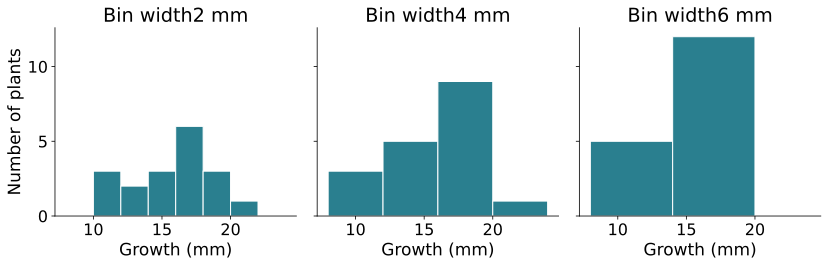
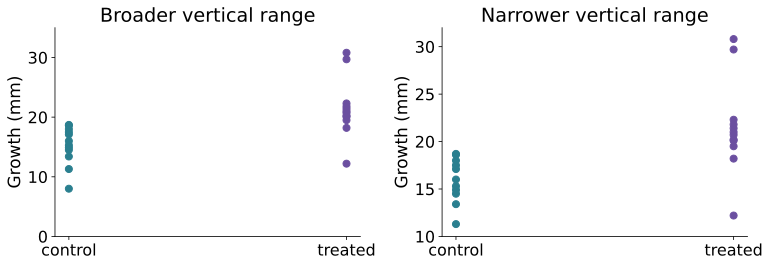
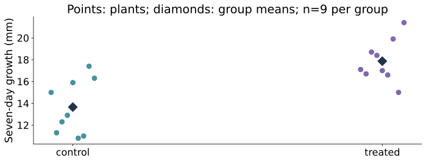

## A summary row is not a new observation

{height=350px}

Keep the measurement table as well as its summary.

::: notes
A table with two group means is not a dataset with two newly measured plants. Show the original and summary objects in R. Summarisation deliberately compresses information, which is why an individual-point plot remains useful.
:::

## Tell R which groups to summarise

```r
library(readr)
library(dplyr)
seedlings <- read_csv("data/seedlings.csv", show_col_types = FALSE) |>
  mutate(growth_mm = final_mm - initial_mm)
group_summary <- seedlings |>
  group_by(treatment) |>
  summarise(n_plants = n(),
    n_observed = sum(!is.na(growth_mm)),
    mean_mm = mean(growth_mm, na.rm = TRUE),
    sd_mm = sd(growth_mm, na.rm = TRUE), .groups = "drop")
```

The result has one row per treatment.

::: notes
Recreate the clean import and growth calculation in the practical before this code. Read the pipe aloud. n counts plant records; !is.na selects available measurements. .groups="drop" leaves an ordinary ungrouped summary table. No missing growths occur in today’s clean data.
:::

## How many plants contributed?

In the complete teaching file:

- Control: **12 plants, 12 available growth values**.
- Treated: **12 plants, 12 available growth values**.

The repaired file from day 11 has only **11 available control growths**.

::: notes
Explicitly distinguish the two supplied files. Missingness changes the contributing count without inventing a zero measurement. The counts belong beside the summaries, not hidden in an undocumented filter.
:::

## Show observations and identify the mean

{height=350px}

Small dots = plants. Red diamonds = group means.

::: notes
Control mean 15.275 mm; treated mean 21.49167 mm. Overlap means the larger group mean is not a claim that every treated plant outgrew every control. Horizontal jitter only separates overlapping dots; measured vertical values remain unchanged.
:::

## If you draw whiskers, define them

{height=350px}

These whiskers show **mean ± SD**, not confidence intervals.

::: notes
Ask what a reader could infer if the caption simply said “error bars”. The answer is too little. SD describes spread among plants. A confidence interval for an estimate has another interpretation, introduced later. It is acceptable to omit whiskers today and show observations and means.
:::

## A histogram describes the distribution

{height=350px}

The vertical axis counts observations, not a biological response.

::: notes
The horizontal axis contains growth intervals; the height counts plants in each bin. The panels use comparable scales. With 12 plants per group, apparent shape is unstable. A histogram does not show measurement order or the identities of plants.
:::

## A bin boundary can change the picture

{height=350px}

Describe stable features; be cautious with tiny samples.

::: notes
Nothing about the plants changed between panels. Changing a display choice changes what detail looks prominent. Invite students to compare the raw dot plot with all three histograms before interpreting an apparent peak or gap.
:::

## Save the right object for the intended use

```r
write_csv(group_summary, "output/growth-summary.csv")
```

A CSV stores numbers; a PNG stores a figure. Keep both traceable to raw data.

::: notes
The practical defines group_plot and output/ already exists in the supplied project. Assigning an R object does not export it. After saving, ask students to find the two ordinary files in a file manager and explain which application could open each.
:::

## A summary can hide the very observations it describes

{height=350px}

Both panels use the same group means.

::: notes
Ask which panel permits inspecting overlap and unusual values. The point plot need not become cluttered: horizontal jitter can separate overlapping dots without changing their measured vertical positions.
:::

## Summary rows are not new plants

The original table has **24 plant rows**.
The grouped table has **two summary rows**.

These are different objects answering different questions.

Which table should supply individual points? Which supplies mean markers?

::: notes
Individual-point layer uses the raw/derived plant table. Mean-marker layer uses group_summary with explicit mappings. A two-row summary cannot substitute for the individual observations in a treatment test.
:::

## Histogram details depend on display choices

{height=350px}

Record the bin width and distinguish stable patterns from unstable detail.

::: notes
The underlying18 measurements are unchanged. Small samples can look multimodal or gapped depending on bins. Compare broad stable patterns across bin widths.
:::

## An axis range changes the visual emphasis

{height=350px}

Read values and axis labels when comparing effects.

::: notes
Both displays can be useful with clear axes, but a reader should not mistake a changed scale for changed observations. This is particularly important when comparing figures from different groups or experiments.
:::

## Repair the caption precisely

Weak caption: **“Treatment makes everything larger; error is shown.”**

Repair it by naming:

1. Independent unit and outcome/units.
2. Individual points and any mean symbol.
3. Available n and the actual meaning of any error bars.

::: notes
Identify only the symbols actually plotted. Mean±SD describes individual spread. A confidence interval describes uncertainty in an estimate. Neither phrase can be replaced by a generic word error.
:::

## A new class needs a complete figure package

{height=350px}

Keep the input, summary CSV, figure, and analysis script distinct.

::: notes
Transfer data have9 plants per group. Students export the summary and plot, verify one mean using a filtered vector, and write a handover request listing actual file dependencies.
:::

## A script should name the files it creates

```r
library(ggplot2)
group_plot <- ggplot(seedlings, aes(treatment, growth_mm)) +
  geom_point(position = position_jitter(
    width = 0.08, height = 0, seed = 13)) +
  labs(x = 'Treatment', y = 'Seven-day growth (mm)') +
  theme_minimal()
ggsave('output/growth-summary.png', plot = group_plot,
       width = 6, height = 4)
```

Use distinct output filenames for the two studies.

::: notes
In the independent task students create transfer_summary and transfer_plot with analogous exports. Explain why a plot object in memory, a PNG, and a summary CSV are not interchangeable outputs.
:::

## A reader test is more specific than “does this look good?”

Check the exported figure for:

- One observation and the mean marker.
- Units, available sample size, and independent unit.
- A pattern supported by both the table and figure.

Record the ambiguity and the correction.

::: notes
The exercises include a caption-repair log and reproducible outputs. Reread the figure with the code closed. Biological claims need numerical meaning, not just attractive layout.
:::

## Exercises: describe the sample before testing it

Write a caption that identifies the unit, units, and symbols.

Choose a transfer summary: repaired seedlings **or** supplied organic yields.

Save the script, summary CSV, and figure.

[Open exercises](../../week3/13-group-summaries.qmd).

::: notes
The organic option reuses the same computations, not a second required practical. Each row is an independently prepared run; yield uses supplied theoretical and isolated masses. SD is expressed in percentage points. No t-test is introduced here.
:::
