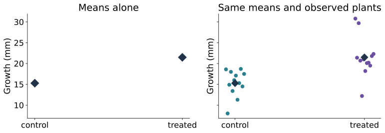
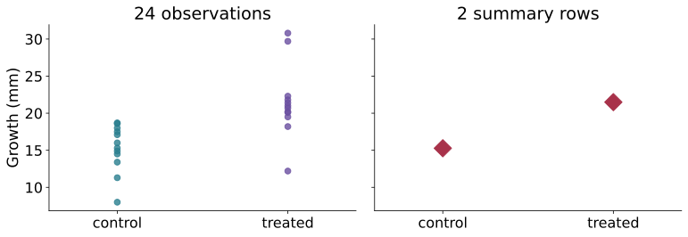
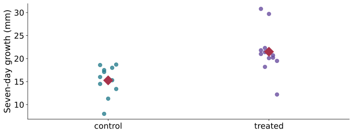
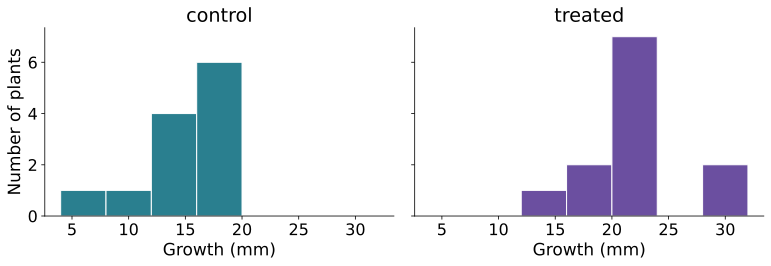
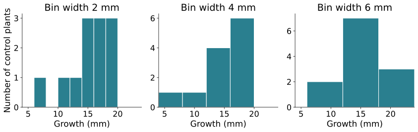

## About this lecture

A thesis draft shows a bar chart with two bars: mean growth of control and treated seedlings. The examiner asks: how many plants are behind each bar? How much did they vary? Is one bar pulled up by a single unusual plant? The chart cannot answer, because the plants have disappeared into two numbers. **How do we summarise groups and still let the reader see the plants?**

Today you will:

- make a **summary table** with one row per group, including **how many plants** contributed;
- plot **individual plants with a mean marker**, and define any whiskers you draw;
- use a **histogram** to see a distribution, and notice how much the bin width shapes it;
- save the table and the figure as files, with a caption a reader can check.

This builds on Day 12's mean and SD; the table and figure go straight into the descriptive report on Day 15.

::: notes
Many published figures still show bars of means only. Journals increasingly ask for individual data points for small samples, exactly because of the examiner's questions above. Today's practical file is day13-groups.R.
:::

## The problem: means alone hide the plants

:::: {.columns}
::: {.column width="40%"}
- **Left:** only the two group means, 15.28 and 21.49 mm.
- **Right:** the same means with the **24 plants** behind them.
- Now you can see that the groups **overlap**, that one treated plant grew only **12.2 mm**, and that two treated plants grew about **30 mm**.
- You can also count the plants: 12 per group.
:::
::: {.column width="60%"}
{width="100%"}
:::
::::

::: notes
Ask which panel lets a reader check the claim "treated plants grew more". With the points, they can see it is true of the means but not of every plant. The point plot does not need to be cluttered: a small horizontal jitter separates overlapping dots without changing their measured heights.
:::

## A summary is a new, smaller table

:::: {.columns}
::: {.column width="40%"}
- `seedlings`: **24 rows**, one per plant.
- `group_summary`: **2 rows**, one per treatment.
- The two summary rows are **not two new plants**; they describe groups.
- Keep both tables. The plant table feeds the individual points; the summary feeds the mean markers.
:::
::: {.column width="60%"}
{width="100%"}
:::
::::

::: notes
Show both objects in the RStudio Environment pane and compare their dimensions. Summarising deliberately throws away detail; that is why we keep the plant-level table for plotting and for any later test.
:::

## One row per group with `group_by()` and `summarise()`

```r
seedlings <- read_csv("data/seedlings.csv", show_col_types = FALSE) |>
  mutate(growth_mm = final_mm - initial_mm)
group_summary <- seedlings |>
  group_by(treatment) |>
  summarise(n_plants = n(),
            n_observed = sum(!is.na(growth_mm)),
            mean_mm = mean(growth_mm, na.rm = TRUE),
            median_mm = median(growth_mm, na.rm = TRUE),
            sd_mm = sd(growth_mm, na.rm = TRUE),
            .groups = "drop")
```

| treatment | n_plants | n_observed | mean_mm | median_mm | sd_mm |
|---|---|---|---|---|---|
| control | 12 | 12 | 15.28 | 15.65 | 3.19 |
| treated | 12 | 12 | 21.49 | 20.85 | 4.87 |

- `group_by(treatment)`: do the next step **separately for each treatment**. `summarise()` returns one row per group.
- `n()` counts rows (plant records); `sum(!is.na(growth_mm))` counts **usable measurements** (`!` means "not").
- `.groups = "drop"` leaves an ordinary table. Check one mean by hand: `mean(filter(seedlings, treatment == "control")$growth_mm)`.

::: notes
Start day13-groups.R with library(readr), library(dplyr) and library(ggplot2), as in the practical. Read the pipe aloud: take seedlings, then group by treatment, then summarise. The names on the left of = become column names. The values in the table are rounded for display; the object keeps full precision.
:::

## Always report how many plants contributed

:::: {.columns}
::: {.column width="45%"}
- In the complete file both groups have **12 plants and 12 growths**.
- Summarise the repaired Day 11 file (`output/seedlings-cleaned.csv`) and control has **12 plants but 11 growths**: P06 is unknown.
- Its control mean is **15.21 mm**, not 15.28 mm: a different set of plants contributed.
- That is why the table has both `n_plants` and `n_observed`. A reader needs the n next to every mean.
:::
::: {.column width="55%"}
{width="100%"}
:::
::::

::: notes
Missingness changes the contributing count without inventing a zero. The counts belong beside the summaries, not hidden in an undocumented filter. The control SD in the repaired file is 3.34 mm.
:::

## Plot the plants, then add the means

:::: {.columns}
::: {.column width="50%"}
```r
group_plot <- ggplot(seedlings,
    aes(x = treatment, y = growth_mm)) +
  geom_point(position = position_jitter(
    width = 0.08, height = 0, seed = 13),
    alpha = 0.75) +
  geom_point(data = group_summary,
    aes(x = treatment, y = mean_mm),
    inherit.aes = FALSE, shape = 18,
    size = 4, colour = "darkred") +
  labs(x = "Treatment",
       y = "Change in seedling length (mm)") +
  theme_minimal()
```
:::
::: {.column width="50%"}
{width="100%"}

- First layer: **plants** from `seedlings`. Second layer: **means** from `group_summary`.
- `height = 0`: dots move sideways only; their measured heights never change.
:::
::::

::: notes
inherit.aes = FALSE means the second layer gets its own mapping, because group_summary has no growth_mm column. The seed makes the jitter identical each time the script runs. Ask students to find one plant above and one below each mean.
:::

## If you draw whiskers, say what they are

:::: {.columns}
::: {.column width="42%"}
- These whiskers show **mean ± SD**: how much plants vary around the mean.
- Another figure's whiskers may show a **confidence interval** (Day 17): how uncertain the mean is. They can look identical.
- A caption that says only "error bars" leaves the reader guessing.
- Fine choice for today: show the points and the means, **no whiskers**.
:::
::: {.column width="58%"}
{width="100%"}
:::
::::

::: notes
Ask: what could a reader infer from a caption that simply says "error bars"? Too little. The treated whisker is longer because the treated SD (4.87 mm) is larger than the control SD (3.19 mm). The CI comes later in the course with a different meaning.
:::

## A histogram shows the shape of a distribution

:::: {.columns}
::: {.column width="42%"}
```r
ggplot(seedlings, aes(x = growth_mm)) +
  geom_histogram(binwidth = 4,
    boundary = 0, colour = "white") +
  facet_wrap(~ treatment, ncol = 1)
```

- Growth is cut into **4 mm bins**; bar height = **number of plants** in each bin.
- `facet_wrap()` gives one panel per group on a shared axis.
- A histogram shows shape and gaps, but not individual plants or their identities.
:::
::: {.column width="58%"}
{width="100%"}
:::
::::

::: notes
The vertical axis counts plants, not a biological response. With 12 plants per group, every bin has only a few plants. In the treated panel, the two plants near 30 mm form their own bar.
:::

## The bin width shapes the picture

:::: {.columns}
::: {.column width="40%"}
- The **same 12 control values** with bins of 2, 4 and 6 mm.
- With 2 mm bins there appear to be gaps and peaks; with 6 mm the shape looks smooth.
- Nothing about the plants changed: only a **display choice**.
- With small samples, describe only features that survive several bin widths, and state the bin width you used.
:::
::: {.column width="60%"}
{width="100%"}
:::
::::

::: notes
The same caution applies to axis ranges: stretching the vertical axis can make a difference look larger or smaller without changing a single measurement. Compare figures by reading their axes, not their visual impression. Invite students to compare the dot plot with all three histograms.
:::

## Write a caption the reader can check

:::: {.columns}
::: {.column width="45%"}
**Weak:** "Treatment makes everything larger; error is shown."

**Better:** "Seven-day growth (mm) of individually potted seedlings. Each dot is one plant (n = 9 per group); diamonds are group means. No error bars are shown."

A caption names:

1. the **unit** (one plant) and outcome with **units**;
2. what each **symbol** means;
3. the **n**, and what any whiskers represent.
:::
::: {.column width="55%"}
{width="100%"}
:::
::::

::: notes
The figure is from the second class's study (data/seedlings-transfer.csv), which students summarise independently in the exercises. "Everything larger" is contradicted by the overlap; "error" is undefined. Ask students to repair a weak caption in three specific places.
:::

## Save the table and the figure as files

```r
write_csv(group_summary, "output/growth-summary.csv")
ggsave("output/growth-summary.png", plot = group_plot, width = 6, height = 4)
```

- A **CSV** stores the numbers; a **PNG** stores the picture. The object in R is neither until you save it.
- Use different file names for each study, e.g. `output/day13-transfer-summary.csv`.
- **Reader test:** close RStudio, open the PNG and CSV from the file manager. Can you find one plant, a mean, the units and the n?

::: notes
After saving, ask students to find the two ordinary files in a file manager and say which application could open each. Restarting R and rerunning the script confirms the outputs come from the script and the raw data.
:::

## Summary {.smaller}

| Concept | Key fact |
|---|---|
| Summary table | `group_by()` + `summarise()`: one row per group; 2 rows are not 2 new plants |
| Counts | `n()` counts records, `sum(!is.na())` counts usable values; report n with every mean |
| Seedlings | Control 15.28 mm (SD 3.19), treated 21.49 mm (SD 4.87), 12 each |
| Points + means | Plant table for dots, summary table for diamonds; jitter sideways only |
| Whiskers | Mean ± SD and a confidence interval look alike: always say which |
| Histogram | Counts per bin; with small n the bin width changes the apparent shape |
| Caption | Unit, outcome and units, symbols, n, meaning of any whiskers |
| Outputs | CSV for numbers, PNG for figures, both regenerated by the script |

**Next (Day 14, replicates and uncertainty):** what counts as an independent plant, and how much a mean would change if we repeated the sampling.

**Now:** [open the Day 13 exercises](../../week3/13-group-summaries.qmd). Leave with `day13-groups.R`, `output/growth-summary.csv`, `output/growth-summary.png` and a caption.

::: notes
The organic-yield option in the practical reuses exactly the same steps (group_by(protocol)), with SD in percentage points; it replaces, not adds to, the repaired-seedling summary. No test is introduced today.
:::
