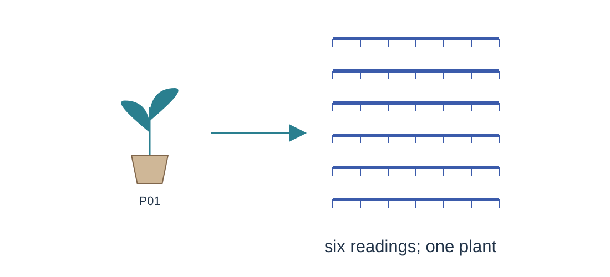
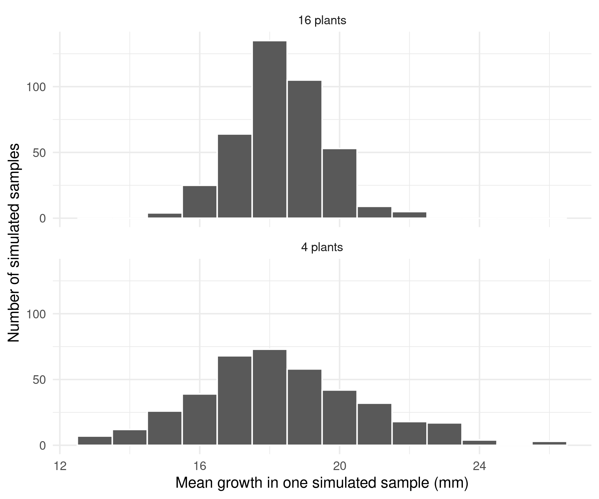
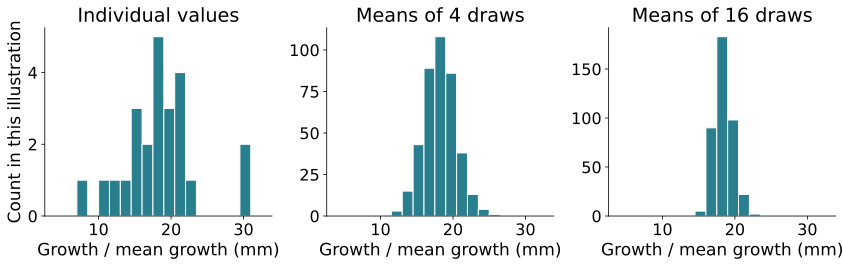
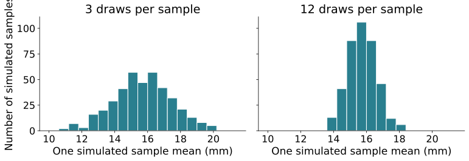
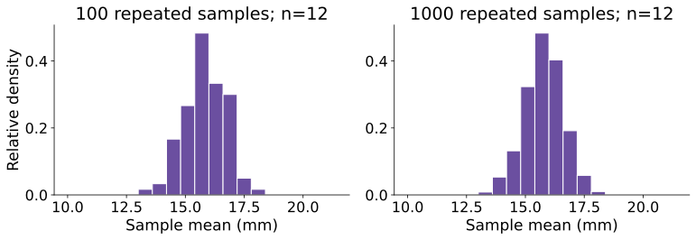
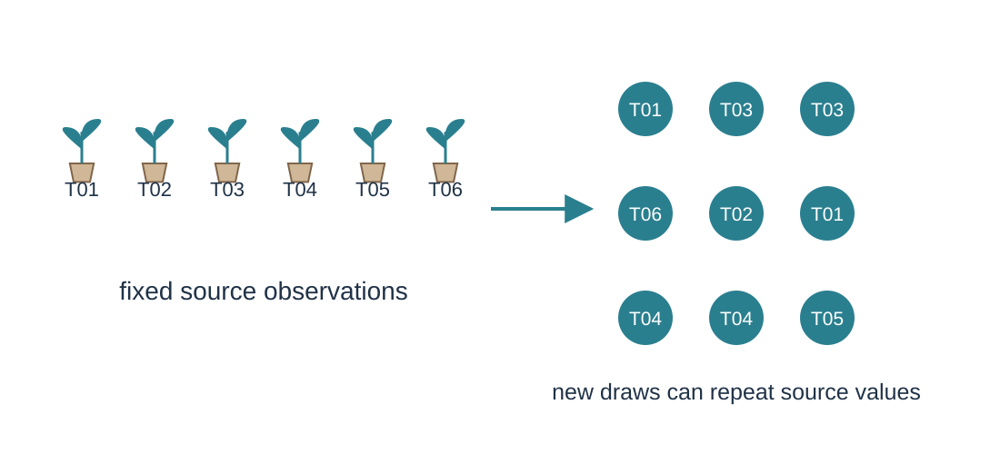

## What received its own treatment allocation?

{height=350px}

In our seedling study, **the pot/plant is the experimental unit**.

::: notes
The picture illustrates separate pots, but physical separation alone is not proof of independence. The design description specifies independent allocation and handling. Ask students which entity could receive control while another receives treatment.
:::

## More readings can still mean one plant

{height=350px}

Technical repeats help describe measurement variation.

::: notes
Rereading the same plant may reveal consistency of the measurement process. It does not create new independently allocated plants or evidence about how different plants respond. The organic analogue is repeatedly weighing one collected product batch.
:::

## A shared treatment can make the tray the unit

{height=350px}

Do not count every plant as independently assigned.

::: notes
This is a schematic layout, not the actual course experiment. If treatment was assigned once to each tray, plants within that tray share its allocation and environment. Ask how many treatment assignments occurred, not how many measurements fill the spreadsheet.
:::

## SD among plants and uncertainty in a mean differ

**Spread:** how much individual plants vary.

**Sampling uncertainty:** how much our mean would vary across repeated samples.

A larger independent sample can stabilise its mean without making plants identical.

::: notes
A group SD and a standard error answer different questions. Larger sample size does not make the underlying biological distribution narrower. Repeated dependent observations do not necessarily provide the information gain promised by more independent samples.
:::

## Each point in a sampling distribution is a mean

{height=360px}

The source values stay fixed.

::: notes
The supplied R demonstration uses the combined growth values as a fixed toy population and samples with replacement. It is not a new treatment experiment or a claim about nature. Each histogram entry summarises one simulated sample, not one freshly measured plant.
:::

## Read the horizontal axis before comparing spread

{height=350px}

Individual values and estimated means are different objects.

::: notes
This additional picture is regenerated from the course values using a fixed illustrative random generator; exact bins need not match the R demonstration. The concept is the narrower distribution of larger-sample means. Do not interpret SD of means as SD among plants within a sample.
:::

## Run the supplied demonstration; do not write a simulator

```r
library(readr)
library(dplyr)
seedlings <- read_csv('data/seedlings.csv', show_col_types = FALSE) |>
  mutate(growth_mm = final_mm - initial_mm)
population_mm <- seedlings$growth_mm
set.seed(14)
means_4 <- replicate(400,
  mean(sample(population_mm, size = 4, replace = TRUE)))
means_16 <- replicate(400,
  mean(sample(population_mm, size = 16, replace = TRUE)))
```

`set.seed()` makes the random demonstration repeatable.

::: notes
The practical imports and defines population_mm before these lines. Explain sample as drawing values, replace=TRUE as allowing a source value again, and replicate as repeating the calculation. Students predict and interpret the result; functions and loops are not a new programming requirement.
:::

## A stable estimate can still answer the wrong question

If one unrepresentative tray is measured very precisely, have we learned the population mean accurately?

Which problem would another ruler reading fix?

Which problem needs another independently chosen unit?

::: notes
Precision does not remove bias, dependence, or unrepresentative sampling. Another reading may help measurement consistency; another independently allocated or sampled unit addresses a different uncertainty. Avoid claiming that sample size alone guarantees a valid study.
:::

## A new toy source makes the same point

{height=350px}

Both sampling processes reuse the same fixed recorded values.

::: notes
This is a supplied simulation, not new biological measurement or a treatment comparison. The transfer source combines groups only to illustrate sampling. Keep the target fixed while changing sample size.
:::

## Number of repeats is not sample size

{height=350px}

More simulated estimates improve our picture of the sampling pattern.

::: notes
Compare100 and 1000 repeats, each using12 draws. More repetitions do not create more measured plants or shrink the underlying distribution as increasing independent sample size does.
:::

## Follow the levels of information

{height=350px}

Observed source → sampled draws → one mean → repeated estimates.

::: notes
Replacement permits a value to appear twice. A stored source plant is not remeasured each time it is drawn by sample. Students should label each row in their simulation output as an estimate, not a new organism.
:::

## A precise estimate can miss the question

{height=350px}

Greater precision does not remove a common measurement offset.

::: notes
This schematic uses a known5 mm shift for illustration. It does not diagnose bias in the course study. A narrow distribution can describe a biased or irrelevant process very precisely.
:::

## Adapt a supplied simulation without inventing a new method

```r
transfer <- read_csv('data/seedlings-transfer.csv',
                     show_col_types = FALSE) |>
  mutate(growth_mm = final_mm - initial_mm)
set.seed(14)
means_3 <- replicate(400, mean(sample(
  transfer$growth_mm, size = 3, replace = TRUE)))
```

Change size to 12 in a second object; preserve the first.

::: notes
Load readr/dplyr before this supplied block. Students need to understand source, draw size, replacement, repetitions, and seed; they are not asked to author loops or a sampling algorithm.
:::

## Different repeat settings answer different questions

Change one setting at a time:

- Seed: another reproducible random sequence.
- Draw size: more values in each estimated mean.
- Repetitions: more simulated means to inspect.

Which change alters the original recorded plants? **None.**

::: notes
Avoid a recipe of trying seeds until a pretty plot appears. The saved source is unchanged, and the simulation is conditional on that source distribution.
:::

## Choose independent units before counting rows

One plant measured twenty times and twenty independent plants are different designs.

**What could technical repeats help assess?**
**What needs additional independently sampled or assigned units?**

::: notes
Technical repeats can assess measurement repeatability under appropriate conditions. Questions about variation among plants or treatment allocations need independent biological units. This is why repeating balance readings of one synthesis does not create more independent runs.
:::

## A defensible simulation explanation has boundaries

State the fixed source, sampling rule, estimate, and comparison.

Then state what the demonstration **does not establish** about a natural population or treatment.

::: notes
The required transfer note should distinguish source SD from SD among means, stable patterns from exact seed-dependent values, and a toy combined-treatment source from a real inferential design.
:::

## Exercises: draw the design and explain the mean

Label independently treated units in three designs.

Run the supplied sampling demonstration and explain the axis.

Keep your diagrams and **`day14-sampling.R`**.

[Open exercises](../../week3/14-replicates-uncertainty.qmd).

::: notes
Protect time for diagrams and discussion. The organic diagram can substitute for one plant example, not add another simulation. A useful explanation identifies what was repeated, what remained the same, and what increased the independent information.
:::
