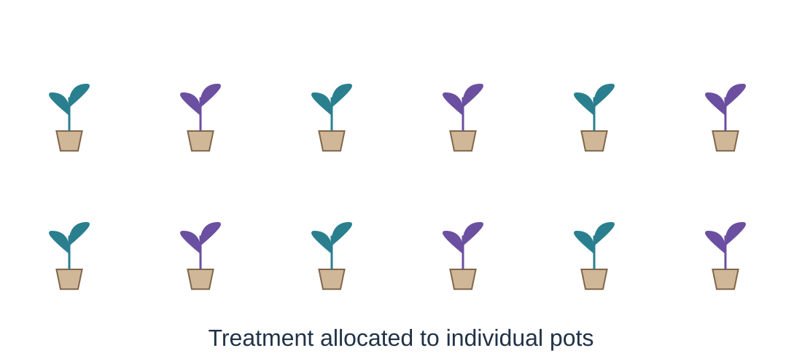
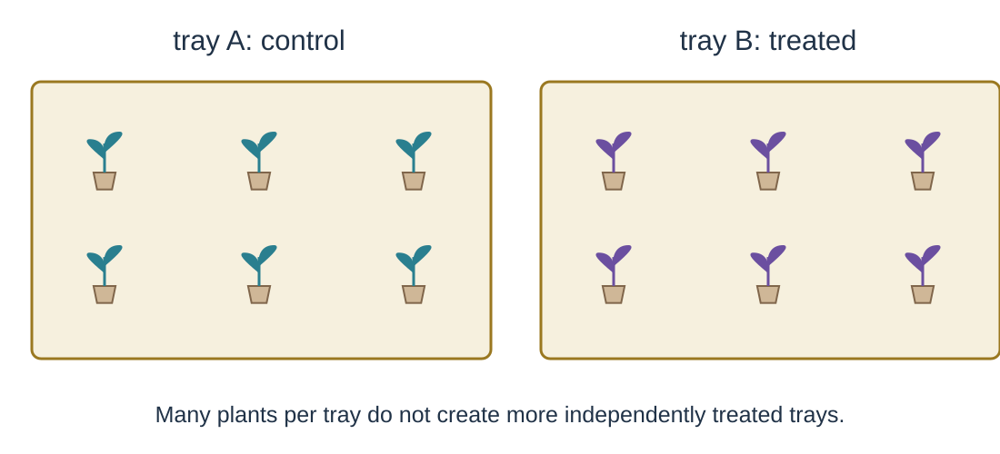
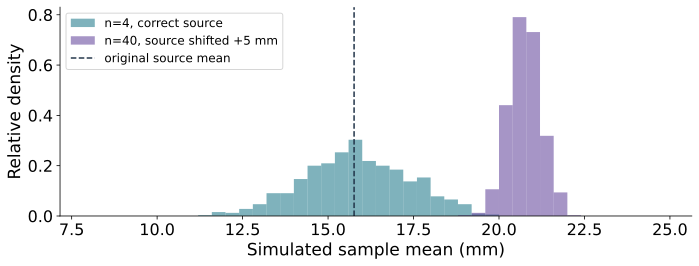

## About this lecture

A thesis student treats three plants, measures a leaf on each plant ten times, and writes **n = 30** in the methods. The examiner replies: "You have three plants. n = 3." With n = 30 every later result looks far more certain than the experiment can support. **Which measurements count as independent evidence, and how precisely does a mean describe the population?**

- The **experimental unit** is the thing that independently received the treatment: here, a plant in its own pot.
- **Technical replicates** (re-measuring the same plant) check the measurement; **biological replicates** (more plants) tell us about plants.
- The **SD** describes how plants vary; a **sampling distribution** shows how much a *mean* would vary between repeated samples.
- A **precise** estimate can still be **wrong** if the sampling or measurement is biased.

This is a reasoning day, supported by a short supplied simulation. Days 16–18 rely on counting independent units correctly.

::: notes
Inflated n from technical replicates or from many cells of one animal is one of the most common reasons manuscripts and theses are sent back. Students should leave able to say, for any design, "we have many measurements, but the number of independently treated units is ...".
:::

## The problem: more rows, not more plants

:::: {.columns}
::: {.column width="42%"}
- Six ruler readings of **P01** are six numbers about **one plant**.
- They tell you how **repeatable the measurement** is (technical replicates).
- They tell you nothing about how **other plants** respond. For that you need more plants (biological replicates).
- Same trap: 100 cells from one mouse, ten time points from one culture, one product batch weighed twelve times.
:::
::: {.column width="58%"}
{width="100%"}
:::
::::

::: notes
Ask: if P01 happened to be an unusually vigorous plant, would six more readings reveal that? No. Technical repeats are useful, for example to check a new measuring method, but they are a different kind of information. The organic analogue is repeatedly weighing one collected product batch: one run, not twelve.
:::

## The experimental unit: what was treated independently?

:::: {.columns}
::: {.column width="42%"}
- In our study, each plant has **its own pot** and was **randomly allocated** to control or treated.
- Ask: could this plant get control while its neighbour gets treatment? If yes, it is a separate unit.
- So the seedling study has **24 units**, 12 per group, even though each plant was measured twice (initial and final).
- Initial and final lengths become **one growth value per plant**.
:::
::: {.column width="58%"}
{width="100%"}
:::
::::

::: notes
Physical separation alone does not prove independence; the design description in data/README.md states independent allocation and handling. Students should get the unit from the study description, not from counting rows.
:::

## When the tray is the unit

:::: {.columns}
::: {.column width="42%"}
Suppose instead the treatment was given to **whole trays**: one tray of control plants, one tray of treated plants.

- Many plants per tray, but only **one treatment decision per group**.
- Any tray effect (warmer spot, more light) is **mixed up with the treatment**.
- Counting 24 independent plants would overstate the evidence. No statistical test can repair this; only more trays can.
:::
::: {.column width="58%"}
{width="100%"}
:::
::::

::: notes
This is a schematic counterexample, not the course experiment. Ask how many treatment assignments occurred, not how many measurements fill the spreadsheet. With several trays per treatment, the tray becomes the unit of analysis.
:::

## Count the independent units

| Design | Measurements | Independent units |
|---|---|---|
| 24 plants in separate pots, randomly allocated | 24 growth values | **24 plants** (12 per group) |
| 1 plant per treatment, measured 12 times each | 24 readings | **1 plant per group** |
| 2 trays of 12 plants, treatment given per tray | 24 growth values | **1 tray per group** |
| 1 synthesis run, product weighed 12 times | 12 masses | **1 run** |

- The independent units decide what the data can say about **other plants or runs**.
- Write it as: "We have *many* measurements, but our number of independently treated units is *…*."

::: notes
Go through each row with the class before revealing the last column. Ask in which design technical repeats would still be useful: for example, checking that the ruler reading is repeatable before starting the real experiment.
:::

## Two kinds of spread

:::: {.columns}
::: {.column width="40%"}
- **SD among plants:** how much individual plants differ. It does not shrink with more plants; plants are as variable as they are.
- **Sampling uncertainty:** how much the **mean** would change if we took a new sample of plants. This *does* shrink with more independent plants.
- Read the horizontal axis: individual values, or **means**?
:::
::: {.column width="60%"}
{width="100%"}
:::
::::

::: notes
This figure is generated from the course values with a fixed illustrative random generator; exact bins need not match the R demonstration. The concept is the narrower distribution of means from larger samples. Distinguish SD among means from SD among the plants within one sample.
:::

## A simulation: draw many samples, compute many means

```r
seedlings <- read_csv("data/seedlings.csv", show_col_types = FALSE) |>
  mutate(growth_mm = final_mm - initial_mm)
population_mm <- seedlings$growth_mm          # 24 values used as a toy population
set.seed(14)                                  # makes the random draws repeatable
means_4 <- replicate(400, mean(sample(population_mm, size = 4, replace = TRUE)))
means_16 <- replicate(400, mean(sample(population_mm, size = 16, replace = TRUE)))
sd(population_mm); sd(means_4); sd(means_16)  # 5.13  2.44  1.24
```

- `sample(..., size = 4, replace = TRUE)` draws 4 values; a value may be drawn twice.
- `replicate(400, ...)`: repeat "draw a sample, take its mean" 400 times.
- The result is **400 means**, not 400 new plants. The 24 recorded plants never change.

::: notes
Load readr, dplyr and ggplot2 first, and keep the block in day14-sampling.R as in the practical; the practical also plots the two sets of means. Students are not asked to write loops or a sampling algorithm; they need to understand source, draw size, replacement, repetitions and seed. This is a teaching demonstration with a toy population, not a new experiment or a claim about nature.
:::

## Larger samples give more stable means

:::: {.columns}
::: {.column width="40%"}
- Each bar counts **simulated sample means**.
- Means of **4** plants: SD **2.44 mm**. Means of **16** plants: SD **1.24 mm**.
- Four times as many plants → the spread of means roughly **halves**.
- The plants themselves still vary with SD **5.13 mm**. More plants make the **mean** more stable, not the plants more alike.
:::
::: {.column width="60%"}
{height="470px"}
:::
::::

::: notes
The SD of the means approximates what is later called the standard error. Change the seed to 25 in the practical: exact numbers change, the relationship between sample size and spread stays. Choosing a convenient seed is not evidence for anything.
:::

## Simulation settings are not sample size

:::: {.columns}
::: {.column width="42%"}
Three settings, three meanings:

- **Draw size** (`size = 12`): plants in each simulated sample. Changes how much the means vary.
- **Repetitions** (100 vs 1000): how many means we look at. Gives a smoother picture, **same width**.
- **Seed**: which random sequence. Exact values change; the pattern does not.

None of them adds a measured plant.
:::
::: {.column width="58%"}
{width="100%"}
:::
::::

::: notes
Compare 100 and 1000 repeats, each using 12 draws. More repetitions do not create more measured plants or narrow the distribution the way a larger independent sample size does. Avoid trying seeds until a pretty plot appears.
:::

## Precise is not the same as correct

:::: {.columns}
::: {.column width="42%"}
- If every measurement is **5 mm too high** (a misread ruler, one unusually sunny tray), means of 40 plants are tightly clustered, **in the wrong place**.
- More readings or more plants from the same biased source make the estimate **narrower, not truer**.
- Another ruler reading fixes measurement noise; another **independent, representative** unit addresses the biology.
:::
::: {.column width="58%"}
{width="100%"}
:::
::::

::: notes
This schematic uses a known 5 mm shift for illustration; it does not diagnose bias in the course study. A narrow histogram describes the sampling process precisely, not whether that process answers the biological question.
:::

## Same idea, new source: the second class

:::: {.columns}
::: {.column width="45%"}
```r
transfer <- read_csv("data/seedlings-transfer.csv",
                     show_col_types = FALSE) |>
  mutate(growth_mm = final_mm - initial_mm)
set.seed(14)
means_3 <- replicate(400, mean(sample(
  transfer$growth_mm, size = 3, replace = TRUE)))
means_12 <- replicate(400, mean(sample(
  transfer$growth_mm, size = 12, replace = TRUE)))
sd(means_3); sd(means_12)   # 1.69  0.83
```

- 18 recorded plants (SD **3.08 mm**) as a toy source.
- Means of 3 draws vary about **twice** as much as means of 12.
:::
::: {.column width="55%"}
{width="100%"}
:::
::::

::: notes
The transfer source combines both groups only to illustrate sampling; it is not a treatment comparison or a confidence interval. Students keep the two results in separate objects and save them as output/day14-transfer-sampling.csv.
:::

## Summary {.smaller}

| Concept | Key fact |
|---|---|
| Experimental unit | What independently received the treatment; seedling study: 24 potted plants |
| Technical replicate | Re-measuring the same material; checks the measurement, not the biology |
| Biological replicate | Another independent unit; informs how plants (or runs) respond |
| Shared trays | Treatment per tray → the tray is the unit; a test cannot repair the design |
| SD among plants | Spread of individuals (5.13 mm); does not shrink with more plants |
| Sampling uncertainty | Spread of means: 2.44 mm (n = 4) vs 1.24 mm (n = 16) |
| Simulation settings | Draw size changes precision; repetitions and seed do not add plants |
| Precision vs bias | A narrow distribution can sit in the wrong place |

**Next (Day 15, descriptive report):** put the checked data, summaries, figure and an honest statement of the units and limits into one report that renders from scratch.

**Now:** [open the Day 14 exercises](../../week3/14-replicates-uncertainty.qmd). Leave with `day14-sampling.R`, your replicate diagrams and a short explanation of what was repeated and what increased the independent information.

::: notes
Design question to end with: measure each of two plants twenty more times, or obtain ten additional independent plants? For a population mean, the ten plants, assuming comparable measurements; checking measurement repeatability first can still be useful.
:::
