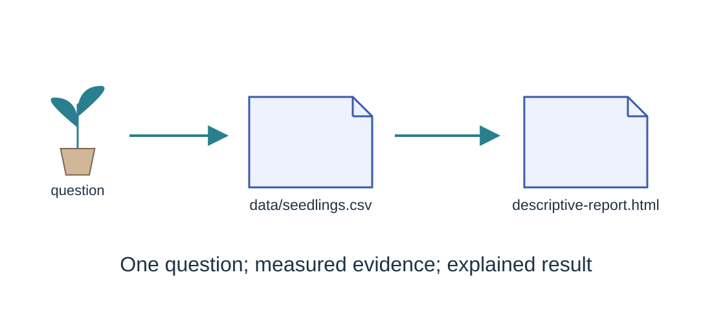
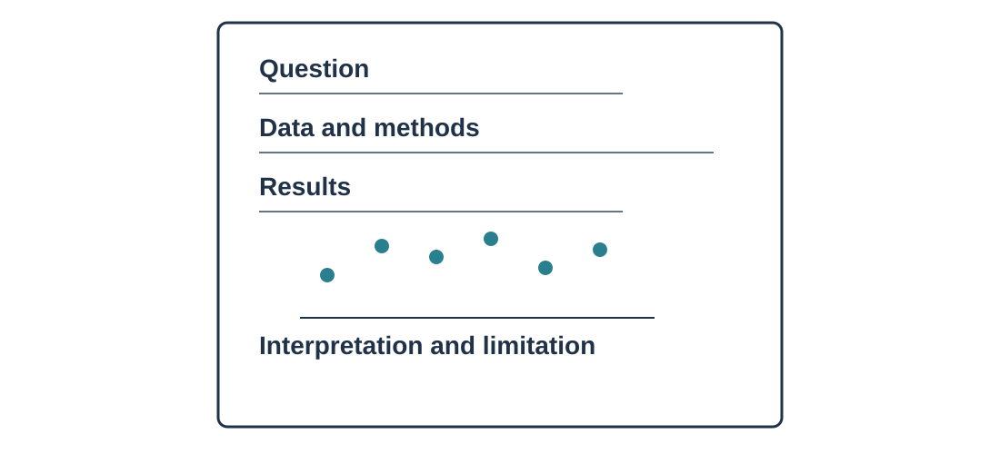
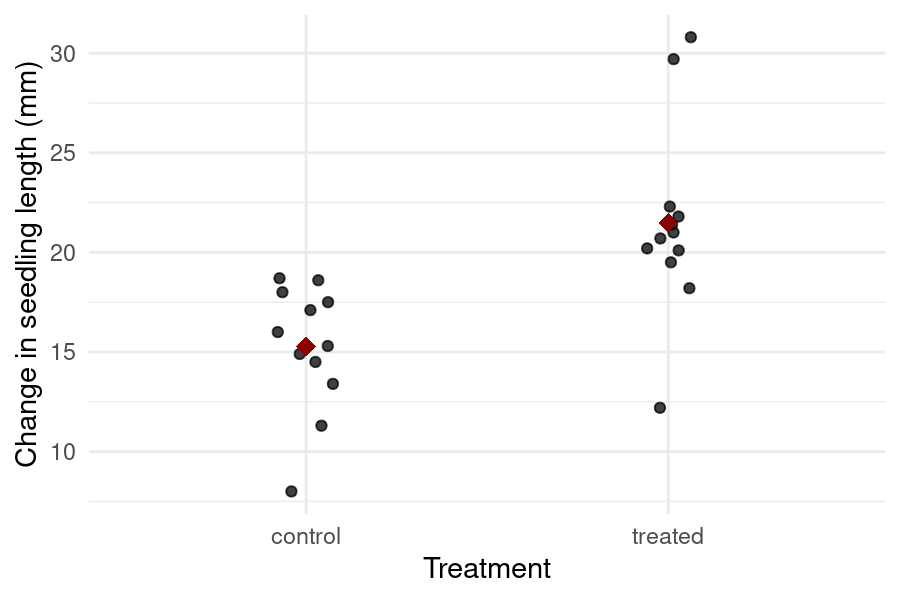
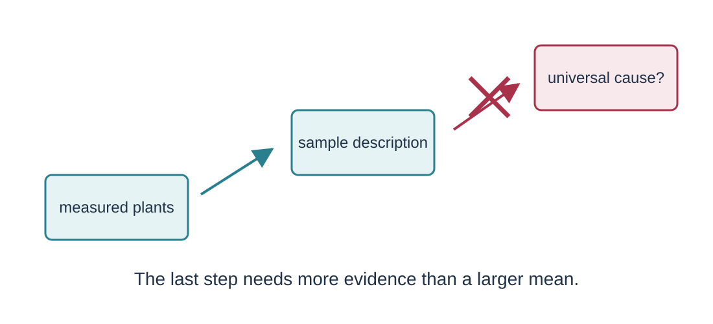
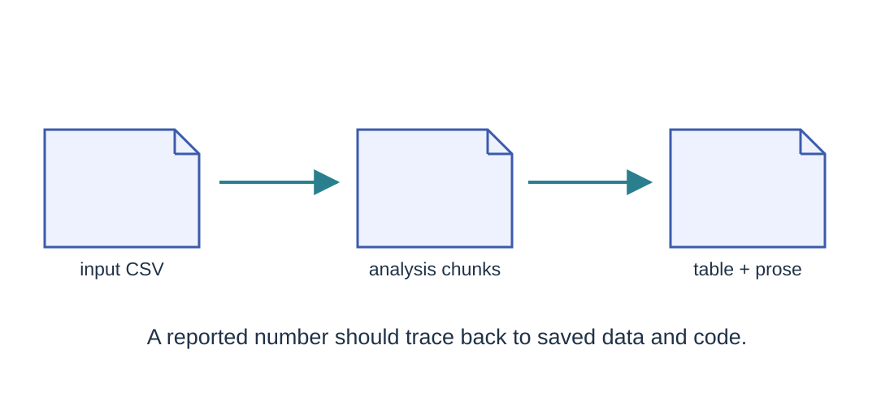
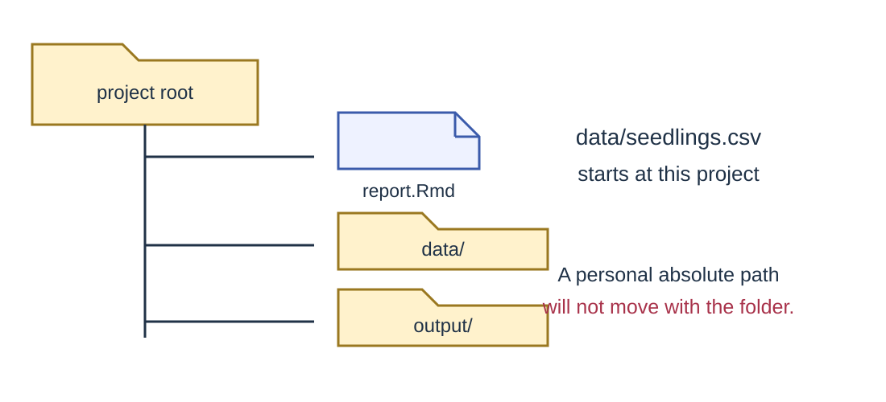
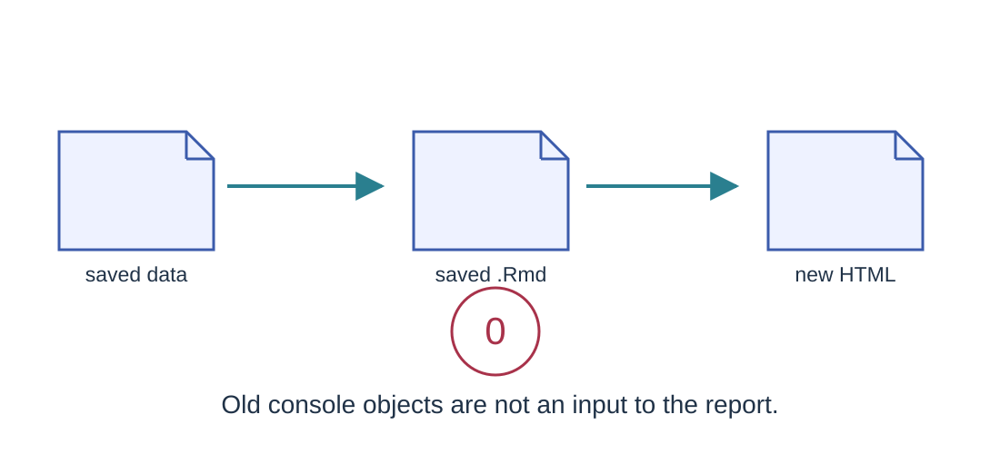
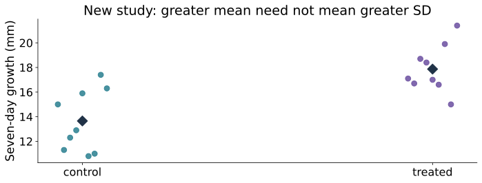

## About this lecture

You send your supervisor a figure and one line: "treated plants grew more." The replies come back: Which data file? How many plants? What are the dots? Did any values go missing? Can I rerun it? Every one of those questions is fair, and a short report can answer all of them at once. **How do we write a report that a reader can understand, check, and regenerate?**

Today you will:

- give each part of a short report a **job**: question, data and methods, results, interpretation;
- **name the input file and the checks**, so every number has a visible origin;
- **render from a fresh session** at the project root, so the report rebuilds itself from saved files;
- keep **claims at the level of the evidence**: describe the sample, without claiming a tested effect.

This day pulls together Days 11–14. The same report becomes the starting point for the comparisons in week 4.

::: notes
The point is not formatting or length. A good descriptive report is short, specific, and reproducible. The practical has a core seedling report (descriptive-report.Rmd) and an organic-yield alternative (organic-report.Rmd); students produce one, chosen by the teacher.
:::

## One question, one evidence trail

:::: {.columns}
::: {.column width="42%"}
**Question:** how does seven-day growth vary among plants, and between control and treated seedlings?

- **Input:** `data/seedlings.csv`, 24 plants in separate pots, 12 per group, lengths in mm.
- **Source:** `descriptive-report.Rmd` at the project root.
- **Output:** an HTML file that anyone can open.
- Each step can be traced to the one before it: question → data → code → result.
:::
::: {.column width="58%"}
{width="100%"}
:::
::::

::: notes
The supplied measurements are simulated; plants received control or a nutrient treatment, and the formulation is unspecified. An organic-yield report may replace this context but is not an extra required report. If the teacher asks for the repaired Day 11 data instead, the report must say so and carry 23 usable growth values through all counts.
:::

## Give each part of the report a job

:::: {.columns}
::: {.column width="45%"}
- **Question:** one or two sentences: what and why.
- **Data and methods:** input file, independent unit (one plant), outcome and units, checks, how growth was calculated.
- **Results:** a table with n, mean, median and SD; a figure with individual plants and means; a caption.
- **Interpretation and limitation:** what the numbers show, in words, and what they cannot show yet.
:::
::: {.column width="55%"}
{width="100%"}
:::
::::

::: notes
Distinguish methods (what was done) from results (what was found). A caption names the unit and the symbols. The interpretation describes direction, variation and limits; it does not repeat all printed output.
:::

## Data and methods: show the checks

:::: {.columns}
::: {.column width="55%"}
```text
> seedlings <- read_csv("data/seedlings.csv",
+                       show_col_types = FALSE)
> anyDuplicated(seedlings$plant_id)
[1] 0
> seedlings |> count(treatment)
# A tibble: 2 × 2
  treatment     n
  <chr>     <int>
1 control      12
2 treated      12
> sum(is.na(seedlings$initial_mm))
[1] 0
> sum(is.na(seedlings$final_mm))
[1] 0
> seedlings <- mutate(seedlings,
+                     growth_mm = final_mm - initial_mm)
```
:::
::: {.column width="45%"}
- These are Day 11's checks, now **inside the report**, so a reader sees what was checked and what came out.
- `anyDuplicated()` gives **0**: no plant ID is repeated.
- **12 plants per group**, **no missing lengths**.
- In the methods text: "24 plants (12 per group), no missing lengths; growth = final − initial length (mm)."
:::
::::

::: notes
Include only checking output that helps the reader; keep the code in the source either way. A positive anyDuplicated() result would be the position of the first repeated ID. If the repaired Day 11 file is used, the methods must state the source and that P06 is unavailable, and every count must use 23 usable growths.
:::

## Results: a table and a figure that agree

:::: {.columns}
::: {.column width="52%"}
```text
> group_summary <- seedlings |>
+   group_by(treatment) |>
+   summarise(n_observed = sum(!is.na(growth_mm)),
+     mean_mm = mean(growth_mm, na.rm = TRUE),
+     median_mm = median(growth_mm, na.rm = TRUE),
+     sd_mm = sd(growth_mm, na.rm = TRUE),
+     .groups = "drop")
> knitr::kable(group_summary, digits = 2)

|treatment | n_observed| mean_mm| median_mm| sd_mm|
|:---------|----------:|-------:|---------:|-----:|
|control   |         12|   15.28|     15.65|  3.19|
|treated   |         12|   21.49|     20.85|  4.87|
```

- In the Console `kable()` prints this text; in the rendered report it becomes a **neat table**, rounded to 2 decimals.
:::
::: {.column width="48%"}
{width="100%"}

The figure from Day 13, with a caption naming the unit, the symbols and n.
:::
::::

::: notes
The table is calculated when the report renders, so if the data change, the table changes with them. A caption must make clear that SD describes spread among plants; this report has no confidence intervals. Do not paste a screenshot of the Environment pane.
:::

## Interpretation: claims at the level of the evidence

:::: {.columns}
::: {.column width="50%"}
**Supported:** "Treated plants grew a mean of 21.5 mm and controls 15.3 mm (n = 12 each). Treated plants also varied more (SD 4.9 vs 3.2 mm), and the groups overlap."

| Weak sentence | Repair |
|---|---|
| "The results were good." | Name the pattern and its size. |
| "The treated group had more error." | "Treated plants varied more (SD 4.9 mm)." |
| "Every treated plant grew more." | False: the groups overlap. |
:::
::: {.column width="50%"}
{width="100%"}

We **described the sample**. Estimating how uncertain the difference is comes in week 4.
:::
::::

::: notes
The smallest treated plant grew 12.2 mm, less than most controls, so "every treated plant" fails. "The computer removed the bad values" is another weak sentence from the exercises: say which value was changed and which source evidence justified it. In the organic alternative, a higher mean yield does not establish greater purity or a better method in general.
:::

## Every number has a visible origin

:::: {.columns}
::: {.column width="45%"}
- A reader should be able to trace each number in the text back to a **saved input** and a **chunk of code**.
- **Inline R** puts a calculated value straight into a sentence. In the source:

  <code>We measured &#96;r nrow(seedlings)&#96; plants.</code>

  renders as "We measured 24 plants."
- The object must be created **earlier in the report**. The sentence still needs units and meaning.
:::
::: {.column width="55%"}
{width="100%"}
:::
::::

::: notes
The literal inline code is shown with escaped characters so this slide does not try to run it. When students render their report, the inline expression is calculated. In the exercises they add two inline values: one count and one mean or SD.
:::

## Keep the report where its paths work

:::: {.columns}
::: {.column width="45%"}
- Save `descriptive-report.Rmd` at the **project root**, beside `data/` and `output/`.
- Then `"data/seedlings.csv"` means the same file on every computer that has the project.
- A path like `C:/Users/anna/Downloads/...` works only on Anna's laptop.
- Render from the **R Console**; `output_dir` puts the HTML into `reports/`.
:::
::: {.column width="55%"}
{width="90%"}
:::
::::

```text
> rmarkdown::render("descriptive-report.Rmd", output_dir = "reports")
processing file: descriptive-report.Rmd
...
Output created: reports/descriptive-report.html
> list.files("reports")
[1] "descriptive-report.html"
```

::: notes
Render prints a progress log; the line to look for is "Output created". Knitting resolves relative paths from the report's own folder, so moving the .Rmd into reports/ would break data/ paths. Never put a render call inside the report itself: a report must not try to render itself.
:::

## Render from files, not from memory

:::: {.columns}
::: {.column width="42%"}
- Restart R, then render. The report must load its own packages, import its data and create every object.
- An object that exists only in your Environment pane is **not** part of the report; on another computer it is missing.
- Best test: copy the project to a **new folder**, render there. Record any failure, fix it, rerun.
- A `.Rproj` file does not contain the data. The CSV must travel with the report.
:::
::: {.column width="58%"}
{width="100%"}
:::
::::

::: notes
Installation commands belong in setup, not in an analysis that should run repeatedly. If rendering fails, read the first meaningful error and the chunk name. A rendered report on a supervisor's computer is the real test.
:::

## Adapt the structure to a new study, not the old conclusion

:::: {.columns}
::: {.column width="42%"}
The second class's data, `data/seedlings-transfer.csv`, go into `transfer-description.Rmd`.

- 18 plants, **9 per group**; treated mean **17.87 mm** (SD 1.94), control **13.66 mm** (SD 2.53).
- Here the treated plants vary **less**, the opposite of the first study.
- Replace imports, counts, numbers, captions and sentences **together**. A new title on an old report is still the old report.
:::
::: {.column width="58%"}
{width="100%"}
:::
::::

::: notes
If students used the transfer data in earlier scripts, they recreate its objects inside the new report rather than relying on the Environment pane. A sentence copied from the first report ("treated plants varied more") would now be false.
:::

## Two reviews before you hand it in

:::: {.columns}
::: {.column width="50%"}
**Reader review** (code closed, HTML only)

- What was the question?
- What is one unit, and how many were there?
- Which file, which outcome, which units?
- What do the dots and diamonds mean?
- What is the main pattern and its main limitation?
:::
::: {.column width="50%"}
**Analyst review** (source open)

- Does every number match a table or chunk?
- Is n the number of **usable** values?
- Were all transformations written in code?
- Does it render after restarting R, in a fresh folder?
- Is there a change log: issue, correction, rerun?
:::
::::

Remove a redundant printout before you remove a unit label or a limitation.

::: notes
The exercises include a revision log in reports/day15-revision.txt. The organic alternative has 12 runs, six per protocol, with yields in percent and SD in percentage points; the same reviews apply.
:::

## Summary {.smaller}

| Concept | Key fact |
|---|---|
| Structure | Question → data and methods → results (table + figure) → interpretation and limitation |
| Input | Name the file; show checks for IDs, labels, missing values; state n (24 plants, 12 per group) |
| Results | Table from code (`knitr::kable()`), figure with plants and means, caption with n and units |
| Claims | Describe the sample (means 21.5 vs 15.3 mm, overlap, SD); no tested effect yet |
| Lineage | Every number traceable to data and code; inline R for counts and means |
| Location | `.Rmd` at project root; render from the Console with `output_dir = "reports"` |
| Fresh session | Restart R and render; test in a new folder; the data travel with the report |
| New study | Adapt the structure; replace every number, caption and sentence |

**Next (Day 16, comparisons):** turn the description into a comparison: state the question, the direction (treated − control) and the independent units before calculating a difference.

**Now:** [open the Day 15 exercises](../../week3/15-descriptive-report.qmd). Leave with `descriptive-report.Rmd` (or `organic-report.Rmd`) and its rendered HTML, with the data needed to render it.

::: notes
No hypothesis test is required today. Avoid spending the session on cosmetic formatting while inputs or interpretation remain unclear.
:::
