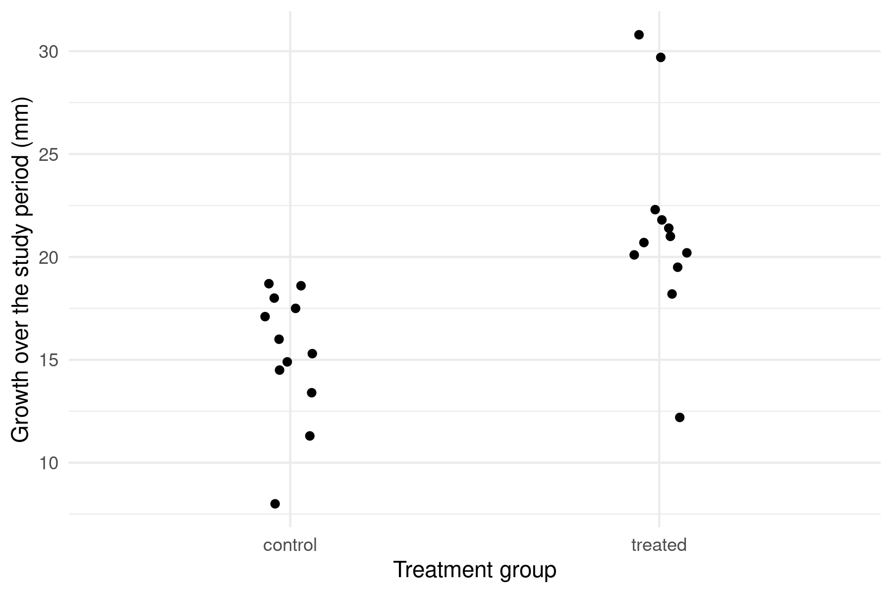
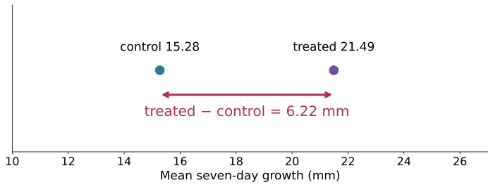
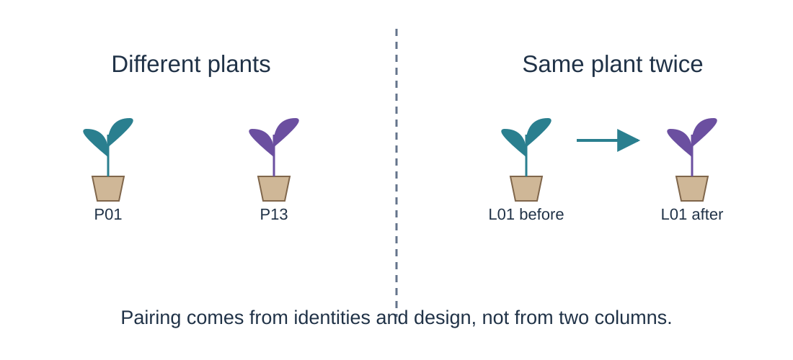

## Does nutrient allocation change seven-day growth?

{height=350px}

Name the question, outcome, units, and independently allocated unit.

::: notes
The course data are simulated. The study description supplies the random-allocation assumption; row order does not prove it. Growth is final minus initial length in millimetres. There are 12 plants per group, measured twice but contributing one growth value each.
:::

## Start with the observations

{height=350px}

A group mean does not describe every plant.

::: notes
Ask students what a dot represents and whether any value obviously contradicts the documented measurement process. There is no known source error in this complete table. Do not remove values simply because they reduce a group difference.
:::

## State the direction before calculating

{height=350px}

**Treated minus control** is our reported difference.

::: notes
Control mean 15.275 mm, treated mean 21.49167 mm, difference 6.21667 mm. Reversing subtraction changes the sign without changing the observed experiment. A reader needs the direction and units to interpret an estimate.
:::

## One change per independently treated plant

```r
library(readr)
library(dplyr)
seedlings <- read_csv("data/seedlings.csv", show_col_types = FALSE) |>
  mutate(growth_mm = final_mm - initial_mm)
treated <- seedlings |> filter(treatment == "treated") |> pull(growth_mm)
control <- seedlings |> filter(treatment == "control") |> pull(growth_mm)
mean(treated) - mean(control)
```

Keep this preparation in **`comparison.Rmd`**.

::: notes
Load readr, dplyr, ggplot2 before these lines, as in the practical. pull extracts the numeric column. These objects are vectors here, not the full group tables. Tomorrow’s lecture and test use exactly these definitions and direction.
:::

## Paired observations require a real identity

{height=350px}

Two columns or two labels alone do not establish pairing.

::: notes
Today compares separate plants. Later, the same plant measured before and after a light change will require within-plant matching. Do not pair unrelated plants merely because their rows happen to align.
:::

## Do we have plants or shared treatment units?

{height=350px}

The design determines whether the group comparison is justified.

::: notes
Revisit the replication concept before running inference. The shown tray layout is a counterexample, not the course study. One tray per treatment would not provide twelve independent treatment assignments per group. A function cannot repair that limitation.
:::

## Size of an effect and variability are separate questions

The sample difference is about **6.22 mm**.

The group SDs describe how much plants vary within each group.

Tomorrow we estimate uncertainty in the population mean difference.

::: notes
Do not use the two within-group SDs as if they were a confidence interval for the difference. Variation among measurements is the starting information for uncertainty, but the quantities answer different questions. Avoid introducing an extra formula today.
:::

## What might weaken the interpretation?

- Non-independent units or biased allocation.
- Recording mistakes or a dominant questionable observation.
- A small sample with severe skew.
- An outcome that does not answer the biological question.

::: notes
This list guides inspection, not a mechanical test-selection algorithm. For this introductory example the supplied design supports independent groups. If an actual practical looks unsuitable, seeking advice is a successful outcome; deleting genuine observations until a test works is not.
:::

## Practical: prepare before testing

Create **`comparison.Rmd`** with design, growth calculation, observations, and the directed difference.

Explain why the two groups are independent.

[Open the practical](../../week4/16-comparisons.qmd).

::: notes
Ask students to read their difference aloud with units and direction. Tomorrow the report gains an interval and p-value; today’s work should already be scientifically intelligible without either.
:::
