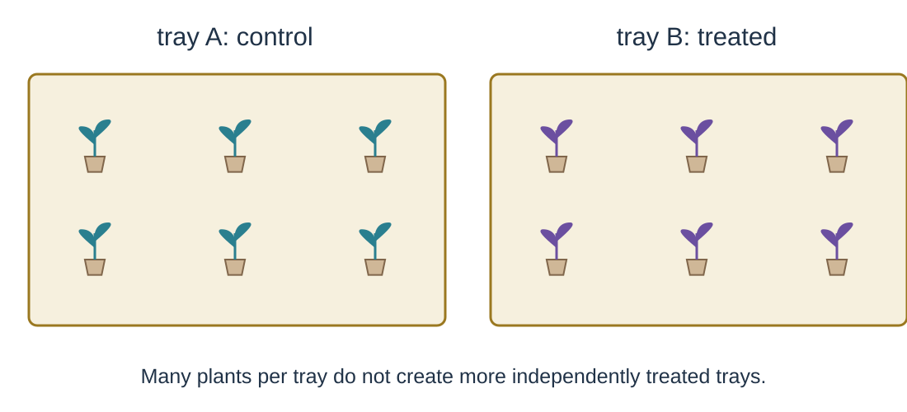
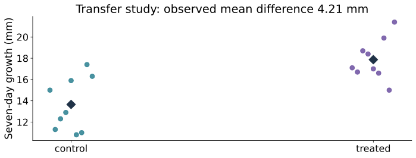

## About this lecture

Your descriptive report says treated seedlings grew more on average. Your supervisor asks: "More than what, by how many millimetres, measured how, and could the set-up itself have produced that?" Before any statistical test, a comparison has to be **defined**: the outcome, the units, the direction, and which plants count as independent. **What exactly are we comparing, and what can the design support?**

- Name the **question, outcome, unit and direction** (treated − control) *before* calculating.
- **Look at the plants** first: a difference in means is not a claim about every plant.
- Check the **design**: independent groups or paired measurements? Plants or shared trays?
- A sample difference is **one estimate**; another experiment would give another number.

Week 4 is about comparisons. Today defines the comparison; Day 17 adds how uncertain it is.

::: notes
Motivate from the reader's side: every results section in biology compares groups, and the first thing a careful reader checks is what was compared, in which direction, and on how many independent units. Students prepare comparison.Rmd today; Day 17 adds a confidence interval and p-value to the same file.
:::

## The question and the design

:::: {.columns}
::: {.column width="42%"}
**Does the nutrient treatment change seven-day seedling growth?**

- **Outcome:** growth = final − initial length, in **mm**, one value per plant.
- **Unit:** one plant in its own pot; **12 + 12**, randomly allocated.
- **Direction:** **treated − control**. A positive number means treated plants grew more.
- Random allocation comes from the **study description**, not from the order of rows in the file.
:::
::: {.column width="58%"}
{width="100%"}
:::
::::

::: notes
The course data are simulated (data/README.md). Each plant is measured twice, but its two lengths are reduced to one growth value, so it contributes one observation. Writing the plan before the output exists prevents choosing a direction or an outcome after seeing which looks best. Students save it as output/day16-plan.txt.
:::

## Choose the outcome that answers the question

:::: {.columns}
::: {.column width="42%"}
- **Left:** initial lengths. Controls started slightly larger (mean **23.0 mm** vs **21.9 mm**).
- **Right:** growth over seven days, the outcome for our question.
- Final length alone would mix starting size with growth.
- A starting difference is worth noting as a **limitation**; adjusting for it is beyond this course.
:::
::: {.column width="58%"}
{width="100%"}
:::
::::

::: notes
Random allocation means a starting difference like this is due to chance, but with 12 plants per group it can still be noticeable. Ask students which quantity answers "does treatment change growth?" before computing any summaries.
:::

## Start with the observations

:::: {.columns}
::: {.column width="45%"}
```r
seedlings <- read_csv("data/seedlings.csv",
                      show_col_types = FALSE) |>
  mutate(growth_mm = final_mm - initial_mm)
growth_plot <- ggplot(seedlings,
    aes(x = treatment, y = growth_mm)) +
  geom_point(position = position_jitter(
    width = 0.08, height = 0, seed = 16)) +
  labs(x = "Treatment group",
       y = "Growth over the study period (mm)") +
  theme_minimal()
```

- The treated group sits higher, but the groups **overlap**.
- The largest control (**18.7 mm**) grew more than the smallest treated plant (**12.2 mm**).
- So "every treated plant grew more" is false, even if the treated mean is higher.
:::
::: {.column width="55%"}
{width="100%"}
:::
::::

::: notes
Ask students what one dot represents and whether any value contradicts the documented measurement process. There is no known source error in this complete table; keep all valid measurements. Overlap does not mean the means are equal, and separated means do not mean every pair of plants differs. Save with ggsave("output/day16-growth.png", growth_plot, width = 6, height = 4).
:::

## Compute the difference in the stated direction

:::: {.columns}
::: {.column width="48%"}
```r
treated <- seedlings |>
  filter(treatment == "treated") |>
  pull(growth_mm)
control <- seedlings |>
  filter(treatment == "control") |>
  pull(growth_mm)
observed_difference <- mean(treated) - mean(control)
observed_difference   # 6.22
```

- `pull()` takes one column out as a plain vector of 12 numbers.
:::
::: {.column width="52%"}
{width="100%"}

- Control **15.28 mm**, treated **21.49 mm**.
- Treated − control = **6.22 mm**: a number with **units and a sign**.
:::
::::

::: notes
Load readr, dplyr and ggplot2 first, as in the practical. These vectors are exactly what Day 17's t.test(treated, control) uses, so the direction carries over. Ask students to read the result aloud: "treated plants grew on average 6.22 mm more than controls".
:::

## The sign comes from the subtraction, not the name

:::: {.columns}
::: {.column width="42%"}
- `mean(treated) - mean(control)` = **+6.22 mm**.
- `mean(control) - mean(treated)` = **−6.22 mm**.
- Same plants, same experiment: only the description changes.
- Calling an object `treatment_effect` does not fix its sign. State the direction **in words** next to the number.
- A report that says one direction and computes the other is wrong.
:::
::: {.column width="58%"}
{width="100%"}
:::
::::

::: notes
If a result comes out negative unexpectedly, print mean(treated) and mean(control) separately before concluding anything about the biology. Neither direction is wrong when it is labelled; we chose treated − control in advance and keep it.
:::

## Independent groups or pairs?

:::: {.columns}
::: {.column width="42%"}
- **Today:** different plants in each group (P01 control, P13 treated). The groups are **independent**.
- **Day 18:** the same plant measured before and after a change (L01 before, L01 after). Those readings form a **pair** and must stay together.
- Two columns in a table do not make a pair; **the same individual** does.
- Within one plant, initial and final are already combined into growth, so each plant gives one value.
:::
::: {.column width="58%"}
{width="100%"}
:::
::::

::: notes
Pairing requires matching subject identity, not matching row positions. Getting this wrong changes the analysis: a paired design needs the within-plant differences, which comes on Day 18.
:::

## Plants or shared trays?

:::: {.columns}
::: {.column width="42%"}
Imagine all treated plants shared **one tray** and all controls another.

- The plants are still measured, but there is only **one treatment assignment per group**.
- A warmer or brighter tray would look exactly like a treatment effect.
- Counting 24 independent plants would overstate the evidence. **No test can repair this**; only more independent trays.
- Our study allocated plants **individually**, so the plant is the unit.
:::
::: {.column width="58%"}
{width="100%"}
:::
::::

::: notes
This is the Day 14 counterexample, not the course study. Other things that weaken a comparison: biased allocation, recording mistakes, one dominating questionable value, or an outcome that does not answer the question. If a real design looks unsuitable, asking for advice is a good outcome; deleting genuine values until a test "works" is not.
:::

## Another sample, another difference

:::: {.columns}
::: {.column width="45%"}
```r
transfer <- read_csv("data/seedlings-transfer.csv",
                     show_col_types = FALSE) |>
  mutate(growth_mm = final_mm - initial_mm)
transfer |> group_by(treatment) |>
  summarise(n = n(), mean_mm = mean(growth_mm),
            sd_mm = sd(growth_mm),
            .groups = "drop")
```

- Second class: **9 plants per group**; control **13.66 mm**, treated **17.87 mm**.
- Treated − control = **4.21 mm**, not 6.22 mm.
- Different plants and conditions give a different estimate. That alone is not evidence that the treatment "failed".
:::
::: {.column width="55%"}
{width="100%"}
:::
::::

::: notes
Students analyse this in transfer-comparison.Rmd with the same direction, and save output/day16-transfer-summary.csv. Confirm 18 rows, 9 per group, no missing values. The two simulated studies differ in values, spread and sample size; descriptive work cannot settle why their differences differ.
:::

## What we can say today, and what remains open

**Results paragraph:** "Treated seedlings grew a mean of 21.49 mm (SD 4.87) and controls 15.28 mm (SD 3.19), 12 plants each: a difference of **6.22 mm (treated − control)**. Growth overlapped between the groups."

Still open: **would another set of plants give a similar difference, or could chance alone produce 6 mm?**

- The **null hypothesis** for Day 17: the population mean growth is the **same** under both conditions.
- **Two-sided:** a difference in either direction counts. We decide this now, before seeing a test.
- A **p-value** will say how surprising our data are *if* the means were equal. It is not the probability that the treatment works, and not the size of the effect.

::: notes
Students should have a meaningful results paragraph before Day 17; the test adds an interval and p-value to it but does not replace it. The within-group SDs describe plants; uncertainty in the difference is a different quantity that also depends on sample size.
:::

## Summary {.smaller}

| Concept | Key fact |
|---|---|
| Plan first | Question, outcome (growth, mm), unit (potted plant), direction (treated − control), before calculating |
| Outcome | Growth answers the question; initial length is a possible limitation (23.0 vs 21.9 mm) |
| Observations | Plot the plants; groups overlap, so a mean difference is not "every plant" |
| Difference | 21.49 − 15.28 = **6.22 mm**; the sign comes from the subtraction order |
| Independent vs paired | Different plants are independent; the same plant twice is a pair (Day 18) |
| Design | Shared trays → the tray is the unit; a test cannot repair the design |
| One estimate | Another study gave 4.21 mm; samples vary |
| Open question | Is 6.22 mm larger than chance variation could produce? (Day 17) |

**Next (Day 17, Welch test):** how uncertain is the 6.22 mm difference? We add a confidence interval and a p-value, using the same `treated` and `control` vectors and the same direction.

**Now:** [open the Day 16 exercises](../../week4/16-comparisons.qmd). Leave with `comparison.Rmd`, its rendered HTML, and `output/day16-growth.png`.

::: notes
Ask students to read their difference aloud with units and direction. Today's report should already be scientifically intelligible without any test.
:::
