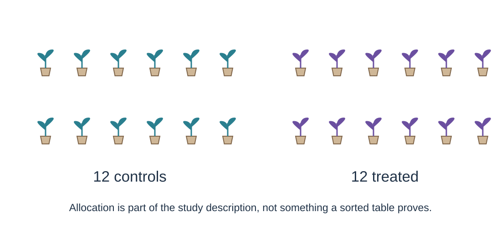
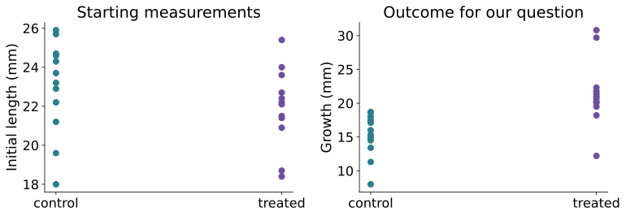
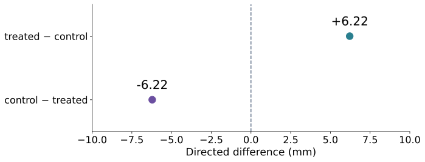
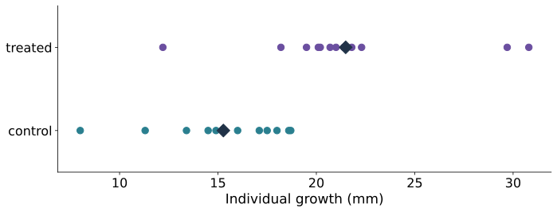

## Does nutrient allocation change seven-day growth?

{height=350px}

Name the question, outcome, units, and independently allocated unit.

::: notes
The course data are simulated. The study description supplies the random-allocation assumption; row order does not prove it. Growth is final minus initial length in millimetres. There are 12 plants per group, measured twice but contributing one growth value each.
:::

## Start with the observations

{height=350px}

A group mean does not describe every plant.

::: notes
Ask students what a dot represents and whether any value obviously contradicts the documented measurement process. There is no known source error in this complete table. Keep valid measurements in the main analysis.
:::

## State the direction before calculating

{height=350px}

**Treated minus control** is our reported difference.

::: notes
Control mean 15.275 mm, treated mean 21.49167 mm, difference 6.21667 mm. Reversing subtraction changes the sign without changing the observed experiment. A reader needs the direction and units to interpret an estimate.
:::

## One change per independently treated plant

```r
library(readr)
library(dplyr)
seedlings <- read_csv("data/seedlings.csv", show_col_types = FALSE) |>
  mutate(growth_mm = final_mm - initial_mm)
treated <- seedlings |> filter(treatment == "treated") |> pull(growth_mm)
control <- seedlings |> filter(treatment == "control") |> pull(growth_mm)
mean(treated) - mean(control)
```

Keep this preparation in **`comparison.Rmd`**.

::: notes
Load readr, dplyr, ggplot2 before these lines, as in the practical. pull extracts the numeric column. These objects are vectors here, not the full group tables. Tomorrow’s lecture and test use exactly these definitions and direction.
:::

## Paired observations require a real identity

{height=350px}

Two columns or two labels alone do not establish pairing.

::: notes
Today compares separate plants. Later, the same plant measured before and after a light change will require within-plant matching. Pairing requires matching subject identity, not matching row positions.
:::

## Do we have plants or shared treatment units?

{height=350px}

The design determines whether the group comparison is justified.

::: notes
Revisit the replication concept before running inference. The shown tray layout is a counterexample, not the course study. One tray per treatment would not provide twelve independent treatment assignments per group. A function cannot repair that limitation.
:::

## Size of an effect and variability are separate questions

The sample difference is about **6.22 mm**.

The group SDs describe how much plants vary within each group.

Tomorrow we estimate uncertainty in the population mean difference.

::: notes
Within-group SD and a confidence interval for the difference describe different quantities. Variation among measurements is the starting information for uncertainty, but the quantities answer different questions. Avoid introducing an extra formula today.
:::

## What might weaken the interpretation?

- Non-independent units or biased allocation.
- Recording mistakes or a dominant questionable observation.
- A small sample with severe skew.
- An outcome that does not answer the biological question.

::: notes
This list guides inspection, not a mechanical test-selection algorithm. For this introductory example the supplied design supports independent groups. If an actual practical looks unsuitable, seeking advice is a successful outcome; deleting genuine observations until a test works is not.
:::

## Starting size and growth answer different questions

{height=350px}

Choose the outcome before choosing a summary or a test.

::: notes
The study records two lengths per plant. Growth is final minus initial, not final size alone. Starting-size patterns can inform a limitation, but we are not adding an adjusted regression in this introductory course.
:::

## Write the analysis plan before the output exists

State the outcome, direction, unit, allocation, and units.

For this study: mean seven-day growth; treated minus control; plant/pot; randomly assigned allocation; mm.

::: notes
A group-sorted file does not establish random assignment. That information comes from the supplied design. Ask what would differ if all treated plants shared one tray and all controls another.
:::

## Direction is an arithmetic choice you must explain

{height=350px}

Changing subtraction order does not change the observations.

::: notes
Treated minus control is+6.2167 mm; control minus treated is−6.2167 mm. Neither direction is intrinsically wrong if labelled. A report that states one direction and calculates the other is wrong.
:::

## A difference in means is not a claim about every plant

{height=350px}

Use individual points to check the word “every”.

::: notes
The largest control growth exceeds some treated values. Rewrite the group statement to say greater mean growth in these observations, not that every treated plant outgrew every control. Overlap itself is not a significance test.
:::

## Describe the result without a threshold label

Include n, group means, directed difference, units, and individual variation.

Then name the unanswered question: **how uncertain is the estimated population difference?**

::: notes
Students should have a meaningful results paragraph before day17. Keep the experimental question and observed difference clear before introducing test output.
:::

## An independent study gives another estimate

{height=350px}

Another observed estimate is not automatically evidence that a mechanism changed.

::: notes
The two simulated studies differ in actual values, group spread, and sample sizes. A smaller observed difference is not proof of no effect or failed treatment. Current descriptive work cannot resolve every comparison between studies.
:::

## Keep transfer inputs and outputs under new names

```r
transfer <- read_csv('data/seedlings-transfer.csv',
                     show_col_types = FALSE) |>
  mutate(growth_mm = final_mm - initial_mm)
transfer |> group_by(treatment) |>
  summarise(n = n(), mean_mm = mean(growth_mm),
            sd_mm = sd(growth_mm), .groups = 'drop')
```

::: notes
Load readr and dplyr as in the main study. Confirm18 rows,9 per group, no missing values. Use transfer-comparison.Rmd rather than overwriting the main report; preserve the comparison direction.
:::

## Inspect a hypothetical design failure

Suppose the label was assigned to **one tray per group**.

What remains observable? What independent treatment information is missing?

A different test cannot manufacture independently assigned trays.

::: notes
The observed plant lengths still exist, but treating24 plants as24 independent treatment allocations would be misleading. Keep a design limitation separate from a data-entry error or computational bug.
:::

## Exercises: prepare before testing

Create **`comparison.Rmd`** with design, growth calculation, observations, and the directed difference.

Explain why the two groups are independent.

[Open exercises](../../week4/16-comparisons.qmd).

::: notes
Ask students to read their difference aloud with units and direction. Tomorrow the report gains an interval and p-value; today’s work should already be scientifically intelligible without either.
:::
