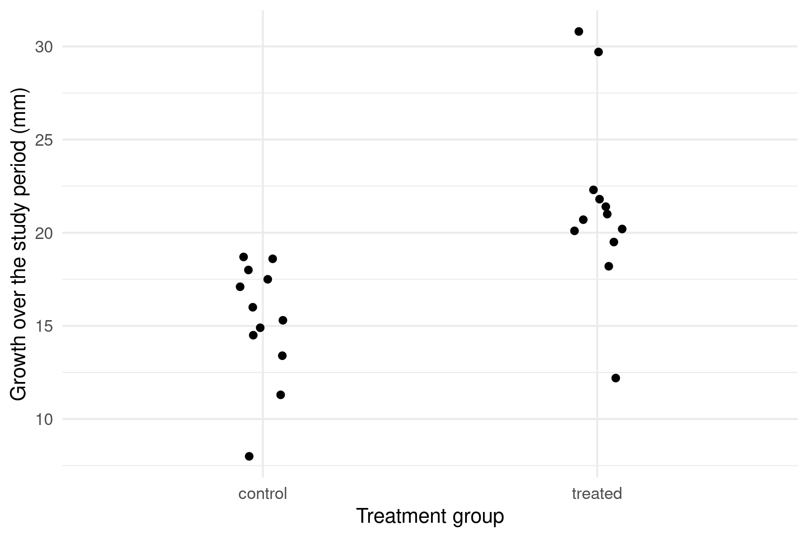
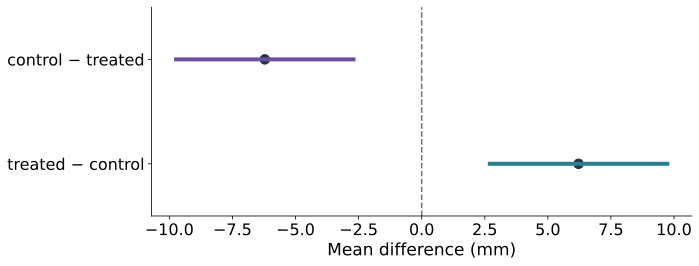
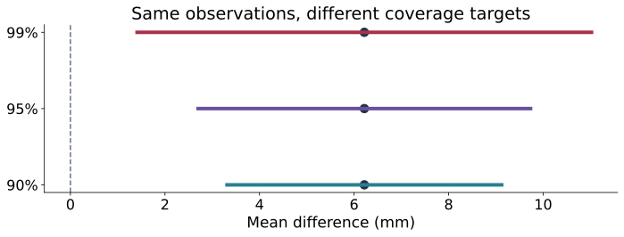
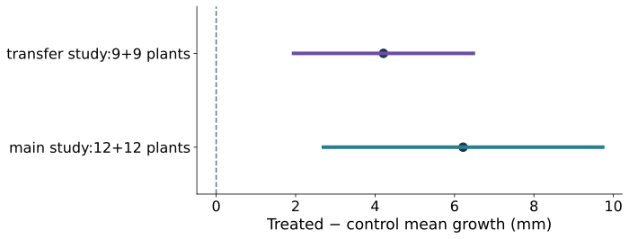

## About this lecture

On Day 16 the treated seedlings grew **6.22 mm more** on average than the controls. But a second experiment with 24 new seedlings would give a different number. **How much should we trust 6.22 mm?** Almost every results section you will read or write answers this with three numbers: an **estimate**, a **95% confidence interval**, and a **p-value**.

- The **estimate** is the observed treated-minus-control difference in means, with units and a direction.
- The **confidence interval** is a range of population differences compatible with the data, under the model.
- The **p-value** asks how surprising the data would be **if the true means were equal**.
- **Welch's test** (`t.test` in R) produces all three for two independent groups, without assuming equal spread.

This is a **reading and writing** day: we do not derive the t formula. We learn to run the test, read every number, and write a result sentence that is correct.

::: notes
Motivate from the reader's side: students will meet "mean difference 6.2 mm (95% CI 2.7 to 9.7; p = 0.002)" in every paper and every lab report they mark or write. The aim today is that they can produce that sentence from R and explain each part, including what it does not mean. Continuity: Day 16 set up the comparison and the direction; today adds uncertainty. Day 18 changes the design to paired measurements.
:::

## The problem: groups overlap

:::: {.columns}
::: {.column width="40%"}
- Treated mean **21.49 mm**, control mean **15.28 mm**, 12 plants each.
- Difference: **6.22 mm** (treated − control).
- But the dots **overlap**: several control plants grew more than several treated plants.
- Plants vary. A different random set of 24 would give a different difference.

**Question:** is 6.22 mm a stable feature of the treatment, or could chance variation between plants produce a gap like this?
:::
::: {.column width="60%"}
{width="100%"}
:::
::::

::: notes
Use the figure saved in comparison.Rmd on Day 16. Point at an individual control plant above the treated mean. The inferential question concerns the population mean difference under the study's conditions, not whether every treated plant beats every control. This is the motivation for the whole day: a difference observed in one sample is a starting point, not a conclusion.
:::

## Check the design before any test

Welch's test fits this study because:

- **Independent units:** each plant is its own unit, randomly allocated to a group.
- **One value per plant:** growth = final − initial, computed once.
- **Unequal spread is allowed:** treated SD 4.87 mm vs control SD 3.19 mm is fine for Welch.

A test **cannot repair** the design:

- Repeated readings of the same plant are not extra plants (Day 14).
- Before/after on the **same** plant needs a paired analysis (Day 18).
- In very small samples, look at the dots for strong skew or a single dominating value; keep genuine unusual values and ask for advice if the simple model looks unsuitable.

::: notes
State the assumptions in biological terms, not as a ritual. Welch's version does not assume equal population variances, which is why it is the default in R. It does assume independence, and nothing in the output will warn you if that is violated. Random allocation is what lets us interpret a difference as a treatment effect within these conditions.
:::

## Run the comparison in the direction we named

:::: {.columns}
::: {.column width="60%"}
```text
> comparison <- t.test(treated, control, var.equal = FALSE,
+                      alternative = "two.sided",
+                      conf.level = 0.95)
> comparison

        Welch Two Sample t-test

data:  treated and control
t = 3.7012, df = 18.986, p-value = 0.001517
alternative hypothesis: true difference in means is not equal to 0
95 percent confidence interval:
 2.700984 9.732349
sample estimates:
mean of x mean of y
 21.49167  15.27500
```
:::
::: {.column width="40%"}
- `treated` and `control` are the two vectors of 12 growth values from Day 16.
- R subtracts the **second from the first**: **treated − control**. The order sets the sign.
- `var.equal = FALSE` (Welch: spreads may differ) and `alternative = "two.sided"` (either direction counts) are the defaults; writing them makes the method visible.
- `comparison` keeps the result, so you can reuse its numbers later.
:::
::::

::: notes
This builds on Day 16's comparison.Rmd, which already creates the treated and control vectors with pull(). Students should run it, not copy numbers from the slide. Emphasise naming the direction in words before running the code, so that the sign of the output is a check rather than a surprise. The next slide goes through the printout line by line.
:::

## Reading the output

| R prints | Value | Units | Meaning |
|---|---|---|---|
| `mean of x`, `mean of y` | 21.49, 15.28 | mm | Group means (treated, control) |
| difference of means | **6.22** | mm | The estimate, treated − control |
| `95 percent confidence interval` | **2.70 to 9.73** | mm | Uncertainty in the mean difference |
| `t` | 3.70 | none | Estimate ÷ its standard error (its expected variation) |
| `df` | 19.0 | none | Degrees of freedom; just report it |
| `p-value` | **0.0015** | none | See the next slides |

- Sample sizes are **not printed**: get them from your data (12 and 12).
- The interval and estimate carry **mm**; t, df and p have **no unit**.

::: notes
Ask students to annotate their own printout with exactly these four columns: quantity, value, units, meaning. The difference of means is not printed directly; it is the subtraction of the two printed means. Do not spend time on the t formula; the important skill is knowing which number answers which question and which carry units.
:::

## The estimate and its confidence interval

{height="330px" fig-align="center"}

- Estimate **6.22 mm**; 95% CI **2.70 to 9.73 mm**.
- **Zero** marks "no difference between population means". This interval lies entirely above zero.
- The interval is about the **mean difference**, not about individual plants: it does not contain 95% of plants.

::: notes
Units and sign matter. Read the interval as: population mean differences from about 2.7 to 9.7 mm are compatible with these data under the model. Values near zero are not well supported; neither are differences of 15 mm. Students often read every interval as a spread of individuals; the next two slides separate those ideas.
:::

## What "95%" refers to

:::: {.columns}
::: {.column width="40%"}
- Imagine repeating the whole experiment many times, each time computing a new interval.
- The **true difference is fixed**. The **intervals move** from study to study.
- A 95% procedure covers the truth in about **95% of repeats** — under its assumptions.
- We do not know whether **our one interval** is one of the hits.
:::
::: {.column width="60%"}
{width="100%"}
:::
::::

::: notes
This is a conceptual illustration, not additional seedling experiments. Some intervals miss the fixed truth; that is part of what 95% means. The probability statement is about the procedure, not about this particular interval. Avoid "there is a 95% probability the true value is in this interval" — under this frequentist framework the truth is fixed and either inside or not.
:::

## Spread among plants is not the difference interval

{width="80%" fig-align="center"}

- **Left:** individual growth values. Spread here is natural **variation between plants** (SD).
- **Right:** uncertainty in the **treated − control mean difference** (CI).
- Before reading any error bar, ask: **which quantity**, and **on which axis**? A figure caption must say.

::: notes
Students frequently read any bar as individual spread or any bar as a confidence interval. Ask them to identify the axis and the summarised object in each panel before interpreting. Link back to Day 13: if you draw whiskers, define them.
:::

## What the p-value conditions on

:::: {.columns}
::: {.column width="45%"}
**Definition:** *if* the two population means were equal (and the assumptions held), how often would a statistic be **at least this extreme**, in either direction?

- Here **p ≈ 0.0015**: rarely.
- The shaded tails lie beyond the observed |t| = 3.70.

**It is not:**

- the probability that the null hypothesis is true;
- the probability that the treatment works;
- a measure of how **large** the effect is.
:::
::: {.column width="55%"}
{width="100%"}
:::
::::

::: notes
The reference curve uses the actual Welch statistic and approximate degrees of freedom. It is not a distribution of possible treatment effects. The key phrase is "if the means were equal": the p-value is computed under that model. Two-sided means both tails count. A large biological effect and a tiny one can both give small p-values with enough data, which is why the estimate and interval must be reported too.
:::

## Direction is a choice; reversing it flips the interval

:::: {.columns}
::: {.column width="45%"}
```text
> reverse <- t.test(control, treated)
> comparison$conf.int
[1] 2.700984 9.732349
attr(,"conf.level")
[1] 0.95
> reverse$conf.int
[1] -9.732349 -2.700984
attr(,"conf.level")
[1] 0.95
> comparison$p.value
[1] 0.001517127
> reverse$p.value
[1] 0.001517127
```

- `$conf.int` and `$p.value` take one part out of a saved result. R also prints the level (0.95) as a label.
- Same data, opposite sign: **control − treated**. The two-sided p-value is **unchanged**.
:::
::: {.column width="55%"}
{width="100%"}

Report the direction you **stated in advance**; keep the check in a separate object.
:::
::::

::: notes
This is not a new experiment, only the same contrast described in the other direction. The argument order determines the sign, not an object name such as treatment_effect. Using a separate object keeps the primary result intact in the report.
:::

## What makes an interval wider or narrower?

:::: {.columns}
::: {.column width="50%"}
{width="100%"}

**Confidence level:** 90% → 3.31 to 9.12; 99% → 1.41 to 11.02 mm. More coverage requires a wider interval. Keep 95% as the stated analysis.
:::
::: {.column width="50%"}
{width="100%"}

**Data:** width depends on **sample size and spread together**. The transfer study (9 per group) has a *narrower* interval than the main study (12 per group) because its plants vary less.
:::
::::

::: notes
Changing conf.level does not change the observed means; it changes how wide the procedure must be to achieve its long-run coverage. On the right, do not teach "bigger n always gives a narrower interval" when spread also differs: transfer SDs are about 1.9 and 2.5 mm against 4.9 and 3.2 mm in the main study.
:::

## When the interval includes zero

{height="330px" fig-align="center"}

- Illustrative small study: estimate 2 mm, 95% CI **−1 to 5 mm**.
- Both a small harmful and a moderate helpful effect remain compatible with the data.
- **Including zero is not proof of no effect.** "Not significant" means *inconclusive here*, not *equal*.

::: notes
These are illustrative numbers, not output from the course data. Ask students what positive and negative differences remain inside the range. A common error in student reports is writing "the treatment had no effect" from p > 0.05; the honest statement is that this study could not determine the direction.
:::

## Write a result, not a threshold label

**Good:** "Treated seedlings grew on average **6.22 mm more** than controls (95% CI **2.70 to 9.73 mm**; Welch two-sided test, **p ≈ 0.0015**; 12 plants per group)."

Then one sentence on **biological size** and one on **design limits**.

| Misreading | Better |
|---|---|
| "The null hypothesis has probability 0.0015." | Under equal means and the assumptions, a statistic this extreme is rare. |
| "The result is significant." (alone) | Give estimate, units, interval and p. |
| "p is small, so the effect is large." | Size comes from the estimate and interval, not from p. |
| "p > 0.05, so there is no difference." | The data are inconclusive about direction. |

::: notes
Random allocation supports a causal comparison within these study conditions, but p alone never establishes causality or generalisation beyond them. Encourage a sentence on biological relevance: is 6 mm over a week a lot for a seedling of about 20 mm? Precision of wording is part of the analysis, not editing afterwards.
:::

## Worked example: a second class's study

:::: {.columns}
::: {.column width="58%"}
```text
> transfer_test <- t.test(new_treated, new_control)
> transfer_test

        Welch Two Sample t-test
...
t = 3.9668, df = 15.004, p-value = 0.00124
alternative hypothesis: true difference in means is not equal to 0
95 percent confidence interval:
 1.948441 6.473782
sample estimates:
mean of x mean of y
 17.86667  13.65556
```
:::
::: {.column width="42%"}
- `new_treated` and `new_control` are the second class's growth values, made with `filter()` and `pull()` as on Day 16. 9 plants per group. Estimate: 17.87 − 13.66 = **4.21 mm**.
- 95% CI **1.95 to 6.47 mm**; p ≈ **0.0012**.

**Result:** "Treated seedlings grew 4.21 mm more on average (95% CI 1.95–6.47 mm; Welch two-sided test, p ≈ 0.0012; 9 per group)."

- A smaller estimate than the main study, yet a **narrower** interval: these plants vary less.
:::
::::

::: notes
Use transfer from its own saved import and growth calculation in transfer-comparison.Rmd, not leftover console objects. Have students write the result sentence before showing it. Transfer SDs are about 1.94 and 2.53 mm, against 4.87 and 3.19 mm in the main study.
:::

## Summary {.smaller}

| Concept | Key fact |
|---|---|
| Estimate | Treated − control difference of means, in **mm**; direction set by argument order |
| Welch's test | Two **independent** groups; spreads may differ; `t.test(x, y)` |
| Design first | Independence and one value per unit; a test cannot repair design |
| 95% CI | Range of mean differences compatible with the data; procedure covers the truth in ~95% of repeats |
| CI vs SD | CI is uncertainty in the **mean difference**, not spread of plants |
| p-value | How extreme the data would be **if means were equal** — not P(null), not effect size |
| CI includes 0 | Inconclusive about direction, not proof of equality |
| Reporting | Estimate + units + CI + test + p + n, then size and limits in words |

**Next (Day 18, paired observations):** when each plant is measured twice, the two readings are not independent, and the analysis must keep each pair together.

**Now:** [open the Day 17 exercises](../../week4/17-welch-test.qmd). Add the method, estimate, interval, sample sizes and p-value to `comparison.Rmd`, keep the individual-point plot, restart R, and render.

::: notes
Recite the result sentence once more as the model answer. The exercises extend comparison.Rmd and transfer-comparison.Rmd; the rendered HTML should be understandable without R's printout. Students should check direction and units in the rendered output, not only in the console.
:::
