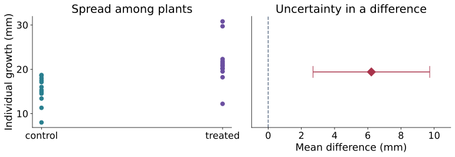

## Observed difference is a starting point

{height=350px}

How uncertain is the estimated **treated-minus-control** mean difference?

::: notes
Use the comparison.Rmd prepared on day 16. The difference in this sample is 6.21667 mm. The inferential question concerns a population mean difference under assumptions, not whether every individual plant must follow the group ordering.
:::

## Check the design and observations first

- Independent plants, allocated to separate groups.
- One growth value per plant.
- Inspect severe skew and influential observations in small samples.
- Keep genuine unusual values; seek advice when the simple model is unsuitable.

::: notes
Welch’s method does not require equal population variances, but does not repair dependence, biased allocation or data quality. Do not introduce formal normality-testing thresholds or a catalogue of alternative methods. The assumptions should be described in biological terms.
:::

## Run the comparison in the direction we named

```r
comparison <- t.test(treated, control,
  var.equal = FALSE, alternative = "two.sided",
  conf.level = 0.95)
comparison
```

First vector minus second vector: **treated minus control**.

::: notes
The prior preparation creates treated and control numeric vectors. var.equal=FALSE explicitly asks for Welch’s method; the default already does this, but the setting is visible. Two-sided means evidence in either direction counts. We are reading estimates, interval and p-value rather than deriving the t formula.
:::

## An interval around the estimated difference

{height=350px}

Estimate **6.22 mm**; 95% CI **2.70 to 9.73 mm**.

::: notes
Units and sign matter. Zero denotes equal population means under this comparison. The interval quantifies uncertainty in the mean difference under the model; it is not an interval containing 95% of individual plants, nor a guarantee that the true difference lies inside this particular interval.
:::

## The 95% refers to a repeated-sampling procedure

{height=350px}

A valid 95% procedure covers the fixed truth in about 95% of repeated samples.

::: notes
This is a conceptual repeated-study illustration, not additional seedling experiments or the actual Welch intervals. Some intervals can miss the fixed truth. We do not know whether this particular experiment’s interval covers it. The frequency statement concerns the procedure under its assumptions.
:::

## What does the p-value condition on?

{height=350px}

If the equal-means model held, how often would a statistic be at least this extreme?

::: notes
For these data p is about 0.001517. The reference curve uses the actual Welch statistic and approximate degrees of freedom. It is not a distribution of possible treatment effects. State the conditioning model and assumptions. The p-value is not the probability that the null hypothesis is true or that the treatment works.
:::

## Spread among plants is not the difference interval

{height=350px}

Keep **individual variation** and **estimate uncertainty** separate.

::: notes
The left panel shows the individual growth values; the right shows uncertainty in treated minus control. Students often read any error bar as individual spread. Ask them to identify the horizontal or vertical axis and the object being summarised before interpreting either picture.
:::

## Write a result, not just a threshold label

“Treated mean growth exceeded control mean growth by **6.22 mm**
(95% CI **2.70–9.73 mm**; Welch two-sided **p ≈ 0.0015**).”

Then explain the biological size, assumptions, and limits.

A small p-value does not establish a large or causal effect.

::: notes
The study’s random allocation supports a causal comparison within its conditions, but a p-value alone never establishes causality or universal generalisation. If an interval included zero, it would not prove equality. Encourage a sentence on biological relevance rather than “significant” alone.
:::

## Practical: add interpretation to the report

Keep the individual-point plot. Add the method, directed estimate, interval, sample sizes and p-value.

Restart R and render **`comparison.Rmd`**.

[Open the guided practical](../../week4/17-welch-test.qmd).

::: notes
Have students find comparison$conf.int and comparison$p.value and relate them to the printed output. They should report the two group means and available sample sizes as well. The written interpretation should be understandable without seeing R’s long printout.
:::
