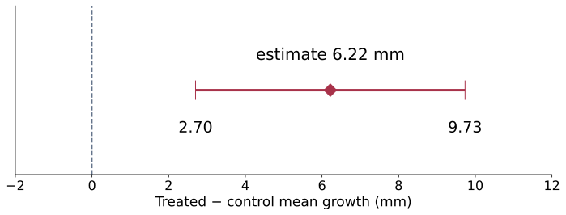
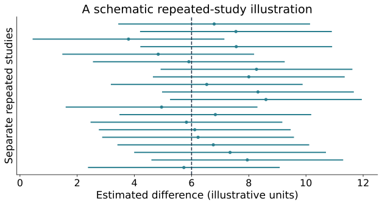
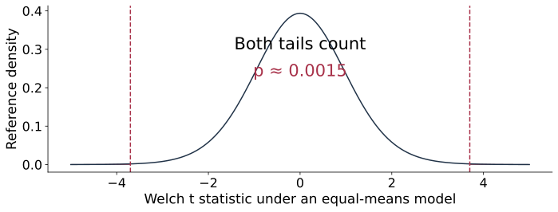
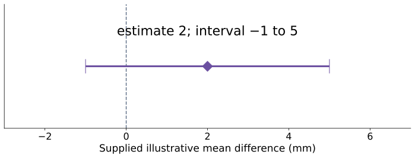

## Observed difference is a starting point

{height=350px}

How uncertain is the estimated **treated-minus-control** mean difference?

::: notes
Use the comparison.Rmd prepared on day 16. The difference in this sample is 6.21667 mm. The inferential question concerns a population mean difference under assumptions, not whether every individual plant must follow the group ordering.
:::

## Check the design and observations first

- Independent plants, allocated to separate groups.
- One growth value per plant.
- Inspect severe skew and influential observations in small samples.
- Keep genuine unusual values; seek advice when the simple model is unsuitable.

::: notes
Welch’s method does not require equal population variances, but does not repair dependence, biased allocation or data quality. Describe the assumptions in biological terms.
:::

## Run the comparison in the direction we named

```r
library(readr)
library(dplyr)
seedlings <- read_csv('data/seedlings.csv', show_col_types = FALSE) |>
  mutate(growth_mm = final_mm - initial_mm)
treated <- filter(seedlings, treatment == 'treated')$growth_mm
control <- filter(seedlings, treatment == 'control')$growth_mm
comparison <- t.test(treated, control,
  var.equal = FALSE, alternative = "two.sided",
  conf.level = 0.95)
comparison
```

First vector minus second vector: **treated minus control**.

::: notes
The prior preparation creates treated and control numeric vectors. var.equal=FALSE explicitly asks for Welch’s method; the default already does this, but the setting is visible. Two-sided means evidence in either direction counts. We are reading estimates, interval and p-value rather than deriving the t formula.
:::

## An interval around the estimated difference

{height=350px}

Estimate **6.22 mm**; 95% CI **2.70 to 9.73 mm**.

::: notes
Units and sign matter. Zero denotes equal population means under this comparison. The interval quantifies uncertainty in the mean difference under the model; it is not an interval containing 95% of individual plants, nor a guarantee that the true difference lies inside this particular interval.
:::

## The 95% refers to a repeated-sampling procedure

{height=350px}

A valid 95% procedure covers the fixed truth in about 95% of repeated samples.

::: notes
This is a conceptual repeated-study illustration, not additional seedling experiments or the actual Welch intervals. Some intervals can miss the fixed truth. We do not know whether this particular experiment’s interval covers it. The frequency statement concerns the procedure under its assumptions.
:::

## What does the p-value condition on?

{height=350px}

If the equal-means model held, how often would a statistic be at least this extreme?

::: notes
For these data p is about 0.001517. The reference curve uses the actual Welch statistic and approximate degrees of freedom. It is not a distribution of possible treatment effects. State the conditioning model and assumptions. The p-value is not the probability that the null hypothesis is true or that the treatment works.
:::

## Spread among plants is not the difference interval

{height=350px}

Keep **individual variation** and **estimate uncertainty** separate.

::: notes
The left panel shows the individual growth values; the right shows uncertainty in treated minus control. Students often read any error bar as individual spread. Ask them to identify the horizontal or vertical axis and the object being summarised before interpreting either picture.
:::

## Write a result, not just a threshold label

“Treated mean growth exceeded control mean growth by **6.22 mm**
(95% CI **2.70–9.73 mm**; Welch two-sided **p ≈ 0.0015**).”

Then explain the biological size, assumptions, and limits.

A small p-value does not establish a large or causal effect.

::: notes
The study’s random allocation supports a causal comparison within its conditions, but a p-value alone never establishes causality or universal generalisation. If an interval included zero, it would not prove equality. Encourage a sentence on biological relevance rather than “significant” alone.
:::

## Read units as well as numbers

Mean growth and the confidence interval use **mm**.
The p-value has **no measurement unit**.

Neither a group SD nor a p-value is the interval for a difference.

::: notes
Ask students to annotate a real output table with quantity,value, units,interpretation. The sample counts come from actual input vectors, not the number of lines printed in the test output.
:::

## Reversing order reverses the interval

{height=350px}

For a two-sided test, the p-value remains the same.

::: notes
A treated-minus-control interval[2.70,9.73] becomes a control-minus-treated interval[−9.73,−2.70]. Both describe the same estimated contrast in opposite units of direction. This is not a new experiment.
:::

## Check the reversal directly

```r
reverse_comparison <- t.test(control, treated)
comparison$conf.int
reverse_comparison$conf.int
comparison$p.value
reverse_comparison$p.value
```

Use separate objects so the stated primary result is preserved.

::: notes
This follows the independent-group setup from day 16: treated/control are numeric growth vectors. The function order determines the sign, not an object name such as treatment_effect.
:::

## Coverage level and interval width are a trade-off

{height=350px}

Keep the 95% interval as the stated main analysis.

::: notes
Higher long-run coverage requires a wider procedure under the same model. Keep the confidence level chosen for the main analysis. Changing conf.level does not change the observed means.
:::

## A small experiment can remain inconclusive about direction

{height=350px}

Including zero is not proof of equality or equivalence.

::: notes
Ask what positive and negative differences remain inside the supplied range. These are illustrative numbers, not output from the course plant file. No new test or sample-size calculation is needed.
:::

## Repair the interpretation, not the desired result

Incorrect: “The null hypothesis has probability 0.0015.”

Better: under the equal-means model and assumptions, a statistic at least this extreme is rare.

Then report effect size, units, interval, and design limits.

::: notes
A frequentist p-value conditions on the model; it does not assign the hypothesis a probability. Biological importance and causality require context. Precision in wording is part of analysis, not an optional editorial add-on.
:::

## Two studies: n alone does not explain interval width

{height=350px}

Both sample size and observed variability contribute.

::: notes
Here the smaller transfer study happens to have a narrower interval because its observed spread is smaller. Do not teach a universal ordering from n alone when other quantities change.
:::

## Recreate the guided comparison for the new source

```r
transfer <- read_csv('data/seedlings-transfer.csv',
                     show_col_types = FALSE) |>
  mutate(growth_mm = final_mm - initial_mm)
new_treated <- transfer |>
  filter(treatment == 'treated') |> pull(growth_mm)
new_control <- transfer |>
  filter(treatment == 'control') |> pull(growth_mm)
transfer_test <- t.test(new_treated, new_control)
transfer_test
```

::: notes
Use transfer from its own saved import/growth calculation, not hidden console state. There are9 available values per group. Difference4.2111 mm;95% interval 1.9484 to6.4738 mm; p about.00124. Include actual observations and assumptions in the interpretation.
:::

## A complete result can be read without R

A reader should identify:

- What was independently assigned and measured.
- The estimated difference and its direction/units.
- Uncertainty under the model and a design/context limitation.

A printout alone does not answer all three.

::: notes
Students extend transfer-comparison.Rmd with a concise results paragraph, then check direction and units in the rendered HTML. Earlier descriptive work remains useful and should not disappear after adding a test.
:::

## Exercises: add interpretation to the report

Keep the individual-point plot. Add the method, directed estimate, interval, sample sizes and p-value.

Restart R and render **`comparison.Rmd`**.

[Open exercises](../../week4/17-welch-test.qmd).

::: notes
Have students find comparison$conf.int and comparison$p.value and relate them to the printed output. They should report the two group means and available sample sizes as well. The written interpretation should be understandable without seeing R’s long printout.
:::
