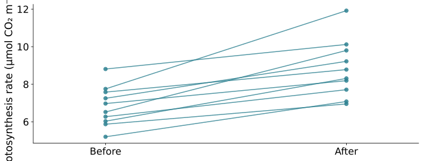
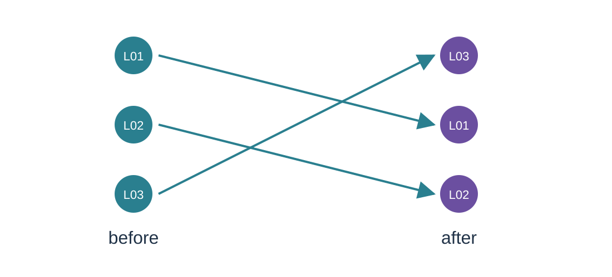
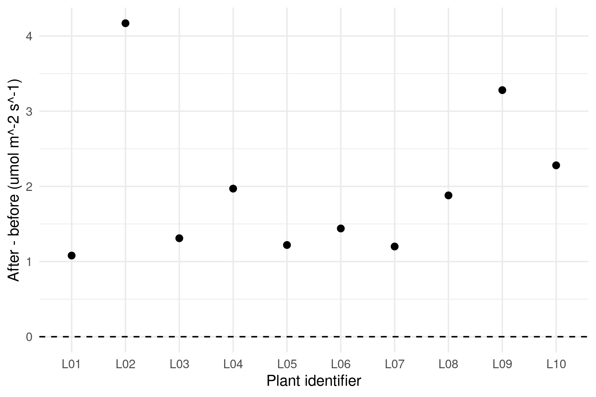
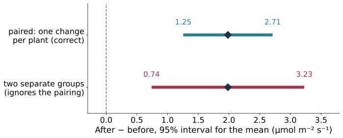
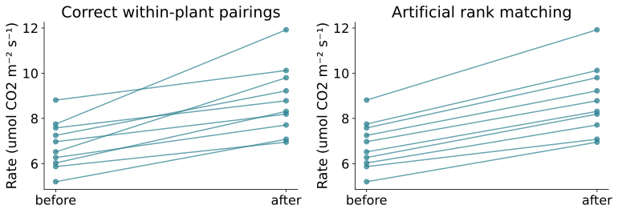

## About this lecture

In a plant physiology lab you measure the photosynthesis rate of ten plants, then raise the light and measure **the same ten plants** again. The plants differ a lot from each other before anything changes. **Did the rate go up, and by how much?** The same design appears whenever a patient, an animal or a culture is measured before and after something: blood pressure before and after exercise, a leaf before and after shading.

Today you will:

- keep the two readings of each plant together, using its identifier;
- turn each pair into one **change** and look at the ten changes;
- run a **paired t-test** and read its estimate, interval and p-value;
- say what a before/after design can and cannot show.

Day 17 compared two **separate** groups. Today each unit is measured **twice**, which needs a different analysis. Day 19 moves on to calibration lines.

::: notes
Open with the design, not the test. Ask the room for other before/after examples from their own biology courses. The aim of the day is that students recognise a paired design when they see one, keep the identity of each unit, and do not report the result as if light alone caused the change.
:::

## The problem: twenty readings, ten plants

:::: {.columns}
::: {.column width="42%"}
- `data/paired.csv`: ten plants, each measured **before** and **after** the light was increased (µmol CO₂ m⁻² s⁻¹).
- Before readings range from **5.20 to 8.81**: plants differ from each other.
- Yet almost every line goes up by a similar amount.
- The two readings of one plant are **not independent**: a high plant before is likely high after.

**Question:** how large is the change **within** a plant?
:::
::: {.column width="58%"}
{width="100%"}
:::
::::

::: notes
Point at the lowest and highest starting plant. The differences between plants are larger than many of the changes. If we treat the 20 readings as two separate groups, that plant-to-plant variation hides the change we care about. This is the motivation for the whole day. The data are simulated teaching data.
:::

## Pair by identity, not by position

:::: {.columns}
::: {.column width="42%"}
- `plant_id` says which two readings belong together.
- In `paired.csv` each row holds one plant's **before** and **after**, so the pair is already kept together.
- If the readings came in two files, **match them by ID** before subtracting. Ten rows in each file is not enough.
- Sorting the **whole table** is safe: rows move together. Sorting **one column** on its own breaks the pairs.
:::
::: {.column width="58%"}
{width="100%"}
:::
::::

::: notes
The diagram imagines two lists in different orders to make the point visible. With the course file this cannot happen, but students will meet two-file data in lab courses (for example a plate-reader export before and after treatment). Ask: what would go wrong if you subtracted row 1 from row 1 here?
:::

## One change per plant

{height=320 fig-align="center"}

- **Change = after − before** for the same plant. Positive means the rate went up.
- L01: 6.95 − 5.87 = **+1.08**. L02: 11.92 − 7.75 = **+4.17**. L03: 10.12 − 8.81 = **+1.31**.
- Each plant is its own reference, so differences in starting level drop out.

::: notes
Do one subtraction on the board. Insist on writing the direction in words ("after minus before") before any code is run; the sign of every later number depends on it. Units stay µmol CO2 m-2 s-1.
:::

## In R: check the pairs, then compute the change

```r
library(readr)
library(dplyr)
library(ggplot2)
paired <- read_csv("data/paired.csv", show_col_types = FALSE)
anyDuplicated(paired$plant_id)        # 0: every plant appears once

paired <- paired |>
  mutate(change_umol_m2_s = after_umol_m2_s - before_umol_m2_s)
mean(paired$change_umol_m2_s)         # 1.983
```

- `anyDuplicated()` returns 0 when no identifier is repeated: ten rows, ten plants.
- The new column holds **one change per plant**; L01's should be +1.08. Check one by hand.
- The mean change is **1.983 µmol m⁻² s⁻¹**.

::: notes
These are the object and column names used in the practical page and paired-report.Rmd. Have students run it and compare L01 with the hand calculation before going further.
:::

## Look at the ten changes

:::: {.columns}
::: {.column width="42%"}
- All ten changes are **positive**, from **+1.08 to +4.17**.
- Mean change **1.983**; SD of the changes **1.02**.
- The dashed line is **no change**.
- L02 changed much more than the others. That alone is not an error: keep it.
:::
::: {.column width="58%"}
{width="100%"}
:::
::::

::: notes
The y-axis is the change, not the after reading. This is the plot students save as change_plot in the practical. A large valid value must not be removed because it is inconvenient; there is no recording note saying L02 is wrong.
:::

## The paired t-test

```r
paired_comparison <- t.test(paired$after_umol_m2_s,
                            paired$before_umol_m2_s,
                            paired = TRUE)
paired_comparison
```

| R prints | Value | Meaning |
|---|---|---|
| `mean difference` | **1.983** µmol m⁻² s⁻¹ | Estimated mean change, after − before |
| `95 percent confidence interval` | **1.255 to 2.711** µmol m⁻² s⁻¹ | Uncertainty in the **mean** change |
| `t`, `df` | 6.16, 9 | df = 10 pairs − 1 |
| `p-value` | **0.00017** | How surprising, if the true mean change were zero |

- `paired = TRUE` matches position 1 with position 1, and so on. That is why the rows must hold true pairs.
- The same numbers come from `t.test(paired$change_umol_m2_s, mu = 0)`: a paired test **is** a test of the changes against zero. It is one analysis, not two pieces of evidence.
- The interval is about the **mean** change; individual plants changed from 1.08 to 4.17.

::: notes
First vector after, second before, so the estimate is after minus before. Ten independent units, not twenty. Run the one-sample version live and show that estimate, interval and p agree to the last digit. Do not present the second call as confirming evidence.
:::

## Why not use Day 17's Welch test?

:::: {.columns}
::: {.column width="42%"}
- Treating before and after as **two separate groups** gives the same estimate, 1.98, but an interval of **0.74 to 3.23**.
- That interval is wider because plant-to-plant differences stay in the calculation.
- The paired analysis removes them: each plant is compared with itself.
- The **design** decides which test to use, not which result looks better.
:::
::: {.column width="58%"}
{width="100%"}
:::
::::

::: notes
Welch on the two columns: t.test(after, before) without paired = TRUE gives 0.74 to 3.23, p about 0.004. It is not wrong arithmetic, it answers a question about two separate groups of plants that this study does not have. Conversely, two unrelated groups can never become paired by putting them side by side.
:::

## Pitfall: sorting the columns separately

:::: {.columns}
::: {.column width="42%"}
- Sorting `before` and `after` **one column at a time** matches the smallest with the smallest, not plant with plant.
- The mean change is still **1.983**: means cannot detect the mistake.
- But the SD of the changes drops from **1.02 to 0.50**, and p shrinks to about 0.0000006.
- A smaller p after breaking the pairs is **not better evidence**; it is a wrong analysis.
:::
::: {.column width="58%"}
{width="100%"}
:::
::::

::: notes
In the practical, students build this deliberately as a separate object, wrong_sorted, and keep paired unchanged. Ask why mean(after) − mean(before) equals mean(after − before) yet tells us nothing about whether the pairs were preserved. The uncertainty depends on the spread of the true within-plant changes.
:::

## Pitfall: few pairs leave much uncertainty

:::: {.columns}
::: {.column width="42%"}
- Illustrative example: three plants, before 5, 8, 6 and after 7, 9, 9.
- Changes **+2, +1, +3**: all positive, mean **2**.
- 95% interval for the mean change: **−0.48 to 4.48** (p ≈ 0.07).
- With three pairs we cannot even be sure of the direction. That is **not** proof of no effect: report the uncertainty.
:::
::: {.column width="58%"}
{width="100%"}
:::
::::

::: notes
These are supplied illustrative values (plants D1–D3), not a measured dataset; students put them into paired-transfer.Rmd. Keep this example separate from the ten-plant study; do not pool them. More independent plants is what narrows the interval.
:::

## What the design cannot show

:::: {.columns}
::: {.column width="42%"}
- Every plant was measured **before, then after**. Light changed, but **time also passed**: acclimation, time of day or instrument drift could contribute.
- There is no group of plants measured twice **without** a light change.
- A small p-value does not separate light from time.
- **Better design:** add plants measured twice under unchanged light, and use more plants.
:::
::: {.column width="58%"}
{width="100%"}
:::
::::

::: notes
Distinguish three improvements: more independent plants gives more pairs and a narrower interval; repeat readings of one plant only tell us about measurement repeatability; a control group measured twice separates light from time. These are different fixes for different limitations.
:::

## Write the result

"Across **10 plants**, photosynthesis rate was on average **1.98 µmol m⁻² s⁻¹ higher after** the light was increased than before (95% CI **1.25 to 2.71**; paired t-test, **p ≈ 0.0002**). Light and measurement order changed together, so the change cannot be attributed to light alone."

| Misreading | Better |
|---|---|
| "We had 20 observations." | 10 plants, each measured twice: **10 pairs**. |
| "Most plants changed by 1.25 to 2.71." | The interval is for the **mean** change; plants changed by 1.08 to 4.17. |
| "Light caused the increase." | Light and time changed together; no unchanged-light group. |
| "Sorting the columns gave a smaller p, so it is better." | Sorting destroyed the pairs; the result is invalid. |

::: notes
Have students write their own sentence before revealing this one. Precision: two or three significant digits is enough in prose; keep the full numbers in R.
:::

## Summary {.smaller}

| Concept | Key fact |
|---|---|
| Paired design | Each unit measured twice; the **unit**, not the reading, is independent (10 plants, not 20 readings) |
| Identity | Match readings by `plant_id`; never sort one column on its own |
| Change | `after − before` per plant; the direction is a choice you write down first |
| Paired t-test | `t.test(after, before, paired = TRUE)` = one-sample test of the changes against 0 |
| Estimate and CI | Mean change **1.98**, 95% CI **1.25 to 2.71** µmol m⁻² s⁻¹; about the **mean** change |
| Why pair | Removes plant-to-plant differences: narrower than treating the columns as two groups |
| Few pairs | Three pairs: CI −0.48 to 4.48; uncertain, not "no effect" |
| Design limit | Fixed before/after order: light and time are mixed; a test cannot separate them |

**Next (Day 19, calibration):** a straight line that turns an instrument reading into a concentration.

**Now:** [open the Day 18 exercises](../../week4/18-paired.qmd). Make `paired-report.Rmd` with the ID check, the change plot, the paired test and a limitation; save `output/day18-changes.png` and render.

::: notes
Ask: could a reader of your report tell what counted as one independent pair? The exercises also include the matching check with the wrong_sorted object and the three-plant paired-transfer.Rmd.
:::
