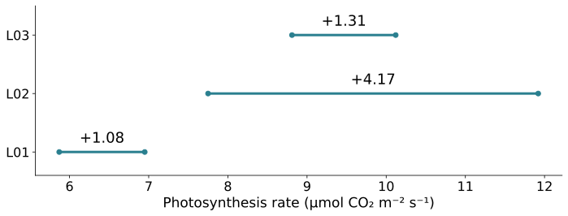
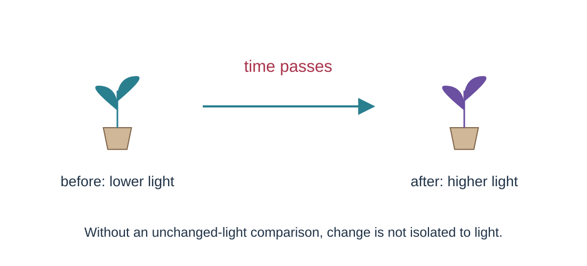
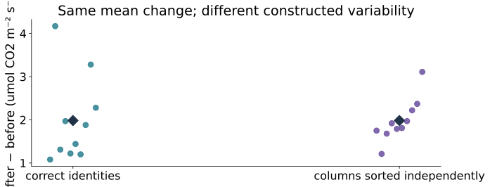
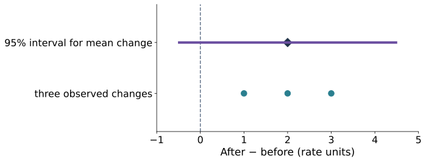
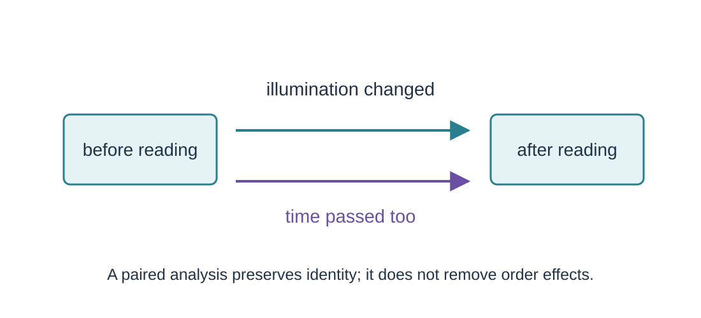

## Which two readings belong together?

{height=350px}

Pair by **identity**, not accidental row position.

::: notes
The file paired.csv stores one plant per row with both readings, so matching is preserved. The diagram imagines two differently ordered lists to make the identity principle visible. Students do not need a join operation for this practical; they need to recognise that labels carry meaning.
:::

## Read the within-plant paths

{height=350px}

Ten plants, ten pairs; not twenty independent plants.

::: notes
Photosynthesis rate is measured in micromoles CO2 per square metre per second. Each line links one plant’s non-destructive reading before and after increasing illumination. The prepared data show positive changes for every plant, but other datasets could have mixed directions.
:::

## Subtract within each plant first

{height=350px}

Positive change means the measured rate increased.

::: notes
L01 changes 6.95−5.87=1.08; L02 changes 11.92−7.75=4.17; L03 changes 10.12−8.81=1.31. These examples show why pairing concerns each plant’s change, not merely comparing two unlabelled collections of readings.
:::

## One paired comparison in R

```r
library(readr)
library(dplyr)
paired_data <- read_csv("data/paired.csv", show_col_types = FALSE)
paired_data <- paired_data |>
  mutate(change = after_umol_m2_s - before_umol_m2_s)
paired_comparison <- t.test(
  paired_data$after_umol_m2_s, paired_data$before_umol_m2_s,
  paired = TRUE)
```

After minus before is the direction of the result.

::: notes
Load readr and dplyr first in the report. The paired argument tells t.test that each position in the first vector belongs with the corresponding position in the second. Keeping both readings in one ID-checked table prevents independent sorting. This is not a method for pairing arbitrary groups.
:::

## Changes differ among plants

{height=350px}

Mean change ≈ **1.983 µmol CO₂ m⁻² s⁻¹**.

::: notes
The y-axis is the difference, not the after reading. Its zero line means no recorded within-plant change. L02 has a larger change than several others; this alone is not a recording error. The mean change and its uncertainty use 10 independent pairs.
:::

## Pairing changes the information used

A paired comparison asks whether the **mean within-plant change** is zero.

A one-sample comparison of those changes gives the same result:

```r
t.test(paired_data$change, mu = 0)
```

Do not independently sort the before and after columns.

::: notes
This equivalence supports understanding, not a demand to learn another method. The subject-to-subject differences in starting level are accounted for through within-subject subtraction. Pairing must be justified by design, and the pairs still need to be independent of one another.
:::

## The design has a limit the test cannot remove

{height=350px}

No unchanged-light group; the same order was used for every plant.

::: notes
We observe a change after the procedure, but light, elapsed time and measurement order accompany one another. The paired t-test does not separate them. Do not claim that a small p-value proves light alone caused the change.
:::

## Report change, uncertainty, and the ordering limit

Mean after-minus-before change: **1.983 µmol CO₂ m⁻² s⁻¹**.

95% CI: **1.255 to 2.711**; paired two-sided **p ≈ 0.000166**.

These describe a change under the study conditions, not an isolated light effect.

::: notes
The confidence interval concerns the population mean change, under the assumptions. It does not describe the range of most plants’ individual changes. Sensible precision and a direct order/time limitation matter more than copying every decimal from the console.
:::

## The same marginal means do not validate a pairing

{height=350px}

Identity influences the uncertainty calculation, even when the mean agrees.

::: notes
For the actual source, correct SD of change is about 1.018 rate units; independently sorted columns give about.505. The changed uncertainty is artificial. A smaller p-value after sorting is not improved evidence.
:::

## Look at which measurements the lines connect

{height=350px}

Keep a plant identifier attached to both of its measurements.

::: notes
Sorting whole rows preserves pairs; sorting columns separately destroys identity. A matching based on numerical rank is not a replacement for the recorded subject identifier.
:::

## A deliberately wrong object exposes the trap

```r
wrong_sorted_change <- sort(paired_data$after_umol_m2_s) -
  sort(paired_data$before_umol_m2_s)
mean(paired_data$change)
mean(wrong_sorted_change)
sd(paired_data$change)
sd(wrong_sorted_change)
```

Never overwrite the valid paired object with this demonstration.

::: notes
The first two means agree. The SDs differ. Ask why subtracting marginal means cannot check whether identities were preserved. Keep the source CSV untouched and label the wrong demonstration unambiguously.
:::

## One analysis, two equivalent computations

Paired comparison of before and after:
` t.test(after, before, paired = TRUE) `

One-sample comparison of correctly matched changes with zero:
` t.test(change, mu = 0) `

These analyse the same within-unit differences.

::: notes
The estimate,interval, and p-value agree when the exact same complete differences are supplied. They are not two independent pieces of evidence and should not be reported as separate confirming experiments.
:::

## Few pairs can leave substantial uncertainty

{height=350px}

Three plants are limited support for a population inference.

::: notes
The three illustrative plants had before5,8,6 and after7,9,9 in the stated rate units. Mean change2,SD 1. The interval is provided to practise interpretation. Do not teach that a function guarantees reliable inference at tiny n.
:::

## A positive observed change does not prove a universal change

For the illustrative case:

- Describe all three individual changes.
- Interpret uncertainty in the population mean.
- Name the small-sample and design limitations separately.

::: notes
All supplied individual changes are positive, yet the model-based95% mean interval includes zero. This does not make the data erroneous or establish equality. Do not select a different test merely to obtain a preferred threshold label.
:::

## Pairing does not remove an order effect

{height=350px}

Preserved identity and a valid causal comparison are different requirements.

::: notes
The source study always measures before then after increased illumination, without an unchanged-light parallel group. The mean change is describable, but light cannot be isolated from every time/order influence.
:::

## Plan the next experiment by limitation

More independent plants → more independent pairs.
Repeat readings of one plant → measurement repeatability.
A suitable comparison/design → better separation of treatment from time.

These are different improvements.

::: notes
Students create paired-transfer.Rmd from the supplied three-row example, including its values/code and a limitation. They should not pool this illustrative case with the unrelated ten-plant study or claim a new measured dataset.
:::

## Practical: keep the pair visible

Make **`paired-report.Rmd`** with the design, matched changes, a figure, result, and limitation.

Could a reader identify what counted as one independent pair?

[Open the practical](../../week4/18-paired.qmd).

::: notes
Check the practical’s chosen source report filename and use its code from the top. Ask students to explain why two unrelated groups cannot become paired by putting them beside one another. No new biology or chemical prerequisite is needed.
:::
