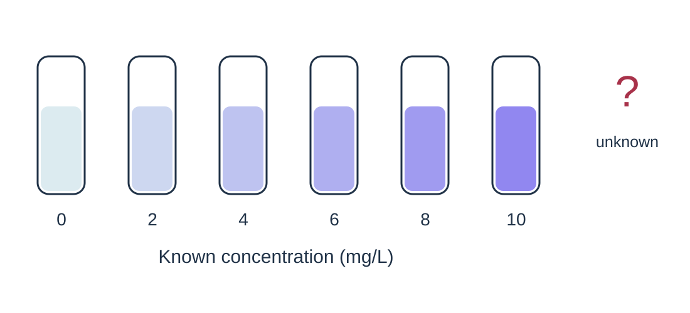
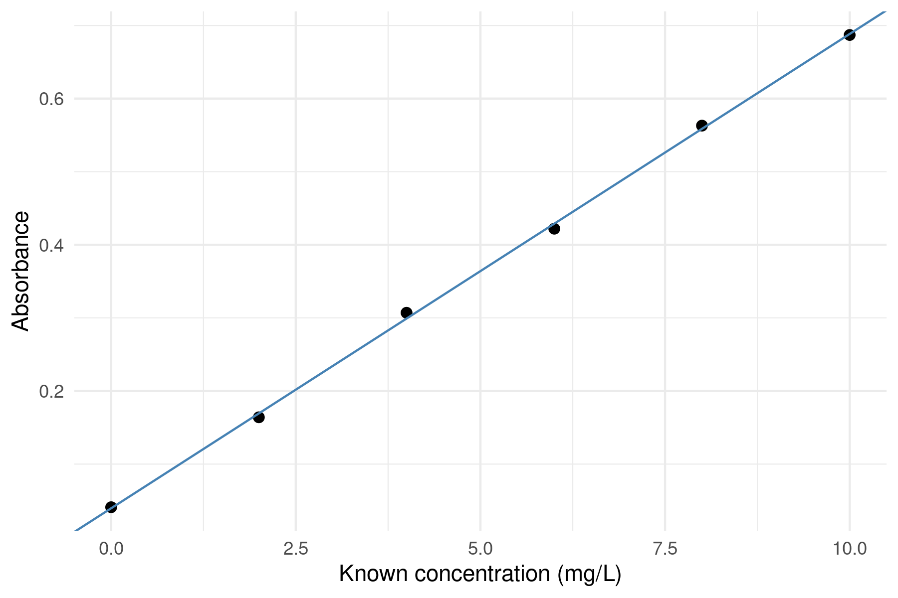
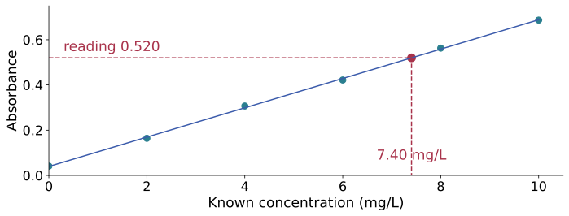
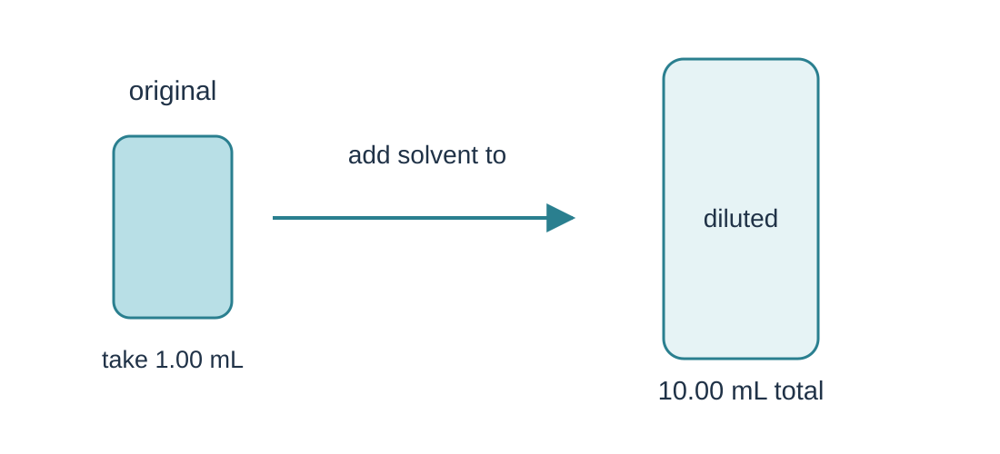
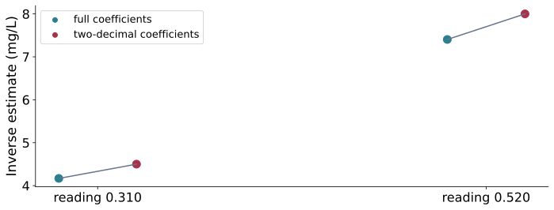
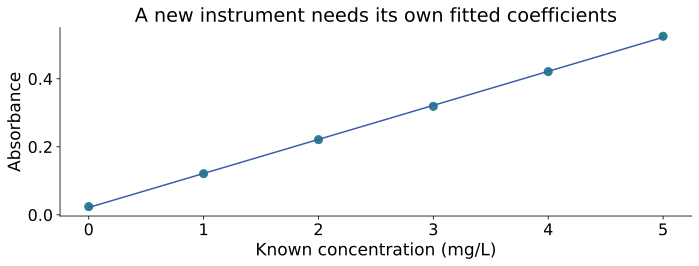
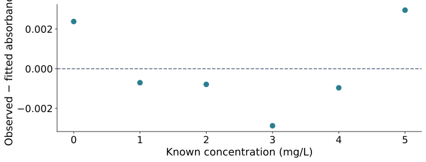
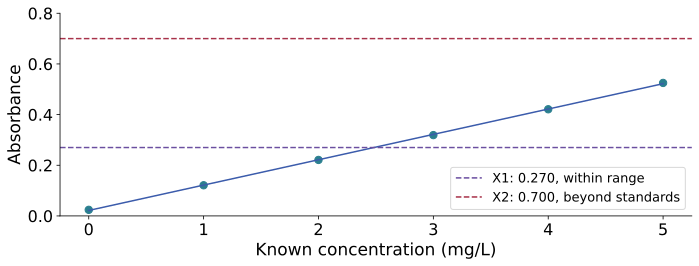

## A reading is not yet a concentration

{height=350px}

Use known **standards** before estimating unknown samples.

::: notes
These are simulated values for a fictional colour assay; no reagent or prior chemistry course is assumed. A standard is a solution whose concentration is supplied. Absorbance describes light attenuation and is dimensionless. The standards span 0–10 mg/L.
:::

## Know which quantity was prepared and which was measured

We **prepared concentration** and **measured absorbance**.

Fit:

`absorbance = intercept + slope × concentration`

One standard is a calibration point, not a biological treatment replicate.

::: notes
This direction is deliberate. Later we rearrange the forward calibration to estimate an unknown concentration. Regressing concentration directly on absorbance would be a different fit. The zero-concentration standard includes background signal; no blank subtraction has been performed.
:::

## Fit the straight line

```r
library(readr)
standards <- read_csv("data/calibration.csv", show_col_types = FALSE)
calibration_fit <- lm(absorbance ~ concentration_mg_l,
                      data = standards)
coef(calibration_fit)
```

Intercept ≈ **0.03957**; slope ≈ **0.06489 per mg/L**.

::: notes
Load readr, dplyr, ggplot2 as usual. Explain the tilde as response on the left and explanatory variable on the right. The practical supplies full precision. A nonzero intercept may represent background, so “zero concentration” does not justify forcing the fit through zero.
:::

## Does a line describe the tested range?

{height=350px}

A fitted line need not pass through every measured standard.

::: notes
Point to each measured value and the line’s fitted value. The fitted slope is the rise in absorbance for one mg/L increase in concentration. This is a working approximation within the tested range, not a chemical law established for every concentration.
:::

## A residual is observed minus fitted

{height=350px}

Look for curvature or an unusual point, not zero residuals everywhere.

::: notes
Positive means the observed absorbance is above the line. The six small residuals show no obvious curved pattern, but six standards remain limited evidence. A plot is a check on the approximation, not a guarantee of validity outside the data.
:::

## Read backward from the measured signal

{height=350px}

The unknown concentration is obtained by rearranging the line.

::: notes
Trace horizontally from the observed reading to the calibration line, then down to concentration. This visual separates the measured input from the estimated output. Keep the unrounded coefficients for the calculation even though slide labels are rounded.
:::

## Calculate a supported point estimate

```r
intercept <- coef(calibration_fit)[1]
slope <- coef(calibration_fit)[2]
concentration_mg_l <- (0.520 - intercept) / slope
```

Result ≈ **7.40 mg/L**.

This simple estimate omits full calibration and measurement uncertainty.

::: notes
The[1] and[2] select coefficients. The denominator is the fitted slope, with absorbance per mg/L units. The practical uses range checks to avoid pretending every numeric inversion is supported. Do not present this point estimate as an exact concentration.
:::

## A number can be calculable but unsupported

{height=350px}

U3 is beyond range: flag for a new suitable measurement.

::: notes
The practical assigns NA to the unsupported concentration rather than presenting an extrapolated number. Do not invent a dilution correction for a measurement that was never made. The instrument’s calibrated range is evidence, not an inconvenience to bypass.
:::

## A new diluted measurement can bring the signal in range

{height=350px}

**1.00 mL original → 10.00 mL total** gives a dilution factor of 10.

::: notes
This is a stated new numerical example, not a wet-lab protocol or a new reading for U3. Define dilution without assuming chemical preparation knowledge. Total 10 mL does not mean adding 10 mL of solvent to the 1 mL sample. Assume no measured material is lost or reacts.
:::

## Distinguish the measured and original concentrations

New diluted reading: **0.520** → **7.40 mg/L** diluted.

Original estimate = diluted estimate × total volume / original volume.

**7.404227 × 10 ≈ 74.04 mg/L** original.

The new measured reading, not the original concentration, is within calibration range.

::: notes
An original concentration above 10 mg/L can be estimated through a new in-range diluted measurement and a justified factor. That is different from extrapolating the old calibration directly to a high absorbance. Full dilution and calibration uncertainty remain outside this exercise.
:::

## Show the complete quantity map

Known standards: concentration → measured absorbance.
Fit: absorbance as a function of known concentration.
Unknown: measured absorbance → inverse point estimate.

Keep the fitted direction and requested output distinct.

::: notes
The standard concentration is prepared and the response is measured. A new direct regression of concentration on absorbance is a different fit. Students should label predictor,response,intercept,slope units,range,and unknown estimate.
:::

## Rounding a display can change a later calculation

{height=350px}

Retain fitted coefficients; round results when communicating.

::: notes
For reading.310, rounding intercept and slope to.04 and.06 gives4.50 rather than4.17 mg/L. It is a deliberate diagnostic, not a recommended new calibration. Extra display precision does not remove measurement uncertainty either.
:::

## A residual has a direction and a scale

```r
standards$observed_minus_fitted <-
  standards$absorbance - fitted(calibration_fit)
residuals(calibration_fit)
```

Positive means the observed signal is above the line.

::: notes
Compare one value by hand. Both expressions should match. A residual is not the concentration error of an unknown and not a p-value. Use the first standard while its measured concentration and signal remain visible.
:::

## Trace a corrected estimate through its evidence

{height=350px}

The corrected original estimate is not a direct instrument reading.

::: notes
A numerical table should retain the new reading,original aliquot volume,total final volume,factor,diluted estimate,and original estimate. Nothing in this chain validates U3 without its own new measurement.
:::

## A second calibration needs a second fit

{height=350px}

Do not reuse the first instrument coefficient objects.

::: notes
Transfer standards span0–5 mg/L. Fit absorbance on known concentration. Their fitted intercept is.02161905 and slope.10008571 per mg/L. This is another empirical calibration,not a universal optical law.
:::

## Rebuild the transfer fit explicitly

```r
transfer_standards <- read_csv(
  'data/calibration-transfer.csv', show_col_types = FALSE)
transfer_fit <- lm(absorbance ~ concentration_mg_l,
                   data = transfer_standards)
coef(transfer_fit)
```

::: notes
Load readr before this block. Keep separate names so the primary instrument report is not silently altered. The independent transfer report must contain its own import,checks,fit,and inverse calculations.
:::

## Inspect the new residuals, not the old picture

{height=350px}

A tidy residual plot is limited evidence with only six standards.

::: notes
Look for obvious curvature or an unusual point. Absence of an obvious pattern does not establish chemical specificity,measurement accuracy in every condition,or performance beyond the tested range.
:::

## Preserve the unsupported unknown as a record

{height=350px}

Keep the ID and reading; flag the unsupported concentration.

::: notes
X1 estimates about 2.48168 mg/L. X2 is not supported by the supplied standard readings. Missing estimate due to out-of-range input differs from a missing measured signal; retain the reason rather than dropping the row.
:::

## An algebra check is useful but not independent validation

```r
transfer_a <- coef(transfer_fit)[1]
transfer_b <- coef(transfer_fit)[2]
x1_mg_l <- (0.270 - transfer_a) / transfer_b
transfer_a + transfer_b * x1_mg_l
```

The forward calculation returns **0.270**, apart from rounding.

::: notes
The check can catch reversal or arithmetic mistakes. Because it reuses the same fitted relationship, it does not independently establish calibration validity or eliminate uncertainty.
:::

## A next action needs new information, not an invented result

For an unsupported sample, state what must be supplied next:

- A new suitable measurement.
- Any recorded sample and total volumes.
- The supported range and applicable calibration.

No fabricated corrected concentration.

::: notes
The transfer report should recommend a sensible information-gathering step for X2. It is not a wet-lab protocol and does not require prior chemistry. Full uncertainty propagation remains beyond this simple exercise.
:::

## Practical: report the line and its limits

Save **`calibration-report.Rmd`**, supported concentration estimates, and both figures.

Explain U3’s missing estimate and the new dilution example.

[Open the practical](../../week4/19-calibration.qmd).

::: notes
Students should explain the standard, slope units, residual sign, supported range, and uncertainty limitation. They need no memorised optical law. Keep the dataset and formula visible so the chemistry setting does not become a prerequisite.
:::
