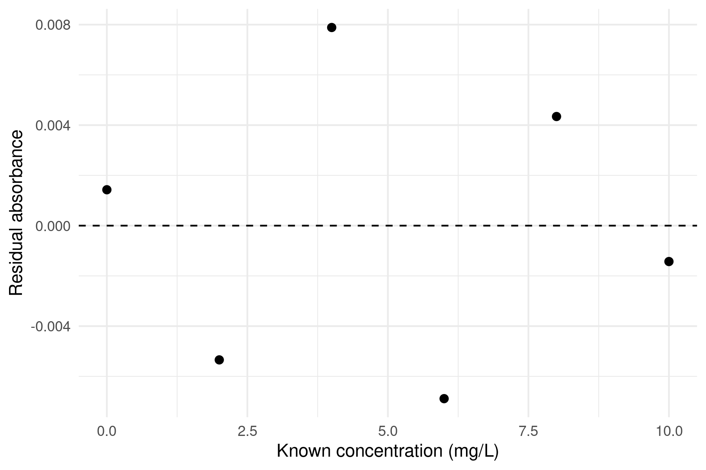
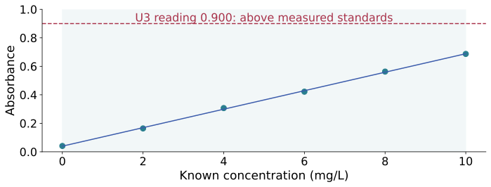
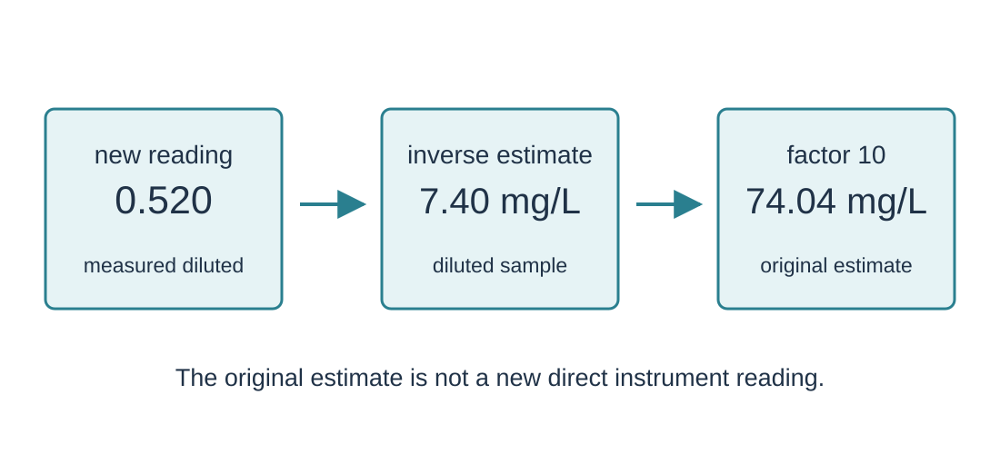

## About this lecture

In a biochemistry lab you put your samples in a spectrophotometer or plate reader. The instrument does not report "mg/L": it reports an **absorbance**, a number without units. To turn it into a concentration you first measure **standards** of known concentration, fit a line through them, and read your sample's concentration backwards from that line. **What concentration is in my sample, and when can I trust the number?**

Today you will:

- fit a calibration line with `lm()` and read its intercept and slope, with units;
- check the residuals: how far each standard lies from the line;
- convert an unknown sample's absorbance into a concentration;
- refuse to report a reading outside the standards, and use a dilution instead.

Days 17–18 compared means. Today and on Day 20 we fit straight lines; today the line is a **measuring tool**.

::: notes
These are simulated readings for a fictional colour assay; no chemistry course is needed. Ask whether anyone has already used a standard curve (protein assays such as Bradford, DNA quantification, enzyme activity). Every one of those is today's workflow.
:::

## The problem: a reading is not a concentration

:::: {.columns}
::: {.column width="42%"}
- Unknown samples gave absorbance **0.310**, **0.520** and **0.900**.
- On its own, 0.520 means nothing: another instrument, reagent batch or day gives a different reading for the same sample.
- Six **standards** of known concentration, **0 to 10 mg/L**, were measured with the samples (`data/calibration.csv`).
- A standard is a calibration point, not a biological replicate.
:::
::: {.column width="58%"}
{width="100%"}
:::
::::

::: notes
The standards set the scale for this run of the instrument. That is why they are measured each time, in the same run as the unknowns.
:::

## Which variable goes on which axis?

:::: {.columns}
::: {.column width="42%"}
- We **prepared** the concentration and **measured** the absorbance.
- So concentration goes on x and absorbance on y:

  `absorbance = intercept + slope × concentration`

- **Intercept:** the fitted reading at 0 mg/L, a background signal (the blank S1 read 0.041).
- **Slope:** the increase in absorbance per 1 mg/L.
- The line does not have to pass through every point.
:::
::: {.column width="58%"}
{width="100%"}
:::
::::

::: notes
The direction is deliberate: the measured quantity is the response. Later we rearrange the same line to get concentration. Fitting concentration on absorbance would be a different regression and is not used here. The nonzero intercept is a background reading: do not force the line through zero just because zero concentration sounds like nothing.
:::

## Fit the line in R

```r
library(readr)
library(dplyr)
library(ggplot2)
standards <- read_csv("data/calibration.csv", show_col_types = FALSE)
calibration_fit <- lm(absorbance ~ concentration_mg_l, data = standards)
coef(calibration_fit)
#>        (Intercept) concentration_mg_l
#>         0.03957143         0.06488571
```

- `~` reads "explained by": response on the left, the prepared variable on the right.
- Line: **absorbance ≈ 0.0396 + 0.0649 × concentration**.
- Slope units: **absorbance per mg/L**. Every extra 1 mg/L adds about 0.065 to the reading.

::: notes
lm() is the same function students use again tomorrow for a biological association. coef() returns the intercept and slope; [1] and [2] select them. Keep the full-precision values in R; round only in the prose.
:::

## Check the residuals

:::: {.columns}
::: {.column width="42%"}
- **Residual = observed − fitted** reading, in absorbance units.
- S1: 0.041 − 0.0396 = **+0.0014**: just above the line.
- All six lie within **±0.008** of the line, on both sides, with no curved pattern.
- Six standards are limited evidence: the line is checked **only between 0 and 10 mg/L**.
:::
::: {.column width="58%"}
{width="100%"}
:::
::::

::: notes
`residuals(calibration_fit)` gives the same values as the hand calculation. Look for curvature (a smile or frown shape) or one point far from the others. A residual is a difference in absorbance, not a concentration error and not a p-value.
:::

## Read the line backwards

:::: {.columns}
::: {.column width="42%"}
Rearrange the line:

`concentration = (absorbance − intercept) / slope`

- U2 read **0.520** → (0.520 − 0.0396) / 0.0649 ≈ **7.40 mg/L**.
- U1 read **0.310** → **4.17 mg/L**.
- These are point estimates; the standards and the readings both carry uncertainty that we do not calculate here.
:::
::: {.column width="58%"}
{width="100%"}
:::
::::

::: notes
Trace with a finger: across from the measured reading to the line, then down to concentration. The input is measured; the output is estimated. Use the unrounded coefficients in the calculation.
:::

## Estimate only inside the standards

```r
unknowns <- read_csv("data/unknowns.csv", show_col_types = FALSE)
intercept <- coef(calibration_fit)[1]
slope <- coef(calibration_fit)[2]
unknowns <- unknowns |>
  mutate(within_range = absorbance >= min(standards$absorbance) &
                        absorbance <= max(standards$absorbance),
         concentration_mg_l = if_else(
           within_range, (absorbance - intercept) / slope, NA_real_))
```

| sample_id | absorbance | within_range | concentration_mg_l |
|---|---|---|---|
| U1 | 0.310 | TRUE | 4.17 |
| U2 | 0.520 | TRUE | 7.40 |
| U3 | 0.900 | FALSE | NA |

- The standards read **0.041 to 0.687**. U3 is above the highest standard, so it gets `NA` instead of a number.
- The row stays in the table with its reading, so the reason for the missing estimate is visible.

::: notes
`&` requires both conditions. `NA_real_` is a numeric missing value. This is the table saved as output/day19-unknowns.csv in the practical.
:::

## Why not just calculate U3?

:::: {.columns}
::: {.column width="42%"}
- The formula happily returns **13.3 mg/L** for U3.
- But no standard was measured above 10 mg/L. The line might bend there: many assays **flatten out** at high concentration.
- A number you can calculate is not a number you can support.
- Report U3 as **"above the calibration range"** and measure it again, diluted.
:::
::: {.column width="58%"}
{width="100%"}
:::
::::

::: notes
The calibrated range is evidence, not an inconvenience to bypass. Saturation at high concentration is common in absorbance assays; we do not need to know why to respect the range.
:::

## Bring a high sample into range by dilution

:::: {.columns}
::: {.column width="42%"}
A separate sample was too concentrated, so a **new** measurement was made:

- **1.00 mL** of sample plus solvent up to **10.00 mL total** → dilution factor 10.00 / 1.00 = **10**.
- The diluted reading, **0.520**, is inside the standards → **7.40 mg/L** diluted.
- Original ≈ 7.404 × 10 ≈ **74.04 mg/L**.

The in-range reading is what was measured; the original concentration is calculated from it and the recorded volumes.
:::
::: {.column width="58%"}
{width="100%"}
:::
::::

::: notes
"10.00 mL total" does not mean adding 10 mL of solvent to 1 mL of sample. This is a separate example, not a new reading for U3: U3 still needs its own new measurement. Assume no substance is lost. The uncertainty of the volumes and the calibration is ignored in this simple point estimate.
:::

## Pitfall: rounded coefficients change the answer

:::: {.columns}
::: {.column width="42%"}
- Rounding to two decimals gives intercept **0.04** and slope **0.06**.
- Reading 0.310: **4.17 mg/L** with the full coefficients, **4.50 mg/L** with the rounded ones.
- Reading 0.520: **7.40** versus **8.00 mg/L**.
- Calculate from `coef(calibration_fit)`; round only the final number you write.
:::
::: {.column width="58%"}
{width="100%"}
:::
::::

::: notes
The slope is small, so rounding it from 0.0649 to 0.06 changes it by about 8 percent, and every estimate with it. This is a deliberate diagnostic; students try it in the practical with round(intercept, 2) and round(slope, 2) in a separate expression. More decimals in a report are not more precision either.
:::

## A new instrument needs its own line

:::: {.columns}
::: {.column width="42%"}
- A second instrument: six standards **0 to 5 mg/L** (`data/calibration-transfer.csv`).
- Its own fit: intercept **0.0216**, slope **0.1001** per mg/L. The old coefficients do not apply.
- X1 read **0.270** → **2.48 mg/L**, inside the standards (0.024 to 0.525).
- X2 read **0.700** → above range: keep the row, flag it, measure again diluted.
:::
::: {.column width="58%"}
{width="100%"}
:::
::::

::: notes
Fit as transfer_fit with its own coefficient objects so the main report is not silently changed. Putting 2.48 mg/L back into the forward equation returns 0.270: a useful check of the algebra, but it reuses the same line, so it does not validate the calibration.
:::

## Write the result

"Absorbance increased linearly with concentration across six standards from 0 to 10 mg/L (slope **0.065 absorbance units per mg/L**; residuals within ±0.008). Sample U1 was estimated at **4.17 mg/L** and U2 at **7.40 mg/L**. U3 (absorbance 0.900) was above the highest standard and needs to be diluted and measured again."

| Misreading | Better |
|---|---|
| "The line fits well, so any concentration is fine." | Only between the lowest and highest standards. |
| "U3 is 13.3 mg/L." | U3 is above the calibration range: no estimate. |
| "The intercept should be zero." | It is the background reading; do not force it. |
| "7.40 mg/L is exact." | It is a point estimate; uncertainty is not calculated here. |

::: notes
Ask students which code produces each number in the paragraph. They should be able to point at coef(), residuals() and the unknowns table.
:::

## Summary {.smaller}

| Concept | Key fact |
|---|---|
| Standard | Solution of known concentration, measured in the same run as the samples |
| Direction | Prepared concentration on x, measured absorbance on y: `lm(absorbance ~ concentration_mg_l)` |
| Coefficients | Intercept **0.0396** (background); slope **0.0649** absorbance per mg/L |
| Residual | Observed − fitted reading; look for curvature or one point far away |
| Inverse | `(absorbance − intercept) / slope`: U1 4.17, U2 7.40 mg/L |
| Range | Estimate only between the lowest and highest standard; U3 → `NA` with a reason |
| Dilution | New in-range reading × factor; 1 → 10 mL gives ×10 (7.40 → 74.04 mg/L) |
| Precision | Calculate with full coefficients; round only the reported result |
| New instrument | New standards, new fit (slope 0.1001 per mg/L for the transfer data) |

**Next (Day 20, association):** the same `lm()` on two measured biological variables, where neither was set by us.

**Now:** [open the Day 19 exercises](../../week4/19-calibration.qmd). Make `calibration-report.Rmd` with the line and residual plots, the slope with units and the range-checked unknowns; save `output/day19-unknowns.csv` and both figures, then render.

::: notes
The exercises continue with the rounding diagnostic, the dilution table and an independent transfer-calibration.Rmd for the second instrument.
:::
