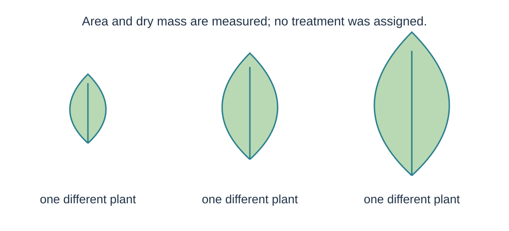
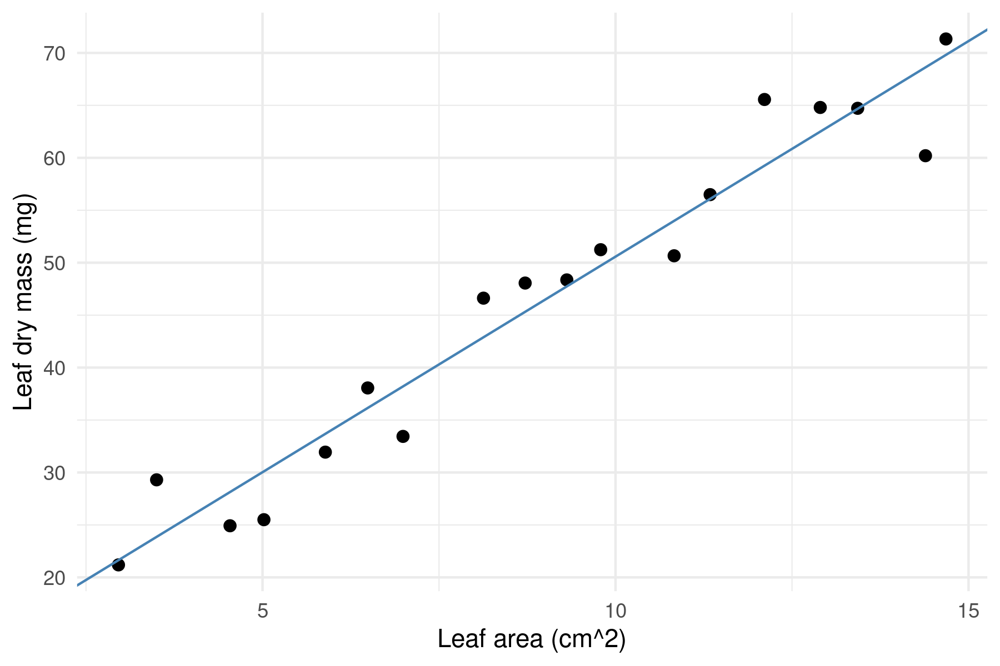
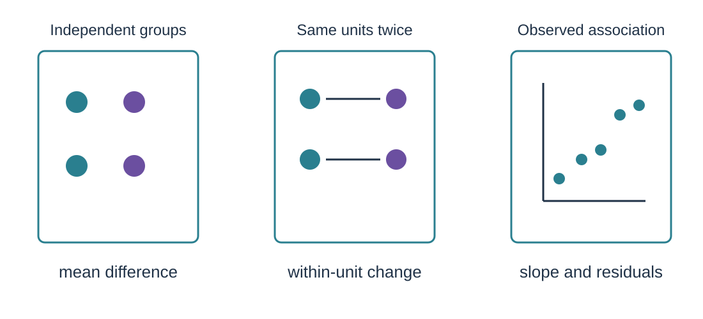

## About this lecture

Plant ecologists often need the dry mass of leaves, but drying and weighing destroys the leaf. Leaf **area** is easy to measure from a photo or scan. If area and mass go together, a line can describe how. We collected one leaf from each of **18 plants** and measured both. **Do larger leaves have more dry mass, and how much more per cm²?**

Today you will:

- plot two measured variables and fit a line with the familiar `lm()`;
- state the slope **with units**: "about 4.11 mg per cm²";
- use residuals and a sensitivity check without deleting data;
- keep apart **association** and **cause**, and stay inside the observed range.

Day 19 used a line as a measuring tool for prepared standards. Today the same code describes a **biological pattern**, and the interpretation changes. Week 5 turns to the computer itself.

::: notes
Ask for other examples where one measurement stands in for another: body length and mass in fish, tree diameter and biomass, wing length and age. In each case it matters whether the relation is a description of a sample or a cause. The data are simulated.
:::

## Not a calibration: nobody set the leaf area

:::: {.columns}
::: {.column width="42%"}
- Day 19: **we prepared** the concentrations; only absorbance was measured.
- Today: **both** area and dry mass were measured on leaves as they were found. Nothing was assigned.
- Plant age, light, water or species could affect **both** measurements.
- So the line can **describe** how they go together, not show that changing one changes the other.
- One leaf per plant: **18 independent plants**.
:::
::: {.column width="58%"}
{width="100%"}
:::
::::

::: notes
This is an observational study. If we had 18 leaves from a single plant, they would share that plant's conditions and would not be 18 independent units. Emphasise the change of meaning, because the R code will look identical to yesterday's.
:::

## Plot first

:::: {.columns}
::: {.column width="42%"}
- x: **leaf area (cm²)**; y: **dry mass (mg)**. Mass is the variable we want to explain.
- Larger leaves tend to be heavier: a clear **positive** association.
- But the points **scatter** around the line: leaves of similar area differ in mass.
- Observed areas: **2.96 to 14.68 cm²**.
:::
::: {.column width="58%"}
{width="100%"}
:::
::::

::: notes
Read the axes before the trend. Ask: is there any sign of curvature, or of one point far from the rest? Note the minimum and maximum area; they will matter for predictions.
:::

## Fit the line in R

```text
> library(readr)
> leaves <- read_csv("data/leaf-mass.csv", show_col_types = FALSE)
> leaf_fit <- lm(dry_mass_mg ~ leaf_area_cm2, data = leaves)
> coef(leaf_fit)
  (Intercept) leaf_area_cm2 
     9.476606      4.110117 
```

- Same `lm()` as Day 19: response (mass) on the left of `~`, area on the right.
- Line: **fitted mass ≈ 9.48 + 4.11 × area**.
- The intercept, 9.48 mg, is the fitted mass at **zero area**, far outside the data. It positions the line; it is not a leaf.

::: notes
The intercept has the units of the response (mg). Zero area is not a biologically meaningful leaf, and it lies well below the smallest observed area of 2.96 cm2.
:::

## The slope has units

:::: {.columns}
::: {.column width="42%"}
- Slope **4.11 mg per cm²**: in these plants, a leaf with 1 cm² more area had on average about **4.11 mg more** fitted dry mass.
- Not 4.11 %, not 4.11 cm², and not a promise for every leaf.
- Units change the number, not the biology: with area in mm² the slope is **0.0411 mg per mm²**, and every fitted mass is the same.
:::
::: {.column width="58%"}
{width="100%"}
:::
::::

::: notes
1 cm2 = 100 mm2, so the slope per mm2 is the slope per cm2 divided by 100. In the practical students fit both versions and check that max(abs(fitted(leaf_fit) - fitted(unit_fit))) is essentially zero. A smaller number in other units is not a weaker association.
:::

## Residuals: what the line leaves out

:::: {.columns}
::: {.column width="42%"}
- **Residual = observed − fitted** mass, in **mg**.
- A17 lies **8.4 mg below** the line; A14 lies **6.3 mg above** it.
- Points on both sides of zero, no clear curve: a straight line is a reasonable summary here.
- The plot cannot show independence. That comes from **how the plants were sampled**.
:::
::: {.column width="58%"}
{width="100%"}
:::
::::

::: notes
In the practical, students pick one leaf, compute observed minus fitted by hand and compare with residuals(leaf_fit). A residual has a sign: positive means heavier than the line predicts at that area. A small sample gives only a rough check of the model.
:::

## Predictions: inside the observed range only

:::: {.columns}
::: {.column width="42%"}
- At **8 cm²**: 9.48 + 4.11 × 8 ≈ **42.36 mg**, a fitted **mean**. Single leaves of that size scatter around it.
- At **25 cm²** the formula gives 112 mg, and at 80 cm² 338 mg. No leaf that large was measured.
- The relation may bend or change beyond the data. A longer line is **not** more evidence.
:::
::: {.column width="58%"}
{width="100%"}
:::
::::

::: notes
`coef(leaf_fit)[1] + coef(leaf_fit)[2] * 8` gives 42.36. Same range rule as for U3 in the calibration yesterday: calculable is not supported.
:::

## Pitfall: one point can move the line

:::: {.columns}
::: {.column width="42%"}
- A18 is the largest leaf and sits at the end of the range, where a point has most influence.
- Refit **without A18**, in a separate object: slope **4.065** instead of **4.110** mg per cm². A small change.
- A18 has **no recorded error**, so it stays in the main result.
- A sensitivity check asks "does my conclusion depend on one point?". It is not a way to pick the line you like.
:::
::: {.column width="58%"}
{width="100%"}
:::
::::

::: notes
Code: without_a18 <- leaves |> filter(plant_id != "A18"); sensitivity_fit <- lm(dry_mass_mg ~ leaf_area_cm2, data = without_a18). Report the full-data fit as the result and the sensitivity check, labelled, as a check. An exclusion needs evidence from the records, not a tidier plot.
:::

## Write what the data support

"Across 18 plants, leaves with larger area had greater dry mass: within the observed range (2.96 to 14.68 cm²), each additional 1 cm² was associated with about **4.11 mg** more fitted dry mass. The study was observational, so this does not show that increasing leaf area would increase mass."

| Claim | Supported? |
|---|---|
| "Larger leaves tended to have more dry mass in this sample." | **Yes**, a description of the association. |
| "Adding 1 cm² of area causes 4.11 mg extra mass." | **No**: nothing was manipulated; other factors vary too. |
| "Every 8 cm² leaf weighs 42.36 mg." | **No**: that is a fitted mean; leaves scatter by several mg. |
| "A 30 cm² leaf will weigh about 133 mg." | **No**: far outside the observed areas. |

::: notes
Showing that area affects mass would need a different design and biological knowledge, not a different lm() call. Ask students to write their own sentence first, using the hint pattern in the practical.
:::

## Week 4: the question chooses the method

:::: {.columns}
::: {.column width="62%"}
| Design | Day | Output |
|---|---|---|
| Two **independent groups** | 16–17 | Mean difference, Welch CI |
| Same unit measured **twice** | 18 | Mean within-unit change, paired CI |
| Prepared standards → reading | 19 | Calibration line, inverse estimate |
| Two **measured** variables | 20 | Slope with units, residuals |

Name the unit, the outcome and its units **before** choosing a function.
:::
::: {.column width="38%"}
{width="100%"}
:::
::::

::: notes
In the practical, students write this as a comparison sheet for future labs. The transfer exercise relates initial and final length in seedlings-transfer.csv: an association question, which is different from the treatment comparison on the same file. Not a menu to pick whichever test gives a small p-value.
:::

## Summary {.smaller}

| Concept | Key fact |
|---|---|
| Observational data | Both variables measured, nothing assigned: the line describes, it does not show cause |
| Fit | `lm(dry_mass_mg ~ leaf_area_cm2, data = leaves)`: mass ≈ 9.48 + 4.11 × area |
| Slope | **4.11 mg per cm²** of fitted mean mass; 0.0411 mg per mm² is the same line |
| Intercept | Fitted mass at area 0, outside the data; not a measured leaf |
| Residual | Observed − fitted mass (mg); look for curvature or a point far away |
| Prediction | Fitted mean, only within 2.96–14.68 cm² (8 cm² → 42.36 mg) |
| Sensitivity | Without A18: slope 4.065; keep A18 in the main result |
| Choosing a method | Design and question first: groups, pairs, calibration or association |

**Next (Day 21, how a computer works and how big data are):** from the analysis to the machine that stores and processes the data.

**Now:** [open the Day 20 exercises](../../week4/20-association.qmd). Make `association-report.Rmd` with the plot and line, the slope in a sentence with units, the residual plot and a labelled A18 check; save `output/day20-leaf-line.png` and render.

::: notes
The exercises add the unit-conversion check, the transfer-association.Rmd on seedling lengths, and the week 4 comparison sheet.
:::
