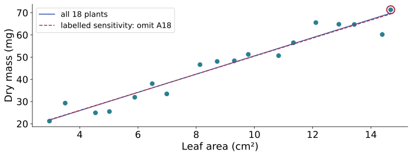
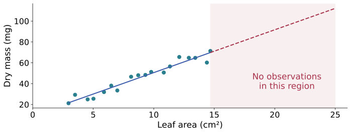

## Do larger leaves tend to have greater dry mass?

{height=350px}

One leaf from each of **18 independent plants**.

::: notes
This is an observational dataset. We measured area and dry mass, not experimentally changed one while holding everything else fixed. One leaf per plant supplies the independent unit for this introductory example. The illustrated leaves are schematic; the plots use the actual course CSV.
:::

## Start by plotting the measured variables

{height=350px}

Horizontal: **area (cm²)**. Vertical: **dry mass (mg)**.

::: notes
Ask students to read the axes before describing the trend. These are not the calibration standards from yesterday, and neither variable was assigned experimentally. The line summarises the observed association; scatter around it matters.
:::

## Fit the same simple kind of model

```r
library(readr)
leaves <- read_csv("data/leaf-mass.csv", show_col_types = FALSE)
leaf_fit <- lm(dry_mass_mg ~ leaf_area_cm2, data = leaves)
coef(leaf_fit)
```

Fitted mass ≈ **9.48 + 4.11 × area**.

::: notes
The input columns and units differ, but the lm syntax is the same as calibration. Intercept is about 9.476606 mg; slope about 4.110117 mg per cm². The intercept locates the line at area 0, outside the observed area range; do not interpret it as measured mass of a zero-area leaf.
:::

## The slope has units

{height=350px}

Slope ≈ **4.11 mg per cm²**.

::: notes
We say the fitted mass is 4.11 mg greater for a one cm² increase in area within this descriptive model. That does not establish what would happen under an intervention. The red step shows the line’s change, not a measured before/after change in a particular leaf.
:::

## Use the line inside the observed range

At area **8 cm²**:

`9.476606 + 4.110117 × 8 ≈ 42.36 mg`

This is a fitted mean relationship, not the exact mass of every leaf that size.

::: notes
Use the stored unrounded coefficients in actual calculations. The point prediction has uncertainty and individuals scatter around the line. Full regression inference is deferred. Here the point 8 cm² lies within the observed 2.96–14.68 cm² area range.
:::

## Residuals keep the scatter visible

{height=350px}

Residuals are in **milligrams**, the outcome’s units.

::: notes
A positive residual means heavier than fitted at that area. Look for structure or a dominating point while remembering that small samples provide limited diagnostics. The line need not explain every biological difference. We do not teach a formal normality-test decision tree.
:::

## Investigate influence without deleting inconvenient data

{height=350px}

A18 is **not** a known recording error.

::: notes
The default result retains all 18 plants. A labelled sensitivity check can reveal whether a conclusion depends strongly on one point. Omitting A18 gives a slightly different slope, about 4.064927 mg per cm². This is an illustration of influence, not permission to choose whichever subset yields the preferred result.
:::

## An extended line is not extended evidence

{height=350px}

No measurements support the shaded region.

::: notes
The dashed extension is deliberately drawn as a warning. A formula produces a number at 25 cm², but there are no such observations here and the relationship may change. Distinguish arithmetic from evidence. The same range principle applied to assay calibration.
:::

## Association does not establish an intervention effect

“Larger leaves tended to have greater dry mass in this sample.”

This does not prove that forcing area to increase would cause the fitted mass change.

Plant age, species, growing conditions, and other properties may vary together.

::: notes
The named possible factors are examples of missing context, not measured covariates to add to a model. We are not introducing multiple regression or causal adjustment. The outcome is a restrained interpretation of an observational pattern.
:::

## Practical: explain the line, the residuals, and one limit

Create **`association-report.Rmd`** with observations, fitted line, slope units, and residuals.

Keep the full-data result and label any sensitivity check.

[Open the practical](../../week4/20-association.qmd).

::: notes
Check the exact source filename in the practical; use the root project convention. Ask students to choose one actual point and explain its residual sign. Their final report should distinguish descriptive association, supported range and a causal claim.
:::
